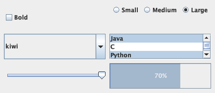
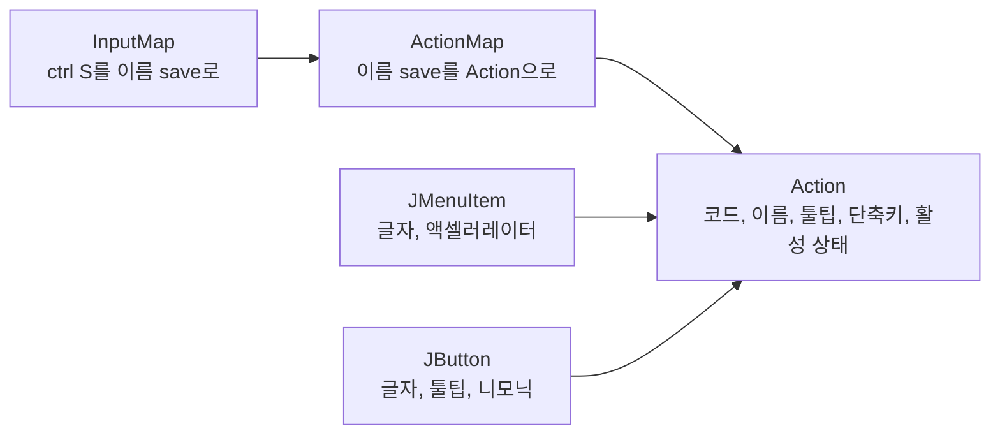
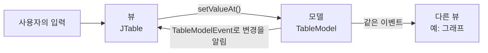
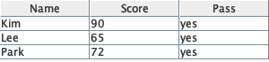
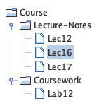
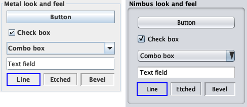
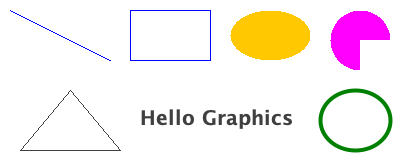
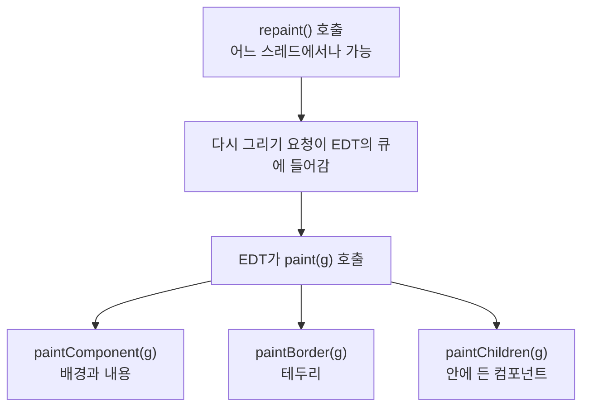
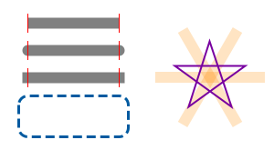
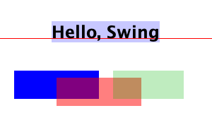

# 16강 — Swing 컴포넌트와 그래픽

[레포지토리 안내](../../README.ko.md) | [English](Concepts_Lecture.md) | [한국어](Concepts_Lecture.ko.md)

> **최종 수정일:** 2026-11-19

> **학습 목표:**
> 1. 버튼, 체크 박스, 라디오 버튼, 콤보 박스, 리스트, 슬라이더, 스피너, 텍스트 컴포넌트로 입력을 받고 각각의 모델과 이벤트를 처리할 수 있다
> 2. 메뉴, 툴바, 대화 상자, 파일 선택기를 Action과 키 바인딩으로 묶어 응용 프로그램의 명령을 구성할 수 있다
> 3. 모델과 뷰를 분리한 Swing의 구조를 설명하고 ListModel, TableModel, TreeModel, 셀 렌더러, 정렬기를 다룰 수 있다
> 4. paintComponent()를 오버라이딩하여 도형과 문자열을 그리고 repaint()의 동작을 설명할 수 있다
> 5. Graphics2D의 선 모양, 좌표 변환, 글꼴 치수, 투명도, 이미지로 그림을 정확하게 구성할 수 있다
> 6. Swing 타이머, 마우스와 키 입력, SwingWorker로 EDT를 막지 않는 그리기 프로그램과 오래 걸리는 작업을 만들 수 있다

---

## 목차

- [1. 선택 컴포넌트와 이벤트](#1-선택-컴포넌트와-이벤트)
  - [1.1 JCheckBox와 아이템 이벤트](#11-jcheckbox와-아이템-이벤트)
  - [1.2 JRadioButton과 ButtonGroup](#12-jradiobutton과-buttongroup)
  - [1.3 JComboBox와 JList](#13-jcombobox와-jlist)
  - [1.4 JSlider와 JProgressBar](#14-jslider와-jprogressbar)
  - [1.5 버튼과 ButtonModel](#15-버튼과-buttonmodel)
  - [1.6 JSpinner와 SpinnerModel](#16-jspinner와-spinnermodel)
  - [1.7 텍스트 컴포넌트와 Document](#17-텍스트-컴포넌트와-document)
- [2. 메뉴, 툴바, 대화 상자](#2-메뉴-툴바-대화-상자)
  - [2.1 메뉴](#21-메뉴)
  - [2.2 툴바와 툴팁](#22-툴바와-툴팁)
  - [2.3 JOptionPane의 대화 상자](#23-joptionpane의-대화-상자)
  - [2.4 JDialog와 모달 대화 상자](#24-jdialog와-모달-대화-상자)
  - [2.5 Action과 키 바인딩](#25-action과-키-바인딩)
  - [2.6 파일 선택기와 색 선택기](#26-파일-선택기와-색-선택기)
- [3. 모델과 뷰](#3-모델과-뷰)
  - [3.1 Swing 컴포넌트의 모델](#31-swing-컴포넌트의-모델)
  - [3.2 TableModel과 JTable](#32-tablemodel과-jtable)
  - [3.3 JTabbedPane, JSplitPane, JScrollPane](#33-jtabbedpane-jsplitpane-jscrollpane)
  - [3.4 컴포넌트별 모델과 모델의 공유](#34-컴포넌트별-모델과-모델의-공유)
  - [3.5 표의 렌더러와 정렬](#35-표의-렌더러와-정렬)
  - [3.6 JTree와 TreeModel](#36-jtree와-treemodel)
  - [3.7 테두리와 룩 앤 필](#37-테두리와-룩-앤-필)
- [4. 그래픽](#4-그래픽)
  - [4.1 좌표계와 paintComponent()](#41-좌표계와-paintcomponent)
  - [4.2 Graphics의 그리기 메서드](#42-graphics의-그리기-메서드)
  - [4.3 다시 그리기의 흐름](#43-다시-그리기의-흐름)
  - [4.4 Swing 타이머를 이용한 애니메이션](#44-swing-타이머를-이용한-애니메이션)
  - [4.5 마우스로 그리기](#45-마우스로-그리기)
  - [4.6 Graphics2D의 도형, 선, 좌표 변환](#46-graphics2d의-도형-선-좌표-변환)
  - [4.7 글꼴 치수와 색의 투명도](#47-글꼴-치수와-색의-투명도)
  - [4.8 이미지, 클립, 이중 버퍼링](#48-이미지-클립-이중-버퍼링)
  - [4.9 입력과 애니메이션의 구조](#49-입력과-애니메이션의-구조)
  - [4.10 SwingWorker의 진행률과 취소](#410-swingworker의-진행률과-취소)
- [5. 흔한 실수](#5-흔한-실수)
- [요약](#요약)
- [점검 문제](#점검-문제)
- [참고 문헌](#참고-문헌)

---

<br>

## 1. 선택 컴포넌트와 이벤트

12강의 표 3에 나열한 컴포넌트 가운데, 사용자가 여러 값 가운데 하나 또는 여럿을 고르게 하는 컴포넌트를 선택 컴포넌트라고 부를 수 있다. 선택 컴포넌트는 선택 상태가 바뀔 때 12강 5.11절의 규칙에 맞는 이벤트를 발생시킨다. 다음 프로그램은 각 컴포넌트의 상태를 코드로 바꾸면서 리스너가 받는 이벤트를 출력하고, 마지막에 컴포넌트들을 패널 하나에 배치해 그린다.

```java
import javax.swing.*;
import javax.swing.event.*;
import java.awt.*;
import java.awt.event.*;
import java.awt.image.BufferedImage;
import java.io.File;
import javax.imageio.ImageIO;

public class Selection {
    public static void main(String[] args) throws Exception {
        JCheckBox bold = new JCheckBox("Bold");
        bold.addItemListener(e -> System.out.println("check box: "
                + (e.getStateChange() == ItemEvent.SELECTED ? "SELECTED" : "DESELECTED")));
        bold.doClick();                                         // 선택
        bold.doClick();                                         // 해제

        JRadioButton small = new JRadioButton("Small"), medium = new JRadioButton("Medium", true),
                     large = new JRadioButton("Large");
        ButtonGroup sizes = new ButtonGroup();                  // 하나만 선택되게 묶는다
        sizes.add(small); sizes.add(medium); sizes.add(large);
        large.doClick();
        System.out.println("radio: small=" + small.isSelected() + " medium=" + medium.isSelected()
                + " large=" + large.isSelected());

        JComboBox<String> fruit = new JComboBox<>(new String[] {"apple", "banana", "kiwi"});
        fruit.addItemListener(e -> System.out.println("combo item " + e.getItem() + " "
                + (e.getStateChange() == ItemEvent.SELECTED ? "SELECTED" : "DESELECTED")));
        fruit.addActionListener(e -> System.out.println("combo action, index "
                + fruit.getSelectedIndex() + " = " + fruit.getSelectedItem()));
        fruit.setSelectedIndex(2);

        JList<String> list = new JList<>(new String[] {"Java", "C", "Python", "Kotlin"});
        list.addListSelectionListener(e -> {
            if (!e.getValueIsAdjusting())                        // 선택이 끝났을 때만
                System.out.println("list selection " + list.getSelectedValuesList());
        });
        list.setSelectedIndices(new int[] {0, 2});

        JSlider volume = new JSlider(0, 100, 50);
        volume.addChangeListener(e -> System.out.println("slider value " + volume.getValue()));
        volume.setValue(75);
        volume.setValue(150);                                    // 최댓값을 넘는 값

        JProgressBar progress = new JProgressBar(0, 10);
        progress.setValue(7);
        progress.setStringPainted(true);
        System.out.println("progress " + progress.getPercentComplete() + " " + progress.getString());

        if (args.length > 0) render(args[0], bold, small, medium, large, fruit, list, volume, progress);
    }

    static void render(String file, JComponent... cs) throws Exception {
        JPanel p = new JPanel(new GridLayout(0, 2, 8, 8));
        p.setBorder(BorderFactory.createEmptyBorder(8, 8, 8, 8));
        JPanel radios = new JPanel(new FlowLayout(FlowLayout.LEFT, 4, 0));
        radios.add(cs[1]); radios.add(cs[2]); radios.add(cs[3]);
        p.add(cs[0]); p.add(radios); p.add(cs[4]); p.add(new JScrollPane(cs[5])); p.add(cs[6]); p.add(cs[7]);
        p.setSize(440, 190);
        layoutAll(p);
        BufferedImage img = new BufferedImage(440, 190, BufferedImage.TYPE_INT_RGB);
        Graphics2D g = img.createGraphics(); p.paint(g); g.dispose();
        ImageIO.write(img, "png", new File(file));
    }

    static void layoutAll(Container c) { c.doLayout(); for (Component k : c.getComponents()) if (k instanceof Container cc) layoutAll(cc); }
}
```

```text
check box: SELECTED
check box: DESELECTED
radio: small=false medium=false large=true
combo item apple DESELECTED
combo item kiwi SELECTED
combo action, index 2 = kiwi
list selection [Java]
list selection [Java, Python]
slider value 75
slider value 100
progress 0.7 70%
```



*그림 1. 체크 박스, 라디오 버튼, 콤보 박스, 리스트, 슬라이더, 진행 막대*

그림 1은 위 프로그램이 마지막 상태의 컴포넌트를 그린 것이다. 체크 박스는 두 번 눌러 해제된 상태이고, 라디오 버튼은 Large가, 콤보 박스는 kiwi가, 리스트는 Java와 Python이 선택되어 있다. 슬라이더는 최댓값 100에 있고, 진행 막대는 70%를 보여 준다.

### 1.1 JCheckBox와 아이템 이벤트

`JCheckBox`는 선택과 해제를 오가는 상자이며, 여러 개가 서로 독립적이다. 상태가 바뀌면 `ItemEvent`가 발생하여 `ItemListener`의 `itemStateChanged()`가 호출되고, 이벤트의 `getStateChange()`가 `ItemEvent.SELECTED` 또는 `ItemEvent.DESELECTED`를 알려 준다. 출력의 첫 두 줄은 `doClick()`으로 체크 박스를 두 번 누른 결과로, 선택과 해제가 차례로 일어났다. 현재 상태는 언제든 `isSelected()`로 읽고 `setSelected(boolean)`으로 바꿀 수 있다. 체크 박스는 누를 때 `ActionEvent`도 발생시키지만, 코드에서 `setSelected()`로 상태를 바꾼 경우에는 `ItemEvent`만 발생하므로 상태 변화를 놓치지 않으려면 `ItemListener`를 쓴다.

### 1.2 JRadioButton과 ButtonGroup

`JRadioButton`은 여러 선택지 가운데 하나만 고르는 버튼이다. 라디오 버튼 자체는 체크 박스처럼 독립적으로 선택되므로, 하나만 선택되게 하려면 `ButtonGroup`에 함께 넣어야 한다. 그룹 안에서 한 버튼이 선택되면 이전에 선택된 버튼은 자동으로 해제된다. 위 프로그램은 Medium을 처음부터 선택된 상태로 만들고 Large를 눌렀으므로, Medium이 해제되고 Large만 선택되었다. `ButtonGroup`은 버튼을 묶는 논리적인 장치일 뿐 컴포넌트가 아니므로 화면에 붙이지 않으며, 화면에는 각 라디오 버튼을 따로 `add()`한다. 그림 1의 라디오 버튼 셋은 FlowLayout 패널 하나에 넣었다(12강 3.6절).

### 1.3 JComboBox와 JList

`JComboBox<E>`는 펼쳐지는 목록에서 항목 하나를 고르는 컴포넌트이고, `JList<E>`는 목록을 늘 펼쳐 보여 주며 여러 항목을 함께 고를 수 있는 컴포넌트이다. 둘 다 원소 타입을 타입 매개변수로 갖는 제네릭 클래스이다(9강 2절).

콤보 박스의 선택을 apple에서 kiwi로 바꾸면 이벤트가 세 번 일어난다. 이전 항목 apple의 `DESELECTED`, 새 항목 kiwi의 `SELECTED`, 그리고 선택이 바뀌었음을 알리는 `ActionEvent`이다. 선택한 항목은 `getSelectedItem()`, 위치는 `getSelectedIndex()`로 읽는다. `setEditable(true)`로 바꾸면 사용자가 목록에 없는 값을 직접 입력할 수도 있다.

리스트는 선택이 바뀔 때 `javax.swing.event.ListSelectionEvent`를 발생시킨다. 사용자가 마우스를 끌어 여러 항목을 고르는 동안에는 이벤트가 연속해서 일어나므로, 선택이 끝났을 때만 처리하려면 `getValueIsAdjusting()`이 `false`인 이벤트만 다룬다. 위 프로그램의 `setSelectedIndices({0, 2})`는 위치 0과 2를 차례로 선택하므로 이벤트가 두 번 일어났고, 마지막 이벤트에서 `getSelectedValuesList()`는 `[Java, Python]`이다. 선택 방식은 `setSelectionMode()`로 정하며, `ListSelectionModel.SINGLE_SELECTION`이면 하나만 고를 수 있다. 항목이 많으면 그림 1처럼 리스트를 `JScrollPane`에 넣는다.

### 1.4 JSlider와 JProgressBar

`JSlider`는 막대 위의 손잡이를 끌어 최솟값과 최댓값 사이의 정수를 고르게 한다. `new JSlider(0, 100, 50)`은 범위가 0\~100이고 처음 값이 50인 슬라이더이다. 값이 바뀌면 `ChangeEvent`가 발생하여 `ChangeListener`의 `stateChanged()`가 호출된다. `ChangeEvent`는 무엇이 바뀌었는지 담지 않으므로 리스너는 `getValue()`로 현재 값을 다시 읽는다. 출력의 `slider value 100`은 범위를 넘는 150을 넣었을 때 슬라이더가 값을 최댓값 100으로 맞춘 결과이다.

`JProgressBar`는 사용자가 고르는 컴포넌트가 아니라 작업의 진행 정도를 보여 주는 컴포넌트이다. 범위가 0\~10이고 값이 7이면 `getPercentComplete()`는 0.7이고, `setStringPainted(true)`로 막대 위에 `70%`라는 글자를 표시한다. 진행 막대는 오래 걸리는 작업과 함께 쓰이므로, 12강 5.8절의 `SwingWorker`가 `process()`에서 값을 고치는 것이 전형적인 형태이다.

### 1.5 버튼과 ButtonModel

`JButton`, `JToggleButton`, `JCheckBox`, `JRadioButton`, `JMenuItem`은 모두 `AbstractButton`을 상속하며(12강 1.2절), 버튼의 상태를 자신이 아니라 `ButtonModel` 객체에 둔다. 상태는 표 1의 다섯 가지 플래그로 이루어지고, 플래그가 바뀔 때마다 모델은 `ChangeEvent`를 발생시킨다. 일반 버튼의 모델은 `DefaultButtonModel`이고, 선택 상태를 유지하는 토글 버튼, 체크 박스, 라디오 버튼의 모델은 그 하위 클래스인 `JToggleButton.ToggleButtonModel`이다.

| 상태 | 뜻 |
|:-----|:-----|
| armed | 마우스 버튼을 누른 채 포인터가 버튼 위에 있어, 지금 놓으면 클릭이 되는 상태 |
| pressed | 마우스 버튼이 눌려 있는 상태 (포인터가 버튼 밖으로 나가도 유지) |
| selected | 선택된 상태 (토글 버튼, 체크 박스, 라디오 버튼) |
| enabled | 사용자가 조작할 수 있는 상태 |
| rollover | 마우스 포인터가 버튼 위에 있는 상태 |

*표 1. ButtonModel의 상태 플래그*

다음 프로그램은 버튼을 누르고 놓는 동안 모델의 상태가 어떻게 바뀌는지 출력한다.

```java
import javax.swing.*;
import java.awt.event.ItemEvent;

public class ButtonModelDemo {
    public static void main(String[] args) {
        JButton save = new JButton("Save");
        save.setActionCommand("save-file");                          // 버튼의 글자와 다른 명령 문자열
        save.addActionListener(e -> System.out.println("action: " + e.getActionCommand()));
        ButtonModel m = save.getModel();
        m.addChangeListener(e -> System.out.println("  model: armed=" + m.isArmed() + " pressed=" + m.isPressed()));
        save.doClick();                                              // 누르고 놓는 과정을 흉내 낸다

        save.setEnabled(false);
        save.doClick();                                              // 비활성 버튼
        System.out.println("disabled: enabled=" + m.isEnabled() + ", no action event");

        JToggleButton bold = new JToggleButton("B");
        bold.addItemListener(e -> System.out.println("toggle: "
                + (e.getStateChange() == ItemEvent.SELECTED ? "SELECTED" : "DESELECTED")));
        bold.doClick();
        System.out.println("toggle selected=" + bold.isSelected()
                + ", model " + bold.getModel().getClass().getSimpleName()
                + ", button model " + m.getClass().getSimpleName());
    }
}
```

```text
  model: armed=true pressed=false
  model: armed=true pressed=true
action: save-file
  model: armed=true pressed=false
  model: armed=false pressed=false
  model: armed=false pressed=false
disabled: enabled=false, no action event
toggle: SELECTED
toggle selected=true, model ToggleButtonModel, button model DefaultButtonModel
```

`doClick()`은 사용자가 버튼을 누르고 놓는 과정을 모델의 상태 변화로 흉내 낸다. 모델은 먼저 armed가 되고 이어서 pressed가 된다. 버튼을 놓으면 pressed가 `false`로 바뀌는데, 그 순간 모델이 armed이므로 액션 이벤트가 먼저 발생하고 상태 변화가 그 뒤에 통지된다. 그래서 `action: save-file`이 pressed가 풀린 넷째 줄의 통지보다 먼저 나오고, 다섯째 줄에서 armed가 해제된다. 포인터를 버튼 밖으로 끌고 나가서 놓으면 armed가 먼저 풀리므로 클릭이 되지 않는데 [1], 사용자가 실수로 누른 버튼을 취소할 수 있는 것이 이 때문이다. 여섯째 줄의 변화는 `setEnabled(false)`가 enabled 플래그를 바꾸어 생긴 것이다. 비활성 버튼의 모델은 armed가 되지 않으므로 `doClick()`이 액션 이벤트를 만들지 않는다.

`setActionCommand()`로 정한 문자열은 리스너에서 `getActionCommand()`로 돌아온다. 정하지 않으면 버튼의 글자가 액션 명령이 되므로(12강 5.2절), 버튼의 글자를 다른 언어로 바꾸는 프로그램은 명령 문자열을 따로 정해 두어야 리스너의 비교 코드가 바뀌지 않는다. 토글 버튼은 누를 때마다 선택과 해제를 오가는 버튼으로, 체크 박스와 같은 `ItemEvent`를 발생시킨다. 서식 툴바의 굵게(B) 버튼이 전형적인 예이다. 마지막 줄은 토글 버튼의 모델이 선택 상태를 기억하는 `ToggleButtonModel`이고 일반 버튼의 모델은 `DefaultButtonModel`임을 보여 준다.

### 1.6 JSpinner와 SpinnerModel

`JSpinner`는 한 줄의 입력 칸 옆에 위아래 화살표를 붙여, 정해진 순서의 값 가운데 하나를 고르게 하는 컴포넌트이다. 사용자는 화살표를 누르거나 입력 칸에 값을 직접 쓸 수 있다. 값의 순서는 `SpinnerModel`이 정하며, `getNextValue()`와 `getPreviousValue()`는 위와 아래 화살표를 눌렀을 때의 값을, 더 갈 수 없으면 `null`을 반환한다. 대표적인 모델은 수의 범위와 간격을 정하는 `SpinnerNumberModel`, 목록의 원소를 차례로 보여 주는 `SpinnerListModel`, 날짜를 다루는 `SpinnerDateModel`이다.

```java
import javax.swing.*;

public class SpinnerDemo {
    public static void main(String[] args) {
        SpinnerNumberModel model = new SpinnerNumberModel(5, 0, 10, 2);   // 값 5, 최솟값 0, 최댓값 10, 간격 2
        JSpinner age = new JSpinner(model);
        age.addChangeListener(e -> System.out.println("changed to " + age.getValue()));
        for (int i = 0; i < 3; i++) {
            Object next = model.getNextValue();                            // 다음 값, 범위를 벗어나면 null
            System.out.println("next = " + next);
            if (next != null) age.setValue(next);
        }
        System.out.println("previous = " + model.getPreviousValue());

        JSpinner day = new JSpinner(new SpinnerListModel(new String[] {"Mon", "Tue", "Wed"}));
        day.setValue("Wed");
        System.out.println("list next after Wed = " + day.getNextValue());
        try {
            day.setValue("Sun");                                           // 목록에 없는 값
        } catch (IllegalArgumentException e) {
            System.out.println("IllegalArgumentException: " + e.getMessage());
        }
    }
}
```

```text
next = 7
changed to 7
next = 9
changed to 9
next = null
previous = 7
list next after Wed = null
IllegalArgumentException: invalid sequence element
```

`new SpinnerNumberModel(5, 0, 10, 2)`는 처음 값 5, 최솟값 0, 최댓값 10, 간격 2인 모델이다. 5에서 위로 두 번 가면 7과 9가 되고, 9 다음의 11은 최댓값을 넘으므로 `getNextValue()`가 `null`을 반환한다. 1.4절의 슬라이더가 범위를 넘는 값을 최댓값으로 맞춘 것과 달리, 스피너의 모델은 범위 밖의 다음 값을 만들지 않는다. 값이 바뀔 때마다 `ChangeEvent`가 발생하는 점은 슬라이더와 같다. 목록 모델에서도 마지막 원소 Wed의 다음 값은 `null`이고, 목록에 없는 값을 넣으면 `IllegalArgumentException`이 발생한다. 슬라이더는 넓은 범위에서 대강의 값을 빠르게 고를 때, 스피너는 정확한 값을 한 단계씩 고르거나 직접 입력하게 할 때 알맞다.

### 1.7 텍스트 컴포넌트와 Document

12강 4절의 `JTextField`, `JTextArea`, `JPasswordField`는 모두 `JTextComponent`를 상속하며, 화면에 보이는 글자를 자신이 아니라 **문서(document)** 라는 모델에 저장한다. 문서는 `javax.swing.text.Document` 인터페이스의 객체이며, 서식 없는 텍스트 컴포넌트는 그 구현인 `PlainDocument`를 쓴다. 텍스트가 바뀌었는지 알고 싶으면 컴포넌트가 아니라 문서에 `DocumentListener`를 등록한다 [2].

```java
import javax.swing.*;
import javax.swing.event.*;
import javax.swing.text.*;

public class DocumentDemo {
    public static void main(String[] args) throws BadLocationException {
        JTextField name = new JTextField(10);
        Document doc = name.getDocument();                                  // 텍스트의 모델
        doc.addDocumentListener(new DocumentListener() {
            public void insertUpdate(DocumentEvent e)  { report("insert", e); }
            public void removeUpdate(DocumentEvent e)  { report("remove", e); }
            public void changedUpdate(DocumentEvent e) { report("change", e); }
            void report(String kind, DocumentEvent e) {
                try {
                    System.out.println(kind + " offset " + e.getOffset() + " length " + e.getLength()
                            + " -> \"" + e.getDocument().getText(0, e.getDocument().getLength()) + "\"");
                } catch (BadLocationException ex) { throw new RuntimeException(ex); }
            }
        });
        name.setText("Kim");
        name.setText("Park");                                               // 지우고 넣는다
        doc.insertString(4, " Jiho", null);

        JTextField copy = new JTextField(doc, null, 10);                    // 같은 모델을 보여 주는 둘째 뷰
        System.out.println("copy shows \"" + copy.getText() + "\", class " + doc.getClass().getSimpleName());

        JTextField code = new JTextField(6);
        ((AbstractDocument) code.getDocument()).setDocumentFilter(new DocumentFilter() {
            @Override public void insertString(FilterBypass fb, int off, String s, AttributeSet a)
                    throws BadLocationException { replace(fb, off, 0, s, a); }
            @Override public void replace(FilterBypass fb, int off, int len, String s, AttributeSet a)
                    throws BadLocationException {
                String digits = s == null ? "" : s.replaceAll("[^0-9]", "");   // 숫자만 남긴다
                int room = 4 - (fb.getDocument().getLength() - len);            // 최대 4자리
                if (digits.length() > room) digits = digits.substring(0, Math.max(room, 0));
                fb.replace(off, len, digits, a);
            }
        });
        code.setText("12a3");
        code.getDocument().insertString(code.getDocument().getLength(), "4567", null);
        System.out.println("code field \"" + code.getText() + "\"");
    }
}
```

```text
insert offset 0 length 3 -> "Kim"
remove offset 0 length 3 -> ""
insert offset 0 length 4 -> "Park"
insert offset 4 length 5 -> "Park Jiho"
copy shows "Park Jiho", class PlainDocument
code field "1234"
```

`DocumentListener`의 세 메서드는 글자가 들어올 때(`insertUpdate`), 지워질 때(`removeUpdate`), 글자의 서식이 바뀔 때(`changedUpdate`) 호출되며, 서식이 없는 `PlainDocument`는 `changedUpdate`를 호출하지 않는다 [2]. 이벤트의 `getOffset()`과 `getLength()`는 바뀐 위치와 글자 수이다. 출력에서 `setText("Park")`는 한 번의 변경이 아니라 기존의 Kim 세 글자를 지우는 이벤트와 Park 네 글자를 넣는 이벤트 두 개로 나타난다. 리스너가 매번 전체 텍스트를 검사한다면, 지운 직후의 빈 문자열도 한 번 검사하게 된다는 점을 고려해야 한다. `insertString(4, " Jiho", null)`은 위치 4, 곧 Park의 바로 뒤에 다섯 글자를 넣는다.

`copy`는 `name`의 문서를 받아 만든 둘째 텍스트 필드이므로, 한쪽에 입력한 글자가 다른 쪽에도 그대로 나타난다. 3.1절의 모델과 뷰의 관계가 텍스트에도 그대로 적용되는 것이다. 키 입력마다 호출되는 `KeyListener`로 텍스트의 변화를 추적하면, 붙여넣기나 코드에서 호출한 `setText()`처럼 키 입력 없이 일어난 변경을 놓친다. 문서의 이벤트는 변경이 어떤 경로로 일어났든 발생하므로 텍스트의 변화는 문서 리스너로 추적한다.

입력 자체를 제한하려고 `DocumentListener` 안에서 문서를 고치면 안 된다. 리스너가 통지를 받을 때는 변경이 이미 끝난 상태이며 [2], 통지 도중에 문서를 고치면 `IllegalStateException`("Attempt to mutate in notification")이 발생한다. 대신 문서에 `DocumentFilter`를 설치하면, 변경이 문서에 반영되기 전에 필터가 그 내용을 바꾸거나 거부할 수 있다. 위 프로그램의 필터는 들어오는 문자열에서 숫자가 아닌 글자를 지우고, 전체 길이가 4자를 넘지 않도록 자른다. `setText("12a3")`은 123으로 걸러지고, 뒤에 덧붙인 4567은 남은 한 자리만큼인 4만 들어가 최종 텍스트는 1234이다. 우편번호나 수량처럼 형식이 정해진 칸은 이렇게 잘못된 값이 문서에 들어가는 것 자체를 막는다.

---

<br>

## 2. 메뉴, 툴바, 대화 상자

### 2.1 메뉴

메뉴는 프레임 위쪽의 메뉴 막대(`JMenuBar`), 그 안의 메뉴(`JMenu`), 메뉴를 펼쳤을 때 나타나는 메뉴 항목(`JMenuItem`)의 세 단계로 이루어진다.

```java
JMenuBar bar = new JMenuBar();
JMenu file = new JMenu("File");
file.setMnemonic(KeyEvent.VK_F);                    // Alt+F로 메뉴를 연다

JMenuItem open = new JMenuItem("Open...");
open.setAccelerator(KeyStroke.getKeyStroke(KeyEvent.VK_O, InputEvent.CTRL_DOWN_MASK));
open.addActionListener(e -> openFile());            // 메뉴 항목도 액션 이벤트를 낸다

file.add(open);
file.addSeparator();                                // 구분선
file.add(new JMenuItem("Exit"));
bar.add(file);
frame.setJMenuBar(bar);                             // 컨텐트팬이 아니라 프레임에 붙인다
```

메뉴 항목을 선택하면 버튼처럼 `ActionEvent`가 발생하므로 같은 방법으로 `ActionListener`를 등록한다. **니모닉(mnemonic)** 은 Alt와 함께 눌러 메뉴를 여는 문자이고, **액셀러레이터(accelerator)** 는 메뉴를 열지 않고 항목을 바로 실행하는 단축키(위에서는 Ctrl+O)이다. 메뉴 막대는 `setJMenuBar()`로 프레임에 직접 붙이며, 컨텐트팬의 배치와 관계없이 제목 표시줄 바로 아래에 놓인다. 메뉴 안에는 `JCheckBoxMenuItem`, `JRadioButtonMenuItem`처럼 선택 상태를 가진 항목과, 또 다른 `JMenu`(하위 메뉴)를 넣을 수 있다. 12강 1.2절의 계층에서 `JMenu`가 `JMenuItem`의 하위 클래스인 이유가 여기에 있다.

### 2.2 툴바와 툴팁

`JToolBar`는 자주 쓰는 명령의 버튼을 한 줄로 모은 컨테이너이다. 보통 BorderLayout을 쓰는 컨텐트팬의 NORTH에 놓고, 그 안에 아이콘 버튼을 `add()`한다. 사용자는 툴바를 끌어 창의 다른 가장자리로 옮기거나 별도의 창으로 떼어 낼 수 있으며, `setFloatable(false)`로 이 기능을 끌 수 있다. 같은 명령을 메뉴 항목과 툴바 버튼에서 모두 실행할 수 있게 하려면 두 컴포넌트에 같은 리스너를 등록한다.

**툴팁(tool tip)** 은 마우스를 컴포넌트 위에 잠시 올려 두면 나타나는 짧은 설명이다. 모든 `JComponent`에 `setToolTipText("Open a file")`처럼 문자열을 정하면 되며, 아이콘만 있는 툴바 버튼에는 툴팁을 다는 것이 사용성의 기본이다.

### 2.3 JOptionPane의 대화 상자

`JOptionPane`은 자주 쓰는 형태의 대화 상자를 static 메서드 하나로 띄운다. 2강과 3강에서 쓴 `showMessageDialog()`와 `showInputDialog()` 외에 다음 메서드가 있다.

| 메서드 | 보여 주는 것 | 반환값 |
|:-----|:-----|:-----|
| `showMessageDialog(parent, msg)` | 메시지와 OK 버튼 | 없음 |
| `showConfirmDialog(parent, msg)` | 질문과 Yes, No, Cancel 버튼 | 누른 버튼의 `int` 상수 |
| `showInputDialog(parent, msg)` | 질문과 입력 칸 | 입력한 `String`, 취소하면 `null` |
| `showOptionDialog(...)` | 직접 정한 버튼들 | 누른 버튼의 위치 |

*표 2. JOptionPane의 주요 메서드*

확인 대화 상자의 반환값은 다음 상수와 비교한다.

```java
import javax.swing.JOptionPane;

public class DialogConstants {
    public static void main(String[] args) {
        System.out.println("YES_OPTION    = " + JOptionPane.YES_OPTION);
        System.out.println("NO_OPTION     = " + JOptionPane.NO_OPTION);
        System.out.println("CANCEL_OPTION = " + JOptionPane.CANCEL_OPTION);
        System.out.println("OK_OPTION     = " + JOptionPane.OK_OPTION);
        System.out.println("CLOSED_OPTION = " + JOptionPane.CLOSED_OPTION);
        try {
            JOptionPane.showConfirmDialog(null, "Save changes?");
        } catch (java.awt.HeadlessException e) {
            System.out.println("no screen: HeadlessException");
        }
    }
}
```

```text
YES_OPTION    = 0
NO_OPTION     = 1
CANCEL_OPTION = 2
OK_OPTION     = 0
CLOSED_OPTION = -1
no screen: HeadlessException
```

`YES_OPTION`과 `OK_OPTION`은 같은 값 0이며, 사용자가 버튼을 누르지 않고 창을 닫으면 `CLOSED_OPTION`(-1)이 반환된다. 따라서 `if (answer == JOptionPane.YES_OPTION)`처럼 상수와 비교하고, 창을 닫은 경우도 처리해야 한다. 마지막 줄은 이 프로그램을 화면이 없는 환경에서 실행했기 때문에 대화 상자를 띄울 수 없어 `HeadlessException`이 난 결과이다. 이 메서드들은 사용자가 답할 때까지 반환하지 않는데, 그동안에도 화면은 계속 다시 그려진다. 모달 대화 상자(2.4절)가 떠 있는 동안에도 다른 이벤트가 막히지 않도록 툴킷이 보장하므로, 이 메서드는 이벤트 리스너 안, 즉 EDT에서 호출해도 된다.

### 2.4 JDialog와 모달 대화 상자

`JOptionPane`으로 만들 수 없는 대화 상자(예: 여러 입력 칸이 있는 설정 창)는 `JDialog`를 상속하거나 직접 만들어 컴포넌트를 배치한다. `JDialog`는 `JFrame`처럼 최상위 창이며 자기만의 컨텐트팬을 가진다(12강 1.2절).

`new JDialog(owner, "Settings", true)`의 세 번째 인자가 `true`이면 **모달(modal)** 대화 상자이다. 모달 대화 상자가 떠 있는 동안 사용자는 주인 창을 조작할 수 없고, `setVisible(true)`는 대화 상자가 닫힐 때까지 반환하지 않는다. 그래서 대화 상자를 닫은 뒤 입력값을 읽는 코드를 `setVisible(true)` 다음 줄에 바로 쓸 수 있다. `false`이면 **모달리스(modeless)** 대화 상자로, 대화 상자와 주인 창을 함께 쓸 수 있고 `setVisible(true)`가 바로 반환한다. 찾기 창처럼 계속 띄워 두고 쓰는 창은 모달리스로, 저장 여부를 묻는 창처럼 답을 받아야 진행할 수 있는 창은 모달로 만든다.

### 2.5 Action과 키 바인딩

2.2절에서 같은 명령을 메뉴 항목과 툴바 버튼에서 실행하려면 두 컴포넌트에 같은 리스너를 등록한다고 했다. 그러나 명령에는 실행할 코드 외에도 이름, 아이콘, 툴팁, 단축키, 그리고 지금 실행할 수 있는지를 나타내는 활성 상태가 딸려 있으며, 리스너만 공유하면 이 상태를 컴포넌트마다 따로 맞추어야 한다. `javax.swing.Action`은 `ActionListener`를 확장하여 실행할 코드와 이 상태를 함께 담는 인터페이스이며, 보통 `AbstractAction`을 상속하여 `actionPerformed()`만 구현한다 [3].

```java
import javax.swing.*;
import java.awt.event.*;

public class ActionDemo {
    public static void main(String[] args) {
        Action save = new AbstractAction("Save") {                              // 명령 하나
            @Override public void actionPerformed(ActionEvent e) {
                System.out.println("saving (source " + e.getSource().getClass().getSimpleName() + ")");
            }
        };
        save.putValue(Action.SHORT_DESCRIPTION, "Save the current file");
        save.putValue(Action.MNEMONIC_KEY, KeyEvent.VK_S);
        save.putValue(Action.ACCELERATOR_KEY, KeyStroke.getKeyStroke(KeyEvent.VK_S, InputEvent.CTRL_DOWN_MASK));

        JMenuItem item = new JMenuItem(save);                                    // 같은 Action으로 만든 두 컴포넌트
        JButton button = new JButton(save);
        System.out.println("menu item: text=" + item.getText() + ", accelerator=" + item.getAccelerator());
        System.out.println("button: text=" + button.getText() + ", tooltip=" + button.getToolTipText()
                + ", mnemonic=" + KeyEvent.getKeyText(button.getMnemonic()));
        button.doClick();

        save.setEnabled(false);                                                  // 한 번 끄면
        System.out.println("after disable: item " + item.isEnabled() + ", button " + button.isEnabled());
        save.setEnabled(true);
        save.putValue(Action.NAME, "Save All");
        System.out.println("after rename: item " + item.getText() + ", button " + button.getText());

        Canvas canvas = new Canvas();
        InputMap im = canvas.getInputMap(JComponent.WHEN_FOCUSED);              // 키 입력 -> 이름
        ActionMap am = canvas.getActionMap();                                    // 이름 -> Action
        KeyStroke ctrlS = KeyStroke.getKeyStroke("ctrl S");
        im.put(ctrlS, "save");
        am.put("save", save);
        System.out.println("lookup: " + ctrlS + " -> " + im.get(ctrlS) + " -> " + am.get("save").getValue(Action.NAME));
        KeyEvent e = new KeyEvent(canvas, KeyEvent.KEY_PRESSED, System.currentTimeMillis(),
                InputEvent.CTRL_DOWN_MASK, KeyEvent.VK_S, KeyEvent.CHAR_UNDEFINED);  // Ctrl+S를 누른 이벤트
        System.out.println("handled: " + canvas.press(ctrlS, e));
        save.setEnabled(false);
        System.out.println("handled while disabled: " + canvas.press(ctrlS, e));
    }

    static class Canvas extends JPanel {                                         // 포커스가 있을 때 Swing이 하는 일을 직접 호출
        boolean press(KeyStroke ks, KeyEvent e) { return processKeyBinding(ks, e, WHEN_FOCUSED, true); }
    }
}
```

```text
menu item: text=Save, accelerator=ctrl pressed S
button: text=Save, tooltip=Save the current file, mnemonic=S
saving (source JButton)
after disable: item false, button false
after rename: item Save All, button Save All
lookup: ctrl pressed S -> save -> Save All
saving (source Canvas)
handled: true
handled while disabled: false
```

`new JMenuItem(save)`와 `new JButton(save)`처럼 `Action`을 받아 만든 컴포넌트는 `Action`의 속성을 자신의 속성으로 가져온다. `NAME`은 두 컴포넌트의 글자가 되고, `SHORT_DESCRIPTION`은 버튼의 툴팁, `ACCELERATOR_KEY`는 메뉴 항목의 액셀러레이터, `MNEMONIC_KEY`는 니모닉이 된다 [3]. 출력의 처음 두 줄이 모두 `Action`에 넣은 값이다. 컴포넌트는 `Action`의 속성 변화를 계속 지켜보므로, `setEnabled(false)` 한 번으로 메뉴 항목과 버튼이 함께 비활성화되고, `NAME`을 바꾸면 두 글자가 함께 바뀐다. 저장할 내용이 없을 때 저장 명령을 끄는 일을 컴포넌트마다 하지 않고 `Action` 한 곳에서 처리할 수 있다.



*그림 2. Action 하나를 함께 쓰는 메뉴 항목, 버튼, 키 바인딩*

`Action`은 키 입력과도 연결된다. 12강 5.6절의 `KeyListener`는 키보드 포커스를 가진 컴포넌트에만 이벤트가 전달되므로 `setFocusable()`과 `requestFocus()`가 필요했다. **키 바인딩(key binding)** 은 컴포넌트의 `InputMap`이 키 입력을 이름에, `ActionMap`이 그 이름을 `Action`에 대응시키는 두 단계의 표로 키와 동작을 연결하는 방법이다 [4]. `InputMap`은 바인딩이 동작하는 조건에 따라 세 가지가 있다. `WHEN_FOCUSED`는 그 컴포넌트에 포커스가 있을 때, `WHEN_ANCESTOR_OF_FOCUSED_COMPONENT`는 그 컴포넌트나 그 안의 컴포넌트에 포커스가 있을 때, `WHEN_IN_FOCUSED_WINDOW`는 그 컴포넌트가 든 창에 포커스가 있을 때 동작한다. 메뉴의 액셀러레이터처럼 창 어디에 포커스가 있든 동작해야 하는 단축키는 마지막 조건을 쓴다 [4].

위 프로그램의 끝부분은 패널의 `WHEN_FOCUSED` 맵에 Ctrl+S를 `save`라는 이름으로, 액션 맵에 그 이름을 `save` 동작으로 넣었다. 헤드리스 환경에는 키보드 포커스가 없으므로, 포커스를 가진 컴포넌트에 키 이벤트가 왔을 때 Swing이 호출하는 `processKeyBinding()`을 하위 클래스에서 직접 불렀다. 메서드는 두 표를 차례로 찾아 동작을 실행하고 `true`를 반환하며, 이때 액션 이벤트의 소스는 패널이다. 동작이 비활성화된 뒤에는 실행하지 않고 `false`를 반환한다. 키 바인딩도 `Action`의 활성 상태를 그대로 따르는 것이다. 바인딩을 이름으로 거치므로 같은 동작에 키를 여럿 묶거나, 키만 바꾸거나, 어떤 키를 이름 `"none"`에 묶어 무시하게 하기도 쉽다.

### 2.6 파일 선택기와 색 선택기

파일을 고르는 `JFileChooser`의 기본 사용법과 파일 필터는 10강 1.3절에서 보았다. `showOpenDialog(parent)`와 `showSaveDialog(parent)`는 모두 모달 대화 상자(2.4절)를 띄우고, 사용자가 확인을 누르면 `APPROVE_OPTION`, 취소하면 `CANCEL_OPTION`, 예상하지 못한 오류가 나면 `ERROR_OPTION`을 반환한다 [5]. 이 절은 파일을 저장하는 흐름과 표준 필터를 다룬다.

```java
import javax.swing.*;
import javax.swing.filechooser.FileNameExtensionFilter;
import java.awt.*;
import java.io.File;

public class ChooserDemo {
    static File askSaveFile(Component parent, JFileChooser chooser) {
        if (chooser.showSaveDialog(parent) != JFileChooser.APPROVE_OPTION) return null;   // 취소, 닫기, 오류
        File f = chooser.getSelectedFile();
        if (f.exists() && JOptionPane.showConfirmDialog(parent, f.getName() + " exists. Overwrite?")
                != JOptionPane.YES_OPTION) return null;                          // 덮어쓰기 확인은 프로그램의 일
        return f;
    }

    public static void main(String[] args) {
        System.out.println("APPROVE_OPTION=" + JFileChooser.APPROVE_OPTION + " CANCEL_OPTION=" + JFileChooser.CANCEL_OPTION
                + " ERROR_OPTION=" + JFileChooser.ERROR_OPTION);
        FileNameExtensionFilter images = new FileNameExtensionFilter("Images (png, jpg)", "png", "jpg");
        File dir = new File("pictures");
        dir.mkdir();
        for (File f : new File[] {new File("photo.PNG"), new File("scan.jpg"), new File("notes.txt"), dir})
            System.out.println("accept " + f.getName() + (f.isDirectory() ? "/" : "") + " -> " + images.accept(f));

        JFileChooser chooser = new JFileChooser(new File("."));
        chooser.setFileFilter(images);
        chooser.setFileSelectionMode(JFileChooser.FILES_ONLY);
        System.out.println("filter " + chooser.getFileFilter().getDescription() + ", mode " + chooser.getFileSelectionMode());
        try {
            System.out.println("chosen " + askSaveFile(null, chooser));
            Color c = JColorChooser.showDialog(null, "Pick a color", Color.WHITE);   // 취소하면 null
            System.out.println("color " + c);
        } catch (HeadlessException e) {
            System.out.println("no screen: HeadlessException");
        }
    }
}
```

```text
APPROVE_OPTION=0 CANCEL_OPTION=1 ERROR_OPTION=-1
accept photo.PNG -> true
accept scan.jpg -> true
accept notes.txt -> false
accept pictures/ -> true
filter Images (png, jpg), mode 0
no screen: HeadlessException
```

`JFileChooser`는 파일을 고르는 화면만 제공할 뿐 파일을 직접 열거나 저장하지 않는다 [5]. 고른 `File`을 읽고 쓰는 일은 10강의 스트림으로 프로그램이 한다. 저장 대화 상자에서 이미 있는 파일을 골랐을 때 덮어쓸지 묻는 일도 프로그램의 몫이므로, `askSaveFile()`은 `exists()`로 확인한 뒤 2.3절의 확인 대화 상자를 띄운다. 확인을 누르지 않은 경우는 취소, 창 닫기, 오류를 가리지 않고 모두 `null`로 돌려주어, 호출한 쪽은 `null`인지만 검사하면 된다.

10강 1.3절처럼 `FileFilter`를 직접 상속하지 않아도, 확장자로 거르는 필터는 `FileNameExtensionFilter`로 만들 수 있다. 출력에서 확장자의 대소문자는 구별하지 않으므로 photo.PNG도 받아들여지고, notes.txt는 걸러진다. 디렉터리는 확장자와 관계없이 받아들여지는데, 그래야 사용자가 다른 폴더로 이동할 수 있다. `setFileSelectionMode()`는 파일만(`FILES_ONLY`, 기본값 0), 디렉터리만(`DIRECTORIES_ONLY`), 둘 다(`FILES_AND_DIRECTORIES`) 고를 수 있게 정한다 [5]. 색을 고르게 할 때는 `JColorChooser.showDialog(parent, 제목, 처음 색)`을 쓰며, 고른 `Color`를 반환하고 취소하면 `null`을 반환한다. 두 대화 상자 모두 화면이 없는 환경에서는 `HeadlessException`을 던진다.

---

<br>

## 3. 모델과 뷰

### 3.1 Swing 컴포넌트의 모델

대부분의 Swing 컴포넌트는 데이터와 상태를 화면 표시와 분리하여 **모델(model)** 객체에 둔다 [6]. 버튼은 눌림, 선택, 활성 상태를 `ButtonModel`에, 리스트는 항목을 `ListModel`에, 선택 상태를 `ListSelectionModel`에, 표는 셀의 값을 `TableModel`에 둔다. 컴포넌트 자신은 모델의 내용을 화면에 그리고 사용자의 입력을 모델에 전하는 **뷰(view)** 의 역할을 맡는다.

> **용어 정의:** **모델-뷰 분리(model-view separation)** 는 데이터와 그 규칙을 담는 모델과, 데이터를 보여 주는 뷰를 서로 다른 객체로 나누고, 모델이 바뀌면 이벤트로 뷰에 알리게 하는 설계이다. 한 모델을 여러 뷰가 함께 보여 줄 수 있고, 화면을 바꾸어도 모델의 코드는 바뀌지 않는다.



*그림 3. 모델과 뷰 사이의 변경 전달*

> **[소프트웨어공학]** 소프트웨어공학의 MVC(Model-View-Controller) 패턴은 모델, 뷰, 입력을 처리하는 컨트롤러를 나눈다. Swing은 뷰와 컨트롤러를 UI 위임 객체(UI delegate) 하나로 합치고 모델만 분리한 변형을 쓴다. 컴포넌트의 겉모양을 룩 앤 필에 따라 바꿀 수 있는 것도(12강 1.1절) 그리는 일을 UI 위임 객체가 맡기 때문이다.

### 3.2 TableModel과 JTable

`JTable`은 행과 열로 된 데이터를 보여 주는 표이다. 데이터가 적고 고정되어 있으면 `new JTable(Object[][] data, String[] columnNames)`로 바로 만들 수 있지만, 데이터가 바뀌거나 셀마다 규칙이 있으면 `AbstractTableModel`을 상속한 모델을 만든다. 모델은 행 수, 열 수, 셀의 값을 알려 주는 세 메서드를 반드시 구현하고, 필요하면 열 이름, 편집 가능 여부, 값의 변경을 오버라이딩한다.

```java
import javax.swing.*;
import javax.swing.table.AbstractTableModel;
import java.awt.*;
import java.awt.image.BufferedImage;
import java.io.File;
import java.util.ArrayList;
import java.util.List;
import javax.imageio.ImageIO;

public class ScoreTable {
    record Row(String name, int score) { }

    static class ScoreModel extends AbstractTableModel {              // 모델: 데이터와 그 규칙
        private final String[] columns = {"Name", "Score", "Pass"};
        private final List<Row> rows = new ArrayList<>();

        void add(String name, int score) {
            rows.add(new Row(name, score));
            fireTableRowsInserted(rows.size() - 1, rows.size() - 1);   // 뷰에 알린다
        }

        @Override public int getRowCount() { return rows.size(); }
        @Override public int getColumnCount() { return columns.length; }
        @Override public String getColumnName(int c) { return columns[c]; }
        @Override public Object getValueAt(int r, int c) {
            Row row = rows.get(r);
            return switch (c) {
                case 0 -> row.name();
                case 1 -> row.score();
                default -> row.score() >= 60 ? "yes" : "no";
            };
        }
        @Override public boolean isCellEditable(int r, int c) { return c == 1; }
        @Override public void setValueAt(Object v, int r, int c) {
            rows.set(r, new Row(rows.get(r).name(), Integer.parseInt(v.toString())));
            fireTableRowsUpdated(r, r);
        }
    }

    public static void main(String[] args) throws Exception {
        ScoreModel model = new ScoreModel();
        JTable table = new JTable(model);                               // 뷰: 모델을 보여 준다
        model.addTableModelListener(e -> System.out.println("model changed: rows "
                + e.getFirstRow() + "-" + e.getLastRow() + ", type " + e.getType()));
        model.add("Kim", 90);
        model.add("Lee", 55);
        model.add("Park", 72);
        System.out.println("table rows " + table.getRowCount() + ", columns " + table.getColumnCount()
                + ", header " + table.getColumnName(0) + "/" + table.getColumnName(1) + "/" + table.getColumnName(2));
        System.out.println("Lee: " + table.getValueAt(1, 1) + " pass=" + table.getValueAt(1, 2)
                + ", editable name? " + table.isCellEditable(1, 0) + ", score? " + table.isCellEditable(1, 1));
        table.setValueAt("65", 1, 1);                                   // 편집한 값이 모델로 간다
        System.out.println("Lee after edit: " + model.getValueAt(1, 1) + " pass=" + model.getValueAt(1, 2));

        if (args.length > 0) {
            JPanel sp = new JPanel(new BorderLayout());
            sp.add(table.getTableHeader(), BorderLayout.NORTH);
            sp.add(table, BorderLayout.CENTER);
            sp.setSize(300, 70);
            layoutAll(sp);
            BufferedImage img = new BufferedImage(300, 70, BufferedImage.TYPE_INT_RGB);
            Graphics2D g = img.createGraphics(); sp.paint(g); g.dispose();
            ImageIO.write(img, "png", new File(args[0]));
        }
    }

    static void layoutAll(Container c) { c.doLayout(); for (Component k : c.getComponents()) if (k instanceof Container cc) layoutAll(cc); }
}
```

```text
model changed: rows 0-0, type 1
model changed: rows 1-1, type 1
model changed: rows 2-2, type 1
table rows 3, columns 3, header Name/Score/Pass
Lee: 55 pass=no, editable name? false, score? true
model changed: rows 1-1, type 0
Lee after edit: 65 pass=yes
```



*그림 4. ScoreModel을 보여 주는 JTable*

`ScoreModel`은 학생의 이름과 점수를 리스트에 저장하고, 셋째 열 Pass는 저장하지 않고 점수가 60 이상인지로 계산하여 돌려준다. `add()`는 행을 더한 뒤 `fireTableRowsInserted()`로 모델의 리스너에게 변경을 알린다. `JTable`은 모델을 받으면서 스스로를 그 리스너로 등록하므로, 이 알림을 받아 새 행을 화면에 그린다. 출력의 `type 1`은 행이 삽입되었다는 `TableModelEvent.INSERT`이고, `type 0`은 값이 바뀌었다는 `UPDATE`이다.

`isCellEditable()`이 점수 열(1)만 `true`를 반환하므로 사용자는 점수만 고칠 수 있다. 사용자가 셀을 편집하면 `JTable`이 `setValueAt()`을 호출하는데, 위 프로그램은 `table.setValueAt("65", 1, 1)`로 같은 일을 흉내 냈다. 모델은 Lee의 점수를 65로 바꾸고 `fireTableRowsUpdated()`로 알리며, Pass 열은 따로 고치지 않아도 다음에 `getValueAt()`을 부를 때 `yes`로 계산된다. 그림 4는 이 상태를 그린 것이다. 이처럼 데이터의 규칙은 모델에 한 번만 두고, 표는 모델이 주는 값을 보여 주기만 한다.

### 3.3 JTabbedPane, JSplitPane, JScrollPane

세 컨테이너는 다른 컴포넌트가 화면을 나누어 쓰는 방식을 정한다.

- `JTabbedPane`은 탭마다 패널 하나를 두고, 탭을 누르면 그 패널만 보여 준다. `tabs.addTab("General", generalPanel)`로 탭을 더하며, 12강 3.7절의 CardLayout에 탭 단추를 붙인 것과 같다.
- `JSplitPane`은 두 컴포넌트를 가로나 세로로 나란히 놓고, 사이의 경계선을 끌어 크기를 나누게 한다. `new JSplitPane(JSplitPane.HORIZONTAL_SPLIT, fileList, editor)`처럼 만든다.
- `JScrollPane`은 안의 컴포넌트가 보이는 영역보다 크면 스크롤바를 붙인다. 12강 4.1절의 `JTextArea`, 1.3절의 `JList`, 3.2절의 `JTable`을 넣는 곳이 이것이다. `JTable`을 `JScrollPane`에 넣으면 열 이름의 머리글이 스크롤 영역 위에 자동으로 붙는다.

### 3.4 컴포넌트별 모델과 모델의 공유

3.1절에서 대부분의 Swing 컴포넌트가 데이터와 상태를 모델에 둔다고 했다. 표 3은 이 강의에서 다루는 컴포넌트와 그 모델, 모델이 바뀔 때 발생하는 이벤트를 정리한 것이다. 컴포넌트 자신의 이벤트(버튼의 `ActionEvent`, 리스트의 `ListSelectionEvent` 등)는 대부분 이 모델의 이벤트를 받아 다시 발생시킨 것이다.

| 컴포넌트 | 모델 | 모델의 이벤트 |
|:-----|:-----|:-----|
| `JButton`, `JToggleButton`, `JCheckBox`, `JRadioButton` | `ButtonModel` | `ChangeEvent`, `ActionEvent` (선택이 바뀌면 `ItemEvent`도) |
| `JTextField`, `JTextArea` 등 텍스트 컴포넌트 | `Document` | `DocumentEvent` |
| `JList` | `ListModel` (항목), `ListSelectionModel` (선택) | `ListDataEvent`, `ListSelectionEvent` |
| `JComboBox` | `ComboBoxModel` | `ListDataEvent` |
| `JSlider`, `JProgressBar`, `JScrollBar` | `BoundedRangeModel` | `ChangeEvent` |
| `JSpinner` | `SpinnerModel` | `ChangeEvent` |
| `JTable` | `TableModel` (값), `TableColumnModel` (열) | `TableModelEvent`, `TableColumnModelEvent` |
| `JTree` | `TreeModel` (노드), `TreeSelectionModel` (선택) | `TreeModelEvent`, `TreeSelectionEvent` |

*표 3. 컴포넌트별 모델과 모델의 이벤트*

모델을 따로 둔 덕분에 모델 하나를 여러 뷰가 함께 쓸 수 있다. 다음 프로그램은 슬라이더의 `BoundedRangeModel`을 진행 막대에 넘기고, `DefaultListModel` 하나를 두 리스트에 넘긴 뒤, 한 리스트의 그리는 방법만 바꾼다.

```java
import javax.swing.*;
import javax.swing.event.*;
import java.awt.Component;

public class SharedModel {
    public static void main(String[] args) {
        JSlider slider = new JSlider(0, 200, 0);
        JProgressBar bar = new JProgressBar(slider.getModel());                 // 슬라이더의 모델을 함께 쓴다
        slider.setValue(50);
        System.out.println("slider " + slider.getValue() + ", bar " + bar.getValue()
                + " (" + Math.round(bar.getPercentComplete() * 100) + "%), same model " + (slider.getModel() == bar.getModel()));

        DefaultListModel<String> names = new DefaultListModel<>();
        names.addListDataListener(new ListDataListener() {
            public void intervalAdded(ListDataEvent e)   { System.out.println("added " + e.getIndex0() + "-" + e.getIndex1()); }
            public void intervalRemoved(ListDataEvent e) { System.out.println("removed " + e.getIndex0() + "-" + e.getIndex1()); }
            public void contentsChanged(ListDataEvent e) { System.out.println("changed " + e.getIndex0() + "-" + e.getIndex1()); }
        });
        JList<String> left = new JList<>(names), right = new JList<>(names);     // 두 뷰, 모델 하나
        names.addElement("Kim");
        names.addElement("Park");
        names.add(1, "Lee");                                                     // 위치 1에 끼운다
        names.set(2, "Choi");
        names.remove(0);
        System.out.println("left " + left.getModel().getSize() + " rows, right first = " + right.getModel().getElementAt(0));

        right.setCellRenderer(new DefaultListCellRenderer() {                    // 그리는 방법만 바꾼다
            @Override public Component getListCellRendererComponent(JList<?> list, Object value,
                    int index, boolean selected, boolean focus) {
                JLabel label = (JLabel) super.getListCellRendererComponent(list, value, index, selected, focus);
                label.setText((index + 1) + ". " + value.toString().toUpperCase());
                return label;
            }
        });
        for (int i = 0; i < names.size(); i++) {
            JLabel l = (JLabel) right.getCellRenderer().getListCellRendererComponent(right, names.get(i), i, false, false);
            JLabel d = (JLabel) left.getCellRenderer().getListCellRendererComponent(left, names.get(i), i, false, false);
            System.out.println("row " + i + ": left \"" + d.getText() + "\", right \"" + l.getText() + "\"");
        }
    }
}
```

```text
slider 50, bar 50 (25%), same model true
added 0-0
added 1-1
added 1-1
changed 2-2
removed 0-0
left 2 rows, right first = Lee
row 0: left "Lee", right "1. LEE"
row 1: left "Choi", right "2. CHOI"
```

`new JProgressBar(slider.getModel())`로 만든 진행 막대는 슬라이더와 같은 모델 객체를 보여 주므로, 슬라이더의 값을 50으로 바꾸면 진행 막대의 값도 50이 된다. 범위가 0\~200이므로 진행률은 50 / 200 = 25%이다. 리스너로 두 컴포넌트를 서로 맞추는 코드 없이도, 같은 데이터를 보는 두 뷰는 언제나 일치한다.

`DefaultListModel`은 원소를 더하고 지우는 메서드를 가진 `ListModel`의 구현이며, 변경마다 `ListDataEvent`로 바뀐 위치의 범위를 알린다. `addElement("Kim")`과 `addElement("Park")`은 위치 0과 1에 원소를 더해 `added 0-0`, `added 1-1`을 발생시키고, `add(1, "Lee")`는 위치 1에 끼워 넣어 다시 `added 1-1`을 발생시킨다. 이때 목록은 Kim, Lee, Park이다. `set(2, "Choi")`는 위치 2의 Park을 바꾸어 `changed 2-2`를, `remove(0)`은 Kim을 지워 `removed 0-0`을 발생시킨다. 두 리스트는 이 이벤트를 받아 스스로 다시 그리므로 둘 다 Lee, Choi를 보여 준다. 데이터를 9강의 `ArrayList`에 따로 들고 있다가 리스트를 새로 만드는 대신, 모델을 고치면 화면이 따라온다.

리스트, 콤보 박스, 표, 트리는 항목마다 컴포넌트를 하나씩 만들지 않는다. **셀 렌더러(cell renderer)** 는 항목을 그릴 때마다 그 항목의 값으로 설정되어, 도장처럼 항목의 자리에 찍히는 컴포넌트 하나이다. 항목이 수만 개여도 컴포넌트는 하나이므로 메모리를 적게 쓴다. 리스트의 기본 렌더러 `DefaultListCellRenderer`는 `JLabel`의 하위 클래스로, 값의 `toString()`을 글자로 쓴다. 위 프로그램은 오른쪽 리스트의 렌더러만 바꾸어 번호와 대문자를 붙였다. 출력에서 두 리스트는 같은 모델의 같은 값 Lee, Choi를 그리지만, 왼쪽은 `Lee`, 오른쪽은 `1. LEE`로 그린다. 렌더러는 그리는 방법만 바꿀 뿐 모델의 값은 바꾸지 않는다. 렌더러는 그릴 때마다 호출되므로, 그 안에서 파일을 읽거나 오래 계산하면 스크롤할 때마다 화면이 느려진다.

### 3.5 표의 렌더러와 정렬

`JTable`은 열마다 셀 렌더러를 고르는데, 열에 렌더러를 따로 정하지 않았으면 모델의 `getColumnClass()`가 돌려주는 타입으로 고른다. `Boolean`은 체크 박스로, `Number`는 오른쪽으로 정렬한 레이블로, 나머지 `Object`는 `toString()`을 보여 주는 레이블로 그린다 [7]. `DefaultTableModel`은 모든 열의 타입을 `Object`라고 알리므로, 숫자 열이 있으면 `getColumnClass()`를 오버라이딩해야 한다.

표의 행을 정렬하거나 조건에 맞는 행만 보여 주는 일은 `TableRowSorter`가 맡는다. `table.setAutoCreateRowSorter(true)`로 만들면 사용자가 열의 머리글을 눌러 정렬할 수 있고, 다음 프로그램처럼 직접 만들어 정렬 기준과 필터를 코드로 정할 수도 있다.

```java
import javax.swing.*;
import javax.swing.table.*;
import java.util.List;

public class TableSort {
    public static void main(String[] args) {
        Object[][] data = {{"Kim", 90}, {"Lee", 55}, {"Park", 72}, {"Choi", 100}, {"Jung", 8}};
        DefaultTableModel model = new DefaultTableModel(data, new String[] {"Name", "Score"}) {
            @Override public Class<?> getColumnClass(int c) { return c == 1 ? Integer.class : String.class; }
        };
        JTable table = new JTable(model);
        TableRowSorter<TableModel> sorter = new TableRowSorter<>(model);
        table.setRowSorter(sorter);
        sorter.setSortKeys(List.of(new RowSorter.SortKey(1, SortOrder.DESCENDING)));   // 점수의 내림차순
        print(table, "sorted by score");

        sorter.setRowFilter(RowFilter.numberFilter(RowFilter.ComparisonType.AFTER, 59, 1));   // 59보다 큰 점수만
        print(table, "filtered score > 59");
        System.out.println("model rows " + model.getRowCount() + ", view rows " + table.getRowCount());

        table.setRowSelectionInterval(0, 0);
        int view = table.getSelectedRow(), m = table.convertRowIndexToModel(view);
        System.out.println("selected view row " + view + " = model row " + m + " (" + model.getValueAt(m, 0) + ")");
        System.out.println("model.getValueAt(" + view + ", 0) = " + model.getValueAt(view, 0) + "  <- wrong row");

        DefaultTableModel plain = new DefaultTableModel(new Object[][] {{"a", 100}, {"b", 9}}, new String[] {"k", "v"});
        JTable t2 = new JTable(plain);
        t2.setAutoCreateRowSorter(true);
        t2.getRowSorter().toggleSortOrder(1);
        System.out.println("Object column sorted as text: " + t2.getValueAt(0, 1) + ", " + t2.getValueAt(1, 1)
                + "; class " + plain.getColumnClass(1).getSimpleName());
    }

    static void print(JTable t, String title) {
        StringBuilder sb = new StringBuilder(title + ":");
        for (int r = 0; r < t.getRowCount(); r++)
            sb.append(" ").append(t.getValueAt(r, 0)).append("=").append(t.getValueAt(r, 1))
              .append("[m").append(t.convertRowIndexToModel(r)).append("]");
        System.out.println(sb);
    }
}
```

```text
sorted by score: Choi=100[m3] Kim=90[m0] Park=72[m2] Lee=55[m1] Jung=8[m4]
filtered score > 59: Choi=100[m3] Kim=90[m0] Park=72[m2]
model rows 5, view rows 3
selected view row 0 = model row 3 (Choi)
model.getValueAt(0, 0) = Kim  <- wrong row
Object column sorted as text: 100, 9; class Object
```

정렬과 필터는 모델을 바꾸지 않는다. 모델의 행 순서는 Kim, Lee, Park, Choi, Jung 그대로이고, 표가 보여 주는 순서만 바뀐다. 이때 사용자가 보는 행의 번호를 뷰 인덱스, 모델의 행 번호를 모델 인덱스라 한다. 출력의 대괄호 속 `m3`처럼 뷰의 0행 Choi는 모델의 3행이다. 필터를 건 뒤에는 모델의 5행 가운데 59점보다 큰 3행만 보인다.

사용자가 선택한 행의 데이터를 모델에서 꺼낼 때 `table.getSelectedRow()`가 돌려준 뷰 인덱스를 그대로 쓰면, 출력의 끝에서 둘째 줄처럼 선택한 Choi 대신 모델 0행의 Kim을 꺼내게 된다. 정렬기가 있는 표에서는 뷰 인덱스를 반드시 `convertRowIndexToModel()`로 바꾸어 쓰고, 반대 방향은 `convertRowIndexToView()`로 바꾼다 [7]. `table.getValueAt()`은 뷰 인덱스를, `model.getValueAt()`은 모델 인덱스를 받는다는 차이를 기억해 둘 필요가 있다.

마지막 줄은 `getColumnClass()`를 오버라이딩하지 않은 표를 정렬한 결과이다. 열의 타입이 `Object`이면 정렬기는 값을 문자열로 바꾸어 비교하므로 100이 9보다 앞에 온다. 문자열 "100"의 첫 글자 1이 "9"보다 앞서기 때문이다. 같은 이유로 그 열의 숫자는 왼쪽으로 정렬되어 그려진다.

### 3.6 JTree와 TreeModel

`JTree`는 폴더 구조처럼 부모와 자식으로 이루어진 계층을 펼치고 접으며 보여 준다. 데이터는 `TreeModel`에 있으며, 보통은 노드 하나하나를 `DefaultMutableTreeNode`로 만들어 트리를 이룬 뒤 그 루트로 `DefaultTreeModel`을 만든다.

```java
import javax.swing.*;
import javax.swing.event.*;
import javax.swing.tree.*;
import java.awt.*;
import java.awt.image.BufferedImage;
import java.io.File;
import java.util.Enumeration;
import javax.imageio.ImageIO;

public class TreeDemo {
    public static void main(String[] args) throws Exception {
        DefaultMutableTreeNode root = new DefaultMutableTreeNode("Course");
        DefaultMutableTreeNode notes = new DefaultMutableTreeNode("Lecture-Notes");
        DefaultMutableTreeNode work = new DefaultMutableTreeNode("Coursework");
        root.add(notes); root.add(work);
        notes.add(new DefaultMutableTreeNode("Lec12"));
        notes.add(new DefaultMutableTreeNode("Lec16"));
        work.add(new DefaultMutableTreeNode("Lab12"));

        DefaultTreeModel model = new DefaultTreeModel(root);
        JTree tree = new JTree(model);
        System.out.println("visible rows " + tree.getRowCount() + ", root children " + model.getChildCount(root));
        tree.expandRow(1);                                                       // Lecture-Notes를 펼친다
        System.out.println("after expanding row 1: rows " + tree.getRowCount());
        for (int r = 0; r < tree.getRowCount(); r++)
            System.out.println("  row " + r + " " + tree.getPathForRow(r));

        tree.addTreeSelectionListener(e -> System.out.println("selected " + e.getPath().getLastPathComponent()));
        tree.setSelectionRow(3);
        model.addTreeModelListener(new TreeModelAdapter());
        model.insertNodeInto(new DefaultMutableTreeNode("Lec17"), notes, notes.getChildCount());   // 모델에 노드를 더한다

        StringBuilder sb = new StringBuilder("preorder:");
        for (Enumeration<TreeNode> en = root.preorderEnumeration(); en.hasMoreElements(); )
            sb.append(' ').append(en.nextElement());
        System.out.println(sb + ", leaves " + root.getLeafCount() + ", depth " + root.getDepth());

        if (args.length > 0) {
            tree.expandRow(tree.getRowCount() - 1);
            tree.setSize(tree.getPreferredSize());
            BufferedImage img = new BufferedImage(tree.getWidth() + 16, tree.getHeight() + 16, BufferedImage.TYPE_INT_RGB);
            Graphics2D g = img.createGraphics();
            g.setColor(Color.WHITE); g.fillRect(0, 0, img.getWidth(), img.getHeight());
            g.translate(8, 8); tree.paint(g); g.dispose();
            ImageIO.write(img, "png", new File(args[0]));
        }
    }

    static class TreeModelAdapter implements TreeModelListener {
        public void treeNodesInserted(TreeModelEvent e) {
            System.out.println("inserted under " + e.getTreePath().getLastPathComponent()
                    + " at index " + e.getChildIndices()[0]);
        }
        public void treeNodesChanged(TreeModelEvent e) { }
        public void treeNodesRemoved(TreeModelEvent e) { }
        public void treeStructureChanged(TreeModelEvent e) { }
    }
}
```

```text
visible rows 3, root children 2
after expanding row 1: rows 5
  row 0 [Course]
  row 1 [Course, Lecture-Notes]
  row 2 [Course, Lecture-Notes, Lec12]
  row 3 [Course, Lecture-Notes, Lec16]
  row 4 [Course, Coursework]
selected Lec16
inserted under Lecture-Notes at index 2
preorder: Course Lecture-Notes Lec12 Lec16 Lec17 Coursework Lab12, leaves 4, depth 2
```



*그림 5. Lecture-Notes와 Coursework를 펼치고 Lec16을 선택한 JTree*

트리를 처음 만들면 루트만 펼쳐져 있으므로 보이는 행은 Course와 그 자식 둘, 모두 3행이다. `expandRow(1)`로 Lecture-Notes를 펼치면 그 자식 둘이 나타나 5행이 된다. 트리의 행 번호는 리스트의 인덱스와 달리 펼친 상태에 따라 바뀌므로, 노드를 가리킬 때는 루트에서 그 노드까지의 경로인 `TreePath`를 쓴다. 출력의 `[Course, Lecture-Notes, Lec16]`이 3행의 경로이며, 선택은 `TreeSelectionListener`가 경로로 받는다.

노드를 더할 때는 노드의 `add()`를 직접 부르지 않고 모델의 `insertNodeInto()`를 쓴다. 그래야 모델이 `TreeModelEvent`로 뷰에 알려 화면이 바뀐다. 노드의 `add()`는 노드 사이의 연결만 바꾸고 알림을 보내지 않으므로, 이미 화면에 보이는 트리에 쓰면 3.2절에서 `fireTable...()`을 빠뜨린 것과 같은 문제가 생긴다. 트리를 만들 때처럼 아직 화면에 보이기 전에는 `add()`를 써도 된다. 그림 5는 Lec17을 더하고 Coursework까지 펼친 상태를 그린 것이다.

> **[자료구조]** 루트, 잎, 깊이, 전위 순회는 자료구조 과목에서 정의하는 트리의 용어이다. 위 트리의 잎은 Lec12, Lec16, Lec17, Lab12의 4개이고, 루트에서 가장 먼 잎까지의 간선 수인 깊이는 2이다. `DefaultMutableTreeNode`는 전위, 후위, 너비 우선 순회를 `preorderEnumeration()`, `postorderEnumeration()`, `breadthFirstEnumeration()`으로 제공한다.

### 3.7 테두리와 룩 앤 필

**테두리(border)** 는 컴포넌트의 가장자리에 선, 제목, 빈 공간을 그리는 객체이다. 테두리 자체는 컴포넌트가 아니며, `BorderFactory`의 static 메서드로 만들어 `setBorder()`로 붙인다 [8]. 테두리는 그리는 데 필요한 만큼 컴포넌트의 가장자리를 차지하며, 테두리를 붙인 컴포넌트의 `getInsets()`는 그 테두리의 인셋을 돌려준다. 배치 관리자는 인셋을 뺀 안쪽 영역에만 자식 컴포넌트를 놓는다.

```java
import javax.swing.*;
import javax.swing.border.*;
import java.awt.*;
import java.awt.image.BufferedImage;
import java.io.File;
import javax.imageio.ImageIO;

public class BorderLaf {
    public static void main(String[] args) throws Exception {
        Border line = BorderFactory.createLineBorder(Color.BLUE, 2);
        Border empty = BorderFactory.createEmptyBorder(5, 10, 5, 10);           // 위, 왼쪽, 아래, 오른쪽
        Border both = BorderFactory.createCompoundBorder(line, empty);           // 바깥 테두리, 안쪽 테두리
        JPanel p = new JPanel(new BorderLayout());
        for (Border b : new Border[] {line, empty, both}) {
            p.setBorder(b);
            System.out.println(b.getClass().getSimpleName() + " insets " + p.getInsets());
        }
        JButton ok = new JButton("OK");
        p.add(ok, BorderLayout.CENTER);
        p.setSize(200, 60);
        p.doLayout();
        System.out.println("child bounds inside 200x60 panel: " + ok.getBounds());

        System.out.println("current L&F: " + UIManager.getLookAndFeel().getName());
        for (UIManager.LookAndFeelInfo info : UIManager.getInstalledLookAndFeels())
            System.out.println("  installed: " + info.getName());

        BufferedImage metal = sample("Metal");
        UIManager.setLookAndFeel("javax.swing.plaf.nimbus.NimbusLookAndFeel");   // 컴포넌트를 만들기 전에 바꾼다
        BufferedImage nimbus = sample("Nimbus");
        System.out.println("current L&F: " + UIManager.getLookAndFeel().getName());

        if (args.length > 0) {
            BufferedImage all = new BufferedImage(metal.getWidth() + nimbus.getWidth() + 8,
                    Math.max(metal.getHeight(), nimbus.getHeight()), BufferedImage.TYPE_INT_RGB);
            Graphics2D g = all.createGraphics();
            g.setColor(Color.WHITE); g.fillRect(0, 0, all.getWidth(), all.getHeight());
            g.drawImage(metal, 0, 0, null); g.drawImage(nimbus, metal.getWidth() + 8, 0, null); g.dispose();
            ImageIO.write(all, "png", new File(args[0]));
        }
    }

    static BufferedImage sample(String title) {
        JPanel panel = new JPanel(new GridLayout(0, 1, 6, 6));
        panel.setBorder(BorderFactory.createCompoundBorder(
                BorderFactory.createTitledBorder(title + " look and feel"),
                BorderFactory.createEmptyBorder(4, 8, 8, 8)));
        JButton b = new JButton("Button");
        panel.add(b);
        JCheckBox c = new JCheckBox("Check box", true);
        panel.add(c);
        JComboBox<String> combo = new JComboBox<>(new String[] {"Combo box"});
        panel.add(combo);
        JTextField t = new JTextField("Text field");
        panel.add(t);
        JPanel labels = new JPanel(new GridLayout(1, 0, 6, 0));
        JLabel l1 = new JLabel("Line", SwingConstants.CENTER);
        l1.setBorder(BorderFactory.createLineBorder(Color.BLUE, 2));
        JLabel l2 = new JLabel("Etched", SwingConstants.CENTER);
        l2.setBorder(BorderFactory.createEtchedBorder());
        JLabel l3 = new JLabel("Bevel", SwingConstants.CENTER);
        l3.setBorder(BorderFactory.createLoweredBevelBorder());
        labels.add(l1); labels.add(l2); labels.add(l3);
        panel.add(labels);
        Dimension d = panel.getPreferredSize();
        System.out.println(title + ": button preferred size " + b.getPreferredSize().width + "x" + b.getPreferredSize().height);
        int w = 240, h = d.height;
        panel.setSize(w, h);
        layoutAll(panel);
        BufferedImage img = new BufferedImage(w, h, BufferedImage.TYPE_INT_RGB);
        Graphics2D g = img.createGraphics();
        g.setColor(panel.getBackground()); g.fillRect(0, 0, w, h);
        panel.paint(g); g.dispose();
        return img;
    }

    static void layoutAll(Container c) { c.doLayout(); for (Component k : c.getComponents()) if (k instanceof Container cc) layoutAll(cc); }
}
```

```text
LineBorder insets java.awt.Insets[top=2,left=2,bottom=2,right=2]
EmptyBorder insets java.awt.Insets[top=5,left=10,bottom=5,right=10]
CompoundBorder insets java.awt.Insets[top=7,left=12,bottom=7,right=12]
child bounds inside 200x60 panel: java.awt.Rectangle[x=12,y=7,width=176,height=46]
current L&F: Metal
  installed: Metal
  installed: Nimbus
  installed: CDE/Motif
  installed: Mac OS X
Metal: button preferred size 76x25
Nimbus: button preferred size 64x27
current L&F: Nimbus
```



*그림 6. 같은 패널을 Metal과 Nimbus 룩 앤 필로 그린 모습*

굵기 2인 선 테두리의 인셋은 사방 2픽셀이고, `createEmptyBorder(5, 10, 5, 10)`은 위, 왼쪽, 아래, 오른쪽에 그만큼의 빈 공간을 둔다. `createCompoundBorder(바깥, 안쪽)`으로 둘을 겹치면 인셋이 더해져 위아래 7, 좌우 12가 된다. 그래서 200 × 60 패널의 CENTER에 놓은 버튼은 (12, 7)에서 시작하고, 폭은 200 - 12 - 12 = 176, 높이는 60 - 7 - 7 = 46이다. 패널 안쪽에 여백을 두는 가장 흔한 방법이 이 빈 테두리이다. 그 밖에 `createEtchedBorder()`(파인 선), `createLoweredBevelBorder()`(안으로 들어간 모양), `createMatteBorder()`(변마다 굵기를 정하는 색 테두리), `createTitledBorder()`(제목이 붙은 테두리)가 있다. 그림 6의 바깥 제목 테두리와 아래쪽 세 레이블이 그 예이다. 많은 표준 컴포넌트는 룩 앤 필이 자기 테두리를 그리므로, `JPanel`이나 `JLabel`이 아닌 컴포넌트에 테두리가 필요하면 그 컴포넌트를 패널에 넣고 패널에 테두리를 붙이는 것이 권장된다 [8].

Swing 컴포넌트의 겉모양은 UI 위임 객체가 그리며(3.1절), 어떤 UI 위임 객체를 쓸지는 **룩 앤 필(look and feel)** 이 정한다. 아무것도 정하지 않으면 모든 플랫폼에서 같은 모양인 Metal 룩 앤 필이 쓰인다 [9]. 설치된 룩 앤 필은 `UIManager.getInstalledLookAndFeels()`로 알 수 있으며, 위 실행 환경(macOS의 JDK)에서는 Metal, Nimbus, CDE/Motif, Mac OS X의 넷이었다. 룩 앤 필은 `UIManager.setLookAndFeel(클래스 이름)`으로 바꾸는데, 컴포넌트는 만들어질 때 그때의 룩 앤 필에서 UI 위임 객체를 받으므로 프로그램의 맨 처음에 바꾸어야 한다 [9]. 이미 화면에 보이는 창을 바꾸려면 `SwingUtilities.updateComponentTreeUI(frame)`로 컴포넌트마다 UI 위임 객체를 다시 받게 한 뒤 `pack()`으로 크기를 다시 맞춘다.

그림 6은 같은 `sample()` 메서드로 만든 패널을 Metal과 Nimbus에서 그린 것이다. 같은 버튼의 선호 크기도 이 실행 환경에서 Metal은 76 × 25, Nimbus는 64 × 27로 달랐다. 12강 3.5절에서 본 것처럼 배치 관리자는 선호 크기로 위치를 계산하므로, 배치 관리자를 쓴 화면은 룩 앤 필이 바뀌어도 알맞게 다시 배치된다. 반면 절대 위치(12강 3.4절)로 크기를 고정한 화면은 룩 앤 필이나 글꼴이 바뀌면 글자가 잘리기 쉽다.

---

<br>

## 4. 그래픽

### 4.1 좌표계와 paintComponent()

컴포넌트 위에 직접 그림을 그리려면 `JPanel`을 상속한 클래스를 만들고 `paintComponent(Graphics g)`를 오버라이딩한다. Swing은 컴포넌트를 그려야 할 때 이 메서드를 호출하며, 그리기에 쓸 도구인 `Graphics` 객체를 인자로 넘긴다. 그리는 코드는 모두 이 메서드 안에 둔다 [10].

`Graphics`의 좌표계는 컴포넌트의 왼쪽 위가 원점 (0, 0)이고, x는 오른쪽으로, y는 아래쪽으로 커진다. 단위는 픽셀이다. 수학의 좌표계와 달리 y가 아래로 커진다는 점에 주의해야 한다. 좌표는 프레임이나 화면이 아니라 그 컴포넌트를 기준으로 하므로, 패널을 다른 위치로 옮겨도 그리는 코드를 바꿀 필요가 없다.

```text
(0,0) ──────────────► x
  │
  │      (130,10) ┌──────────┐
  │               │          │ 높이 50
  │               └──────────┘
  │                  폭 80
  ▼
  y
```

*그림 7. 컴포넌트의 좌표계와 drawRect(130, 10, 80, 50)*

> **[컴퓨터그래픽스]** 컴퓨터그래픽스에서는 이런 좌표를 화면 좌표(장치 좌표)라 하며, 도형을 픽셀의 격자로 바꾸는 과정을 래스터화라고 한다. 4.6절의 좌표 변환은 컴퓨터그래픽스에서 이동, 회전, 크기 조절을 행렬로 나타내는 아핀 변환을 2차원에 적용한 것이다.

### 4.2 Graphics의 그리기 메서드

다음 패널은 `Graphics`의 대표적인 메서드로 도형과 문자열을 그린다. 화면에 창을 띄우는 대신 패널을 이미지에 그려 파일로 저장했다.

```java
import javax.swing.*;
import java.awt.*;
import java.awt.image.BufferedImage;
import java.io.File;
import javax.imageio.ImageIO;

public class Drawing extends JPanel {
    @Override
    protected void paintComponent(Graphics g) {
        super.paintComponent(g);                                       // 배경을 먼저 지운다
        g.setColor(Color.BLUE);
        g.drawLine(10, 10, 110, 60);                                   // 선
        g.drawRect(130, 10, 80, 50);                                   // 사각형의 윤곽
        g.setColor(Color.ORANGE);
        g.fillOval(230, 10, 80, 50);                                   // 채운 타원
        g.setColor(Color.MAGENTA);
        g.fillArc(330, 10, 60, 60, 0, 270);                            // 0도에서 270도까지의 부채꼴
        g.setColor(Color.DARK_GRAY);
        g.drawPolygon(new int[] {20, 70, 120}, new int[] {150, 90, 150}, 3);
        g.setFont(new Font(Font.SANS_SERIF, Font.BOLD, 20));
        g.drawString("Hello Graphics", 140, 125);                      // 기준선의 왼쪽 끝이 (140, 125)

        Graphics2D g2 = (Graphics2D) g;                                // 더 많은 기능
        g2.setRenderingHint(RenderingHints.KEY_ANTIALIASING, RenderingHints.VALUE_ANTIALIAS_ON);
        g2.setStroke(new BasicStroke(4));
        g2.setColor(new Color(0, 128, 0));
        g2.drawOval(320, 90, 70, 60);
    }

    public static void main(String[] args) throws Exception {
        Drawing d = new Drawing();
        d.setBackground(Color.WHITE);
        d.setSize(400, 160);
        BufferedImage img = new BufferedImage(400, 160, BufferedImage.TYPE_INT_RGB);
        Graphics2D g = img.createGraphics();
        d.paint(g);                                                    // 화면 대신 이미지에 그린다
        g.dispose();
        ImageIO.write(img, "png", new File(args[0]));
        System.out.println("pixel at (270, 35): " + Integer.toHexString(img.getRGB(270, 35) & 0xFFFFFF));
        System.out.println("pixel at (5, 150):  " + Integer.toHexString(img.getRGB(5, 150) & 0xFFFFFF));
    }
}
```

```text
pixel at (270, 35): ffc800
pixel at (5, 150):  ffffff
```



*그림 8. Graphics와 Graphics2D로 그린 도형과 문자열*

| 메서드 | 그리는 것 |
|:-----|:-----|
| `drawLine(x1, y1, x2, y2)` | (x1, y1)에서 (x2, y2)까지의 선 |
| `drawRect(x, y, w, h)`, `fillRect(...)` | 왼쪽 위가 (x, y)이고 폭 w, 높이 h인 사각형의 윤곽, 채운 사각형 |
| `drawOval(x, y, w, h)`, `fillOval(...)` | 그 사각형에 내접하는 타원 |
| `drawArc(x, y, w, h, start, angle)`, `fillArc(...)` | 타원의 일부인 호, 부채꼴 (각도는 3시 방향에서 반시계 방향) |
| `drawPolygon(xs, ys, n)`, `fillPolygon(...)` | 꼭짓점 n개를 이은 다각형 |
| `drawString(s, x, y)` | 기준선의 왼쪽 끝이 (x, y)인 문자열 |
| `drawImage(img, x, y, observer)` | 이미지 |
| `setColor(c)`, `setFont(f)` | 이후에 그릴 색과 글꼴 |

*표 4. Graphics의 주요 메서드*

`draw`로 시작하는 메서드는 윤곽만, `fill`로 시작하는 메서드는 안쪽까지 채워 그린다. 타원은 중심과 반지름이 아니라 타원을 둘러싸는 사각형으로 지정하므로, `fillOval(230, 10, 80, 50)`은 중심이 (270, 35)인 타원이다. 출력의 첫 줄은 그 중심 픽셀의 색이 주황(`ffc800`, 빨강 255, 초록 200, 파랑 0)이라는 것을, 둘째 줄은 아무것도 그리지 않은 곳이 배경색 흰색이라는 것을 보여 준다. `fillArc(330, 10, 60, 60, 0, 270)`은 3시 방향(0도)에서 반시계 방향으로 270도를 채우므로 오른쪽 아래 4분의 1이 빠진 부채꼴이 된다. `drawString`의 y는 글자의 위쪽이 아니라 기준선의 위치이므로, 글자는 대부분 y보다 위에 그려진다.

`paintComponent()`가 받는 객체의 실제 타입은 `Graphics`의 하위 클래스인 `Graphics2D`이다. 캐스트하여 쓰면 선의 굵기(`setStroke`), 계단 현상을 줄이는 안티에일리어싱(`setRenderingHint`), 좌표 변환 같은 기능을 더 쓸 수 있다. 그림 8의 초록 타원은 굵기 4의 선과 안티에일리어싱으로 그려 다른 도형보다 테두리가 매끄럽다.

### 4.3 다시 그리기의 흐름

프로그램이 `paintComponent()`를 직접 호출하는 일은 없다. 창이 처음 나타날 때, 가려졌던 부분이 다시 보일 때, 크기가 바뀔 때 Swing이 알아서 그리기를 요청하고, 프로그램이 그림의 내용을 바꾸었을 때는 `repaint()`를 호출하여 다시 그려 달라고 요청한다. `repaint()`는 그리기를 바로 하지 않고, 다시 그릴 영역을 기록하여 EDT의 큐에 요청을 넣은 뒤 반환한다. 짧은 시간에 여러 번 호출된 요청은 하나로 합쳐질 수 있다.



*그림 9. repaint()에서 paintComponent()까지의 다시 그리기 흐름*

EDT가 요청을 처리하면 컴포넌트의 `paint()`가 호출되고, Swing의 `paint()`는 이를 `paintComponent()`, `paintBorder()`, `paintChildren()`의 순서로 나누어 부른다 [10]. 그래서 직접 그리는 코드는 `paint()`가 아니라 `paintComponent()`에 두어야 테두리와 자식 컴포넌트가 그 위에 제대로 그려진다. `paintComponent()`의 첫 문장 `super.paintComponent(g)`는 불투명한 컴포넌트의 배경을 배경색으로 채운다. 이 호출을 빼면 이전에 그린 그림이 지워지지 않아 잔상이 남는다.

이 구조에서 중요한 결론은 그림의 상태를 필드에 저장해야 한다는 것이다. `paintComponent()`는 언제든 다시 호출될 수 있으므로, 이 메서드는 매번 필드에 저장된 상태로부터 그림 전체를 처음부터 그려야 한다. 리스너에서 `getGraphics()`로 얻은 객체에 바로 그리면, 창이 가려졌다 다시 나타나는 순간 그 그림은 사라진다.

### 4.4 Swing 타이머를 이용한 애니메이션

애니메이션은 일정한 간격으로 그림의 상태를 바꾸고 `repaint()`를 호출하는 일의 반복이다. 13강처럼 스레드에서 `sleep()`을 반복할 수도 있지만, `javax.swing.Timer`를 쓰면 정해진 간격마다 액션 이벤트가 EDT에서 발생하므로 컴포넌트를 안전하게 고칠 수 있다 [11].

```java
import javax.swing.*;

public class TimerAnim {
    static int x = 0, ticks = 0;

    public static void main(String[] args) throws Exception {
        long t0 = System.nanoTime();
        Timer timer = new Timer(100, null);                            // 0.1초마다
        timer.addActionListener(e -> {
            x += 10;                                                   // 위치를 옮기고 repaint()를 부르는 자리
            ticks++;
            System.out.printf("tick %d at ~%d ms on %s, x = %d%n", ticks,
                    Math.round((System.nanoTime() - t0) / 1e6 / 100) * 100,
                    Thread.currentThread().getName(), x);
            if (ticks == 5) timer.stop();
        });
        timer.start();
        Thread.sleep(800);
        System.out.println("running after stop? " + timer.isRunning());
    }
}
```

```text
tick 1 at ~100 ms on AWT-EventQueue-0, x = 10
tick 2 at ~200 ms on AWT-EventQueue-0, x = 20
tick 3 at ~400 ms on AWT-EventQueue-0, x = 30
tick 4 at ~500 ms on AWT-EventQueue-0, x = 40
tick 5 at ~600 ms on AWT-EventQueue-0, x = 50
running after stop? false
```

`new Timer(100, listener)`는 0.1초마다 리스너를 호출하는 타이머이며, `start()`로 시작하고 `stop()`으로 멈춘다. 출력의 모든 틱이 `AWT-EventQueue-0`, 즉 EDT에서 실행되었다. 실제 애니메이션이라면 리스너 안에서 `x`를 바꾼 뒤 `repaint()`를 호출하고, `paintComponent()`는 필드 `x`의 위치에 도형을 그린다. 이 실행에서 세 번째 틱이 약 400밀리초에 실행된 것처럼 타이머의 간격은 정확하지 않고 틱의 시각은 실행마다 달라지며, EDT가 다른 이벤트를 처리하느라 바쁘면 더 늦어진다. 그래서 움직임의 정확한 속도가 중요하면 틱의 횟수가 아니라 실제로 흐른 시간(`System.nanoTime()`)으로 위치를 계산한다. 다섯 번째 틱에서 `stop()`을 호출했으므로 그 뒤에는 리스너가 호출되지 않고 `isRunning()`은 `false`이다.

Swing 타이머의 리스너는 EDT에서 실행되므로 짧게 끝나야 한다(12강 5.7절). 오래 걸리는 계산이 필요하면 `SwingWorker`를 함께 쓴다(12강 5.8절).

### 4.5 마우스로 그리기

마우스를 끄는 대로 선이 그려지는 그림판은 4.3절의 원칙을 그대로 따른다. 마우스 리스너는 그림의 상태(점의 목록)만 바꾸고 `repaint()`를 요청하며, 실제로 그리는 일은 `paintComponent()`가 상태로부터 한다.

```java
import javax.swing.*;
import java.awt.*;
import java.awt.event.*;
import java.util.ArrayList;
import java.util.List;

public class MouseDraw extends JPanel {
    private final List<Point> points = new ArrayList<>();             // 그림의 상태를 기억한다
    int repaints = 0;

    MouseDraw() {
        MouseAdapter handler = new MouseAdapter() {
            @Override public void mousePressed(MouseEvent e) { points.clear(); points.add(e.getPoint()); requestRepaint(); }
            @Override public void mouseDragged(MouseEvent e) { points.add(e.getPoint()); requestRepaint(); }
        };
        addMouseListener(handler);
        addMouseMotionListener(handler);                               // 드래그는 모션 리스너
    }

    void requestRepaint() { repaints++; repaint(); }

    @Override
    protected void paintComponent(Graphics g) {
        super.paintComponent(g);
        for (int i = 1; i < points.size(); i++) {
            Point a = points.get(i - 1), b = points.get(i);
            g.drawLine(a.x, a.y, b.x, b.y);
        }
    }

    public static void main(String[] args) {
        MouseDraw p = new MouseDraw();
        p.setSize(200, 100);
        long when = System.currentTimeMillis();
        p.dispatchEvent(new MouseEvent(p, MouseEvent.MOUSE_PRESSED, when, 0, 10, 10, 1, false, MouseEvent.BUTTON1));
        for (int x = 20; x <= 60; x += 10)
            p.dispatchEvent(new MouseEvent(p, MouseEvent.MOUSE_DRAGGED, when, InputEvent.BUTTON1_DOWN_MASK,
                    x, 10 + x / 2, 0, false, MouseEvent.NOBUTTON));
        System.out.println("points " + p.points.size() + ", segments " + (p.points.size() - 1)
                + ", repaint requests " + p.repaints);
        System.out.println("last point " + p.points.get(p.points.size() - 1));
    }
}
```

```text
points 6, segments 5, repaint requests 6
last point java.awt.Point[x=60,y=40]
```

`MouseAdapter`는 `MouseListener`와 `MouseMotionListener`를 모두 구현하므로(12강 5.5절), 같은 객체를 `addMouseListener()`와 `addMouseMotionListener()`에 함께 등록한다. 버튼을 누를 때의 `mousePressed()`는 목록을 비우고 첫 점을 넣으며, 버튼을 누른 채 움직일 때의 `mouseDragged()`는 점을 하나씩 더한다. 위 프로그램은 (10, 10)에서 누르고 (60, 40)까지 다섯 번 끄는 이벤트를 전달했으므로(12강 5.10절) 점은 6개, 이웃한 점을 잇는 선분은 5개이고, 이벤트마다 `repaint()`를 요청하여 요청은 6번이다. `paintComponent()`는 이웃한 두 점을 `drawLine()`으로 이어 끊김 없는 곡선을 그린다. 여러 획을 남기려면 점 목록의 목록을 저장하면 된다.

### 4.6 Graphics2D의 도형, 선, 좌표 변환

4.2절의 `drawRect()`, `fillOval()` 같은 메서드는 정수 좌표를 쓰고 도형마다 다른 메서드를 쓴다. `Graphics2D`는 모든 도형을 `java.awt.Shape` 인터페이스로 다루어, `draw(Shape)`로 윤곽을, `fill(Shape)`로 안쪽을 그린다. `java.awt.geom` 패키지의 `Line2D.Double`, `Rectangle2D.Double`, `RoundRectangle2D.Double`, `Ellipse2D.Double`, `Arc2D.Double`은 실수 좌표의 도형이고, `Path2D`는 `moveTo()`, `lineTo()`, `curveTo()`, `closePath()`로 임의의 경로를 만든다. 도형은 객체이므로 필드에 저장해 두었다가 다시 그리거나, `contains(x, y)`로 어떤 점이 도형 안에 있는지 검사할 수 있다.

```java
import javax.swing.*;
import java.awt.*;
import java.awt.geom.*;
import java.awt.image.BufferedImage;
import java.io.File;
import javax.imageio.ImageIO;

public class Shapes2D extends JPanel {
    @Override
    protected void paintComponent(Graphics g) {
        super.paintComponent(g);
        Graphics2D g2 = (Graphics2D) g.create();                                 // 복사본에서 작업한다
        try {
            g2.setRenderingHint(RenderingHints.KEY_ANTIALIASING, RenderingHints.VALUE_ANTIALIAS_ON);
            int[] caps = {BasicStroke.CAP_BUTT, BasicStroke.CAP_ROUND, BasicStroke.CAP_SQUARE};
            for (int i = 0; i < 3; i++) {                                        // 선 끝 모양 셋
                g2.setStroke(new BasicStroke(12, caps[i], BasicStroke.JOIN_MITER));
                g2.setColor(Color.GRAY);
                g2.draw(new Line2D.Double(30, 25 + 30 * i, 130, 25 + 30 * i));
                g2.setStroke(new BasicStroke(1));
                g2.setColor(Color.RED);                                          // 원래 끝점
                g2.draw(new Line2D.Double(30, 15 + 30 * i, 30, 35 + 30 * i));
                g2.draw(new Line2D.Double(130, 15 + 30 * i, 130, 35 + 30 * i));
            }
            float[] dash = {10f, 5f};                                            // 10픽셀 그리고 5픽셀 쉰다
            g2.setStroke(new BasicStroke(3, BasicStroke.CAP_BUTT, BasicStroke.JOIN_ROUND, 10f, dash, 0f));
            g2.setColor(new Color(0, 90, 160));
            g2.draw(new RoundRectangle2D.Double(20, 105, 120, 45, 20, 20));

            Path2D star = new Path2D.Double();                                   // 꼭짓점 다섯 개의 별
            for (int k = 0; k < 5; k++) {
                double a = Math.toRadians(-90 + k * 144);
                double x = 40 * Math.cos(a), y = 40 * Math.sin(a);
                if (k == 0) star.moveTo(x, y); else star.lineTo(x, y);
            }
            star.closePath();
            g2.translate(230, 85);                                               // 원점을 별의 중심으로 옮긴다
            for (int k = 0; k < 6; k++) {
                g2.setColor(new Color(255, 140, 0, 60));                         // 반투명한 주황
                g2.fill(new Rectangle2D.Double(0, -6, 60, 12));
                g2.rotate(Math.toRadians(60));                                   // 60도씩 돌린다
            }
            g2.setStroke(new BasicStroke(2));
            g2.setColor(new Color(120, 0, 160));
            g2.draw(star);
        } finally {
            g2.dispose();
        }
    }

    public static void main(String[] args) throws Exception {
        AffineTransform t1 = new AffineTransform();
        t1.translate(100, 100);
        t1.rotate(Math.toRadians(90));                                           // translate 다음 rotate
        AffineTransform t2 = new AffineTransform();
        t2.rotate(Math.toRadians(90));
        t2.translate(100, 100);                                                  // 순서를 바꾼다
        Point2D p = new Point2D.Double(50, 0);
        System.out.println("translate then rotate: " + round(t1.transform(p, null)));
        System.out.println("rotate then translate: " + round(t2.transform(p, null)));

        Shape box = new Rectangle2D.Double(10, 10, 80, 40);
        Shape ring = new Ellipse2D.Double(0, 0, 100, 100);
        System.out.println("box contains (50,30)? " + box.contains(50, 30) + ", (95,30)? " + box.contains(95, 30));
        System.out.println("circle contains (50,50)? " + ring.contains(50, 50) + ", (5,5)? " + ring.contains(5, 5));
        System.out.println("circle bounds " + ring.getBounds());

        Shapes2D panel = new Shapes2D();
        panel.setBackground(Color.WHITE);
        panel.setSize(300, 165);
        BufferedImage img = new BufferedImage(300, 165, BufferedImage.TYPE_INT_RGB);
        Graphics2D g = img.createGraphics();
        AffineTransform before = g.getTransform();
        panel.paint(g);
        System.out.println("caller transform unchanged? " + before.equals(g.getTransform()));
        g.dispose();
        if (args.length > 0) ImageIO.write(img, "png", new File(args[0]));
    }

    static String round(Point2D q) { return "(" + Math.round(q.getX()) + ", " + Math.round(q.getY()) + ")"; }
}
```

```text
translate then rotate: (100, 150)
rotate then translate: (-100, 150)
box contains (50,30)? true, (95,30)? false
circle contains (50,50)? true, (5,5)? false
circle bounds java.awt.Rectangle[x=0,y=0,width=100,height=100]
caller transform unchanged? true
```



*그림 10. 선의 끝 모양과 점선, 좌표 변환으로 그린 바퀴살과 별*

출력의 셋째와 넷째 줄은 도형 객체의 검사이다. 왼쪽 위가 (10, 10)이고 80 × 40인 사각형은 (50, 30)을 포함하지만, 오른쪽 끝 x = 90을 넘는 (95, 30)은 포함하지 않는다. 지름 100인 원은 중심 (50, 50)을 포함하지만, 둘러싸는 사각형의 구석인 (5, 5)는 원 밖이다. 원의 `getBounds()`가 돌려주는 사각형은 (0, 0, 100, 100)이므로, 사각형으로 먼저 거르고 `contains()`로 정확히 검사하면 그림판에서 클릭한 도형을 빠르게 고를 수 있다.

선의 모양은 `BasicStroke`가 정한다. 굵기 외에 선의 끝 모양(cap), 꺾이는 곳의 모양(join), 점선 패턴을 정할 수 있다. 그림 10의 왼쪽 위 세 선은 같은 두 끝점(빨간 세로선) 사이에 굵기 12로 그린 것이다. 위에서부터 `CAP_BUTT`는 끝점에서 잘리고, `CAP_ROUND`는 끝점에 반원을 붙이며, `CAP_SQUARE`는 굵기의 절반인 6픽셀만큼 사각형을 덧붙인다. 굵은 선은 경로의 양쪽으로 절반씩 퍼지므로, 굵기 12인 가로선은 경로에서 위아래로 6픽셀씩 그려진다. 아래의 둥근 사각형은 배열 `{10f, 5f}`를 패턴으로 주어 10픽셀을 그리고 5픽셀을 쉬는 점선이다. 꺾이는 곳의 모양은 `JOIN_MITER`(뾰족하게), `JOIN_ROUND`(둥글게), `JOIN_BEVEL`(깎아서) 가운데 하나이다.

`Graphics2D`는 그리기 전에 좌표계를 옮기고(`translate`), 돌리고(`rotate`, 단위는 라디안), 늘린다(`scale`). 이 변환들은 `AffineTransform` 하나로 합쳐지며, 나중에 호출한 변환이 점에 먼저 적용된다. `translate(100, 100)` 다음에 `rotate(90도)`를 호출하면 점 (50, 0)은 먼저 90도 돌아 (0, 50)이 되고, 이어서 옮겨져 (100, 150)이 된다. 순서를 바꾸면 먼저 (150, 100)으로 옮겨진 뒤 원점을 중심으로 돌아 (-100, 150)이 된다. 출력의 첫 두 줄이 이 계산과 같다. 회전은 양의 x축을 양의 y축 쪽으로 돌리는 방향이 양의 각도인데, 화면의 y가 아래로 커지므로 화면에서는 시계 방향이다.

```math
\begin{pmatrix} x' \\ y' \end{pmatrix} = \begin{pmatrix} \cos\theta & -\sin\theta \\ \sin\theta & \cos\theta \end{pmatrix} \begin{pmatrix} x \\ y \end{pmatrix} + \begin{pmatrix} t_x \\ t_y \end{pmatrix}, \qquad \theta = 90^\circ,\ (x, y) = (50, 0),\ (t_x, t_y) = (100, 100)
```

위 식에 값을 넣으면 x' = 0 - 0 + 100 = 100, y' = 50 + 0 + 100 = 150이다. 그림 10의 오른쪽은 이 성질을 이용한다. 원점을 (230, 85)로 옮긴 뒤, 같은 직사각형 `(0, -6, 60, 12)`를 그리고 60도 돌리기를 여섯 번 반복하여 바퀴살을 만들었다. 직사각형의 좌표는 한 번만 정하고 위치와 방향은 변환으로 정한 것이다. 별의 꼭짓점도 중심을 원점으로 하는 좌표 (40 cos θ, 40 sin θ)로 계산하여, -90도에서 시작해 144도씩 건너뛰며 이었다.

변환과 클립은 `Graphics` 객체의 상태이므로, `paintComponent()`가 받은 객체를 바꾸어 놓고 돌려주면 뒤에 그려지는 테두리와 자식 컴포넌트까지 바뀐 좌표계로 그려진다. API 문서도 넘겨받은 `Graphics`를 영구히 바꾸지 말고, 변환이나 클립을 바꾸려면 넘겨받은 객체에서 새 `Graphics`를 만들어 쓰라고 권한다 [12]. 위 코드는 `g.create()`로 복사본을 만들어 변환하고 `finally`에서 `dispose()`했다. 출력의 마지막 줄은 그리기가 끝난 뒤에도 호출한 쪽의 변환이 그대로임을 보여 준다. 다른 방법은 `getTransform()`으로 저장해 두었다가 그린 뒤 `setTransform()`으로 되돌리는 것이다 [13].

### 4.7 글꼴 치수와 색의 투명도

글꼴은 `new Font(이름, 모양, 크기)`로 만든다. 이름에 `Font.SANS_SERIF`, `Font.SERIF`, `Font.MONOSPACED` 같은 논리 글꼴을 쓰면 실행하는 플랫폼에 있는 실제 글꼴로 대응된다. 모양은 `Font.PLAIN`, `Font.BOLD`, `Font.ITALIC`이며 `Font.BOLD | Font.ITALIC`처럼 합칠 수 있고, 크기의 단위는 포인트이다. 문자열을 정확한 자리에 놓으려면 그 글꼴로 쓴 글자의 치수를 알아야 하며, `g.getFontMetrics()`가 돌려주는 `FontMetrics`가 이 값을 알려 준다 [14].

- **어센트(ascent):** 기준선에서 대부분의 영숫자 글자의 위쪽 끝까지의 거리
- **디센트(descent):** 기준선에서 g, y처럼 아래로 내려가는 글자의 아래쪽 끝까지의 거리
- **행간(leading):** 한 줄의 디센트와 다음 줄의 어센트 사이에 두는 간격
- `getHeight()`: 행간, 어센트, 디센트의 합으로, 이웃한 두 줄의 기준선 사이의 거리
- `stringWidth(s)`: 문자열의 전진 폭, 곧 문자열의 시작에서 다음 문자열이 이어질 자리까지의 거리

```java
import javax.swing.*;
import java.awt.*;
import java.awt.image.BufferedImage;
import java.io.File;
import javax.imageio.ImageIO;

public class TextMetrics extends JPanel {
    static final String TEXT = "Hello, Swing";

    @Override
    protected void paintComponent(Graphics g) {
        super.paintComponent(g);
        Graphics2D g2 = (Graphics2D) g;
        g2.setRenderingHint(RenderingHints.KEY_TEXT_ANTIALIASING, RenderingHints.VALUE_TEXT_ANTIALIAS_ON);
        g2.setFont(new Font(Font.SANS_SERIF, Font.BOLD, 24));
        FontMetrics fm = g2.getFontMetrics();                                    // 지금 글꼴의 치수
        int w = getWidth(), h = 90;                                              // 위쪽 90픽셀 띠의 가운데에 쓴다
        int x = (w - fm.stringWidth(TEXT)) / 2;
        int baseline = (h - (fm.getAscent() + fm.getDescent())) / 2 + fm.getAscent();
        g2.setColor(new Color(200, 200, 255));
        g2.fillRect(x, baseline - fm.getAscent(), fm.stringWidth(TEXT), fm.getAscent() + fm.getDescent());
        g2.setColor(Color.RED);
        g2.drawLine(0, baseline, w, baseline);                                   // 기준선
        g2.setColor(Color.BLACK);
        g2.drawString(TEXT, x, baseline);
        if (getClientProperty("print") != null)
            System.out.printf("ascent %d, descent %d, leading %d, height %d, width %d -> x %d, baseline %d%n",
                    fm.getAscent(), fm.getDescent(), fm.getLeading(), fm.getHeight(), fm.stringWidth(TEXT), x, baseline);

        g2.setColor(Color.BLUE);
        g2.fillRect(20, 100, 120, 40);
        g2.setColor(new Color(255, 0, 0, 128));                                  // 알파 128인 빨강
        g2.fillRect(80, 110, 120, 40);
        g2.setComposite(AlphaComposite.getInstance(AlphaComposite.SRC_OVER, 0.25f));   // 이후 그리는 모든 것의 불투명도 25%
        g2.setColor(Color.GREEN.darker());
        g2.fillRect(160, 100, 100, 40);
    }

    public static void main(String[] args) throws Exception {
        TextMetrics p = new TextMetrics();
        p.putClientProperty("print", true);
        p.setBackground(Color.WHITE);
        p.setSize(300, 160);
        BufferedImage img = new BufferedImage(300, 160, BufferedImage.TYPE_INT_RGB);
        Graphics2D g = img.createGraphics(); p.paint(g); g.dispose();
        for (int[] q : new int[][] {{30, 120}, {100, 130}, {170, 145}, {190, 120}, {230, 120}})
            System.out.printf("pixel (%d, %d) = %06x%n", q[0], q[1], img.getRGB(q[0], q[1]) & 0xFFFFFF);
        if (args.length > 0) ImageIO.write(img, "png", new File(args[0]));
    }
}
```

```text
ascent 24, descent 6, leading 0, height 30, width 153 -> x 73, baseline 54
pixel (30, 120) = 0000ff
pixel (100, 130) = 80007f
pixel (170, 145) = ff7f7f
pixel (190, 120) = bf8c5f
pixel (230, 120) = bfecbf
```



*그림 11. 띠의 가운데에 놓은 문자열과 기준선, 반투명한 색의 겹침*

영역의 폭과 높이를 W, H, 문자열의 폭을 w, 어센트와 디센트를 a, d라 하면, 문자열을 영역의 한가운데에 놓는 `drawString()`의 인자는 다음과 같다.

```math
x = \left\lfloor \frac{W - w}{2} \right\rfloor, \qquad y_{b} = \left\lfloor \frac{H - (a + d)}{2} \right\rfloor + a
```

가로는 남는 폭을 양쪽에 나누면 되므로 x = (300 - 153) / 2 = 73이다(정수 나눗셈). 세로는 글자가 차지하는 띠, 곧 어센트와 디센트를 합한 24 + 6 = 30픽셀을 높이 90인 띠의 가운데에 놓는다. 글자 띠의 위쪽 끝은 (90 - 30) / 2 = 30이고, `drawString()`의 y는 기준선이므로(4.2절) 여기에 어센트를 더한 30 + 24 = 54가 기준선의 y이다. 그림 11의 파란 상자가 어센트에서 디센트까지의 띠이고, 빨간 선이 y = 54의 기준선이다. 띠의 가운데 y = 45를 그대로 `drawString()`에 넘기면 글자 전체가 그 선 위에 그려져 위로 치우친다. 이 실행에서는 행간이 0이어서 높이가 30이지만, 여러 줄을 쓸 때는 줄 사이의 거리로 `getHeight()`를 쓴다. 치수는 실제로 대응된 글꼴에 따라 달라지므로, 출력의 수는 macOS의 JDK에서 SansSerif 굵은 24포인트의 값일 뿐이다. 위치는 항상 `FontMetrics`로 계산하고 상수로 고정하지 않는다.

색은 `new Color(r, g, b)`로 빨강, 초록, 파랑의 세기를 0\~255로 정하고, 넷째 인자로 **알파(alpha)** 를 주면 불투명도까지 정한다. 알파 255는 완전히 불투명하고 0은 완전히 투명하다. 반투명한 색으로 그리면 결과 픽셀은 새 색 S와 원래 픽셀 D를 알파의 비율로 섞은 값이 된다.

```math
C = \alpha S + (1 - \alpha) D, \qquad \alpha = \frac{a}{255}
```

알파 128인 빨강 (255, 0, 0)을 파랑 (0, 0, 255) 위에 그리면 α = 128 / 255 ≈ 0.502이므로, 빨강 성분은 0.502 × 255 ≈ 128, 파랑 성분은 0.498 × 255 ≈ 127이 되어 출력의 `80007f`, 곧 (128, 0, 127)이 나온다. 흰색 위에서는 초록과 파랑 성분이 0.498 × 255 ≈ 127이 되어 `ff7f7f`이다. `AlphaComposite.getInstance(AlphaComposite.SRC_OVER, 0.25f)`는 이후 그리는 모든 것에 불투명도 25%를 곱한다. `Color.GREEN.darker()`, 곧 (0, 178, 0)을 이 설정으로 흰색 위에 그린 (230, 120)의 빨강은 0.75 × 255 ≈ 191(`bf`), 초록은 0.25 × 178 + 0.75 × 255 ≈ 236(`ec`)이다. 알파가 있는 색은 그 색 하나에, `AlphaComposite`는 그 뒤의 모든 그리기에 적용된다는 차이가 있다.

### 4.8 이미지, 클립, 이중 버퍼링

이미지를 그리는 메서드는 표 4의 `drawImage()`이다. 파일의 이미지는 `ImageIO.read(file)`로 읽어 `BufferedImage`로 받고, `drawImage(img, x, y, null)`로 원래 크기로, `drawImage(img, x, y, w, h, null)`로 폭과 높이를 바꾸어 그린다. 마지막 인자는 이미지가 아직 다 읽히지 않았을 때 알림을 받을 `ImageObserver`이며, 이미 메모리에 있는 `BufferedImage`에는 `null`을 넘겨도 된다. 아이콘처럼 작은 이미지를 레이블이나 버튼에 붙일 때는 12강 4.1절의 `ImageIcon`을 쓴다.

`BufferedImage`는 화면 대신 그 위에 그릴 수도 있는 이미지이다. `createGraphics()`로 얻은 `Graphics2D`로 이미지에 그리면 그 내용은 이미지에 계속 남는다. 4.5절의 그림판은 점의 목록을 저장했다가 다시 그릴 때마다 모든 선분을 그렸으므로, 그림이 복잡해질수록 그리기가 느려진다. 다음 프로그램은 그린 결과를 이미지 한 장에 쌓아 두고, `paintComponent()`에서는 그 이미지를 한 번에 그린다.

```java
import javax.swing.*;
import java.awt.*;
import java.awt.image.BufferedImage;
import java.io.File;
import javax.imageio.ImageIO;

public class ImageCanvas extends JPanel {
    private final BufferedImage layer = new BufferedImage(200, 100, BufferedImage.TYPE_INT_ARGB);   // 그림을 쌓아 두는 이미지
    int cellsDrawn;

    void stamp(int x, int y) {                                                   // 이미지에 그리고 화면은 다시 그리게 한다
        Graphics2D g = layer.createGraphics();
        g.setColor(Color.RED);
        g.fillOval(x - 5, y - 5, 10, 10);
        g.dispose();
        repaint(x - 5, y - 5, 10, 10);                                           // 바뀐 영역만
    }

    @Override
    protected void paintComponent(Graphics g) {
        super.paintComponent(g);
        Rectangle clip = g.getClipBounds();                                      // 다시 그려야 하는 영역
        cellsDrawn = 0;
        g.setColor(new Color(230, 230, 230));
        for (int y = 0; y < 100; y += 10)
            for (int x = 0; x < 200; x += 10)
                if (clip == null || clip.intersects(x, y, 10, 10)) {             // 보이지 않을 칸은 건너뛴다
                    g.drawRect(x, y, 10, 10);
                    cellsDrawn++;
                }
        g.drawImage(layer, 0, 0, null);                                          // 쌓인 그림 전체를 한 번에
    }

    public static void main(String[] args) throws Exception {
        ImageCanvas c = new ImageCanvas();
        c.setBackground(Color.WHITE);
        c.setSize(200, 100);
        c.stamp(20, 20); c.stamp(100, 50); c.stamp(180, 80);
        System.out.println("double buffered " + c.isDoubleBuffered() + ", showing " + c.isShowing());

        BufferedImage screen = new BufferedImage(200, 100, BufferedImage.TYPE_INT_RGB);
        Graphics2D g = screen.createGraphics();
        c.paint(g);
        System.out.println("full paint: cells " + c.cellsDrawn + ", pixel (100,50) = "
                + Integer.toHexString(screen.getRGB(100, 50) & 0xFFFFFF));
        g.setClip(95, 45, 10, 10);                                               // repaint(95, 45, 10, 10)이 만드는 것과 같은 클립
        c.paint(g);
        System.out.println("clipped paint: cells " + c.cellsDrawn);
        g.dispose();

        File f = new File("canvas.png");
        ImageIO.write(screen, "png", f);
        BufferedImage back = ImageIO.read(f);                                    // 파일에서 다시 읽는다
        BufferedImage big = new BufferedImage(400, 200, BufferedImage.TYPE_INT_RGB);
        Graphics2D bg = big.createGraphics();
        bg.drawImage(back, 0, 0, 400, 200, null);                                // 두 배로 늘려 그린다
        bg.dispose();
        System.out.println("read " + back.getWidth() + "x" + back.getHeight() + ", scaled pixel (200,100) = "
                + Integer.toHexString(big.getRGB(200, 100) & 0xFFFFFF));
    }
}
```

```text
double buffered true, showing false
full paint: cells 200, pixel (100,50) = ff0000
clipped paint: cells 4
read 200x100, scaled pixel (200,100) = ff0000
```

`stamp()`는 이미지에 점을 그린 뒤 `repaint(x - 5, y - 5, 10, 10)`으로 바뀐 영역만 다시 그리게 요청한다. 영역을 준 `repaint()`는 그 영역을 다시 그릴 영역의 목록에 더하고, 대기 중인 이벤트를 모두 처리한 뒤 다시 그린다 [12]. 다시 그릴 때 Swing은 그 영역을 `Graphics`의 **클립(clip)** 으로 정하여, 클립 밖에 그린 내용은 화면에 반영되지 않게 한다. 클립 밖에 그리는 일은 결과에 영향을 주지 않으므로, 그리기가 무거우면 `getClipBounds()`로 클립을 알아내 그 밖의 부분을 건너뛸 수 있다. 출력에서 전체를 그릴 때는 격자 칸 200개를 모두 그렸고, `repaint(95, 45, 10, 10)`이 만드는 것과 같은 클립을 주었을 때는 클립과 겹치는 4칸만 그렸다. 10 × 10 클립이 가로로 x가 90\~100과 100\~110인 칸에, 세로로 y가 40\~50과 50\~60인 칸에 걸치기 때문이다.

출력의 첫 줄에서 `isShowing()`이 `false`인 것은 이 패널이 창에 붙지 않았기 때문이며, 이때 `repaint()`는 아무것도 예약하지 않는다. 그래서 이 프로그램은 `paint()`를 직접 불러 결과를 확인했다. 마지막 줄은 그린 결과를 PNG 파일로 쓰고 `ImageIO.read()`로 다시 읽은 뒤 400 × 200으로 늘려 그린 결과로, 원래 (100, 50)에 있던 빨간 점이 (200, 100)에 그려졌다.

> **용어 정의:** **이중 버퍼링(double buffering)** 은 화면에 바로 그리지 않고 보이지 않는 버퍼에 먼저 그린 뒤, 완성된 그림을 한 번에 화면으로 복사하는 방법이다. 화면에 직접 그리면 배경을 지운 순간과 내용을 다 그린 순간 사이의 중간 상태가 잠깐 보여 그림이 깜박이지만, 버퍼에 그리면 사용자는 완성된 그림만 본다.

`JPanel`은 기본 생성자에서 이중 버퍼링을 켜며(출력의 `double buffered true`), 버퍼링하는 컴포넌트의 조상도 버퍼링하면 조상의 버퍼가 쓰인다 [12]. 그래서 패널 안에서 그리는 4.5절의 그림판은 깜박이지 않는다. Swing에서 `BufferedImage`를 직접 만드는 목적은 깜박임을 없애는 것이 아니라, 위 프로그램처럼 그린 결과를 보존하여 다시 그리기를 가볍게 하거나 파일로 저장하는 것이다.

### 4.9 입력과 애니메이션의 구조

마우스와 키보드로 움직이는 그림은 3.1절의 모델과 뷰를 적용하면 구조가 분명해진다. 위치와 속도 같은 상태와 움직임의 규칙은 모델에, 모델을 그리는 일은 뷰의 `paintComponent()`에, 입력과 시간을 모델의 변경으로 바꾸는 일은 컨트롤러에 둔다. 다음 프로그램에서 `Ball`이 모델, 패널의 `paintComponent()`가 뷰, 키 바인딩(2.5절)과 타이머의 리스너가 컨트롤러이다.

```java
import javax.swing.*;
import java.awt.*;
import java.awt.event.*;

public class BallGame extends JPanel {
    static class Ball {                                                          // 모델: 위치와 속도, 규칙
        double x = 0, vx = 300;                                                  // 픽셀, 초당 픽셀
        final int size = 20;
        void step(double dt, int width) {
            x += vx * dt;
            if (x < 0) { x = -x; vx = -vx; }                                     // 왼쪽 벽에서 반사
            else if (x + size > width) { x = 2 * (width - size) - x; vx = -vx; } // 오른쪽 벽에서 반사
        }
    }

    final Ball ball = new Ball();
    private long last, startedAt;
    final Timer timer = new Timer(16, e -> {                                     // 약 60분의 1초마다 EDT에서
        long now = System.nanoTime();
        ball.step((now - last) / 1e9, getWidth());                               // 실제로 흐른 시간만큼 움직인다
        last = now;
        repaint();
    });

    BallGame() {
        bind("pressed RIGHT", "right", () -> ball.vx = Math.abs(ball.vx));     // 컨트롤러: 키를 모델의 변경으로
        bind("pressed LEFT", "left", () -> ball.vx = -Math.abs(ball.vx));
        bind("pressed SPACE", "pause", () -> { if (timer.isRunning()) timer.stop(); else start(); });
    }

    void start() { last = startedAt = System.nanoTime(); timer.start(); }

    private void bind(String key, String name, Runnable r) {
        getInputMap(WHEN_IN_FOCUSED_WINDOW).put(KeyStroke.getKeyStroke(key), name);
        getActionMap().put(name, new AbstractAction() {
            @Override public void actionPerformed(ActionEvent e) { r.run(); }
        });
    }

    @Override
    protected void paintComponent(Graphics g) {                                  // 뷰: 모델을 그리기만 한다
        super.paintComponent(g);
        g.setColor(Color.ORANGE);
        g.fillOval((int) Math.round(ball.x), getHeight() / 2 - ball.size / 2, ball.size, ball.size);
    }

    boolean key(String stroke) {                                                 // 창에 포커스가 있을 때 Swing이 하는 일
        KeyStroke ks = KeyStroke.getKeyStroke(stroke);
        KeyEvent e = new KeyEvent(this, KeyEvent.KEY_PRESSED, 0, 0, ks.getKeyCode(), KeyEvent.CHAR_UNDEFINED);
        return processKeyBinding(ks, e, WHEN_IN_FOCUSED_WINDOW, true);
    }

    public static void main(String[] args) throws Exception {
        BallGame game = new BallGame();
        game.setSize(200, 60);
        for (int i = 1; i <= 8; i++) {                                           // 0.1초씩 직접 진행시킨다
            game.ball.step(0.1, game.getWidth());
            System.out.printf("t=%.1f x=%.0f vx=%.0f%n", i / 10.0, game.ball.x, game.ball.vx);
        }
        game.key("RIGHT");
        System.out.println("after RIGHT: vx=" + (int) game.ball.vx);

        game.ball.x = 0;
        SwingUtilities.invokeAndWait(() -> game.key("SPACE"));                   // 타이머를 켠다
        Thread.sleep(300);
        SwingUtilities.invokeAndWait(() -> game.key("SPACE"));                   // 타이머를 끈다
        double sec = (game.last - game.startedAt) / 1e9;
        System.out.printf("timer: moved %.0f px in %.2f s, speed %.0f px/s%n", game.ball.x, sec, game.ball.x / sec);
    }
}
```

```text
t=0.1 x=30 vx=300
t=0.2 x=60 vx=300
t=0.3 x=90 vx=300
t=0.4 x=120 vx=300
t=0.5 x=150 vx=300
t=0.6 x=180 vx=300
t=0.7 x=150 vx=-300
t=0.8 x=120 vx=-300
after RIGHT: vx=300
timer: moved 89 px in 0.30 s, speed 300 px/s
```

`step(dt, width)`는 흐른 시간 `dt`초 동안 공을 `vx × dt`만큼 옮기고, 벽을 넘었으면 넘은 만큼 되돌려 반사시킨다. 폭 200인 패널에서 지름 20인 공의 왼쪽 끝 x는 0\~180 사이에 있어야 한다. 공은 0.1초마다 30픽셀씩 움직여 0.6초에 x = 180으로 오른쪽 벽에 닿고, 0.7초에는 210이 되어 벽을 30만큼 넘는다. 넘은 만큼 되돌리면 x = 180 - 30 = 2 × 180 - 210 = 150이고, 속도의 부호가 바뀌어 왼쪽으로 움직인다. 오른쪽 화살표 키는 `vx`를 양수로 만드는 동작에 묶여 있으므로, 키를 누르자 왼쪽으로 가던 공의 속도가 300으로 바뀌었다. 바인딩은 `WHEN_IN_FOCUSED_WINDOW` 맵에 넣었으므로, 실제 창에서는 포커스가 창 안의 어느 컴포넌트에 있든 동작한다.

타이머의 리스너는 틱의 횟수가 아니라 `System.nanoTime()`으로 잰 실제 경과 시간으로 `step()`을 호출한다. 4.4절에서 본 것처럼 틱의 간격은 일정하지 않지만, 위치의 변화가 경과 시간에 비례하므로 공의 속도는 틱이 몇 번 실행되었든 초당 300픽셀이다. 출력의 마지막 줄은 스페이스 키로 타이머를 켜고 약 0.3초 뒤에 끈 결과로, 움직인 거리를 경과 시간으로 나누면 300이다. 움직인 거리 자체는 타이머를 끈 시각에 따라 실행마다 조금씩 다르다. 뷰는 모델의 `x`를 읽어 그리기만 하므로, 같은 모델을 다른 모양으로 그리거나 화면 없이 `step()`만 시험하기도 쉽다. 위 프로그램의 앞부분이 화면 없이 모델만 0.1초씩 진행시킨 시험이다.

리스너 안에서 `Thread.sleep()`으로 다음 프레임을 기다리면 안 된다. 리스너는 EDT에서 실행되므로(12강 5.7절), 잠든 동안 다시 그리기 요청과 키 입력이 모두 큐에서 기다리게 되어 화면이 멈춘다. 다음 프레임의 시각은 타이머가 정하게 하고, 리스너는 한 프레임의 계산만 하고 끝낸다. 리스너가 간격보다 오래 걸려 타이머의 이벤트가 밀리면, Swing 타이머는 기본적으로 쌓인 이벤트를 하나로 합쳐 큐가 계속 불어나는 것을 막는다 [15].

### 4.10 SwingWorker의 진행률과 취소

12강 5.8절의 `SwingWorker`는 오래 걸리는 작업을 작업자 스레드에서 실행하고, `publish()`와 `process()`로 중간 결과를 EDT에 넘겼다. 진행 막대만 고치면 될 때는 더 간단한 방법으로 `progress` 속성이 있다. `doInBackground()` 안에서 0\~100의 값으로 `setProgress()`를 호출하면 `SwingWorker`가 `PropertyChangeEvent`를 발생시키고, 등록한 `PropertyChangeListener`는 EDT에서 호출된다 [16]. `SwingWorker`는 `state` 속성도 가지며, 그 값은 실행 전의 `PENDING`, 실행 중의 `STARTED`, 끝난 뒤의 `DONE`이다 [17].

```java
import javax.swing.*;
import java.util.*;
import java.util.concurrent.*;

public class WorkerProgress {
    static class PrimeCounter extends SwingWorker<Integer, Void> {
        private final int n;
        PrimeCounter(int n) { this.n = n; }

        @Override protected Integer doInBackground() {                          // 작업자 스레드
            int count = 0;
            for (int i = 2; i <= n; i++) {
                if (isCancelled()) return null;                                  // 취소되었으면 멈춘다
                if (isPrime(i)) count++;
                if (i % (n / 10) == 0) setProgress((int) (100L * i / n));        // 10%마다
            }
            return count;
        }

        static boolean isPrime(int k) {
            for (int d = 2; (long) d * d <= k; d++) if (k % d == 0) return false;
            return true;
        }
    }

    public static void main(String[] args) throws Exception {
        PrimeCounter w = new PrimeCounter(1_000_000);
        List<Integer> progress = Collections.synchronizedList(new ArrayList<>());
        List<String> states = Collections.synchronizedList(new ArrayList<>());
        boolean[] allOnEdt = {true};
        CountDownLatch finished = new CountDownLatch(1);
        w.addPropertyChangeListener(e -> {                                       // EDT에서 호출된다
            allOnEdt[0] &= SwingUtilities.isEventDispatchThread();
            if ("progress".equals(e.getPropertyName())) progress.add((Integer) e.getNewValue());
            else if ("state".equals(e.getPropertyName())) {
                states.add(String.valueOf(e.getNewValue()));
                if (e.getNewValue() == SwingWorker.StateValue.DONE) finished.countDown();
            }
        });
        System.out.println("state before execute: " + w.getState());
        w.execute();
        finished.await();
        System.out.println("primes up to 1,000,000: " + w.get());
        System.out.println("state changes " + states + ", listener always on EDT " + allOnEdt[0]);
        boolean increasing = true;
        for (int i = 1; i < progress.size(); i++) increasing &= progress.get(i) > progress.get(i - 1);
        System.out.println("progress events at most 10: " + (progress.size() <= 10) + ", increasing: " + increasing
                + ", last: " + progress.get(progress.size() - 1));

        PrimeCounter big = new PrimeCounter(2_000_000_000);
        big.execute();
        Thread.sleep(200);
        System.out.println("cancel returned " + big.cancel(true));
        try {
            big.get();
        } catch (CancellationException e) {
            System.out.println("get() after cancel: CancellationException");
        }
        System.out.println("isCancelled " + big.isCancelled() + ", isDone " + big.isDone());

        SwingWorker<Integer, Void> bad = new SwingWorker<>() {
            @Override protected Integer doInBackground() { return Integer.parseInt("12x"); }
        };
        bad.execute();
        try {
            bad.get();
        } catch (ExecutionException e) {                                         // doInBackground의 예외를 감싼다
            System.out.println("ExecutionException caused by " + e.getCause());
        }
    }
}
```

```text
state before execute: PENDING
primes up to 1,000,000: 78498
state changes [STARTED, DONE], listener always on EDT true
progress events at most 10: true, increasing: true, last: 100
cancel returned true
get() after cancel: CancellationException
isCancelled true, isDone true
ExecutionException caused by java.lang.NumberFormatException: For input string: "12x"
```

1부터 1,000,000까지의 소수는 78,498개이고, 상태는 `PENDING`에서 `STARTED`를 거쳐 `DONE`으로 바뀌었다. 리스너는 모두 EDT에서 호출되었으므로, 실제 프로그램이라면 리스너에서 진행 막대의 `setValue()`를 바로 불러도 안전하다. `setProgress()`는 10%마다 열 번 호출되었지만, 리스너는 열 번보다 적게 호출될 수 있다. EDT가 앞의 알림을 처리하기 전에 여러 번 호출되면 마지막 값 하나로 합쳐지기 때문이다 [16]. 그래서 진행 막대는 받은 값을 그대로 설정해야 하며, 알림의 횟수를 세어 진행률을 계산하면 안 된다. 받은 값은 항상 늘어나고 마지막 값은 100이다.

작업을 멈추려면 `cancel(true)`를 호출한다. 인자가 `true`이면 작업자 스레드에 인터럽트를 보내며(15강 3.2절), 인자와 관계없이 취소 상태가 `true`로 바뀌고 되돌릴 수 없다 [18]. 다만 이미 끝난 작업에는 `cancel()`이 아무 효과가 없어 [16], `false`를 반환하고 `isCancelled()`도 `false`로 남는다. 작업은 스스로 협조해야 하므로, 위 `doInBackground()`는 반복할 때마다 `isCancelled()`를 검사하여 멈춘다. 취소된 작업의 `get()`은 결과 대신 `CancellationException`을 던지고 [18], `isCancelled()`와 `isDone()`은 모두 `true`가 된다. 마지막 부분처럼 `doInBackground()`가 예외를 던지면 `get()`은 `ExecutionException`을 던지고, 원래의 예외는 `getCause()`로 얻는다. 그러므로 `done()`에서 `get()`을 호출할 때는 이 두 예외를 잡아, 취소되었는지와 실패의 원인을 사용자에게 알린다.

---

<br>

## 5. 흔한 실수

| 실수 | 일어나는 일 | 바로잡는 방법 |
|:-----|:-----|:-----|
| 라디오 버튼을 `ButtonGroup`에 넣지 않는다 | 여러 버튼이 함께 선택된다 | 하나만 선택되어야 하는 버튼을 한 `ButtonGroup`에 넣는다 |
| `ButtonGroup`을 컨테이너에 `add()`하려 한다 | 컴포넌트가 아니므로 컴파일 오류가 난다 | 각 라디오 버튼을 따로 화면에 붙인다 |
| 리스트의 선택 이벤트를 `getValueIsAdjusting()` 검사 없이 처리한다 | 끄는 동안 같은 처리가 여러 번 실행된다 | 조정이 끝난 이벤트만 처리한다 |
| 확인 대화 상자의 반환값을 `true`, `false`로 여긴다 | 정수 상수이므로 비교가 틀린다 | `JOptionPane.YES_OPTION` 등과 비교하고 `CLOSED_OPTION`도 처리한다 |
| 표의 데이터를 바꾼 뒤 모델의 `fire...` 메서드를 호출하지 않는다 | 화면에 변경이 나타나지 않는다 | 바꾼 범위에 맞는 `fireTable...()`을 호출한다 |
| `paint()`를 오버라이딩하여 그린다 | 테두리와 자식 컴포넌트가 제대로 그려지지 않는다 | `paintComponent()`를 오버라이딩한다 |
| `paintComponent()`에서 `super.paintComponent(g)`를 빼먹는다 | 배경이 지워지지 않아 잔상이 남는다 | 첫 문장에서 호출한다 |
| `paintComponent()`를 직접 호출하거나 `getGraphics()`에 그린다 | 그림이 다시 그려질 때 사라진다 | 상태를 필드에 두고 `repaint()`를 호출한다 |
| `paintComponent()` 안에서 상태를 바꾸거나 오래 계산한다 | 그릴 때마다 결과가 달라지고 화면이 느려진다 | 상태는 리스너나 타이머에서 바꾸고, 그리기는 그리기만 한다 |
| 수학의 좌표계처럼 y가 위로 커진다고 생각한다 | 그림이 위아래로 뒤집힌다 | y는 아래로 커진다는 것을 기억한다 |
| 텍스트의 변화를 `KeyListener`로 추적한다 | 붙여넣기나 `setText()`로 바뀐 내용을 놓친다 | 문서에 `DocumentListener`를 등록한다 |
| `DocumentListener` 안에서 문서를 고친다 | `IllegalStateException`이 발생한다 | 입력의 제한은 `DocumentFilter`로 한다 |
| 메뉴 항목과 툴바 버튼을 따로 활성화하고 비활성화한다 | 두 컴포넌트의 상태가 어긋난다 | 같은 `Action`으로 만들고 `Action`의 `setEnabled()`를 쓴다 |
| `JFileChooser`가 고른 파일을 저장해 준다고 생각한다 | 아무것도 저장되지 않는다 | `APPROVE_OPTION`일 때 받은 `File`에 프로그램이 직접 쓴다 |
| 정렬된 표에서 뷰 인덱스로 모델을 읽는다 | 선택한 행과 다른 행의 데이터를 꺼낸다 | `convertRowIndexToModel()`로 바꾼다 |
| 숫자 열의 `getColumnClass()`를 오버라이딩하지 않는다 | 숫자가 문자열로 정렬되어 100이 9보다 앞에 온다 | 열의 실제 타입을 돌려준다 |
| 화면에 보이는 트리에 노드의 `add()`로 노드를 더한다 | 화면이 바뀌지 않는다 | 모델의 `insertNodeInto()`를 쓴다 |
| 컴포넌트를 만든 뒤 룩 앤 필을 바꾼다 | 이미 만든 컴포넌트는 이전 모양으로 남는다 | 맨 처음에 바꾸거나 `updateComponentTreeUI()`를 호출한다 |
| 넘겨받은 `Graphics`의 변환을 바꾸고 되돌리지 않는다 | 테두리와 자식 컴포넌트가 다른 자리에 그려진다 | `g.create()`로 만든 복사본을 쓰고 `dispose()`한다 |
| 문자열의 위쪽을 `drawString()`의 y로 생각한다 | 글자가 위로 치우친다 | 기준선 = 글자 띠의 위쪽 + 어센트로 계산한다 |
| 애니메이션의 위치를 틱의 횟수로 계산한다 | EDT가 바쁘면 움직임이 느려진다 | 실제 경과 시간에 속도를 곱한다 |
| 타이머 리스너에서 `Thread.sleep()`으로 기다린다 | EDT가 멈추어 화면과 입력이 멈춘다 | 다음 프레임은 타이머에 맡긴다 |
| `setProgress()` 알림의 횟수로 진행률을 센다 | 알림이 합쳐져 횟수가 모자란다 | 알림이 준 값을 그대로 쓴다 |

*표 5. Swing 컴포넌트와 그래픽의 흔한 실수*

---

<br>

## 요약

| 개념 | 핵심 요약 |
|:-----|:-----|
| 선택 컴포넌트 | 체크 박스와 라디오 버튼, 콤보 박스는 `ItemEvent`를, 리스트는 `ListSelectionEvent`를, 슬라이더는 `ChangeEvent`를 발생시킨다. |
| ButtonGroup | 라디오 버튼을 묶어 그 가운데 하나만 선택되게 하는 논리적인 장치이며, 화면에는 붙이지 않는다. |
| 메뉴 | `JMenuBar`, `JMenu`, `JMenuItem`의 세 단계로 이루어지며, 메뉴 항목은 액션 이벤트를 낸다. |
| JOptionPane | 메시지, 확인, 입력 대화 상자를 static 메서드로 띄우며, 확인 결과는 정수 상수로 돌려준다. |
| 모달 대화 상자 | 닫힐 때까지 주인 창을 조작할 수 없고 `setVisible(true)`가 반환하지 않는다. |
| 모델과 뷰 | 컴포넌트의 데이터와 상태를 모델에 두고, 모델이 바뀌면 이벤트로 뷰에 알린다. |
| TableModel | 행 수, 열 수, 셀의 값을 제공하며, 데이터를 바꾸면 `fireTable...()`로 표에 알린다. |
| 좌표계 | 컴포넌트의 왼쪽 위가 (0, 0)이고 x는 오른쪽, y는 아래쪽으로 커지는 픽셀 좌표이다. |
| paintComponent | 그리는 코드를 두는 메서드이며, 첫 문장에서 `super.paintComponent(g)`를 호출하고 필드의 상태로부터 매번 전부 그린다. |
| repaint | 다시 그리기를 요청만 하고 반환하며, EDT가 나중에 `paint()`를 통해 `paintComponent()`를 호출한다. |
| Swing 타이머 | 정해진 간격으로 EDT에서 액션 이벤트를 발생시켜 애니메이션을 안전하게 만든다. |
| ButtonModel | 버튼의 armed, pressed, selected, enabled, rollover 상태를 담으며, 놓는 순간 armed이면 액션 이벤트를 발생시킨다. |
| JSpinner | `SpinnerModel`이 정한 순서의 값을 한 단계씩 고르게 하며, 범위 밖의 다음 값은 `null`이다. |
| Document | 텍스트 컴포넌트의 모델이며, 변경은 `DocumentListener`로 받고 입력의 제한은 `DocumentFilter`로 한다. |
| Action | 실행할 코드와 이름, 툴팁, 단축키, 활성 상태를 묶어 메뉴 항목, 버튼, 키 바인딩이 함께 쓰게 한다. |
| 키 바인딩 | `InputMap`이 키 입력을 이름에, `ActionMap`이 이름을 `Action`에 대응시키며, 동작 조건은 세 가지이다. |
| JFileChooser | 파일을 고르는 모달 대화 상자이며, 고른 파일을 읽고 쓰거나 덮어쓰기를 확인하는 일은 프로그램이 한다. |
| 셀 렌더러 | 컴포넌트 하나를 항목마다 값으로 설정하여 찍어 그리며, 표는 `getColumnClass()`로 기본 렌더러를 고른다. |
| 뷰 인덱스와 모델 인덱스 | 정렬하거나 필터를 건 표의 행 번호는 모델의 행 번호와 다르므로 `convertRowIndexToModel()`로 바꾼다. |
| JTree | `TreeModel`의 계층을 펼치고 접어 보여 주며, 노드는 `TreePath`로 가리키고 모델의 메서드로 더한다. |
| 테두리와 룩 앤 필 | 테두리는 인셋만큼 공간을 차지하고, 룩 앤 필은 컴포넌트를 만들기 전에 정한다. |
| Graphics2D의 변환 | `Shape`를 `draw()`와 `fill()`로 그리며, 나중에 호출한 변환이 점에 먼저 적용되고, 변환은 복사본에서 바꾼다. |
| FontMetrics | 어센트, 디센트, 행간, 문자열 폭을 알려 주며, 세로 가운데의 기준선은 글자 띠의 위쪽에 어센트를 더한 값이다. |
| 알파 | 반투명한 색의 결과는 새 색과 원래 색을 α와 1 - α의 비율로 섞은 값이다. |
| 클립과 이중 버퍼링 | 클립은 다시 그릴 영역이고, 이중 버퍼링은 버퍼에 다 그린 뒤 한 번에 복사하여 깜박임을 없앤다. |
| SwingWorker의 진행률 | `setProgress()`의 알림은 EDT에서 오고 합쳐질 수 있으며, 취소한 작업의 `get()`은 `CancellationException`을 던진다. |

---

<br>

## 점검 문제

1. **아이템 이벤트:** 1.3절의 콤보 박스에서 선택이 kiwi일 때 `setSelectedIndex(2)`를 다시 호출하면 이벤트가 발생하는가? 선택을 kiwi에서 banana로 바꾸면 어떤 이벤트가 어떤 순서로 발생하는가?

   <details>
   <summary>정답</summary>

   같은 항목을 다시 선택하면 선택 상태가 바뀌지 않으므로 아이템 이벤트는 발생하지 않고, 액션 이벤트만 한 번 발생한다. 실제로 실행하면 액션 리스너만 한 번 호출된다. kiwi에서 banana로 바꾸면 이전 항목 kiwi의 `DESELECTED`, 새 항목 banana의 `SELECTED`라는 두 `ItemEvent`가 이 순서로 발생하고, 이어서 `ActionEvent`가 발생한다. 1.3절의 출력에서 apple에서 kiwi로 바꿀 때와 같은 순서이다.

   </details>

2. **ButtonGroup:** 라디오 버튼 셋을 `ButtonGroup`에 넣지 않고 화면에만 붙였다. Small을 누른 뒤 Large를 누르면 두 버튼의 상태는 어떻게 되는가?

   <details>
   <summary>정답</summary>

   둘 다 선택된 상태가 된다. `JRadioButton`은 그 자체로는 체크 박스처럼 독립적으로 선택되며, 다른 버튼을 해제하는 일은 `ButtonGroup`이 한다. 하나만 선택되게 하려면 세 버튼을 같은 `ButtonGroup`에 `add()`해야 한다.

   </details>

3. **TableModel:** 3.2절의 `ScoreModel`에서 `setValueAt()`의 `fireTableRowsUpdated(r, r)`을 지우면, 프로그램의 출력과 화면은 각각 어떻게 달라지는가?

   <details>
   <summary>정답</summary>

   모델의 리스너가 호출되지 않으므로 출력에서 `model changed: rows 1-1, type 0` 줄이 사라진다. 모델의 값은 바뀌었으므로 `getValueAt()`으로 읽은 `Lee after edit: 65 pass=yes`는 그대로이다. 그러나 화면의 `JTable`은 변경 알림을 받지 못하므로, 다른 이유로 그 셀을 다시 그리기 전까지 예전 값이 표시될 수 있다. 데이터와 화면이 어긋나지 않도록 모델을 바꾼 뒤에는 반드시 알린다.

   </details>

4. **좌표:** 폭 200, 높이 100인 패널의 한가운데에 지름 40인 원을 채워 그리려면 `fillOval`에 어떤 인자를 넘겨야 하는가?

   <details>
   <summary>정답</summary>

   `fillOval(80, 30, 40, 40)`이다. 타원은 둘러싸는 사각형의 왼쪽 위 좌표와 폭, 높이로 지정한다. 원의 중심이 패널의 중심 (100, 50)이 되려면 사각형의 왼쪽 위는 (100 - 20, 50 - 20) = (80, 30)이고, 폭과 높이는 지름 40이다.

   </details>

5. **다시 그리기:** 마우스를 클릭할 때마다 클릭한 자리에 점을 찍는 프로그램을 만들면서, 리스너 안에서 `getGraphics().fillOval(...)`로 바로 그렸다. 처음에는 점이 보이지만 창을 최소화했다가 되돌리면 점이 모두 사라진다. 이유와 고치는 방법을 쓰라.

   <details>
   <summary>정답</summary>

   창이 다시 나타날 때 Swing은 `paintComponent()`를 호출하여 컴포넌트를 다시 그리는데, 점의 위치가 어디에도 저장되어 있지 않으므로 `super.paintComponent(g)`가 배경을 채운 뒤 아무것도 그리지 않는다. 클릭한 위치를 리스트 필드에 저장하고 `repaint()`를 호출하며, `paintComponent()`에서 리스트의 모든 점을 그리도록 바꾸면 언제 다시 그려도 점이 유지된다(4.3절, 4.5절).

   </details>

6. **Swing 타이머:** 0.05초마다 공을 오른쪽으로 5픽셀씩 옮기는 애니메이션을 만들려고 한다. `Thread`와 `sleep(50)`으로 만드는 방법과 `javax.swing.Timer`로 만드는 방법의 차이를 공의 위치를 바꾸는 코드가 실행되는 스레드의 관점에서 설명하라.

   <details>
   <summary>정답</summary>

   `Thread`와 `sleep(50)`으로 만들면 위치를 바꾸는 코드가 별도의 스레드에서 실행되므로, EDT에서 실행되는 `paintComponent()`와 같은 필드를 함께 쓰게 되어 동기화를 고려해야 하고, 컴포넌트를 직접 고치면 Swing의 스레드 원칙에 어긋난다. `javax.swing.Timer`의 리스너는 EDT에서 실행되므로 위치를 바꾸고 `repaint()`를 호출하는 일이 그리기와 같은 스레드에서 차례로 일어나 안전하다(4.4절). 다만 리스너는 짧게 끝나야 한다.

   </details>

7. **Document:** 텍스트 필드에 Kim이 들어 있을 때 `setText("Lee")`를 호출하면 문서 리스너의 어느 메서드가 어떤 위치와 길이로 호출되는가? 리스너가 텍스트가 비어 있으면 경고 대화 상자를 띄우도록 만들었다면 어떤 문제가 생기는가?

   <details>
   <summary>정답</summary>

   먼저 `removeUpdate`가 위치 0, 길이 3으로 호출되고(이때 텍스트는 빈 문자열), 이어서 `insertUpdate`가 위치 0, 길이 3으로 호출된다(텍스트는 Lee). 1.7절의 Park 예와 같은 순서이다. 따라서 첫 호출에서 텍스트가 비어 있어 경고가 뜨는데, 최종 텍스트는 비어 있지 않으므로 잘못된 경고이다. 빈 칸 검사는 사용자가 확인 버튼을 눌렀을 때 하거나, 리스너에서 `SwingUtilities.invokeLater()`로 검사를 미루어 두 이벤트가 모두 처리된 뒤에 하도록 고친다.

   </details>

8. **좌표 변환:** `g2.translate(50, 0); g2.scale(2, 2);` 다음에 `g2.fillRect(10, 10, 20, 20)`을 호출했다. 화면에서 사각형의 왼쪽 위 꼭짓점과 크기는 얼마인가? 두 변환의 호출 순서를 바꾸면 어떻게 되는가?

   <details>
   <summary>정답</summary>

   나중에 호출한 변환이 먼저 적용된다(4.6절). 왼쪽 위 (10, 10)은 먼저 두 배로 늘어 (20, 20)이 되고 이어서 오른쪽으로 50 옮겨져 (70, 20)이 된다. 오른쪽 아래 (30, 30)은 (60, 60)을 거쳐 (110, 60)이 되므로 크기는 40 × 40이다. 순서를 바꾸어 `scale(2, 2)` 다음에 `translate(50, 0)`을 호출하면 점이 먼저 옮겨진 뒤 늘어나므로, 왼쪽 위는 (60, 10)을 거쳐 (120, 20)이 되고 크기는 똑같이 40 × 40이다. 옮긴 거리도 두 배로 늘어난 것이다.

   </details>

9. **글자 가운데 놓기:** 폭 200, 높이 60인 영역의 한가운데에 문자열을 그리려 한다. 그 글꼴에서 문자열의 `stringWidth`가 120, 어센트가 20, 디센트가 5이면 `drawString()`에 넘길 x와 y는 얼마인가?

   <details>
   <summary>정답</summary>

   x = (200 - 120) / 2 = 40이다. 글자 띠의 높이는 20 + 5 = 25이므로 띠의 위쪽 끝은 (60 - 25) / 2 = 17(정수 나눗셈)이고, y는 기준선이므로 여기에 어센트를 더한 17 + 20 = 37이다. 영역의 세로 가운데인 30을 y로 넘기면 글자가 30 위쪽에 그려져 위로 치우친다.

   </details>

10. **표의 정렬:** 3.5절의 표에서 점수의 내림차순 정렬과 59점 초과 필터를 건 상태로 사용자가 둘째 행을 선택했다. `table.getSelectedRow()`와 `convertRowIndexToModel()`의 값, 그리고 그 학생의 이름은 무엇인가? `model.getValueAt(table.getSelectedRow(), 0)`을 쓰면 어떤 이름이 나오는가?

    <details>
    <summary>정답</summary>

    보이는 행은 Choi, Kim, Park의 순서이므로 둘째 행의 뷰 인덱스는 1이고, 출력의 `[m0]`처럼 모델 인덱스는 0이며 이름은 Kim이다. `model.getValueAt(1, 0)`은 모델의 1행인 Lee를 돌려주므로 선택하지 않은 학생의 데이터가 나온다. 뷰 인덱스는 `convertRowIndexToModel()`로 바꾼 뒤 모델에 쓴다.

    </details>

---

<br>

## 참고 문헌

1. Oracle, "ButtonModel (Java SE 21 & JDK 21)," *Java Platform, Standard Edition 21 API Specification*. https://docs.oracle.com/en/java/javase/21/docs/api/java.desktop/javax/swing/ButtonModel.html
2. Oracle, "How to Write a Document Listener," *The Java Tutorials: Creating a GUI With Swing, Writing Event Listeners*. https://docs.oracle.com/javase/tutorial/uiswing/events/documentlistener.html
3. Oracle, "How to Use Actions," *The Java Tutorials: Creating a GUI With Swing, Using Other Swing Features*. https://docs.oracle.com/javase/tutorial/uiswing/misc/action.html
4. Oracle, "How to Use Key Bindings," *The Java Tutorials: Creating a GUI With Swing, Using Other Swing Features*. https://docs.oracle.com/javase/tutorial/uiswing/misc/keybinding.html
5. Oracle, "How to Use File Choosers," *The Java Tutorials: Creating a GUI With Swing, Using Swing Components*. https://docs.oracle.com/javase/tutorial/uiswing/components/filechooser.html
6. Oracle, "How to Use Models," *The Java Tutorials: Creating a GUI With Swing, Using Swing Components*. https://docs.oracle.com/javase/tutorial/uiswing/components/model.html
7. Oracle, "How to Use Tables," *The Java Tutorials: Creating a GUI With Swing, Using Swing Components*. https://docs.oracle.com/javase/tutorial/uiswing/components/table.html
8. Oracle, "How to Use Borders," *The Java Tutorials: Creating a GUI With Swing, Using Swing Components*. https://docs.oracle.com/javase/tutorial/uiswing/components/border.html
9. Oracle, "How to Set the Look and Feel," *The Java Tutorials: Creating a GUI With Swing, Modifying the Look and Feel*. https://docs.oracle.com/javase/tutorial/uiswing/lookandfeel/plaf.html
10. Oracle, "A Closer Look at the Paint Mechanism," *The Java Tutorials: Creating a GUI With Swing, Performing Custom Painting*. https://docs.oracle.com/javase/tutorial/uiswing/painting/closer.html
11. Oracle, "How to Use Swing Timers," *The Java Tutorials: Creating a GUI With Swing, Using Other Swing Features*. https://docs.oracle.com/javase/tutorial/uiswing/misc/timer.html
12. Oracle, "JComponent (Java SE 21 & JDK 21)," *Java Platform, Standard Edition 21 API Specification*. https://docs.oracle.com/en/java/javase/21/docs/api/java.desktop/javax/swing/JComponent.html
13. Oracle, "Transforming Shapes, Text, and Images," *The Java Tutorials: 2D Graphics, Advanced Topics in Java2D*. https://docs.oracle.com/javase/tutorial/2d/advanced/transforming.html
14. Oracle, "FontMetrics (Java SE 21 & JDK 21)," *Java Platform, Standard Edition 21 API Specification*. https://docs.oracle.com/en/java/javase/21/docs/api/java.desktop/java/awt/FontMetrics.html
15. Oracle, "Timer (Java SE 21 & JDK 21)," *Java Platform, Standard Edition 21 API Specification*. https://docs.oracle.com/en/java/javase/21/docs/api/java.desktop/javax/swing/Timer.html
16. Oracle, "SwingWorker (Java SE 21 & JDK 21)," *Java Platform, Standard Edition 21 API Specification*. https://docs.oracle.com/en/java/javase/21/docs/api/java.desktop/javax/swing/SwingWorker.html
17. Oracle, "Bound Properties and Status Methods," *The Java Tutorials: Creating a GUI With Swing, Concurrency in Swing*. https://docs.oracle.com/javase/tutorial/uiswing/concurrency/bound.html
18. Oracle, "Canceling Background Tasks," *The Java Tutorials: Creating a GUI With Swing, Concurrency in Swing*. https://docs.oracle.com/javase/tutorial/uiswing/concurrency/cancel.html
