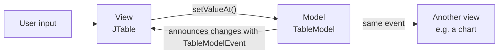
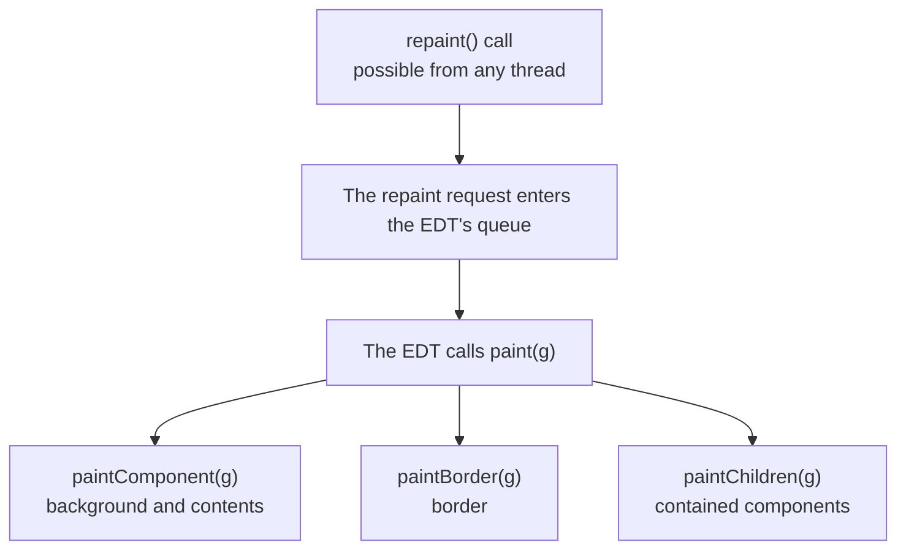

# Lecture 16 — Swing Components and Graphics

[Repository Guide](../../README.md) | [English](Concepts_Lecture.md) | [한국어](Concepts_Lecture.ko.md)

> **Last Updated:** 2026-11-19

> **Learning Objectives:**
> 1. Receive choices with check boxes, radio buttons, combo boxes, lists, and sliders and handle the event of each
> 2. Organize an application's commands and confirmation steps with menus, tool bars, and dialogs
> 3. Explain Swing's structure that separates models from views and build a JTable with a TableModel
> 4. Draw shapes and strings by overriding paintComponent() and explain how repaint() works
> 5. Build animation and drawing programs with Swing timers and mouse events

---

## Table of Contents

- [1. Selection Components and Their Events](#1-selection-components-and-their-events)
  - [1.1 JCheckBox and Item Events](#11-jcheckbox-and-item-events)
  - [1.2 JRadioButton and ButtonGroup](#12-jradiobutton-and-buttongroup)
  - [1.3 JComboBox and JList](#13-jcombobox-and-jlist)
  - [1.4 JSlider and JProgressBar](#14-jslider-and-jprogressbar)
- [2. Menus, Tool Bars, and Dialogs](#2-menus-tool-bars-and-dialogs)
  - [2.1 Menus](#21-menus)
  - [2.2 Tool Bars and Tool Tips](#22-tool-bars-and-tool-tips)
  - [2.3 Dialogs of JOptionPane](#23-dialogs-of-joptionpane)
  - [2.4 JDialog and Modal Dialogs](#24-jdialog-and-modal-dialogs)
- [3. Models and Views](#3-models-and-views)
  - [3.1 Models of Swing Components](#31-models-of-swing-components)
  - [3.2 TableModel and JTable](#32-tablemodel-and-jtable)
  - [3.3 JTabbedPane, JSplitPane, and JScrollPane](#33-jtabbedpane-jsplitpane-and-jscrollpane)
- [4. Graphics](#4-graphics)
  - [4.1 The Coordinate System and paintComponent()](#41-the-coordinate-system-and-paintcomponent)
  - [4.2 Drawing Methods of Graphics](#42-drawing-methods-of-graphics)
  - [4.3 The Flow of Repainting](#43-the-flow-of-repainting)
  - [4.4 Animation with Swing Timers](#44-animation-with-swing-timers)
  - [4.5 Drawing with the Mouse](#45-drawing-with-the-mouse)
- [5. Common Mistakes](#5-common-mistakes)
- [Summary](#summary)
- [Self-Check Questions](#self-check-questions)
- [References](#references)

---

<br>

## 1. Selection Components and Their Events

Among the components listed in Table 3 of Lecture 12, those that let the user choose one or more of several values can be called selection components. A selection component raises, when its selection state changes, events that follow the rules of Lecture 12, Section 5.11. The following program changes the state of each component in code, prints the events the listeners receive, and at the end lays the components out on one panel and draws them.

```java
import javax.swing.*;
import javax.swing.event.*;
import java.awt.*;
import java.awt.event.*;
import java.awt.image.BufferedImage;
import java.io.File;
import javax.imageio.ImageIO;

public class Selection {
    public static void main(String[] args) throws Exception {
        JCheckBox bold = new JCheckBox("Bold");
        bold.addItemListener(e -> System.out.println("check box: "
                + (e.getStateChange() == ItemEvent.SELECTED ? "SELECTED" : "DESELECTED")));
        bold.doClick();                                         // select
        bold.doClick();                                         // deselect

        JRadioButton small = new JRadioButton("Small"), medium = new JRadioButton("Medium", true),
                     large = new JRadioButton("Large");
        ButtonGroup sizes = new ButtonGroup();                  // group so only one is selected
        sizes.add(small); sizes.add(medium); sizes.add(large);
        large.doClick();
        System.out.println("radio: small=" + small.isSelected() + " medium=" + medium.isSelected()
                + " large=" + large.isSelected());

        JComboBox<String> fruit = new JComboBox<>(new String[] {"apple", "banana", "kiwi"});
        fruit.addItemListener(e -> System.out.println("combo item " + e.getItem() + " "
                + (e.getStateChange() == ItemEvent.SELECTED ? "SELECTED" : "DESELECTED")));
        fruit.addActionListener(e -> System.out.println("combo action, index "
                + fruit.getSelectedIndex() + " = " + fruit.getSelectedItem()));
        fruit.setSelectedIndex(2);

        JList<String> list = new JList<>(new String[] {"Java", "C", "Python", "Kotlin"});
        list.addListSelectionListener(e -> {
            if (!e.getValueIsAdjusting())                        // only when the selection settles
                System.out.println("list selection " + list.getSelectedValuesList());
        });
        list.setSelectedIndices(new int[] {0, 2});

        JSlider volume = new JSlider(0, 100, 50);
        volume.addChangeListener(e -> System.out.println("slider value " + volume.getValue()));
        volume.setValue(75);
        volume.setValue(150);                                    // beyond the maximum

        JProgressBar progress = new JProgressBar(0, 10);
        progress.setValue(7);
        progress.setStringPainted(true);
        System.out.println("progress " + progress.getPercentComplete() + " " + progress.getString());

        if (args.length > 0) render(args[0], bold, small, medium, large, fruit, list, volume, progress);
    }

    static void render(String file, JComponent... cs) throws Exception {
        JPanel p = new JPanel(new GridLayout(0, 2, 8, 8));
        p.setBorder(BorderFactory.createEmptyBorder(8, 8, 8, 8));
        JPanel radios = new JPanel(new FlowLayout(FlowLayout.LEFT, 4, 0));
        radios.add(cs[1]); radios.add(cs[2]); radios.add(cs[3]);
        p.add(cs[0]); p.add(radios); p.add(cs[4]); p.add(new JScrollPane(cs[5])); p.add(cs[6]); p.add(cs[7]);
        p.setSize(440, 190);
        layoutAll(p);
        BufferedImage img = new BufferedImage(440, 190, BufferedImage.TYPE_INT_RGB);
        Graphics2D g = img.createGraphics(); p.paint(g); g.dispose();
        ImageIO.write(img, "png", new File(file));
    }

    static void layoutAll(Container c) { c.doLayout(); for (Component k : c.getComponents()) if (k instanceof Container cc) layoutAll(cc); }
}
```

```text
check box: SELECTED
check box: DESELECTED
radio: small=false medium=false large=true
combo item apple DESELECTED
combo item kiwi SELECTED
combo action, index 2 = kiwi
list selection [Java]
list selection [Java, Python]
slider value 75
slider value 100
progress 0.7 70%
```


*Figure 1. Check box, radio buttons, combo box, list, slider, and progress bar*

Figure 1 is the program above drawing the components in their final state. The check box is deselected after two clicks, Large is selected among the radio buttons, kiwi in the combo box, and Java and Python in the list. The slider is at its maximum 100, and the progress bar shows 70%.

### 1.1 JCheckBox and Item Events

`JCheckBox` is a box that toggles between selected and deselected, and several of them are independent of each other. When its state changes, an `ItemEvent` occurs and `itemStateChanged()` of the `ItemListener` is called, and `getStateChange()` of the event tells `ItemEvent.SELECTED` or `ItemEvent.DESELECTED`. The first two output lines are the result of clicking the check box twice with `doClick()`, which selected and then deselected it. The current state can be read at any time with `isSelected()` and changed with `setSelected(boolean)`. A check box also raises an `ActionEvent` when clicked, but when the state is changed in code with `setSelected()`, only the `ItemEvent` occurs, so use an `ItemListener` not to miss state changes.

### 1.2 JRadioButton and ButtonGroup

`JRadioButton` is a button for choosing exactly one of several options. A radio button on its own is selected independently, like a check box, so to allow only one to be selected the buttons must be put together in a `ButtonGroup`. When one button in the group is selected, the previously selected button is deselected automatically. The program above created Medium as initially selected and clicked Large, so Medium was deselected and only Large is selected. A `ButtonGroup` is only a logical device that ties buttons together and is not a component, so it is not attached to the screen; each radio button is `add()`ed to the screen separately. The three radio buttons in Figure 1 were put in one FlowLayout panel (Lecture 12, Section 3.6).

### 1.3 JComboBox and JList

`JComboBox<E>` is a component for choosing one item from a drop-down list, and `JList<E>` is a component that always shows its list and allows several items to be chosen together. Both are generic classes with the element type as their type parameter (Lecture 9, Section 2).

Changing the combo box selection from apple to kiwi raises three events: `DESELECTED` for the previous item apple, `SELECTED` for the new item kiwi, and an `ActionEvent` announcing that the selection changed. The selected item is read with `getSelectedItem()` and its position with `getSelectedIndex()`. Switching to `setEditable(true)` also lets the user type a value that is not in the list.

A list raises a `javax.swing.event.ListSelectionEvent` when its selection changes. While the user drags the mouse to choose several items, events occur one after another, so to act only when the selection is finished, handle only events whose `getValueIsAdjusting()` is `false`. `setSelectedIndices({0, 2})` in the program above selects positions 0 and 2 in turn, so two events occurred, and in the last event `getSelectedValuesList()` is `[Java, Python]`. The selection mode is set with `setSelectionMode()`; with `ListSelectionModel.SINGLE_SELECTION` only one item can be chosen. When there are many items, the list is put in a `JScrollPane` as in Figure 1.

### 1.4 JSlider and JProgressBar

`JSlider` lets the user choose an integer between a minimum and a maximum by dragging a knob along a bar. `new JSlider(0, 100, 50)` is a slider with range 0-100 and initial value 50. When the value changes, a `ChangeEvent` occurs and `stateChanged()` of the `ChangeListener` is called. A `ChangeEvent` does not carry what changed, so the listener reads the current value again with `getValue()`. The `slider value 100` in the output is the result of the slider clamping the out-of-range 150 to its maximum 100.

`JProgressBar` is not a component the user chooses with but one that shows how far a task has progressed. With range 0-10 and value 7, `getPercentComplete()` is 0.7, and `setStringPainted(true)` shows the text `70%` on the bar. A progress bar is used with long-running work, so the typical form is a `SwingWorker` of Lecture 12, Section 5.8 updating its value in `process()`.

---

<br>

## 2. Menus, Tool Bars, and Dialogs

### 2.1 Menus

A menu consists of three levels: the menu bar at the top of the frame (`JMenuBar`), the menus in it (`JMenu`), and the menu items that appear when a menu is opened (`JMenuItem`).

```java
JMenuBar bar = new JMenuBar();
JMenu file = new JMenu("File");
file.setMnemonic(KeyEvent.VK_F);                    // Alt+F opens the menu

JMenuItem open = new JMenuItem("Open...");
open.setAccelerator(KeyStroke.getKeyStroke(KeyEvent.VK_O, InputEvent.CTRL_DOWN_MASK));
open.addActionListener(e -> openFile());            // menu items also raise action events

file.add(open);
file.addSeparator();                                // a separator line
file.add(new JMenuItem("Exit"));
bar.add(file);
frame.setJMenuBar(bar);                             // attached to the frame, not the content pane
```

Choosing a menu item raises an `ActionEvent`, as a button does, so an `ActionListener` is registered in the same way. A **mnemonic** is a character pressed together with Alt to open a menu, and an **accelerator** is a shortcut key that runs an item directly without opening the menu (Ctrl+O above). The menu bar is attached directly to the frame with `setJMenuBar()` and sits just below the title bar regardless of the layout of the content pane. A menu can contain items with a selection state, such as `JCheckBoxMenuItem` and `JRadioButtonMenuItem`, and another `JMenu` (a submenu). This is why `JMenu` is a subclass of `JMenuItem` in the hierarchy of Lecture 12, Section 1.2.

### 2.2 Tool Bars and Tool Tips

`JToolBar` is a container that gathers buttons for frequently used commands in one row. It is usually placed in NORTH of a content pane that uses BorderLayout, and icon buttons are `add()`ed to it. The user can drag the tool bar to another edge of the window or detach it into a separate window, and `setFloatable(false)` turns this off. To let the same command run from both a menu item and a tool-bar button, register the same listener on both components.

A **tool tip** is a short description that appears when the mouse rests over a component for a moment. Any `JComponent` gets one by setting a string, as in `setToolTipText("Open a file")`, and giving tool tips to icon-only tool-bar buttons is basic usability.

### 2.3 Dialogs of JOptionPane

`JOptionPane` shows commonly used kinds of dialogs with a single static method. Besides `showMessageDialog()` and `showInputDialog()`, used in Lectures 2 and 3, there are the following methods.

| Method | What it shows | Return value |
|:-----|:-----|:-----|
| `showMessageDialog(parent, msg)` | A message and an OK button | None |
| `showConfirmDialog(parent, msg)` | A question and Yes, No, Cancel buttons | An `int` constant for the button pressed |
| `showInputDialog(parent, msg)` | A question and an input field | The `String` entered, `null` if cancelled |
| `showOptionDialog(...)` | Buttons of your choice | The position of the button pressed |

*Table 1. Main methods of JOptionPane*

The return value of a confirm dialog is compared with the following constants.

```java
import javax.swing.JOptionPane;

public class DialogConstants {
    public static void main(String[] args) {
        System.out.println("YES_OPTION    = " + JOptionPane.YES_OPTION);
        System.out.println("NO_OPTION     = " + JOptionPane.NO_OPTION);
        System.out.println("CANCEL_OPTION = " + JOptionPane.CANCEL_OPTION);
        System.out.println("OK_OPTION     = " + JOptionPane.OK_OPTION);
        System.out.println("CLOSED_OPTION = " + JOptionPane.CLOSED_OPTION);
        try {
            JOptionPane.showConfirmDialog(null, "Save changes?");
        } catch (java.awt.HeadlessException e) {
            System.out.println("no screen: HeadlessException");
        }
    }
}
```

```text
YES_OPTION    = 0
NO_OPTION     = 1
CANCEL_OPTION = 2
OK_OPTION     = 0
CLOSED_OPTION = -1
no screen: HeadlessException
```

`YES_OPTION` and `OK_OPTION` have the same value 0, and if the user closes the window without pressing a button, `CLOSED_OPTION` (-1) is returned. So compare with the constants, as in `if (answer == JOptionPane.YES_OPTION)`, and handle the case of a closed window too. The last line is a `HeadlessException`, raised because this program was run in an environment without a screen and could not show the dialog. These methods do not return until the user answers, yet the screen keeps being repainted in the meantime. The toolkit ensures that other events are not blocked even while a modal dialog (Section 2.4) is showing, so these methods may be called inside event listeners, that is, on the EDT.

### 2.4 JDialog and Modal Dialogs

A dialog that `JOptionPane` cannot make (for example, a settings window with several input fields) is built by extending or creating a `JDialog` and laying out components in it. `JDialog` is a top-level window like `JFrame` and has its own content pane (Lecture 12, Section 1.2).

If the third argument of `new JDialog(owner, "Settings", true)` is `true`, it is a **modal** dialog. While a modal dialog is showing, the user cannot operate its owner window, and `setVisible(true)` does not return until the dialog is closed. So code that reads the entered values after the dialog closes can be written on the line right after `setVisible(true)`. With `false` it is a **modeless** dialog: the dialog and the owner window can be used together, and `setVisible(true)` returns at once. A window kept open for repeated use, such as a find window, is made modeless, and a window whose answer is needed before continuing, such as one asking whether to save, is made modal.

---

<br>

## 3. Models and Views

### 3.1 Models of Swing Components

Most Swing components keep their data and state apart from their display, in **model** objects [1]. A button keeps its pressed, selected, and enabled states in a `ButtonModel`, a list keeps its items in a `ListModel` and its selection state in a `ListSelectionModel`, and a table keeps the values of its cells in a `TableModel`. The component itself takes the role of the **view**, which draws the contents of the model on the screen and passes the user's input to the model.

> **Definition:** **Model-view separation** is a design that splits the model, which holds the data and its rules, and the view, which shows the data, into different objects, and has the model notify the views with events when it changes. Several views can show one model together, and the model's code does not change when the screen changes.



*Figure 2. Passing changes between a model and its views*

> **[Software Engineering]** The MVC (Model-View-Controller) pattern of software engineering separates the model, the view, and the controller that handles input. Swing uses a variant that merges the view and the controller into one UI delegate object and separates only the model. That the appearance of components can change with the look and feel (Lecture 12, Section 1.1) is also because the UI delegate does the drawing.

### 3.2 TableModel and JTable

`JTable` is a table that shows data in rows and columns. If the data is small and fixed, it can be created directly with `new JTable(Object[][] data, String[] columnNames)`, but if the data changes or cells follow rules, create a model that extends `AbstractTableModel`. The model must implement the three methods that give the number of rows, the number of columns, and the value of a cell, and it overrides the column names, editability, and value changes as needed.

```java
import javax.swing.*;
import javax.swing.table.AbstractTableModel;
import java.awt.*;
import java.awt.image.BufferedImage;
import java.io.File;
import java.util.ArrayList;
import java.util.List;
import javax.imageio.ImageIO;

public class ScoreTable {
    record Row(String name, int score) { }

    static class ScoreModel extends AbstractTableModel {              // model: data and its rules
        private final String[] columns = {"Name", "Score", "Pass"};
        private final List<Row> rows = new ArrayList<>();

        void add(String name, int score) {
            rows.add(new Row(name, score));
            fireTableRowsInserted(rows.size() - 1, rows.size() - 1);   // notify the views
        }

        @Override public int getRowCount() { return rows.size(); }
        @Override public int getColumnCount() { return columns.length; }
        @Override public String getColumnName(int c) { return columns[c]; }
        @Override public Object getValueAt(int r, int c) {
            Row row = rows.get(r);
            return switch (c) {
                case 0 -> row.name();
                case 1 -> row.score();
                default -> row.score() >= 60 ? "yes" : "no";
            };
        }
        @Override public boolean isCellEditable(int r, int c) { return c == 1; }
        @Override public void setValueAt(Object v, int r, int c) {
            rows.set(r, new Row(rows.get(r).name(), Integer.parseInt(v.toString())));
            fireTableRowsUpdated(r, r);
        }
    }

    public static void main(String[] args) throws Exception {
        ScoreModel model = new ScoreModel();
        JTable table = new JTable(model);                               // view: shows the model
        model.addTableModelListener(e -> System.out.println("model changed: rows "
                + e.getFirstRow() + "-" + e.getLastRow() + ", type " + e.getType()));
        model.add("Kim", 90);
        model.add("Lee", 55);
        model.add("Park", 72);
        System.out.println("table rows " + table.getRowCount() + ", columns " + table.getColumnCount()
                + ", header " + table.getColumnName(0) + "/" + table.getColumnName(1) + "/" + table.getColumnName(2));
        System.out.println("Lee: " + table.getValueAt(1, 1) + " pass=" + table.getValueAt(1, 2)
                + ", editable name? " + table.isCellEditable(1, 0) + ", score? " + table.isCellEditable(1, 1));
        table.setValueAt("65", 1, 1);                                   // the edit goes to the model
        System.out.println("Lee after edit: " + model.getValueAt(1, 1) + " pass=" + model.getValueAt(1, 2));

        if (args.length > 0) {
            JPanel sp = new JPanel(new BorderLayout());
            sp.add(table.getTableHeader(), BorderLayout.NORTH);
            sp.add(table, BorderLayout.CENTER);
            sp.setSize(300, 70);
            layoutAll(sp);
            BufferedImage img = new BufferedImage(300, 70, BufferedImage.TYPE_INT_RGB);
            Graphics2D g = img.createGraphics(); sp.paint(g); g.dispose();
            ImageIO.write(img, "png", new File(args[0]));
        }
    }

    static void layoutAll(Container c) { c.doLayout(); for (Component k : c.getComponents()) if (k instanceof Container cc) layoutAll(cc); }
}
```

```text
model changed: rows 0-0, type 1
model changed: rows 1-1, type 1
model changed: rows 2-2, type 1
table rows 3, columns 3, header Name/Score/Pass
Lee: 55 pass=no, editable name? false, score? true
model changed: rows 1-1, type 0
Lee after edit: 65 pass=yes
```


*Figure 3. A JTable showing ScoreModel*

`ScoreModel` stores students' names and scores in a list, and the third column, Pass, is not stored but computed from whether the score is 60 or more. `add()` adds a row and then notifies the model's listeners of the change with `fireTableRowsInserted()`. `JTable` registers itself as such a listener when it receives the model, so it receives this notification and draws the new row on the screen. `type 1` in the output is `TableModelEvent.INSERT`, meaning a row was inserted, and `type 0` is `UPDATE`, meaning values changed.

`isCellEditable()` returns `true` only for the score column (1), so the user can change only scores. When the user edits a cell, `JTable` calls `setValueAt()`; the program above imitates this with `table.setValueAt("65", 1, 1)`. The model changes Lee's score to 65 and announces it with `fireTableRowsUpdated()`, and the Pass column, without being changed separately, is computed as `yes` the next time `getValueAt()` is called. Figure 3 draws this state. In this way the rules of the data are kept once in the model, and the table only shows the values the model gives.

### 3.3 JTabbedPane, JSplitPane, and JScrollPane

These three containers decide how other components share the screen.

- `JTabbedPane` keeps one panel per tab and shows only that panel when its tab is clicked. Tabs are added with `tabs.addTab("General", generalPanel)`; it is like the CardLayout of Lecture 12, Section 3.7 with tab buttons attached.
- `JSplitPane` places two components side by side horizontally or vertically and lets the user divide the space by dragging the divider between them. It is created as in `new JSplitPane(JSplitPane.HORIZONTAL_SPLIT, fileList, editor)`.
- `JScrollPane` adds scroll bars when the component inside is larger than the visible area. This is where the `JTextArea` of Lecture 12, Section 4.1, the `JList` of Section 1.3, and the `JTable` of Section 3.2 go. Putting a `JTable` in a `JScrollPane` automatically attaches the column-name header above the scrolling area.

---

<br>

## 4. Graphics

### 4.1 The Coordinate System and paintComponent()

To draw directly on a component, create a class that extends `JPanel` and override `paintComponent(Graphics g)`. Swing calls this method when the component needs to be drawn and passes as its argument a `Graphics` object, the tool for drawing. All drawing code goes in this method [2].

In the coordinate system of `Graphics`, the top-left corner of the component is the origin (0, 0), x grows to the right, and y grows downward. The unit is the pixel. Note that unlike mathematical coordinates, y grows downward. Coordinates are relative to the component, not to the frame or the screen, so the drawing code need not change when the panel is moved elsewhere.

```text
(0,0) ──────────────► x
  │
  │      (130,10) ┌──────────┐
  │               │          │ height 50
  │               └──────────┘
  │                  width 80
  ▼
  y
```

*Figure 4. The coordinate system of a component and drawRect(130, 10, 80, 50)*

> **[Computer Graphics]** In computer graphics such coordinates are called screen (device) coordinates, and the process of turning shapes into a grid of pixels is called rasterization. `Graphics2D` can transform the coordinate system with `translate()`, `rotate()`, and `scale()` before drawing, so drawing code can be written in the shape's own coordinates while its position and orientation are set by the transformation.

### 4.2 Drawing Methods of Graphics

The following panel draws shapes and a string with the typical methods of `Graphics`. Instead of showing a window on the screen, the panel was painted into an image and saved to a file.

```java
import javax.swing.*;
import java.awt.*;
import java.awt.image.BufferedImage;
import java.io.File;
import javax.imageio.ImageIO;

public class Drawing extends JPanel {
    @Override
    protected void paintComponent(Graphics g) {
        super.paintComponent(g);                                       // clear the background first
        g.setColor(Color.BLUE);
        g.drawLine(10, 10, 110, 60);                                   // line
        g.drawRect(130, 10, 80, 50);                                   // outline of a rectangle
        g.setColor(Color.ORANGE);
        g.fillOval(230, 10, 80, 50);                                   // filled oval
        g.setColor(Color.MAGENTA);
        g.fillArc(330, 10, 60, 60, 0, 270);                            // sector from 0 to 270 degrees
        g.setColor(Color.DARK_GRAY);
        g.drawPolygon(new int[] {20, 70, 120}, new int[] {150, 90, 150}, 3);
        g.setFont(new Font(Font.SANS_SERIF, Font.BOLD, 20));
        g.drawString("Hello Graphics", 140, 125);                      // baseline starts at (140, 125)

        Graphics2D g2 = (Graphics2D) g;                                // more features
        g2.setRenderingHint(RenderingHints.KEY_ANTIALIASING, RenderingHints.VALUE_ANTIALIAS_ON);
        g2.setStroke(new BasicStroke(4));
        g2.setColor(new Color(0, 128, 0));
        g2.drawOval(320, 90, 70, 60);
    }

    public static void main(String[] args) throws Exception {
        Drawing d = new Drawing();
        d.setBackground(Color.WHITE);
        d.setSize(400, 160);
        BufferedImage img = new BufferedImage(400, 160, BufferedImage.TYPE_INT_RGB);
        Graphics2D g = img.createGraphics();
        d.paint(g);                                                    // paint into an image instead of the screen
        g.dispose();
        ImageIO.write(img, "png", new File(args[0]));
        System.out.println("pixel at (270, 35): " + Integer.toHexString(img.getRGB(270, 35) & 0xFFFFFF));
        System.out.println("pixel at (5, 150):  " + Integer.toHexString(img.getRGB(5, 150) & 0xFFFFFF));
    }
}
```

```text
pixel at (270, 35): ffc800
pixel at (5, 150):  ffffff
```


*Figure 5. Shapes and a string drawn with Graphics and Graphics2D*

| Method | What it draws |
|:-----|:-----|
| `drawLine(x1, y1, x2, y2)` | A line from (x1, y1) to (x2, y2) |
| `drawRect(x, y, w, h)`, `fillRect(...)` | The outline or the filled area of a rectangle whose top-left corner is (x, y), with width w and height h |
| `drawOval(x, y, w, h)`, `fillOval(...)` | The ellipse inscribed in that rectangle |
| `drawArc(x, y, w, h, start, angle)`, `fillArc(...)` | An arc or sector that is part of the ellipse (angles counterclockwise from 3 o'clock) |
| `drawPolygon(xs, ys, n)`, `fillPolygon(...)` | A polygon joining n vertices |
| `drawString(s, x, y)` | A string whose baseline starts at (x, y) |
| `drawImage(img, x, y, observer)` | An image |
| `setColor(c)`, `setFont(f)` | The color and font for what is drawn next |

*Table 2. Main methods of Graphics*

Methods starting with `draw` draw only the outline, and methods starting with `fill` fill the inside too. An ellipse is specified not by its center and radii but by the rectangle that encloses it, so `fillOval(230, 10, 80, 50)` is an ellipse centered at (270, 35). The first output line shows that the color of that center pixel is orange (`ffc800`: red 255, green 200, blue 0), and the second line shows that a place where nothing was drawn has the background color white. `fillArc(330, 10, 60, 60, 0, 270)` fills 270 degrees counterclockwise from 3 o'clock (0 degrees), giving a sector with the lower-right quarter missing. The y of `drawString` is the position of the baseline, not the top of the text, so most of the characters are drawn above y.

The actual type of the object `paintComponent()` receives is `Graphics2D`, a subclass of `Graphics`. Casting to it gives further features such as line width (`setStroke`), antialiasing that reduces jagged edges (`setRenderingHint`), and coordinate transformations. The green ellipse in Figure 5 was drawn with a line width of 4 and antialiasing, so its outline is smoother than the other shapes.

### 4.3 The Flow of Repainting

A program never calls `paintComponent()` directly. When a window first appears, when a hidden part becomes visible again, or when the size changes, Swing requests painting on its own, and when the program has changed what the picture contains, it calls `repaint()` to request a repaint. `repaint()` does not paint at once; it records the area to repaint, puts a request into the EDT's queue, and returns. Requests made several times within a short time may be merged into one.



*Figure 6. The repaint flow from repaint() to paintComponent()*

When the EDT handles the request, the component's `paint()` is called, and Swing's `paint()` divides the work into calls to `paintComponent()`, `paintBorder()`, and `paintChildren()`, in that order [2]. So drawing code must go in `paintComponent()`, not `paint()`, for the border and child components to be drawn properly on top of it. The first statement of `paintComponent()`, `super.paintComponent(g)`, fills the background of an opaque component with its background color. Leaving this call out leaves earlier drawings unerased, producing ghost images.

The important conclusion of this structure is that the state of the picture must be stored in fields. `paintComponent()` can be called again at any time, so each time this method must draw the whole picture from scratch from the state stored in fields. Drawing directly on an object obtained with `getGraphics()` in a listener makes that drawing disappear the moment the window is hidden and shown again.

### 4.4 Animation with Swing Timers

Animation is the repetition of changing the state of the picture at regular intervals and calling `repaint()`. It can be done by repeating `sleep()` in a thread as in Lecture 13, but with `javax.swing.Timer` the action events occur on the EDT at the set interval, so components can be changed safely [3].

```java
import javax.swing.*;

public class TimerAnim {
    static int x = 0, ticks = 0;

    public static void main(String[] args) throws Exception {
        long t0 = System.nanoTime();
        Timer timer = new Timer(100, null);                            // every 0.1 s
        timer.addActionListener(e -> {
            x += 10;                                                   // where the position moves and repaint() is called
            ticks++;
            System.out.printf("tick %d at ~%d ms on %s, x = %d%n", ticks,
                    Math.round((System.nanoTime() - t0) / 1e6 / 100) * 100,
                    Thread.currentThread().getName(), x);
            if (ticks == 5) timer.stop();
        });
        timer.start();
        Thread.sleep(800);
        System.out.println("running after stop? " + timer.isRunning());
    }
}
```

```text
tick 1 at ~100 ms on AWT-EventQueue-0, x = 10
tick 2 at ~200 ms on AWT-EventQueue-0, x = 20
tick 3 at ~400 ms on AWT-EventQueue-0, x = 30
tick 4 at ~500 ms on AWT-EventQueue-0, x = 40
tick 5 at ~600 ms on AWT-EventQueue-0, x = 50
running after stop? false
```

`new Timer(100, listener)` is a timer that calls the listener every 0.1 seconds; it is started with `start()` and stopped with `stop()`. Every tick in the output ran on `AWT-EventQueue-0`, that is, the EDT. In a real animation the listener would change `x` and then call `repaint()`, and `paintComponent()` would draw the shape at the position in field `x`. As the third tick running at about 400 milliseconds shows, the timer's interval is not exact, and it becomes later still when the EDT is busy with other events. So when the exact speed of motion matters, the position is computed from the time actually elapsed (`System.nanoTime()`), not from the number of ticks. `stop()` was called on the fifth tick, so the listener is not called after that and `isRunning()` is `false`.

The listener of a Swing timer runs on the EDT, so it must finish quickly (Lecture 12, Section 5.7). If a long computation is needed, use a `SwingWorker` alongside it (Lecture 12, Section 5.8).

### 4.5 Drawing with the Mouse

A paint program in which lines follow the dragged mouse follows the principle of Section 4.3 exactly. The mouse listener only changes the state of the picture (the list of points) and requests `repaint()`, and the actual drawing is done by `paintComponent()` from the state.

```java
import javax.swing.*;
import java.awt.*;
import java.awt.event.*;
import java.util.ArrayList;
import java.util.List;

public class MouseDraw extends JPanel {
    private final List<Point> points = new ArrayList<>();             // remember the state of the drawing
    int repaints = 0;

    MouseDraw() {
        MouseAdapter handler = new MouseAdapter() {
            @Override public void mousePressed(MouseEvent e) { points.clear(); points.add(e.getPoint()); requestRepaint(); }
            @Override public void mouseDragged(MouseEvent e) { points.add(e.getPoint()); requestRepaint(); }
        };
        addMouseListener(handler);
        addMouseMotionListener(handler);                               // drags go to the motion listener
    }

    void requestRepaint() { repaints++; repaint(); }

    @Override
    protected void paintComponent(Graphics g) {
        super.paintComponent(g);
        for (int i = 1; i < points.size(); i++) {
            Point a = points.get(i - 1), b = points.get(i);
            g.drawLine(a.x, a.y, b.x, b.y);
        }
    }

    public static void main(String[] args) {
        MouseDraw p = new MouseDraw();
        p.setSize(200, 100);
        long when = System.currentTimeMillis();
        p.dispatchEvent(new MouseEvent(p, MouseEvent.MOUSE_PRESSED, when, 0, 10, 10, 1, false, MouseEvent.BUTTON1));
        for (int x = 20; x <= 60; x += 10)
            p.dispatchEvent(new MouseEvent(p, MouseEvent.MOUSE_DRAGGED, when, InputEvent.BUTTON1_DOWN_MASK,
                    x, 10 + x / 2, 0, false, MouseEvent.NOBUTTON));
        System.out.println("points " + p.points.size() + ", segments " + (p.points.size() - 1)
                + ", repaint requests " + p.repaints);
        System.out.println("last point " + p.points.get(p.points.size() - 1));
    }
}
```

```text
points 6, segments 5, repaint requests 6
last point java.awt.Point[x=60,y=40]
```

`MouseAdapter` implements both `MouseListener` and `MouseMotionListener` (Lecture 12, Section 5.5), so the same object is registered with both `addMouseListener()` and `addMouseMotionListener()`. `mousePressed()`, called when the button is pressed, clears the list and adds the first point, and `mouseDragged()`, called while moving with the button held, adds points one by one. The program above delivered a press at (10, 10) and five drags up to (60, 40) (Lecture 12, Section 5.10), so there are 6 points and 5 segments joining neighboring points, and a `repaint()` was requested for each event, 6 requests in all. `paintComponent()` joins each pair of neighboring points with `drawLine()` to draw an unbroken curve. To keep several strokes, store a list of point lists.

---

<br>

## 5. Common Mistakes

| Mistake | What happens | How to fix it |
|:-----|:-----|:-----|
| Not putting radio buttons in a `ButtonGroup` | Several buttons are selected together | Put the buttons of which only one may be selected in one `ButtonGroup` |
| Trying to `add()` a `ButtonGroup` to a container | It is not a component, so a compile error occurs | Attach each radio button to the screen separately |
| Handling list selection events without checking `getValueIsAdjusting()` | The same handling runs many times while dragging | Handle only events after adjustment ends |
| Treating the return value of a confirm dialog as `true` or `false` | It is an integer constant, so the comparison is wrong | Compare with `JOptionPane.YES_OPTION` and the like, and handle `CLOSED_OPTION` too |
| Not calling the model's `fire...` method after changing table data | The change does not appear on the screen | Call the `fireTable...()` method that matches the changed range |
| Drawing by overriding `paint()` | The border and child components are not drawn properly | Override `paintComponent()` |
| Forgetting `super.paintComponent(g)` in `paintComponent()` | The background is not cleared and ghost images remain | Call it as the first statement |
| Calling `paintComponent()` directly or drawing on `getGraphics()` | The drawing disappears when the component is repainted | Keep the state in fields and call `repaint()` |
| Changing state or computing at length in `paintComponent()` | Results differ on every paint and the screen slows down | Change state in listeners or timers, and let painting only paint |
| Thinking y grows upward as in mathematics | The picture is drawn upside down | Remember that y grows downward |

*Table 3. Common mistakes with Swing components and graphics*

---

<br>

## Summary

| Concept | Key Summary |
|:-----|:-----|
| Selection components | Check boxes, radio buttons, and combo boxes raise `ItemEvent`s, lists raise `ListSelectionEvent`s, and sliders raise `ChangeEvent`s. |
| ButtonGroup | It is a logical device that ties radio buttons together so that only one of them is selected, and it is not attached to the screen. |
| Menus | They consist of the three levels `JMenuBar`, `JMenu`, and `JMenuItem`, and menu items raise action events. |
| JOptionPane | It shows message, confirm, and input dialogs with static methods and returns confirm results as integer constants. |
| Modal dialog | The owner window cannot be operated until it closes, and `setVisible(true)` does not return. |
| Models and views | The data and state of a component are kept in a model, which notifies the views with events when it changes. |
| TableModel | It provides the number of rows, the number of columns, and the cell values, and announces data changes to the table with `fireTable...()`. |
| Coordinate system | It is a pixel coordinate system with the top-left corner of the component at (0, 0), x growing to the right and y growing downward. |
| paintComponent | It is the method that holds the drawing code; it calls `super.paintComponent(g)` first and draws everything from the state in fields every time. |
| repaint | It only requests a repaint and returns, and the EDT later calls `paintComponent()` through `paint()`. |
| Swing timer | It raises action events on the EDT at set intervals, making animation safe. |

---

<br>

## Self-Check Questions

1. **Item events:** With kiwi selected in the combo box of Section 1.3, does calling `setSelectedIndex(2)` again raise events? Which events occur, and in what order, when the selection changes from kiwi to banana?

   <details>
   <summary>Answer</summary>

   Selecting the same item again does not change the selection state, so no item events occur; only one action event occurs. Running it actually calls only the action listener, once. Changing from kiwi to banana raises two `ItemEvent`s in this order, `DESELECTED` for the previous item kiwi and `SELECTED` for the new item banana, followed by an `ActionEvent`. This is the same order as when changing from apple to kiwi in the output of Section 1.3.

   </details>

2. **ButtonGroup:** Three radio buttons were attached to the screen without being put in a `ButtonGroup`. What are the states of the two buttons after clicking Small and then Large?

   <details>
   <summary>Answer</summary>

   Both are selected. A `JRadioButton` on its own is selected independently, like a check box, and deselecting the other buttons is the job of the `ButtonGroup`. To allow only one to be selected, the three buttons must be `add()`ed to the same `ButtonGroup`.

   </details>

3. **TableModel:** If `fireTableRowsUpdated(r, r)` is deleted from `setValueAt()` of the `ScoreModel` in Section 3.2, how do the program's output and the screen each change?

   <details>
   <summary>Answer</summary>

   The model's listeners are not called, so the line `model changed: rows 1-1, type 0` disappears from the output. The model's value did change, so `Lee after edit: 65 pass=yes`, read with `getValueAt()`, stays the same. But the `JTable` on the screen receives no change notification, so it may show the old value until that cell is repainted for some other reason. So that data and screen do not diverge, always notify after changing the model.

   </details>

4. **Coordinates:** What arguments must be passed to `fillOval` to fill a circle of diameter 40 at the exact center of a panel 200 wide and 100 high?

   <details>
   <summary>Answer</summary>

   `fillOval(80, 30, 40, 40)`. An ellipse is specified by the top-left coordinates, width, and height of the enclosing rectangle. For the center of the circle to be the panel's center (100, 50), the top-left corner of the rectangle is (100 - 20, 50 - 20) = (80, 30), and the width and height are the diameter 40.

   </details>

5. **Repainting:** A program that puts a dot wherever the mouse is clicked draws directly in the listener with `getGraphics().fillOval(...)`. The dots appear at first, but all of them disappear after the window is minimized and restored. Explain why and how to fix it.

   <details>
   <summary>Answer</summary>

   When the window reappears, Swing calls `paintComponent()` to repaint the component, but the positions of the dots are stored nowhere, so `super.paintComponent(g)` fills the background and nothing else is drawn. Storing the clicked positions in a list field, calling `repaint()`, and drawing every point in the list in `paintComponent()` keeps the dots however often the component is repainted (Sections 4.3 and 4.5).

   </details>

6. **Swing timers:** An animation is to move a ball 5 pixels to the right every 0.05 seconds. Explain the difference between building it with a `Thread` and `sleep(50)` and building it with `javax.swing.Timer`, in terms of the thread on which the code that changes the ball's position runs.

   <details>
   <summary>Answer</summary>

   With a `Thread` and `sleep(50)`, the code that changes the position runs on a separate thread, so it shares fields with `paintComponent()`, which runs on the EDT, and synchronization must be considered; changing components directly also breaks Swing's threading rule. The listener of `javax.swing.Timer` runs on the EDT, so changing the position and calling `repaint()` happen one after another on the same thread as painting, which is safe (Section 4.4). The listener must still finish quickly.

   </details>

---

<br>

## References

1. Oracle, "How to Use Models," *The Java Tutorials: Creating a GUI With Swing, Using Swing Components*. https://docs.oracle.com/javase/tutorial/uiswing/components/model.html
2. Oracle, "A Closer Look at the Paint Mechanism," *The Java Tutorials: Creating a GUI With Swing, Performing Custom Painting*. https://docs.oracle.com/javase/tutorial/uiswing/painting/closer.html
3. Oracle, "How to Use Swing Timers," *The Java Tutorials: Creating a GUI With Swing, Using Other Swing Features*. https://docs.oracle.com/javase/tutorial/uiswing/misc/timer.html
