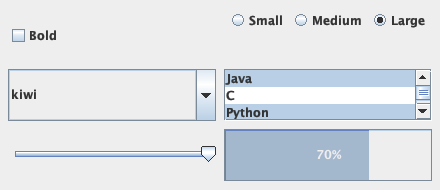
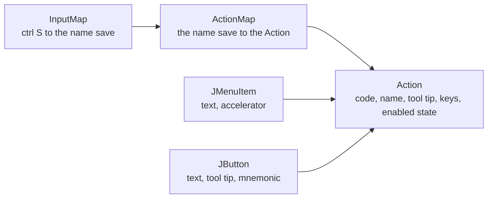
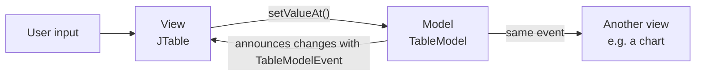
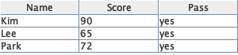
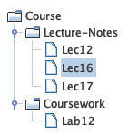
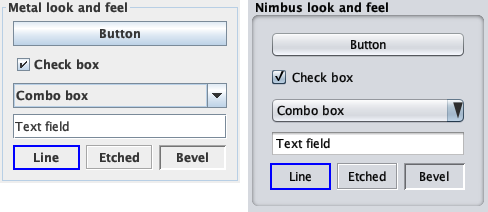
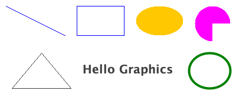
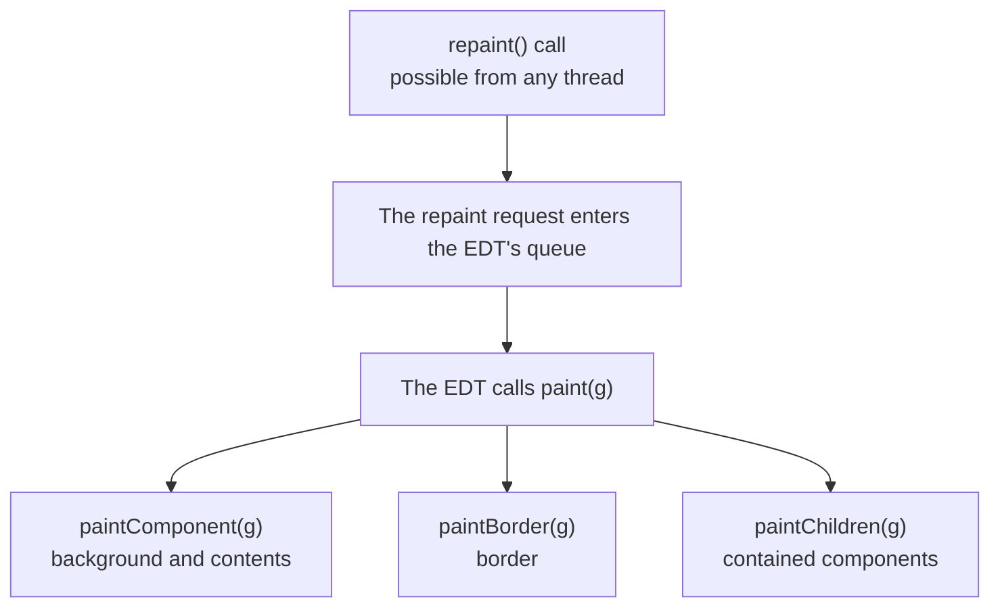
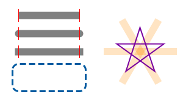
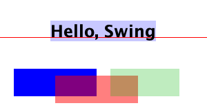

# Lecture 16 — Swing Components and Graphics

[Repository Guide](../../README.md) | [English](Concepts_Lecture.md) | [한국어](Concepts_Lecture.ko.md)

> **Last Updated:** 2026-11-19

> **Learning Objectives:**
> 1. Receive input with buttons, check boxes, radio buttons, combo boxes, lists, sliders, spinners, and text components and handle the model and events of each
> 2. Organize an application's commands by tying menus, tool bars, dialogs, and file choosers together with Actions and key bindings
> 3. Explain Swing's structure that separates models from views and work with ListModel, TableModel, TreeModel, cell renderers, and sorters
> 4. Draw shapes and strings by overriding paintComponent() and explain how repaint() works
> 5. Compose drawings precisely with the strokes, coordinate transforms, font metrics, transparency, and images of Graphics2D
> 6. Build drawing programs and long-running tasks that do not block the EDT with Swing timers, mouse and key input, and SwingWorker

---

## Table of Contents

- [1. Selection Components and Their Events](#1-selection-components-and-their-events)
  - [1.1 JCheckBox and Item Events](#11-jcheckbox-and-item-events)
  - [1.2 JRadioButton and ButtonGroup](#12-jradiobutton-and-buttongroup)
  - [1.3 JComboBox and JList](#13-jcombobox-and-jlist)
  - [1.4 JSlider and JProgressBar](#14-jslider-and-jprogressbar)
  - [1.5 Buttons and ButtonModel](#15-buttons-and-buttonmodel)
  - [1.6 JSpinner and SpinnerModel](#16-jspinner-and-spinnermodel)
  - [1.7 Text Components and Document](#17-text-components-and-document)
- [2. Menus, Tool Bars, and Dialogs](#2-menus-tool-bars-and-dialogs)
  - [2.1 Menus](#21-menus)
  - [2.2 Tool Bars and Tool Tips](#22-tool-bars-and-tool-tips)
  - [2.3 Dialogs of JOptionPane](#23-dialogs-of-joptionpane)
  - [2.4 JDialog and Modal Dialogs](#24-jdialog-and-modal-dialogs)
  - [2.5 Actions and Key Bindings](#25-actions-and-key-bindings)
  - [2.6 File Choosers and Color Choosers](#26-file-choosers-and-color-choosers)
- [3. Models and Views](#3-models-and-views)
  - [3.1 Models of Swing Components](#31-models-of-swing-components)
  - [3.2 TableModel and JTable](#32-tablemodel-and-jtable)
  - [3.3 JTabbedPane, JSplitPane, and JScrollPane](#33-jtabbedpane-jsplitpane-and-jscrollpane)
  - [3.4 Models by Component and Shared Models](#34-models-by-component-and-shared-models)
  - [3.5 Table Renderers and Sorting](#35-table-renderers-and-sorting)
  - [3.6 JTree and TreeModel](#36-jtree-and-treemodel)
  - [3.7 Borders and Look and Feel](#37-borders-and-look-and-feel)
- [4. Graphics](#4-graphics)
  - [4.1 The Coordinate System and paintComponent()](#41-the-coordinate-system-and-paintcomponent)
  - [4.2 Drawing Methods of Graphics](#42-drawing-methods-of-graphics)
  - [4.3 The Flow of Repainting](#43-the-flow-of-repainting)
  - [4.4 Animation with Swing Timers](#44-animation-with-swing-timers)
  - [4.5 Drawing with the Mouse](#45-drawing-with-the-mouse)
  - [4.6 Shapes, Strokes, and Coordinate Transforms of Graphics2D](#46-shapes-strokes-and-coordinate-transforms-of-graphics2d)
  - [4.7 Font Metrics and Color Transparency](#47-font-metrics-and-color-transparency)
  - [4.8 Images, Clips, and Double Buffering](#48-images-clips-and-double-buffering)
  - [4.9 The Structure of Input and Animation](#49-the-structure-of-input-and-animation)
  - [4.10 Progress and Cancellation of SwingWorker](#410-progress-and-cancellation-of-swingworker)
- [5. Common Mistakes](#5-common-mistakes)
- [Summary](#summary)
- [Self-Check Questions](#self-check-questions)
- [References](#references)

---

<br>

## 1. Selection Components and Their Events

Among the components listed in Table 3 of Lecture 12, those that let the user choose one or more of several values can be called selection components. A selection component raises, when its selection state changes, events that follow the rules of Lecture 12, Section 5.11. The following program changes the state of each component in code, prints the events the listeners receive, and at the end lays the components out on one panel and draws them.

```java
import javax.swing.*;
import javax.swing.event.*;
import java.awt.*;
import java.awt.event.*;
import java.awt.image.BufferedImage;
import java.io.File;
import javax.imageio.ImageIO;

public class Selection {
    public static void main(String[] args) throws Exception {
        JCheckBox bold = new JCheckBox("Bold");
        bold.addItemListener(e -> System.out.println("check box: "
                + (e.getStateChange() == ItemEvent.SELECTED ? "SELECTED" : "DESELECTED")));
        bold.doClick();                                         // select
        bold.doClick();                                         // deselect

        JRadioButton small = new JRadioButton("Small"), medium = new JRadioButton("Medium", true),
                     large = new JRadioButton("Large");
        ButtonGroup sizes = new ButtonGroup();                  // group so only one is selected
        sizes.add(small); sizes.add(medium); sizes.add(large);
        large.doClick();
        System.out.println("radio: small=" + small.isSelected() + " medium=" + medium.isSelected()
                + " large=" + large.isSelected());

        JComboBox<String> fruit = new JComboBox<>(new String[] {"apple", "banana", "kiwi"});
        fruit.addItemListener(e -> System.out.println("combo item " + e.getItem() + " "
                + (e.getStateChange() == ItemEvent.SELECTED ? "SELECTED" : "DESELECTED")));
        fruit.addActionListener(e -> System.out.println("combo action, index "
                + fruit.getSelectedIndex() + " = " + fruit.getSelectedItem()));
        fruit.setSelectedIndex(2);

        JList<String> list = new JList<>(new String[] {"Java", "C", "Python", "Kotlin"});
        list.addListSelectionListener(e -> {
            if (!e.getValueIsAdjusting())                        // only when the selection settles
                System.out.println("list selection " + list.getSelectedValuesList());
        });
        list.setSelectedIndices(new int[] {0, 2});

        JSlider volume = new JSlider(0, 100, 50);
        volume.addChangeListener(e -> System.out.println("slider value " + volume.getValue()));
        volume.setValue(75);
        volume.setValue(150);                                    // beyond the maximum

        JProgressBar progress = new JProgressBar(0, 10);
        progress.setValue(7);
        progress.setStringPainted(true);
        System.out.println("progress " + progress.getPercentComplete() + " " + progress.getString());

        if (args.length > 0) render(args[0], bold, small, medium, large, fruit, list, volume, progress);
    }

    static void render(String file, JComponent... cs) throws Exception {
        JPanel p = new JPanel(new GridLayout(0, 2, 8, 8));
        p.setBorder(BorderFactory.createEmptyBorder(8, 8, 8, 8));
        JPanel radios = new JPanel(new FlowLayout(FlowLayout.LEFT, 4, 0));
        radios.add(cs[1]); radios.add(cs[2]); radios.add(cs[3]);
        p.add(cs[0]); p.add(radios); p.add(cs[4]); p.add(new JScrollPane(cs[5])); p.add(cs[6]); p.add(cs[7]);
        p.setSize(440, 190);
        layoutAll(p);
        BufferedImage img = new BufferedImage(440, 190, BufferedImage.TYPE_INT_RGB);
        Graphics2D g = img.createGraphics(); p.paint(g); g.dispose();
        ImageIO.write(img, "png", new File(file));
    }

    static void layoutAll(Container c) { c.doLayout(); for (Component k : c.getComponents()) if (k instanceof Container cc) layoutAll(cc); }
}
```

```text
check box: SELECTED
check box: DESELECTED
radio: small=false medium=false large=true
combo item apple DESELECTED
combo item kiwi SELECTED
combo action, index 2 = kiwi
list selection [Java]
list selection [Java, Python]
slider value 75
slider value 100
progress 0.7 70%
```



*Figure 1. Check box, radio buttons, combo box, list, slider, and progress bar*

Figure 1 is the program above drawing the components in their final state. The check box is deselected after two clicks, Large is selected among the radio buttons, kiwi in the combo box, and Java and Python in the list. The slider is at its maximum 100, and the progress bar shows 70%.

### 1.1 JCheckBox and Item Events

`JCheckBox` is a box that toggles between selected and deselected, and several of them are independent of each other. When its state changes, an `ItemEvent` occurs and `itemStateChanged()` of the `ItemListener` is called, and `getStateChange()` of the event tells `ItemEvent.SELECTED` or `ItemEvent.DESELECTED`. The first two output lines are the result of clicking the check box twice with `doClick()`, which selected and then deselected it. The current state can be read at any time with `isSelected()` and changed with `setSelected(boolean)`. A check box also raises an `ActionEvent` when clicked, but when the state is changed in code with `setSelected()`, only the `ItemEvent` occurs, so use an `ItemListener` not to miss state changes.

### 1.2 JRadioButton and ButtonGroup

`JRadioButton` is a button for choosing exactly one of several options. A radio button on its own is selected independently, like a check box, so to allow only one to be selected the buttons must be put together in a `ButtonGroup`. When one button in the group is selected, the previously selected button is deselected automatically. The program above created Medium as initially selected and clicked Large, so Medium was deselected and only Large is selected. A `ButtonGroup` is only a logical device that ties buttons together and is not a component, so it is not attached to the screen; each radio button is `add()`ed to the screen separately. The three radio buttons in Figure 1 were put in one FlowLayout panel (Lecture 12, Section 3.6).

### 1.3 JComboBox and JList

`JComboBox<E>` is a component for choosing one item from a drop-down list, and `JList<E>` is a component that always shows its list and allows several items to be chosen together. Both are generic classes with the element type as their type parameter (Lecture 9, Section 2).

Changing the combo box selection from apple to kiwi raises three events: `DESELECTED` for the previous item apple, `SELECTED` for the new item kiwi, and an `ActionEvent` announcing that the selection changed. The selected item is read with `getSelectedItem()` and its position with `getSelectedIndex()`. Switching to `setEditable(true)` also lets the user type a value that is not in the list.

A list raises a `javax.swing.event.ListSelectionEvent` when its selection changes. While the user drags the mouse to choose several items, events occur one after another, so to act only when the selection is finished, handle only events whose `getValueIsAdjusting()` is `false`. `setSelectedIndices({0, 2})` in the program above selects positions 0 and 2 in turn, so two events occurred, and in the last event `getSelectedValuesList()` is `[Java, Python]`. The selection mode is set with `setSelectionMode()`; with `ListSelectionModel.SINGLE_SELECTION` only one item can be chosen. When there are many items, the list is put in a `JScrollPane` as in Figure 1.

### 1.4 JSlider and JProgressBar

`JSlider` lets the user choose an integer between a minimum and a maximum by dragging a knob along a bar. `new JSlider(0, 100, 50)` is a slider with range 0-100 and initial value 50. When the value changes, a `ChangeEvent` occurs and `stateChanged()` of the `ChangeListener` is called. A `ChangeEvent` does not carry what changed, so the listener reads the current value again with `getValue()`. The `slider value 100` in the output is the result of the slider clamping the out-of-range 150 to its maximum 100.

`JProgressBar` is not a component the user chooses with but one that shows how far a task has progressed. With range 0-10 and value 7, `getPercentComplete()` is 0.7, and `setStringPainted(true)` shows the text `70%` on the bar. A progress bar is used with long-running work, so the typical form is a `SwingWorker` of Lecture 12, Section 5.8 updating its value in `process()`.

### 1.5 Buttons and ButtonModel

`JButton`, `JToggleButton`, `JCheckBox`, `JRadioButton`, and `JMenuItem` all extend `AbstractButton` (Lecture 12, Section 1.2) and keep the button's state not in themselves but in a `ButtonModel` object. The state consists of the five flags of Table 1, and the model raises a `ChangeEvent` whenever a flag changes. The model of an ordinary button is `DefaultButtonModel`, and the model of toggle buttons, check boxes, and radio buttons, which keep a selection state, is its subclass `JToggleButton.ToggleButtonModel`.

| State | Meaning |
|:-----|:-----|
| armed | The mouse button is held down with the pointer over the button, so releasing now would make a click |
| pressed | The mouse button is held down (kept even if the pointer leaves the button) |
| selected | Selected (toggle buttons, check boxes, radio buttons) |
| enabled | The user can operate it |
| rollover | The mouse pointer is over the button |

*Table 1. State flags of ButtonModel*

The following program prints how the model's state changes while a button is pressed and released.

```java
import javax.swing.*;
import java.awt.event.ItemEvent;

public class ButtonModelDemo {
    public static void main(String[] args) {
        JButton save = new JButton("Save");
        save.setActionCommand("save-file");                          // a command string other than the label
        save.addActionListener(e -> System.out.println("action: " + e.getActionCommand()));
        ButtonModel m = save.getModel();
        m.addChangeListener(e -> System.out.println("  model: armed=" + m.isArmed() + " pressed=" + m.isPressed()));
        save.doClick();                                              // imitates a press and release

        save.setEnabled(false);
        save.doClick();                                              // a disabled button
        System.out.println("disabled: enabled=" + m.isEnabled() + ", no action event");

        JToggleButton bold = new JToggleButton("B");
        bold.addItemListener(e -> System.out.println("toggle: "
                + (e.getStateChange() == ItemEvent.SELECTED ? "SELECTED" : "DESELECTED")));
        bold.doClick();
        System.out.println("toggle selected=" + bold.isSelected()
                + ", model " + bold.getModel().getClass().getSimpleName()
                + ", button model " + m.getClass().getSimpleName());
    }
}
```

```text
  model: armed=true pressed=false
  model: armed=true pressed=true
action: save-file
  model: armed=true pressed=false
  model: armed=false pressed=false
  model: armed=false pressed=false
disabled: enabled=false, no action event
toggle: SELECTED
toggle selected=true, model ToggleButtonModel, button model DefaultButtonModel
```

`doClick()` imitates the user pressing and releasing a button as changes of the model's state. The model first becomes armed and then pressed. When the button is released, pressed changes to `false`, and since the model is armed at that moment, the action event occurs first and the state change is announced after it. That is why `action: save-file` appears before the fourth line, the notification that pressed was released, and armed is cleared on the fifth line. If the pointer is dragged off the button before release, armed is cleared first and no click occurs [1], which is how a user can cancel a button pressed by mistake. The change on the sixth line comes from `setEnabled(false)` changing the enabled flag. The model of a disabled button does not become armed, so `doClick()` makes no action event.

The string set with `setActionCommand()` comes back in the listener through `getActionCommand()`. Without it the button's label becomes the action command (Lecture 12, Section 5.2), so a program that translates button labels into other languages should set command strings separately so that the listener's comparisons do not change. A toggle button switches between selected and deselected on each press and raises the same `ItemEvent` as a check box. The bold (B) button of a formatting tool bar is a typical example. The last line shows that the model of the toggle button is `ToggleButtonModel`, which remembers the selection state, and the model of the ordinary button is `DefaultButtonModel`.

### 1.6 JSpinner and SpinnerModel

`JSpinner` is a component that attaches up and down arrows beside a one-line input field and lets the user choose one of the values in a fixed order. The user can click the arrows or type a value directly into the field. The order of values is set by a `SpinnerModel`; `getNextValue()` and `getPreviousValue()` return the value for the up and down arrows, or `null` if it cannot go further. Typical models are `SpinnerNumberModel`, which sets a numeric range and step, `SpinnerListModel`, which shows the elements of a list in turn, and `SpinnerDateModel`, which handles dates.

```java
import javax.swing.*;

public class SpinnerDemo {
    public static void main(String[] args) {
        SpinnerNumberModel model = new SpinnerNumberModel(5, 0, 10, 2);   // value 5, min 0, max 10, step 2
        JSpinner age = new JSpinner(model);
        age.addChangeListener(e -> System.out.println("changed to " + age.getValue()));
        for (int i = 0; i < 3; i++) {
            Object next = model.getNextValue();                            // next value, null if out of range
            System.out.println("next = " + next);
            if (next != null) age.setValue(next);
        }
        System.out.println("previous = " + model.getPreviousValue());

        JSpinner day = new JSpinner(new SpinnerListModel(new String[] {"Mon", "Tue", "Wed"}));
        day.setValue("Wed");
        System.out.println("list next after Wed = " + day.getNextValue());
        try {
            day.setValue("Sun");                                           // a value not in the list
        } catch (IllegalArgumentException e) {
            System.out.println("IllegalArgumentException: " + e.getMessage());
        }
    }
}
```

```text
next = 7
changed to 7
next = 9
changed to 9
next = null
previous = 7
list next after Wed = null
IllegalArgumentException: invalid sequence element
```

`new SpinnerNumberModel(5, 0, 10, 2)` is a model with initial value 5, minimum 0, maximum 10, and step 2. Going up twice from 5 gives 7 and 9, and 11, the value after 9, exceeds the maximum, so `getNextValue()` returns `null`. Unlike the slider of Section 1.4, which clamped an out-of-range value to its maximum, the spinner's model does not produce a next value outside the range. Like the slider, it raises a `ChangeEvent` whenever the value changes. In the list model, too, the next value after the last element Wed is `null`, and setting a value that is not in the list raises `IllegalArgumentException`. A slider suits choosing a rough value quickly over a wide range; a spinner suits choosing an exact value one step at a time or typing it directly.

### 1.7 Text Components and Document

`JTextField`, `JTextArea`, and `JPasswordField` of Lecture 12, Section 4 all extend `JTextComponent` and store the characters on the screen not in themselves but in a model called a **document**. A document is an object of the `javax.swing.text.Document` interface, and plain text components use its implementation `PlainDocument`. To learn whether the text has changed, register a `DocumentListener` on the document, not on the component [2].

```java
import javax.swing.*;
import javax.swing.event.*;
import javax.swing.text.*;

public class DocumentDemo {
    public static void main(String[] args) throws BadLocationException {
        JTextField name = new JTextField(10);
        Document doc = name.getDocument();                                  // the model of the text
        doc.addDocumentListener(new DocumentListener() {
            public void insertUpdate(DocumentEvent e)  { report("insert", e); }
            public void removeUpdate(DocumentEvent e)  { report("remove", e); }
            public void changedUpdate(DocumentEvent e) { report("change", e); }
            void report(String kind, DocumentEvent e) {
                try {
                    System.out.println(kind + " offset " + e.getOffset() + " length " + e.getLength()
                            + " -> \"" + e.getDocument().getText(0, e.getDocument().getLength()) + "\"");
                } catch (BadLocationException ex) { throw new RuntimeException(ex); }
            }
        });
        name.setText("Kim");
        name.setText("Park");                                               // removes, then inserts
        doc.insertString(4, " Jiho", null);

        JTextField copy = new JTextField(doc, null, 10);                    // a second view of the same model
        System.out.println("copy shows \"" + copy.getText() + "\", class " + doc.getClass().getSimpleName());

        JTextField code = new JTextField(6);
        ((AbstractDocument) code.getDocument()).setDocumentFilter(new DocumentFilter() {
            @Override public void insertString(FilterBypass fb, int off, String s, AttributeSet a)
                    throws BadLocationException { replace(fb, off, 0, s, a); }
            @Override public void replace(FilterBypass fb, int off, int len, String s, AttributeSet a)
                    throws BadLocationException {
                String digits = s == null ? "" : s.replaceAll("[^0-9]", "");   // keep digits only
                int room = 4 - (fb.getDocument().getLength() - len);            // at most 4 digits
                if (digits.length() > room) digits = digits.substring(0, Math.max(room, 0));
                fb.replace(off, len, digits, a);
            }
        });
        code.setText("12a3");
        code.getDocument().insertString(code.getDocument().getLength(), "4567", null);
        System.out.println("code field \"" + code.getText() + "\"");
    }
}
```

```text
insert offset 0 length 3 -> "Kim"
remove offset 0 length 3 -> ""
insert offset 0 length 4 -> "Park"
insert offset 4 length 5 -> "Park Jiho"
copy shows "Park Jiho", class PlainDocument
code field "1234"
```

The three methods of `DocumentListener` are called when characters are inserted (`insertUpdate`), removed (`removeUpdate`), or restyled (`changedUpdate`), and a plain `PlainDocument` never calls `changedUpdate` [2]. The event's `getOffset()` and `getLength()` give the position and number of characters changed. In the output, `setText("Park")` appears not as one change but as two events: one removing the three characters of Kim and one inserting the four characters of Park. If the listener checks the whole text each time, it must allow for checking the empty string right after the removal. `insertString(4, " Jiho", null)` inserts five characters at position 4, that is, right after Park.

`copy` is a second text field built from `name`'s document, so characters typed into one appear in the other as well. The model-view relation of Section 3.1 applies to text exactly as it does elsewhere. Tracking text changes with a `KeyListener`, called on every key press, misses changes made without key presses, such as pasting or a `setText()` called from code. Document events occur whatever path the change took, so text changes are tracked with a document listener.

To restrict input itself, a `DocumentListener` must not modify the document. When the listener is notified, the change is already complete [2], and modifying the document during the notification raises `IllegalStateException` ("Attempt to mutate in notification"). Instead, installing a `DocumentFilter` on the document lets the filter change or reject a change before it reaches the document. The filter in the program above deletes non-digit characters from the incoming string and cuts it so the total length does not exceed 4. `setText("12a3")` is filtered to 123, and of the 4567 appended afterwards only 4 fits in the one remaining place, so the final text is 1234. Fields with a fixed format, such as postal codes or quantities, prevent invalid values from entering the document in this way.

---

<br>

## 2. Menus, Tool Bars, and Dialogs

### 2.1 Menus

A menu consists of three levels: the menu bar at the top of the frame (`JMenuBar`), the menus in it (`JMenu`), and the menu items that appear when a menu is opened (`JMenuItem`).

```java
JMenuBar bar = new JMenuBar();
JMenu file = new JMenu("File");
file.setMnemonic(KeyEvent.VK_F);                    // Alt+F opens the menu

JMenuItem open = new JMenuItem("Open...");
open.setAccelerator(KeyStroke.getKeyStroke(KeyEvent.VK_O, InputEvent.CTRL_DOWN_MASK));
open.addActionListener(e -> openFile());            // menu items also raise action events

file.add(open);
file.addSeparator();                                // a separator line
file.add(new JMenuItem("Exit"));
bar.add(file);
frame.setJMenuBar(bar);                             // attached to the frame, not the content pane
```

Choosing a menu item raises an `ActionEvent`, as a button does, so an `ActionListener` is registered in the same way. A **mnemonic** is a character pressed together with Alt to open a menu, and an **accelerator** is a shortcut key that runs an item directly without opening the menu (Ctrl+O above). The menu bar is attached directly to the frame with `setJMenuBar()` and sits just below the title bar regardless of the layout of the content pane. A menu can contain items with a selection state, such as `JCheckBoxMenuItem` and `JRadioButtonMenuItem`, and another `JMenu` (a submenu). This is why `JMenu` is a subclass of `JMenuItem` in the hierarchy of Lecture 12, Section 1.2.

### 2.2 Tool Bars and Tool Tips

`JToolBar` is a container that gathers buttons for frequently used commands in one row. It is usually placed in NORTH of a content pane that uses BorderLayout, and icon buttons are `add()`ed to it. The user can drag the tool bar to another edge of the window or detach it into a separate window, and `setFloatable(false)` turns this off. To let the same command run from both a menu item and a tool-bar button, register the same listener on both components.

A **tool tip** is a short description that appears when the mouse rests over a component for a moment. Any `JComponent` gets one by setting a string, as in `setToolTipText("Open a file")`, and giving tool tips to icon-only tool-bar buttons is basic usability.

### 2.3 Dialogs of JOptionPane

`JOptionPane` shows commonly used kinds of dialogs with a single static method. Besides `showMessageDialog()` and `showInputDialog()`, used in Lectures 2 and 3, there are the following methods.

| Method | What it shows | Return value |
|:-----|:-----|:-----|
| `showMessageDialog(parent, msg)` | A message and an OK button | None |
| `showConfirmDialog(parent, msg)` | A question and Yes, No, Cancel buttons | An `int` constant for the button pressed |
| `showInputDialog(parent, msg)` | A question and an input field | The `String` entered, `null` if cancelled |
| `showOptionDialog(...)` | Buttons of your choice | The position of the button pressed |

*Table 2. Main methods of JOptionPane*

The return value of a confirm dialog is compared with the following constants.

```java
import javax.swing.JOptionPane;

public class DialogConstants {
    public static void main(String[] args) {
        System.out.println("YES_OPTION    = " + JOptionPane.YES_OPTION);
        System.out.println("NO_OPTION     = " + JOptionPane.NO_OPTION);
        System.out.println("CANCEL_OPTION = " + JOptionPane.CANCEL_OPTION);
        System.out.println("OK_OPTION     = " + JOptionPane.OK_OPTION);
        System.out.println("CLOSED_OPTION = " + JOptionPane.CLOSED_OPTION);
        try {
            JOptionPane.showConfirmDialog(null, "Save changes?");
        } catch (java.awt.HeadlessException e) {
            System.out.println("no screen: HeadlessException");
        }
    }
}
```

```text
YES_OPTION    = 0
NO_OPTION     = 1
CANCEL_OPTION = 2
OK_OPTION     = 0
CLOSED_OPTION = -1
no screen: HeadlessException
```

`YES_OPTION` and `OK_OPTION` have the same value 0, and if the user closes the window without pressing a button, `CLOSED_OPTION` (-1) is returned. So compare with the constants, as in `if (answer == JOptionPane.YES_OPTION)`, and handle the case of a closed window too. The last line is a `HeadlessException`, raised because this program was run in an environment without a screen and could not show the dialog. These methods do not return until the user answers, yet the screen keeps being repainted in the meantime. The toolkit ensures that other events are not blocked even while a modal dialog (Section 2.4) is showing, so these methods may be called inside event listeners, that is, on the EDT.

### 2.4 JDialog and Modal Dialogs

A dialog that `JOptionPane` cannot make (for example, a settings window with several input fields) is built by extending or creating a `JDialog` and laying out components in it. `JDialog` is a top-level window like `JFrame` and has its own content pane (Lecture 12, Section 1.2).

If the third argument of `new JDialog(owner, "Settings", true)` is `true`, it is a **modal** dialog. While a modal dialog is showing, the user cannot operate its owner window, and `setVisible(true)` does not return until the dialog is closed. So code that reads the entered values after the dialog closes can be written on the line right after `setVisible(true)`. With `false` it is a **modeless** dialog: the dialog and the owner window can be used together, and `setVisible(true)` returns at once. A window kept open for repeated use, such as a find window, is made modeless, and a window whose answer is needed before continuing, such as one asking whether to save, is made modal.

### 2.5 Actions and Key Bindings

Section 2.2 said that to run the same command from a menu item and a tool-bar button, the same listener is registered on both components. But a command carries, besides the code to run, a name, an icon, a tool tip, shortcut keys, and an enabled state saying whether it can run now, and sharing only the listener means adjusting this state on each component separately. `javax.swing.Action` is an interface that extends `ActionListener` to hold the code to run together with this state; usually one extends `AbstractAction` and implements only `actionPerformed()` [3].

```java
import javax.swing.*;
import java.awt.event.*;

public class ActionDemo {
    public static void main(String[] args) {
        Action save = new AbstractAction("Save") {                              // one command
            @Override public void actionPerformed(ActionEvent e) {
                System.out.println("saving (source " + e.getSource().getClass().getSimpleName() + ")");
            }
        };
        save.putValue(Action.SHORT_DESCRIPTION, "Save the current file");
        save.putValue(Action.MNEMONIC_KEY, KeyEvent.VK_S);
        save.putValue(Action.ACCELERATOR_KEY, KeyStroke.getKeyStroke(KeyEvent.VK_S, InputEvent.CTRL_DOWN_MASK));

        JMenuItem item = new JMenuItem(save);                                    // two components made from the same Action
        JButton button = new JButton(save);
        System.out.println("menu item: text=" + item.getText() + ", accelerator=" + item.getAccelerator());
        System.out.println("button: text=" + button.getText() + ", tooltip=" + button.getToolTipText()
                + ", mnemonic=" + KeyEvent.getKeyText(button.getMnemonic()));
        button.doClick();

        save.setEnabled(false);                                                  // disabling it once
        System.out.println("after disable: item " + item.isEnabled() + ", button " + button.isEnabled());
        save.setEnabled(true);
        save.putValue(Action.NAME, "Save All");
        System.out.println("after rename: item " + item.getText() + ", button " + button.getText());

        Canvas canvas = new Canvas();
        InputMap im = canvas.getInputMap(JComponent.WHEN_FOCUSED);              // keystroke -> name
        ActionMap am = canvas.getActionMap();                                    // name -> Action
        KeyStroke ctrlS = KeyStroke.getKeyStroke("ctrl S");
        im.put(ctrlS, "save");
        am.put("save", save);
        System.out.println("lookup: " + ctrlS + " -> " + im.get(ctrlS) + " -> " + am.get("save").getValue(Action.NAME));
        KeyEvent e = new KeyEvent(canvas, KeyEvent.KEY_PRESSED, System.currentTimeMillis(),
                InputEvent.CTRL_DOWN_MASK, KeyEvent.VK_S, KeyEvent.CHAR_UNDEFINED);  // the event of pressing Ctrl+S
        System.out.println("handled: " + canvas.press(ctrlS, e));
        save.setEnabled(false);
        System.out.println("handled while disabled: " + canvas.press(ctrlS, e));
    }

    static class Canvas extends JPanel {                                         // calls what Swing does when the panel has focus
        boolean press(KeyStroke ks, KeyEvent e) { return processKeyBinding(ks, e, WHEN_FOCUSED, true); }
    }
}
```

```text
menu item: text=Save, accelerator=ctrl pressed S
button: text=Save, tooltip=Save the current file, mnemonic=S
saving (source JButton)
after disable: item false, button false
after rename: item Save All, button Save All
lookup: ctrl pressed S -> save -> Save All
saving (source Canvas)
handled: true
handled while disabled: false
```

A component built from an `Action`, as in `new JMenuItem(save)` and `new JButton(save)`, takes the `Action`'s properties as its own. `NAME` becomes the text of both components, `SHORT_DESCRIPTION` the button's tool tip, `ACCELERATOR_KEY` the menu item's accelerator, and `MNEMONIC_KEY` the mnemonic [3]. Everything in the first two output lines is a value put into the `Action`. The components keep watching the `Action`'s property changes, so a single `setEnabled(false)` disables the menu item and the button together, and changing `NAME` changes both texts together. Turning off the save command when there is nothing to save can be handled in the one `Action` instead of on each component.



*Figure 2. A menu item, a button, and a key binding sharing one Action*

An `Action` is also connected to key input. The `KeyListener` of Lecture 12, Section 5.6 receives events only on the component with keyboard focus, so `setFocusable()` and `requestFocus()` were needed. A **key binding** connects keys to behavior through two tables: the component's `InputMap` maps key strokes to names, and its `ActionMap` maps those names to `Action`s [4]. There are three `InputMap`s, by the condition under which the binding works. `WHEN_FOCUSED` works when the component has focus, `WHEN_ANCESTOR_OF_FOCUSED_COMPONENT` when the component or a component inside it has focus, and `WHEN_IN_FOCUSED_WINDOW` when the window containing the component has focus. Shortcuts that must work wherever focus is in the window, like menu accelerators, use the last condition [4].

The end of the program above put Ctrl+S under the name `save` in the panel's `WHEN_FOCUSED` map and that name with the `save` action in the action map. A headless environment has no keyboard focus, so a subclass calls `processKeyBinding()` directly, the method Swing calls when a key event reaches the component with focus. The method looks up the two tables in turn, runs the action, and returns `true`, and the source of the action event is then the panel. After the action is disabled, it does not run the action and returns `false`. Key bindings, too, follow the `Action`'s enabled state. Because a binding goes through a name, it is also easy to bind several keys to one action, change only the key, or make a key ignored by binding it to the name `"none"`.

### 2.6 File Choosers and Color Choosers

The basic use of `JFileChooser` for choosing files and its file filters appeared in Lecture 10, Section 1.3. `showOpenDialog(parent)` and `showSaveDialog(parent)` both show a modal dialog (Section 2.4) and return `APPROVE_OPTION` if the user confirms, `CANCEL_OPTION` if the user cancels, and `ERROR_OPTION` if an unanticipated error occurs [5]. This section covers the flow of saving a file and the standard filter.

```java
import javax.swing.*;
import javax.swing.filechooser.FileNameExtensionFilter;
import java.awt.*;
import java.io.File;

public class ChooserDemo {
    static File askSaveFile(Component parent, JFileChooser chooser) {
        if (chooser.showSaveDialog(parent) != JFileChooser.APPROVE_OPTION) return null;   // cancelled, closed, or an error
        File f = chooser.getSelectedFile();
        if (f.exists() && JOptionPane.showConfirmDialog(parent, f.getName() + " exists. Overwrite?")
                != JOptionPane.YES_OPTION) return null;                          // checking for overwrite is the program's job
        return f;
    }

    public static void main(String[] args) {
        System.out.println("APPROVE_OPTION=" + JFileChooser.APPROVE_OPTION + " CANCEL_OPTION=" + JFileChooser.CANCEL_OPTION
                + " ERROR_OPTION=" + JFileChooser.ERROR_OPTION);
        FileNameExtensionFilter images = new FileNameExtensionFilter("Images (png, jpg)", "png", "jpg");
        File dir = new File("pictures");
        dir.mkdir();
        for (File f : new File[] {new File("photo.PNG"), new File("scan.jpg"), new File("notes.txt"), dir})
            System.out.println("accept " + f.getName() + (f.isDirectory() ? "/" : "") + " -> " + images.accept(f));

        JFileChooser chooser = new JFileChooser(new File("."));
        chooser.setFileFilter(images);
        chooser.setFileSelectionMode(JFileChooser.FILES_ONLY);
        System.out.println("filter " + chooser.getFileFilter().getDescription() + ", mode " + chooser.getFileSelectionMode());
        try {
            System.out.println("chosen " + askSaveFile(null, chooser));
            Color c = JColorChooser.showDialog(null, "Pick a color", Color.WHITE);   // null if cancelled
            System.out.println("color " + c);
        } catch (HeadlessException e) {
            System.out.println("no screen: HeadlessException");
        }
    }
}
```

```text
APPROVE_OPTION=0 CANCEL_OPTION=1 ERROR_OPTION=-1
accept photo.PNG -> true
accept scan.jpg -> true
accept notes.txt -> false
accept pictures/ -> true
filter Images (png, jpg), mode 0
no screen: HeadlessException
```

`JFileChooser` only presents the screen for choosing a file; it does not open or save files itself [5]. Reading and writing the chosen `File` is done by the program with the streams of Lecture 10. Asking whether to overwrite when an existing file is chosen in a save dialog is also the program's job, so `askSaveFile()` checks with `exists()` and then shows the confirm dialog of Section 2.3. Every case without confirmation, whether cancellation, closing the window, or an error, returns `null`, so the caller only needs to check for `null`.

A filter by extension can be made with `FileNameExtensionFilter`, without extending `FileFilter` directly as in Lecture 10, Section 1.3. In the output, extensions are compared without regard to case, so photo.PNG is accepted, while notes.txt is filtered out. Directories are accepted regardless of extension, so that the user can move to other folders. `setFileSelectionMode()` allows choosing files only (`FILES_ONLY`, the default 0), directories only (`DIRECTORIES_ONLY`), or both (`FILES_AND_DIRECTORIES`) [5]. To let the user choose a color, use `JColorChooser.showDialog(parent, title, initialColor)`, which returns the chosen `Color` or `null` if cancelled. Both dialogs throw `HeadlessException` in an environment without a screen.

---

<br>

## 3. Models and Views

### 3.1 Models of Swing Components

Most Swing components keep their data and state apart from their display, in **model** objects [6]. A button keeps its pressed, selected, and enabled states in a `ButtonModel`, a list keeps its items in a `ListModel` and its selection state in a `ListSelectionModel`, and a table keeps the values of its cells in a `TableModel`. The component itself takes the role of the **view**, which draws the contents of the model on the screen and passes the user's input to the model.

> **Definition:** **Model-view separation** is a design that splits the model, which holds the data and its rules, and the view, which shows the data, into different objects, and has the model notify the views with events when it changes. Several views can show one model together, and the model's code does not change when the screen changes.



*Figure 3. Passing changes between a model and its views*

> **[Software Engineering]** The MVC (Model-View-Controller) pattern of software engineering separates the model, the view, and the controller that handles input. Swing uses a variant that merges the view and the controller into one UI delegate object and separates only the model. That the appearance of components can change with the look and feel (Lecture 12, Section 1.1) is also because the UI delegate does the drawing.

### 3.2 TableModel and JTable

`JTable` is a table that shows data in rows and columns. If the data is small and fixed, it can be created directly with `new JTable(Object[][] data, String[] columnNames)`, but if the data changes or cells follow rules, create a model that extends `AbstractTableModel`. The model must implement the three methods that give the number of rows, the number of columns, and the value of a cell, and it overrides the column names, editability, and value changes as needed.

```java
import javax.swing.*;
import javax.swing.table.AbstractTableModel;
import java.awt.*;
import java.awt.image.BufferedImage;
import java.io.File;
import java.util.ArrayList;
import java.util.List;
import javax.imageio.ImageIO;

public class ScoreTable {
    record Row(String name, int score) { }

    static class ScoreModel extends AbstractTableModel {              // model: data and its rules
        private final String[] columns = {"Name", "Score", "Pass"};
        private final List<Row> rows = new ArrayList<>();

        void add(String name, int score) {
            rows.add(new Row(name, score));
            fireTableRowsInserted(rows.size() - 1, rows.size() - 1);   // notify the views
        }

        @Override public int getRowCount() { return rows.size(); }
        @Override public int getColumnCount() { return columns.length; }
        @Override public String getColumnName(int c) { return columns[c]; }
        @Override public Object getValueAt(int r, int c) {
            Row row = rows.get(r);
            return switch (c) {
                case 0 -> row.name();
                case 1 -> row.score();
                default -> row.score() >= 60 ? "yes" : "no";
            };
        }
        @Override public boolean isCellEditable(int r, int c) { return c == 1; }
        @Override public void setValueAt(Object v, int r, int c) {
            rows.set(r, new Row(rows.get(r).name(), Integer.parseInt(v.toString())));
            fireTableRowsUpdated(r, r);
        }
    }

    public static void main(String[] args) throws Exception {
        ScoreModel model = new ScoreModel();
        JTable table = new JTable(model);                               // view: shows the model
        model.addTableModelListener(e -> System.out.println("model changed: rows "
                + e.getFirstRow() + "-" + e.getLastRow() + ", type " + e.getType()));
        model.add("Kim", 90);
        model.add("Lee", 55);
        model.add("Park", 72);
        System.out.println("table rows " + table.getRowCount() + ", columns " + table.getColumnCount()
                + ", header " + table.getColumnName(0) + "/" + table.getColumnName(1) + "/" + table.getColumnName(2));
        System.out.println("Lee: " + table.getValueAt(1, 1) + " pass=" + table.getValueAt(1, 2)
                + ", editable name? " + table.isCellEditable(1, 0) + ", score? " + table.isCellEditable(1, 1));
        table.setValueAt("65", 1, 1);                                   // the edit goes to the model
        System.out.println("Lee after edit: " + model.getValueAt(1, 1) + " pass=" + model.getValueAt(1, 2));

        if (args.length > 0) {
            JPanel sp = new JPanel(new BorderLayout());
            sp.add(table.getTableHeader(), BorderLayout.NORTH);
            sp.add(table, BorderLayout.CENTER);
            sp.setSize(300, 70);
            layoutAll(sp);
            BufferedImage img = new BufferedImage(300, 70, BufferedImage.TYPE_INT_RGB);
            Graphics2D g = img.createGraphics(); sp.paint(g); g.dispose();
            ImageIO.write(img, "png", new File(args[0]));
        }
    }

    static void layoutAll(Container c) { c.doLayout(); for (Component k : c.getComponents()) if (k instanceof Container cc) layoutAll(cc); }
}
```

```text
model changed: rows 0-0, type 1
model changed: rows 1-1, type 1
model changed: rows 2-2, type 1
table rows 3, columns 3, header Name/Score/Pass
Lee: 55 pass=no, editable name? false, score? true
model changed: rows 1-1, type 0
Lee after edit: 65 pass=yes
```



*Figure 4. A JTable showing ScoreModel*

`ScoreModel` stores students' names and scores in a list, and the third column, Pass, is not stored but computed from whether the score is 60 or more. `add()` adds a row and then notifies the model's listeners of the change with `fireTableRowsInserted()`. `JTable` registers itself as such a listener when it receives the model, so it receives this notification and draws the new row on the screen. `type 1` in the output is `TableModelEvent.INSERT`, meaning a row was inserted, and `type 0` is `UPDATE`, meaning values changed.

`isCellEditable()` returns `true` only for the score column (1), so the user can change only scores. When the user edits a cell, `JTable` calls `setValueAt()`; the program above imitates this with `table.setValueAt("65", 1, 1)`. The model changes Lee's score to 65 and announces it with `fireTableRowsUpdated()`, and the Pass column, without being changed separately, is computed as `yes` the next time `getValueAt()` is called. Figure 4 draws this state. In this way the rules of the data are kept once in the model, and the table only shows the values the model gives.

### 3.3 JTabbedPane, JSplitPane, and JScrollPane

These three containers decide how other components share the screen.

- `JTabbedPane` keeps one panel per tab and shows only that panel when its tab is clicked. Tabs are added with `tabs.addTab("General", generalPanel)`; it is like the CardLayout of Lecture 12, Section 3.7 with tab buttons attached.
- `JSplitPane` places two components side by side horizontally or vertically and lets the user divide the space by dragging the divider between them. It is created as in `new JSplitPane(JSplitPane.HORIZONTAL_SPLIT, fileList, editor)`.
- `JScrollPane` adds scroll bars when the component inside is larger than the visible area. This is where the `JTextArea` of Lecture 12, Section 4.1, the `JList` of Section 1.3, and the `JTable` of Section 3.2 go. Putting a `JTable` in a `JScrollPane` automatically attaches the column-name header above the scrolling area.

### 3.4 Models by Component and Shared Models

Section 3.1 said that most Swing components keep their data and state in a model. Table 3 lists the components covered in this lecture, their models, and the events the models raise when they change. The components' own events (a button's `ActionEvent`, a list's `ListSelectionEvent`, and so on) are mostly re-raised from these model events.

| Component | Model | Model events |
|:-----|:-----|:-----|
| `JButton`, `JToggleButton`, `JCheckBox`, `JRadioButton` | `ButtonModel` | `ChangeEvent`, `ActionEvent` (also `ItemEvent` when the selection changes) |
| `JTextField`, `JTextArea`, and other text components | `Document` | `DocumentEvent` |
| `JList` | `ListModel` (items), `ListSelectionModel` (selection) | `ListDataEvent`, `ListSelectionEvent` |
| `JComboBox` | `ComboBoxModel` | `ListDataEvent` |
| `JSlider`, `JProgressBar`, `JScrollBar` | `BoundedRangeModel` | `ChangeEvent` |
| `JSpinner` | `SpinnerModel` | `ChangeEvent` |
| `JTable` | `TableModel` (values), `TableColumnModel` (columns) | `TableModelEvent`, `TableColumnModelEvent` |
| `JTree` | `TreeModel` (nodes), `TreeSelectionModel` (selection) | `TreeModelEvent`, `TreeSelectionEvent` |

*Table 3. Models by component and their events*

Because the model is separate, several views can share one model. The following program passes a slider's `BoundedRangeModel` to a progress bar, passes one `DefaultListModel` to two lists, and then changes only how one of the lists is drawn.

```java
import javax.swing.*;
import javax.swing.event.*;
import java.awt.Component;

public class SharedModel {
    public static void main(String[] args) {
        JSlider slider = new JSlider(0, 200, 0);
        JProgressBar bar = new JProgressBar(slider.getModel());                 // shares the slider's model
        slider.setValue(50);
        System.out.println("slider " + slider.getValue() + ", bar " + bar.getValue()
                + " (" + Math.round(bar.getPercentComplete() * 100) + "%), same model " + (slider.getModel() == bar.getModel()));

        DefaultListModel<String> names = new DefaultListModel<>();
        names.addListDataListener(new ListDataListener() {
            public void intervalAdded(ListDataEvent e)   { System.out.println("added " + e.getIndex0() + "-" + e.getIndex1()); }
            public void intervalRemoved(ListDataEvent e) { System.out.println("removed " + e.getIndex0() + "-" + e.getIndex1()); }
            public void contentsChanged(ListDataEvent e) { System.out.println("changed " + e.getIndex0() + "-" + e.getIndex1()); }
        });
        JList<String> left = new JList<>(names), right = new JList<>(names);     // two views, one model
        names.addElement("Kim");
        names.addElement("Park");
        names.add(1, "Lee");                                                     // inserted at position 1
        names.set(2, "Choi");
        names.remove(0);
        System.out.println("left " + left.getModel().getSize() + " rows, right first = " + right.getModel().getElementAt(0));

        right.setCellRenderer(new DefaultListCellRenderer() {                    // changes only how items are drawn
            @Override public Component getListCellRendererComponent(JList<?> list, Object value,
                    int index, boolean selected, boolean focus) {
                JLabel label = (JLabel) super.getListCellRendererComponent(list, value, index, selected, focus);
                label.setText((index + 1) + ". " + value.toString().toUpperCase());
                return label;
            }
        });
        for (int i = 0; i < names.size(); i++) {
            JLabel l = (JLabel) right.getCellRenderer().getListCellRendererComponent(right, names.get(i), i, false, false);
            JLabel d = (JLabel) left.getCellRenderer().getListCellRendererComponent(left, names.get(i), i, false, false);
            System.out.println("row " + i + ": left \"" + d.getText() + "\", right \"" + l.getText() + "\"");
        }
    }
}
```

```text
slider 50, bar 50 (25%), same model true
added 0-0
added 1-1
added 1-1
changed 2-2
removed 0-0
left 2 rows, right first = Lee
row 0: left "Lee", right "1. LEE"
row 1: left "Choi", right "2. CHOI"
```

The progress bar made with `new JProgressBar(slider.getModel())` shows the same model object as the slider, so setting the slider's value to 50 makes the progress bar's value 50 as well. The range is 0-200, so the progress is 50 / 200 = 25%. Without any listener code keeping the two components in step, two views of the same data always agree.

`DefaultListModel` is an implementation of `ListModel` with methods for adding and removing elements, and it announces the range of changed positions with a `ListDataEvent` on every change. `addElement("Kim")` and `addElement("Park")` add elements at positions 0 and 1, raising `added 0-0` and `added 1-1`, and `add(1, "Lee")` inserts at position 1, raising `added 1-1` again. The list is then Kim, Lee, Park. `set(2, "Choi")` replaces Park at position 2, raising `changed 2-2`, and `remove(0)` removes Kim, raising `removed 0-0`. Both lists receive these events and repaint themselves, so both show Lee, Choi. Instead of holding the data separately in an `ArrayList` of Lecture 9 and rebuilding the list, changing the model makes the screen follow.

Lists, combo boxes, tables, and trees do not create one component per item. A **cell renderer** is a single component that is configured with each item's value whenever the item is drawn and stamped into the item's place like a rubber stamp. Even with tens of thousands of items there is one component, so little memory is used. The default list renderer `DefaultListCellRenderer` is a subclass of `JLabel` that shows the value's `toString()` as text. The program above changed only the right list's renderer to add a number and capital letters. In the output, both lists draw the same values Lee and Choi of the same model, but the left draws `Lee` and the right `1. LEE`. A renderer changes only how values are drawn, never the model's values. A renderer is called on every paint, so reading files or long computations inside it slow the screen down on every scroll.

### 3.5 Table Renderers and Sorting

`JTable` chooses a cell renderer per column, and if no renderer was set for a column it chooses by the type returned by the model's `getColumnClass()`. `Boolean` is drawn as a check box, `Number` as a right-aligned label, and any other `Object` as a label showing its `toString()` [7]. `DefaultTableModel` reports every column's type as `Object`, so if there is a numeric column, `getColumnClass()` must be overridden.

Sorting a table's rows or showing only the rows that meet a condition is the job of `TableRowSorter`. Creating it with `table.setAutoCreateRowSorter(true)` lets the user sort by clicking a column header, and creating it directly, as in the following program, lets code set the sort keys and the filter.

```java
import javax.swing.*;
import javax.swing.table.*;
import java.util.List;

public class TableSort {
    public static void main(String[] args) {
        Object[][] data = {{"Kim", 90}, {"Lee", 55}, {"Park", 72}, {"Choi", 100}, {"Jung", 8}};
        DefaultTableModel model = new DefaultTableModel(data, new String[] {"Name", "Score"}) {
            @Override public Class<?> getColumnClass(int c) { return c == 1 ? Integer.class : String.class; }
        };
        JTable table = new JTable(model);
        TableRowSorter<TableModel> sorter = new TableRowSorter<>(model);
        table.setRowSorter(sorter);
        sorter.setSortKeys(List.of(new RowSorter.SortKey(1, SortOrder.DESCENDING)));   // scores, descending
        print(table, "sorted by score");

        sorter.setRowFilter(RowFilter.numberFilter(RowFilter.ComparisonType.AFTER, 59, 1));   // only scores above 59
        print(table, "filtered score > 59");
        System.out.println("model rows " + model.getRowCount() + ", view rows " + table.getRowCount());

        table.setRowSelectionInterval(0, 0);
        int view = table.getSelectedRow(), m = table.convertRowIndexToModel(view);
        System.out.println("selected view row " + view + " = model row " + m + " (" + model.getValueAt(m, 0) + ")");
        System.out.println("model.getValueAt(" + view + ", 0) = " + model.getValueAt(view, 0) + "  <- wrong row");

        DefaultTableModel plain = new DefaultTableModel(new Object[][] {{"a", 100}, {"b", 9}}, new String[] {"k", "v"});
        JTable t2 = new JTable(plain);
        t2.setAutoCreateRowSorter(true);
        t2.getRowSorter().toggleSortOrder(1);
        System.out.println("Object column sorted as text: " + t2.getValueAt(0, 1) + ", " + t2.getValueAt(1, 1)
                + "; class " + plain.getColumnClass(1).getSimpleName());
    }

    static void print(JTable t, String title) {
        StringBuilder sb = new StringBuilder(title + ":");
        for (int r = 0; r < t.getRowCount(); r++)
            sb.append(" ").append(t.getValueAt(r, 0)).append("=").append(t.getValueAt(r, 1))
              .append("[m").append(t.convertRowIndexToModel(r)).append("]");
        System.out.println(sb);
    }
}
```

```text
sorted by score: Choi=100[m3] Kim=90[m0] Park=72[m2] Lee=55[m1] Jung=8[m4]
filtered score > 59: Choi=100[m3] Kim=90[m0] Park=72[m2]
model rows 5, view rows 3
selected view row 0 = model row 3 (Choi)
model.getValueAt(0, 0) = Kim  <- wrong row
Object column sorted as text: 100, 9; class Object
```

Sorting and filtering do not change the model. The model's row order stays Kim, Lee, Park, Choi, Jung, and only the order the table shows changes. The row number the user sees is then called the view index, and the model's row number the model index. As `m3` in brackets in the output shows, Choi in view row 0 is model row 3. After the filter, only the 3 of the model's 5 rows that are above 59 are visible.

When taking the data of the row the user selected out of the model, using the view index returned by `table.getSelectedRow()` as is takes Kim from model row 0 instead of the selected Choi, as the second-to-last output line shows. In a table with a sorter, view indexes must always be converted with `convertRowIndexToModel()`, and the opposite direction with `convertRowIndexToView()` [7]. It is worth remembering that `table.getValueAt()` takes a view index and `model.getValueAt()` a model index.

The last line is the result of sorting a table that did not override `getColumnClass()`. If a column's type is `Object`, the sorter compares values as strings, so 100 comes before 9. This is because the first character 1 of the string "100" precedes "9". For the same reason, the numbers in that column are drawn left-aligned.

### 3.6 JTree and TreeModel

`JTree` shows a hierarchy of parents and children, like a folder structure, by expanding and collapsing it. The data is in a `TreeModel`; usually each node is made a `DefaultMutableTreeNode` to form the tree, and a `DefaultTreeModel` is created from its root.

```java
import javax.swing.*;
import javax.swing.event.*;
import javax.swing.tree.*;
import java.awt.*;
import java.awt.image.BufferedImage;
import java.io.File;
import java.util.Enumeration;
import javax.imageio.ImageIO;

public class TreeDemo {
    public static void main(String[] args) throws Exception {
        DefaultMutableTreeNode root = new DefaultMutableTreeNode("Course");
        DefaultMutableTreeNode notes = new DefaultMutableTreeNode("Lecture-Notes");
        DefaultMutableTreeNode work = new DefaultMutableTreeNode("Coursework");
        root.add(notes); root.add(work);
        notes.add(new DefaultMutableTreeNode("Lec12"));
        notes.add(new DefaultMutableTreeNode("Lec16"));
        work.add(new DefaultMutableTreeNode("Lab12"));

        DefaultTreeModel model = new DefaultTreeModel(root);
        JTree tree = new JTree(model);
        System.out.println("visible rows " + tree.getRowCount() + ", root children " + model.getChildCount(root));
        tree.expandRow(1);                                                       // expand Lecture-Notes
        System.out.println("after expanding row 1: rows " + tree.getRowCount());
        for (int r = 0; r < tree.getRowCount(); r++)
            System.out.println("  row " + r + " " + tree.getPathForRow(r));

        tree.addTreeSelectionListener(e -> System.out.println("selected " + e.getPath().getLastPathComponent()));
        tree.setSelectionRow(3);
        model.addTreeModelListener(new TreeModelAdapter());
        model.insertNodeInto(new DefaultMutableTreeNode("Lec17"), notes, notes.getChildCount());   // add a node to the model

        StringBuilder sb = new StringBuilder("preorder:");
        for (Enumeration<TreeNode> en = root.preorderEnumeration(); en.hasMoreElements(); )
            sb.append(' ').append(en.nextElement());
        System.out.println(sb + ", leaves " + root.getLeafCount() + ", depth " + root.getDepth());

        if (args.length > 0) {
            tree.expandRow(tree.getRowCount() - 1);
            tree.setSize(tree.getPreferredSize());
            BufferedImage img = new BufferedImage(tree.getWidth() + 16, tree.getHeight() + 16, BufferedImage.TYPE_INT_RGB);
            Graphics2D g = img.createGraphics();
            g.setColor(Color.WHITE); g.fillRect(0, 0, img.getWidth(), img.getHeight());
            g.translate(8, 8); tree.paint(g); g.dispose();
            ImageIO.write(img, "png", new File(args[0]));
        }
    }

    static class TreeModelAdapter implements TreeModelListener {
        public void treeNodesInserted(TreeModelEvent e) {
            System.out.println("inserted under " + e.getTreePath().getLastPathComponent()
                    + " at index " + e.getChildIndices()[0]);
        }
        public void treeNodesChanged(TreeModelEvent e) { }
        public void treeNodesRemoved(TreeModelEvent e) { }
        public void treeStructureChanged(TreeModelEvent e) { }
    }
}
```

```text
visible rows 3, root children 2
after expanding row 1: rows 5
  row 0 [Course]
  row 1 [Course, Lecture-Notes]
  row 2 [Course, Lecture-Notes, Lec12]
  row 3 [Course, Lecture-Notes, Lec16]
  row 4 [Course, Coursework]
selected Lec16
inserted under Lecture-Notes at index 2
preorder: Course Lecture-Notes Lec12 Lec16 Lec17 Coursework Lab12, leaves 4, depth 2
```



*Figure 5. A JTree with Lecture-Notes and Coursework expanded and Lec16 selected*

When a tree is first created only the root is expanded, so the visible rows are Course and its two children, 3 rows in all. Expanding Lecture-Notes with `expandRow(1)` reveals its two children, making 5 rows. Unlike list indexes, tree row numbers change with the expansion state, so a node is identified by a `TreePath`, the path from the root to the node. `[Course, Lecture-Notes, Lec16]` in the output is the path of row 3, and a `TreeSelectionListener` receives selections as paths.

To add a node, do not call the node's `add()` directly but use the model's `insertNodeInto()`. Only then does the model notify the views with a `TreeModelEvent` so that the screen changes. A node's `add()` only changes the links between nodes and sends no notification, so using it on a tree already on the screen causes the same problem as leaving out `fireTable...()` in Section 3.2. Before the tree is on the screen, as when building it, `add()` may be used. Figure 5 draws the state after adding Lec17 and expanding Coursework as well.

> **[Data Structures]** Root, leaf, depth, and preorder traversal are tree terms defined in a data structures course. The leaves of the tree above are the 4 nodes Lec12, Lec16, Lec17, and Lab12, and its depth, the number of edges from the root to the farthest leaf, is 2. `DefaultMutableTreeNode` provides preorder, postorder, and breadth-first traversal through `preorderEnumeration()`, `postorderEnumeration()`, and `breadthFirstEnumeration()`.

### 3.7 Borders and Look and Feel

A **border** is an object that draws lines, a title, or empty space along the edges of a component. A border is not itself a component; it is created with the static methods of `BorderFactory` and attached with `setBorder()` [8]. A border occupies as much of the component's edge as it needs to draw itself, and `getInsets()` of a component with a border returns the insets of that border. Layout managers place child components only in the inner area left after the insets.

```java
import javax.swing.*;
import javax.swing.border.*;
import java.awt.*;
import java.awt.image.BufferedImage;
import java.io.File;
import javax.imageio.ImageIO;

public class BorderLaf {
    public static void main(String[] args) throws Exception {
        Border line = BorderFactory.createLineBorder(Color.BLUE, 2);
        Border empty = BorderFactory.createEmptyBorder(5, 10, 5, 10);           // top, left, bottom, right
        Border both = BorderFactory.createCompoundBorder(line, empty);           // outer border, inner border
        JPanel p = new JPanel(new BorderLayout());
        for (Border b : new Border[] {line, empty, both}) {
            p.setBorder(b);
            System.out.println(b.getClass().getSimpleName() + " insets " + p.getInsets());
        }
        JButton ok = new JButton("OK");
        p.add(ok, BorderLayout.CENTER);
        p.setSize(200, 60);
        p.doLayout();
        System.out.println("child bounds inside 200x60 panel: " + ok.getBounds());

        System.out.println("current L&F: " + UIManager.getLookAndFeel().getName());
        for (UIManager.LookAndFeelInfo info : UIManager.getInstalledLookAndFeels())
            System.out.println("  installed: " + info.getName());

        BufferedImage metal = sample("Metal");
        UIManager.setLookAndFeel("javax.swing.plaf.nimbus.NimbusLookAndFeel");   // switch before creating components
        BufferedImage nimbus = sample("Nimbus");
        System.out.println("current L&F: " + UIManager.getLookAndFeel().getName());

        if (args.length > 0) {
            BufferedImage all = new BufferedImage(metal.getWidth() + nimbus.getWidth() + 8,
                    Math.max(metal.getHeight(), nimbus.getHeight()), BufferedImage.TYPE_INT_RGB);
            Graphics2D g = all.createGraphics();
            g.setColor(Color.WHITE); g.fillRect(0, 0, all.getWidth(), all.getHeight());
            g.drawImage(metal, 0, 0, null); g.drawImage(nimbus, metal.getWidth() + 8, 0, null); g.dispose();
            ImageIO.write(all, "png", new File(args[0]));
        }
    }

    static BufferedImage sample(String title) {
        JPanel panel = new JPanel(new GridLayout(0, 1, 6, 6));
        panel.setBorder(BorderFactory.createCompoundBorder(
                BorderFactory.createTitledBorder(title + " look and feel"),
                BorderFactory.createEmptyBorder(4, 8, 8, 8)));
        JButton b = new JButton("Button");
        panel.add(b);
        JCheckBox c = new JCheckBox("Check box", true);
        panel.add(c);
        JComboBox<String> combo = new JComboBox<>(new String[] {"Combo box"});
        panel.add(combo);
        JTextField t = new JTextField("Text field");
        panel.add(t);
        JPanel labels = new JPanel(new GridLayout(1, 0, 6, 0));
        JLabel l1 = new JLabel("Line", SwingConstants.CENTER);
        l1.setBorder(BorderFactory.createLineBorder(Color.BLUE, 2));
        JLabel l2 = new JLabel("Etched", SwingConstants.CENTER);
        l2.setBorder(BorderFactory.createEtchedBorder());
        JLabel l3 = new JLabel("Bevel", SwingConstants.CENTER);
        l3.setBorder(BorderFactory.createLoweredBevelBorder());
        labels.add(l1); labels.add(l2); labels.add(l3);
        panel.add(labels);
        Dimension d = panel.getPreferredSize();
        System.out.println(title + ": button preferred size " + b.getPreferredSize().width + "x" + b.getPreferredSize().height);
        int w = 240, h = d.height;
        panel.setSize(w, h);
        layoutAll(panel);
        BufferedImage img = new BufferedImage(w, h, BufferedImage.TYPE_INT_RGB);
        Graphics2D g = img.createGraphics();
        g.setColor(panel.getBackground()); g.fillRect(0, 0, w, h);
        panel.paint(g); g.dispose();
        return img;
    }

    static void layoutAll(Container c) { c.doLayout(); for (Component k : c.getComponents()) if (k instanceof Container cc) layoutAll(cc); }
}
```

```text
LineBorder insets java.awt.Insets[top=2,left=2,bottom=2,right=2]
EmptyBorder insets java.awt.Insets[top=5,left=10,bottom=5,right=10]
CompoundBorder insets java.awt.Insets[top=7,left=12,bottom=7,right=12]
child bounds inside 200x60 panel: java.awt.Rectangle[x=12,y=7,width=176,height=46]
current L&F: Metal
  installed: Metal
  installed: Nimbus
  installed: CDE/Motif
  installed: Mac OS X
Metal: button preferred size 76x25
Nimbus: button preferred size 64x27
current L&F: Nimbus
```



*Figure 6. The same panel drawn in the Metal and Nimbus look and feels*

A line border of thickness 2 has insets of 2 pixels on every side, and `createEmptyBorder(5, 10, 5, 10)` leaves that much empty space at the top, left, bottom, and right. Combining the two with `createCompoundBorder(outer, inner)` adds the insets, giving 7 at the top and bottom and 12 on the left and right. So the button in CENTER of a 200 × 60 panel starts at (12, 7), with width 200 - 12 - 12 = 176 and height 60 - 7 - 7 = 46. The most common way to leave a margin inside a panel is this empty border. Others are `createEtchedBorder()` (an etched line), `createLoweredBevelBorder()` (a recessed look), `createMatteBorder()` (a colored border with a thickness per side), and `createTitledBorder()` (a border with a title). The outer titled border and the three labels at the bottom of Figure 6 are examples. The look and feel draws its own borders for many standard components, so when a component other than a `JPanel` or `JLabel` needs a border, the recommendation is to put it in a panel and give the panel the border [8].

The appearance of Swing components is drawn by UI delegate objects (Section 3.1), and which UI delegates to use is decided by the **look and feel**. If nothing is set, the Metal look and feel, which looks the same on every platform, is used [9]. The installed look and feels are listed by `UIManager.getInstalledLookAndFeels()`; in the environment above (a JDK on macOS) there were four: Metal, Nimbus, CDE/Motif, and Mac OS X. The look and feel is changed with `UIManager.setLookAndFeel(className)`, and since a component obtains its UI delegate from the look and feel current when it is created, the change must come at the very start of the program [9]. To change a window already on the screen, call `SwingUtilities.updateComponentTreeUI(frame)` so that each component obtains its UI delegate again, and then readjust the size with `pack()`.

Figure 6 draws panels made by the same `sample()` method in Metal and Nimbus. Even the preferred size of the same button differed in this environment: 76 × 25 in Metal and 64 × 27 in Nimbus. As seen in Lecture 12, Section 3.5, layout managers compute positions from preferred sizes, so a screen using layout managers is laid out again properly when the look and feel changes. A screen whose sizes are fixed with absolute positioning (Lecture 12, Section 3.4), by contrast, easily clips text when the look and feel or font changes.

---

<br>

## 4. Graphics

### 4.1 The Coordinate System and paintComponent()

To draw directly on a component, create a class that extends `JPanel` and override `paintComponent(Graphics g)`. Swing calls this method when the component needs to be drawn and passes as its argument a `Graphics` object, the tool for drawing. All drawing code goes in this method [10].

In the coordinate system of `Graphics`, the top-left corner of the component is the origin (0, 0), x grows to the right, and y grows downward. The unit is the pixel. Note that unlike mathematical coordinates, y grows downward. Coordinates are relative to the component, not to the frame or the screen, so the drawing code need not change when the panel is moved elsewhere.

```text
(0,0) ──────────────► x
  │
  │      (130,10) ┌──────────┐
  │               │          │ height 50
  │               └──────────┘
  │                  width 80
  ▼
  y
```

*Figure 7. The coordinate system of a component and drawRect(130, 10, 80, 50)*

> **[Computer Graphics]** In computer graphics such coordinates are called screen (device) coordinates, and the process of turning shapes into a grid of pixels is called rasterization. The coordinate transforms of Section 4.6 are the affine transforms of computer graphics, which express translation, rotation, and scaling as matrices, applied in two dimensions.

### 4.2 Drawing Methods of Graphics

The following panel draws shapes and a string with the typical methods of `Graphics`. Instead of showing a window on the screen, the panel was painted into an image and saved to a file.

```java
import javax.swing.*;
import java.awt.*;
import java.awt.image.BufferedImage;
import java.io.File;
import javax.imageio.ImageIO;

public class Drawing extends JPanel {
    @Override
    protected void paintComponent(Graphics g) {
        super.paintComponent(g);                                       // clear the background first
        g.setColor(Color.BLUE);
        g.drawLine(10, 10, 110, 60);                                   // line
        g.drawRect(130, 10, 80, 50);                                   // outline of a rectangle
        g.setColor(Color.ORANGE);
        g.fillOval(230, 10, 80, 50);                                   // filled oval
        g.setColor(Color.MAGENTA);
        g.fillArc(330, 10, 60, 60, 0, 270);                            // sector from 0 to 270 degrees
        g.setColor(Color.DARK_GRAY);
        g.drawPolygon(new int[] {20, 70, 120}, new int[] {150, 90, 150}, 3);
        g.setFont(new Font(Font.SANS_SERIF, Font.BOLD, 20));
        g.drawString("Hello Graphics", 140, 125);                      // baseline starts at (140, 125)

        Graphics2D g2 = (Graphics2D) g;                                // more features
        g2.setRenderingHint(RenderingHints.KEY_ANTIALIASING, RenderingHints.VALUE_ANTIALIAS_ON);
        g2.setStroke(new BasicStroke(4));
        g2.setColor(new Color(0, 128, 0));
        g2.drawOval(320, 90, 70, 60);
    }

    public static void main(String[] args) throws Exception {
        Drawing d = new Drawing();
        d.setBackground(Color.WHITE);
        d.setSize(400, 160);
        BufferedImage img = new BufferedImage(400, 160, BufferedImage.TYPE_INT_RGB);
        Graphics2D g = img.createGraphics();
        d.paint(g);                                                    // paint into an image instead of the screen
        g.dispose();
        ImageIO.write(img, "png", new File(args[0]));
        System.out.println("pixel at (270, 35): " + Integer.toHexString(img.getRGB(270, 35) & 0xFFFFFF));
        System.out.println("pixel at (5, 150):  " + Integer.toHexString(img.getRGB(5, 150) & 0xFFFFFF));
    }
}
```

```text
pixel at (270, 35): ffc800
pixel at (5, 150):  ffffff
```



*Figure 8. Shapes and a string drawn with Graphics and Graphics2D*

| Method | What it draws |
|:-----|:-----|
| `drawLine(x1, y1, x2, y2)` | A line from (x1, y1) to (x2, y2) |
| `drawRect(x, y, w, h)`, `fillRect(...)` | The outline or the filled area of a rectangle whose top-left corner is (x, y), with width w and height h |
| `drawOval(x, y, w, h)`, `fillOval(...)` | The ellipse inscribed in that rectangle |
| `drawArc(x, y, w, h, start, angle)`, `fillArc(...)` | An arc or sector that is part of the ellipse (angles counterclockwise from 3 o'clock) |
| `drawPolygon(xs, ys, n)`, `fillPolygon(...)` | A polygon joining n vertices |
| `drawString(s, x, y)` | A string whose baseline starts at (x, y) |
| `drawImage(img, x, y, observer)` | An image |
| `setColor(c)`, `setFont(f)` | The color and font for what is drawn next |

*Table 4. Main methods of Graphics*

Methods starting with `draw` draw only the outline, and methods starting with `fill` fill the inside too. An ellipse is specified not by its center and radii but by the rectangle that encloses it, so `fillOval(230, 10, 80, 50)` is an ellipse centered at (270, 35). The first output line shows that the color of that center pixel is orange (`ffc800`: red 255, green 200, blue 0), and the second line shows that a place where nothing was drawn has the background color white. `fillArc(330, 10, 60, 60, 0, 270)` fills 270 degrees counterclockwise from 3 o'clock (0 degrees), giving a sector with the lower-right quarter missing. The y of `drawString` is the position of the baseline, not the top of the text, so most of the characters are drawn above y.

The actual type of the object `paintComponent()` receives is `Graphics2D`, a subclass of `Graphics`. Casting to it gives further features such as line width (`setStroke`), antialiasing that reduces jagged edges (`setRenderingHint`), and coordinate transformations. The green ellipse in Figure 8 was drawn with a line width of 4 and antialiasing, so its outline is smoother than the other shapes.

### 4.3 The Flow of Repainting

A program never calls `paintComponent()` directly. When a window first appears, when a hidden part becomes visible again, or when the size changes, Swing requests painting on its own, and when the program has changed what the picture contains, it calls `repaint()` to request a repaint. `repaint()` does not paint at once; it records the area to repaint, puts a request into the EDT's queue, and returns. Requests made several times within a short time may be merged into one.



*Figure 9. The repaint flow from repaint() to paintComponent()*

When the EDT handles the request, the component's `paint()` is called, and Swing's `paint()` divides the work into calls to `paintComponent()`, `paintBorder()`, and `paintChildren()`, in that order [10]. So drawing code must go in `paintComponent()`, not `paint()`, for the border and child components to be drawn properly on top of it. The first statement of `paintComponent()`, `super.paintComponent(g)`, fills the background of an opaque component with its background color. Leaving this call out leaves earlier drawings unerased, producing ghost images.

The important conclusion of this structure is that the state of the picture must be stored in fields. `paintComponent()` can be called again at any time, so each time this method must draw the whole picture from scratch from the state stored in fields. Drawing directly on an object obtained with `getGraphics()` in a listener makes that drawing disappear the moment the window is hidden and shown again.

### 4.4 Animation with Swing Timers

Animation is the repetition of changing the state of the picture at regular intervals and calling `repaint()`. It can be done by repeating `sleep()` in a thread as in Lecture 13, but with `javax.swing.Timer` the action events occur on the EDT at the set interval, so components can be changed safely [11].

```java
import javax.swing.*;

public class TimerAnim {
    static int x = 0, ticks = 0;

    public static void main(String[] args) throws Exception {
        long t0 = System.nanoTime();
        Timer timer = new Timer(100, null);                            // every 0.1 s
        timer.addActionListener(e -> {
            x += 10;                                                   // where the position moves and repaint() is called
            ticks++;
            System.out.printf("tick %d at ~%d ms on %s, x = %d%n", ticks,
                    Math.round((System.nanoTime() - t0) / 1e6 / 100) * 100,
                    Thread.currentThread().getName(), x);
            if (ticks == 5) timer.stop();
        });
        timer.start();
        Thread.sleep(800);
        System.out.println("running after stop? " + timer.isRunning());
    }
}
```

```text
tick 1 at ~100 ms on AWT-EventQueue-0, x = 10
tick 2 at ~200 ms on AWT-EventQueue-0, x = 20
tick 3 at ~400 ms on AWT-EventQueue-0, x = 30
tick 4 at ~500 ms on AWT-EventQueue-0, x = 40
tick 5 at ~600 ms on AWT-EventQueue-0, x = 50
running after stop? false
```

`new Timer(100, listener)` is a timer that calls the listener every 0.1 seconds; it is started with `start()` and stopped with `stop()`. Every tick in the output ran on `AWT-EventQueue-0`, that is, the EDT. In a real animation the listener would change `x` and then call `repaint()`, and `paintComponent()` would draw the shape at the position in field `x`. As the third tick running at about 400 milliseconds in this run shows, the timer's interval is not exact and the tick times vary from run to run, and ticks come later still when the EDT is busy with other events. So when the exact speed of motion matters, the position is computed from the time actually elapsed (`System.nanoTime()`), not from the number of ticks. `stop()` was called on the fifth tick, so the listener is not called after that and `isRunning()` is `false`.

The listener of a Swing timer runs on the EDT, so it must finish quickly (Lecture 12, Section 5.7). If a long computation is needed, use a `SwingWorker` alongside it (Lecture 12, Section 5.8).

### 4.5 Drawing with the Mouse

A paint program in which lines follow the dragged mouse follows the principle of Section 4.3 exactly. The mouse listener only changes the state of the picture (the list of points) and requests `repaint()`, and the actual drawing is done by `paintComponent()` from the state.

```java
import javax.swing.*;
import java.awt.*;
import java.awt.event.*;
import java.util.ArrayList;
import java.util.List;

public class MouseDraw extends JPanel {
    private final List<Point> points = new ArrayList<>();             // remember the state of the drawing
    int repaints = 0;

    MouseDraw() {
        MouseAdapter handler = new MouseAdapter() {
            @Override public void mousePressed(MouseEvent e) { points.clear(); points.add(e.getPoint()); requestRepaint(); }
            @Override public void mouseDragged(MouseEvent e) { points.add(e.getPoint()); requestRepaint(); }
        };
        addMouseListener(handler);
        addMouseMotionListener(handler);                               // drags go to the motion listener
    }

    void requestRepaint() { repaints++; repaint(); }

    @Override
    protected void paintComponent(Graphics g) {
        super.paintComponent(g);
        for (int i = 1; i < points.size(); i++) {
            Point a = points.get(i - 1), b = points.get(i);
            g.drawLine(a.x, a.y, b.x, b.y);
        }
    }

    public static void main(String[] args) {
        MouseDraw p = new MouseDraw();
        p.setSize(200, 100);
        long when = System.currentTimeMillis();
        p.dispatchEvent(new MouseEvent(p, MouseEvent.MOUSE_PRESSED, when, 0, 10, 10, 1, false, MouseEvent.BUTTON1));
        for (int x = 20; x <= 60; x += 10)
            p.dispatchEvent(new MouseEvent(p, MouseEvent.MOUSE_DRAGGED, when, InputEvent.BUTTON1_DOWN_MASK,
                    x, 10 + x / 2, 0, false, MouseEvent.NOBUTTON));
        System.out.println("points " + p.points.size() + ", segments " + (p.points.size() - 1)
                + ", repaint requests " + p.repaints);
        System.out.println("last point " + p.points.get(p.points.size() - 1));
    }
}
```

```text
points 6, segments 5, repaint requests 6
last point java.awt.Point[x=60,y=40]
```

`MouseAdapter` implements both `MouseListener` and `MouseMotionListener` (Lecture 12, Section 5.5), so the same object is registered with both `addMouseListener()` and `addMouseMotionListener()`. `mousePressed()`, called when the button is pressed, clears the list and adds the first point, and `mouseDragged()`, called while moving with the button held, adds points one by one. The program above delivered a press at (10, 10) and five drags up to (60, 40) (Lecture 12, Section 5.10), so there are 6 points and 5 segments joining neighboring points, and a `repaint()` was requested for each event, 6 requests in all. `paintComponent()` joins each pair of neighboring points with `drawLine()` to draw an unbroken curve. To keep several strokes, store a list of point lists.

### 4.6 Shapes, Strokes, and Coordinate Transforms of Graphics2D

Methods such as `drawRect()` and `fillOval()` of Section 4.2 use integer coordinates and a different method for each shape. `Graphics2D` treats every shape as a `java.awt.Shape`, drawing its outline with `draw(Shape)` and its inside with `fill(Shape)`. `Line2D.Double`, `Rectangle2D.Double`, `RoundRectangle2D.Double`, `Ellipse2D.Double`, and `Arc2D.Double` of the `java.awt.geom` package are shapes with real coordinates, and `Path2D` builds an arbitrary path with `moveTo()`, `lineTo()`, `curveTo()`, and `closePath()`. Shapes are objects, so they can be stored in fields and drawn again, or tested with `contains(x, y)` for whether a point lies inside.

```java
import javax.swing.*;
import java.awt.*;
import java.awt.geom.*;
import java.awt.image.BufferedImage;
import java.io.File;
import javax.imageio.ImageIO;

public class Shapes2D extends JPanel {
    @Override
    protected void paintComponent(Graphics g) {
        super.paintComponent(g);
        Graphics2D g2 = (Graphics2D) g.create();                                 // work on a copy
        try {
            g2.setRenderingHint(RenderingHints.KEY_ANTIALIASING, RenderingHints.VALUE_ANTIALIAS_ON);
            int[] caps = {BasicStroke.CAP_BUTT, BasicStroke.CAP_ROUND, BasicStroke.CAP_SQUARE};
            for (int i = 0; i < 3; i++) {                                        // three line caps
                g2.setStroke(new BasicStroke(12, caps[i], BasicStroke.JOIN_MITER));
                g2.setColor(Color.GRAY);
                g2.draw(new Line2D.Double(30, 25 + 30 * i, 130, 25 + 30 * i));
                g2.setStroke(new BasicStroke(1));
                g2.setColor(Color.RED);                                          // the original end points
                g2.draw(new Line2D.Double(30, 15 + 30 * i, 30, 35 + 30 * i));
                g2.draw(new Line2D.Double(130, 15 + 30 * i, 130, 35 + 30 * i));
            }
            float[] dash = {10f, 5f};                                            // draw 10 pixels, skip 5
            g2.setStroke(new BasicStroke(3, BasicStroke.CAP_BUTT, BasicStroke.JOIN_ROUND, 10f, dash, 0f));
            g2.setColor(new Color(0, 90, 160));
            g2.draw(new RoundRectangle2D.Double(20, 105, 120, 45, 20, 20));

            Path2D star = new Path2D.Double();                                   // a five-pointed star
            for (int k = 0; k < 5; k++) {
                double a = Math.toRadians(-90 + k * 144);
                double x = 40 * Math.cos(a), y = 40 * Math.sin(a);
                if (k == 0) star.moveTo(x, y); else star.lineTo(x, y);
            }
            star.closePath();
            g2.translate(230, 85);                                               // move the origin to the star's center
            for (int k = 0; k < 6; k++) {
                g2.setColor(new Color(255, 140, 0, 60));                         // translucent orange
                g2.fill(new Rectangle2D.Double(0, -6, 60, 12));
                g2.rotate(Math.toRadians(60));                                   // rotate by 60 degrees
            }
            g2.setStroke(new BasicStroke(2));
            g2.setColor(new Color(120, 0, 160));
            g2.draw(star);
        } finally {
            g2.dispose();
        }
    }

    public static void main(String[] args) throws Exception {
        AffineTransform t1 = new AffineTransform();
        t1.translate(100, 100);
        t1.rotate(Math.toRadians(90));                                           // translate, then rotate
        AffineTransform t2 = new AffineTransform();
        t2.rotate(Math.toRadians(90));
        t2.translate(100, 100);                                                  // reversed order
        Point2D p = new Point2D.Double(50, 0);
        System.out.println("translate then rotate: " + round(t1.transform(p, null)));
        System.out.println("rotate then translate: " + round(t2.transform(p, null)));

        Shape box = new Rectangle2D.Double(10, 10, 80, 40);
        Shape ring = new Ellipse2D.Double(0, 0, 100, 100);
        System.out.println("box contains (50,30)? " + box.contains(50, 30) + ", (95,30)? " + box.contains(95, 30));
        System.out.println("circle contains (50,50)? " + ring.contains(50, 50) + ", (5,5)? " + ring.contains(5, 5));
        System.out.println("circle bounds " + ring.getBounds());

        Shapes2D panel = new Shapes2D();
        panel.setBackground(Color.WHITE);
        panel.setSize(300, 165);
        BufferedImage img = new BufferedImage(300, 165, BufferedImage.TYPE_INT_RGB);
        Graphics2D g = img.createGraphics();
        AffineTransform before = g.getTransform();
        panel.paint(g);
        System.out.println("caller transform unchanged? " + before.equals(g.getTransform()));
        g.dispose();
        if (args.length > 0) ImageIO.write(img, "png", new File(args[0]));
    }

    static String round(Point2D q) { return "(" + Math.round(q.getX()) + ", " + Math.round(q.getY()) + ")"; }
}
```

```text
translate then rotate: (100, 150)
rotate then translate: (-100, 150)
box contains (50,30)? true, (95,30)? false
circle contains (50,50)? true, (5,5)? false
circle bounds java.awt.Rectangle[x=0,y=0,width=100,height=100]
caller transform unchanged? true
```



*Figure 10. Line caps and a dashed line, and spokes and a star drawn with coordinate transforms*

The third and fourth output lines test shape objects. The 80 × 40 rectangle with top-left corner (10, 10) contains (50, 30) but not (95, 30), which lies beyond its right edge x = 90. The circle of diameter 100 contains its center (50, 50), but (5, 5), a corner of the enclosing rectangle, is outside the circle. The rectangle returned by the circle's `getBounds()` is (0, 0, 100, 100), so filtering first by the rectangle and testing exactly with `contains()` picks the clicked shape quickly in a paint program.

The look of a line is set by `BasicStroke`. Besides the width, it sets the line cap, the line join, and the dash pattern. The three lines at the top left of Figure 10 are drawn with width 12 between the same two end points (the red vertical lines). From the top, `CAP_BUTT` stops at the end point, `CAP_ROUND` adds a semicircle at the end point, and `CAP_SQUARE` adds a square extension of half the width, 6 pixels. A wide line spreads half its width to each side of the path, so a horizontal line of width 12 is drawn 6 pixels above and below the path. The rounded rectangle below is a dashed line drawing 10 pixels and skipping 5, given the array `{10f, 5f}` as its pattern. The join is one of `JOIN_MITER` (pointed), `JOIN_ROUND` (rounded), and `JOIN_BEVEL` (cut off).

Before drawing, `Graphics2D` can move (`translate`), rotate (`rotate`, in radians), and stretch (`scale`) the coordinate system. These transforms are combined into one `AffineTransform`, and the transform called last is applied to points first. If `rotate(90 degrees)` is called after `translate(100, 100)`, the point (50, 0) is first rotated 90 degrees to (0, 50) and then moved to (100, 150). Reversing the order first moves it to (150, 100) and then rotates it about the origin to (-100, 150). The first two output lines match this computation. A positive angle rotates the positive x-axis toward the positive y-axis, and since screen y grows downward, that is clockwise on the screen.

```math
\begin{pmatrix} x' \\ y' \end{pmatrix} = \begin{pmatrix} \cos\theta & -\sin\theta \\ \sin\theta & \cos\theta \end{pmatrix} \begin{pmatrix} x \\ y \end{pmatrix} + \begin{pmatrix} t_x \\ t_y \end{pmatrix}, \qquad \theta = 90^\circ,\ (x, y) = (50, 0),\ (t_x, t_y) = (100, 100)
```

Substituting the values gives x' = 0 - 0 + 100 = 100 and y' = 50 + 0 + 100 = 150. The right side of Figure 10 uses this property. After moving the origin to (230, 85), it draws the same rectangle `(0, -6, 60, 12)` and rotates by 60 degrees, six times, to make the spokes. The rectangle's coordinates are given once, and its position and orientation are set by transforms. The star's vertices were also computed in coordinates with the center at the origin, (40 cos θ, 40 sin θ), starting at -90 degrees and joining every 144 degrees.

Transforms and clips are part of the state of the `Graphics` object, so if `paintComponent()` changes the object it received and hands it back changed, the border and child components drawn afterwards are drawn in the changed coordinate system too. The API documentation likewise advises not to change the passed `Graphics` permanently and, to change the transform or clip, to create a new `Graphics` from the passed object [12]. The code above made a copy with `g.create()`, transformed it, and called `dispose()` in `finally`. The last output line shows that the caller's transform is unchanged after painting. Another way is to save the transform with `getTransform()` and restore it with `setTransform()` after drawing [13].

### 4.7 Font Metrics and Color Transparency

A font is created with `new Font(name, style, size)`. Using a logical font such as `Font.SANS_SERIF`, `Font.SERIF`, or `Font.MONOSPACED` as the name maps it to an actual font available on the running platform. The style is `Font.PLAIN`, `Font.BOLD`, or `Font.ITALIC`, which can be combined as in `Font.BOLD | Font.ITALIC`, and the size is in points. Placing a string exactly requires the measurements of characters in that font, and the `FontMetrics` returned by `g.getFontMetrics()` provides them [14].

- **Ascent:** the distance from the baseline to the top of most alphanumeric characters
- **Descent:** the distance from the baseline to the bottom of characters that descend, such as g and y
- **Leading:** the space left between the descent of one line and the ascent of the next
- `getHeight()`: the sum of leading, ascent, and descent, the distance between the baselines of adjacent lines
- `stringWidth(s)`: the advance width of the string, the distance from its start to where a following string would continue

```java
import javax.swing.*;
import java.awt.*;
import java.awt.image.BufferedImage;
import java.io.File;
import javax.imageio.ImageIO;

public class TextMetrics extends JPanel {
    static final String TEXT = "Hello, Swing";

    @Override
    protected void paintComponent(Graphics g) {
        super.paintComponent(g);
        Graphics2D g2 = (Graphics2D) g;
        g2.setRenderingHint(RenderingHints.KEY_TEXT_ANTIALIASING, RenderingHints.VALUE_TEXT_ANTIALIAS_ON);
        g2.setFont(new Font(Font.SANS_SERIF, Font.BOLD, 24));
        FontMetrics fm = g2.getFontMetrics();                                    // metrics of the current font
        int w = getWidth(), h = 90;                                              // center in the top 90-pixel band
        int x = (w - fm.stringWidth(TEXT)) / 2;
        int baseline = (h - (fm.getAscent() + fm.getDescent())) / 2 + fm.getAscent();
        g2.setColor(new Color(200, 200, 255));
        g2.fillRect(x, baseline - fm.getAscent(), fm.stringWidth(TEXT), fm.getAscent() + fm.getDescent());
        g2.setColor(Color.RED);
        g2.drawLine(0, baseline, w, baseline);                                   // the baseline
        g2.setColor(Color.BLACK);
        g2.drawString(TEXT, x, baseline);
        if (getClientProperty("print") != null)
            System.out.printf("ascent %d, descent %d, leading %d, height %d, width %d -> x %d, baseline %d%n",
                    fm.getAscent(), fm.getDescent(), fm.getLeading(), fm.getHeight(), fm.stringWidth(TEXT), x, baseline);

        g2.setColor(Color.BLUE);
        g2.fillRect(20, 100, 120, 40);
        g2.setColor(new Color(255, 0, 0, 128));                                  // red with alpha 128
        g2.fillRect(80, 110, 120, 40);
        g2.setComposite(AlphaComposite.getInstance(AlphaComposite.SRC_OVER, 0.25f));   // 25% opacity for everything drawn next
        g2.setColor(Color.GREEN.darker());
        g2.fillRect(160, 100, 100, 40);
    }

    public static void main(String[] args) throws Exception {
        TextMetrics p = new TextMetrics();
        p.putClientProperty("print", true);
        p.setBackground(Color.WHITE);
        p.setSize(300, 160);
        BufferedImage img = new BufferedImage(300, 160, BufferedImage.TYPE_INT_RGB);
        Graphics2D g = img.createGraphics(); p.paint(g); g.dispose();
        for (int[] q : new int[][] {{30, 120}, {100, 130}, {170, 145}, {190, 120}, {230, 120}})
            System.out.printf("pixel (%d, %d) = %06x%n", q[0], q[1], img.getRGB(q[0], q[1]) & 0xFFFFFF);
        if (args.length > 0) ImageIO.write(img, "png", new File(args[0]));
    }
}
```

```text
ascent 24, descent 6, leading 0, height 30, width 153 -> x 73, baseline 54
pixel (30, 120) = 0000ff
pixel (100, 130) = 80007f
pixel (170, 145) = ff7f7f
pixel (190, 120) = bf8c5f
pixel (230, 120) = bfecbf
```



*Figure 11. A string centered in a band with its baseline, and overlapping translucent colors*

With W and H the width and height of the area, w the width of the string, and a and d the ascent and descent, the arguments of `drawString()` that center the string in the area are as follows.

```math
x = \left\lfloor \frac{W - w}{2} \right\rfloor, \qquad y_{b} = \left\lfloor \frac{H - (a + d)}{2} \right\rfloor + a
```

Horizontally the leftover width is split between the two sides, so x = (300 - 153) / 2 = 73 (integer division). Vertically, the band the characters occupy, ascent plus descent 24 + 6 = 30 pixels, is placed in the middle of the 90-pixel band. The top of the character band is (90 - 30) / 2 = 30, and since the y of `drawString()` is the baseline (Section 4.2), adding the ascent gives the baseline's y, 30 + 24 = 54. The blue box in Figure 11 is the band from ascent to descent, and the red line is the baseline at y = 54. Passing the band's middle y = 45 directly to `drawString()` draws all the characters above that line, shifting the text upward. In this run the leading is 0 so the height is 30, but when writing several lines, `getHeight()` is used as the distance between lines. Metrics depend on the actual font the logical font maps to, so the numbers in the output are only those of SansSerif bold 24 points on a JDK on macOS. Positions are always computed with `FontMetrics`, never fixed as constants.

A color is created with `new Color(r, g, b)`, setting the intensities of red, green, and blue in 0-255, and a fourth argument, the **alpha**, sets its opacity as well. Alpha 255 is fully opaque and 0 fully transparent. Drawing with a translucent color makes the resulting pixel a mix of the new color S and the original pixel D in proportion to alpha.

```math
C = \alpha S + (1 - \alpha) D, \qquad \alpha = \frac{a}{255}
```

Drawing red (255, 0, 0) with alpha 128 over blue (0, 0, 255) gives α = 128 / 255 ≈ 0.502, so the red component is 0.502 × 255 ≈ 128 and the blue component 0.498 × 255 ≈ 127, producing `80007f`, that is (128, 0, 127), in the output. Over white, the green and blue components become 0.498 × 255 ≈ 127, giving `ff7f7f`. `AlphaComposite.getInstance(AlphaComposite.SRC_OVER, 0.25f)` multiplies everything drawn afterwards by an opacity of 25%. At (230, 120), where `Color.GREEN.darker()`, that is (0, 178, 0), is drawn over white with this setting, red is 0.75 × 255 ≈ 191 (`bf`) and green 0.25 × 178 + 0.75 × 255 ≈ 236 (`ec`). The difference is that a color with alpha applies to that one color, while an `AlphaComposite` applies to all drawing after it.

### 4.8 Images, Clips, and Double Buffering

The method that draws images is `drawImage()` of Table 4. An image in a file is read with `ImageIO.read(file)` into a `BufferedImage` and drawn at its original size with `drawImage(img, x, y, null)` or with a new width and height with `drawImage(img, x, y, w, h, null)`. The last argument is an `ImageObserver` to be notified while an image is still loading, and `null` may be passed for a `BufferedImage` already in memory. To attach a small image such as an icon to a label or button, use the `ImageIcon` of Lecture 12, Section 4.1.

A `BufferedImage` is an image that can also be drawn on instead of the screen. Drawing on the image with the `Graphics2D` obtained from `createGraphics()` leaves the result in the image. The paint program of Section 4.5 stored the list of points and drew every segment on each repaint, so painting slows down as the drawing grows. The following program accumulates what has been drawn in one image, and `paintComponent()` draws that image at once.

```java
import javax.swing.*;
import java.awt.*;
import java.awt.image.BufferedImage;
import java.io.File;
import javax.imageio.ImageIO;

public class ImageCanvas extends JPanel {
    private final BufferedImage layer = new BufferedImage(200, 100, BufferedImage.TYPE_INT_ARGB);   // an image that accumulates the drawing
    int cellsDrawn;

    void stamp(int x, int y) {                                                   // draw into the image, then request a repaint
        Graphics2D g = layer.createGraphics();
        g.setColor(Color.RED);
        g.fillOval(x - 5, y - 5, 10, 10);
        g.dispose();
        repaint(x - 5, y - 5, 10, 10);                                           // only the changed area
    }

    @Override
    protected void paintComponent(Graphics g) {
        super.paintComponent(g);
        Rectangle clip = g.getClipBounds();                                      // the area that must be repainted
        cellsDrawn = 0;
        g.setColor(new Color(230, 230, 230));
        for (int y = 0; y < 100; y += 10)
            for (int x = 0; x < 200; x += 10)
                if (clip == null || clip.intersects(x, y, 10, 10)) {             // skip cells outside the clip
                    g.drawRect(x, y, 10, 10);
                    cellsDrawn++;
                }
        g.drawImage(layer, 0, 0, null);                                          // the whole accumulated drawing at once
    }

    public static void main(String[] args) throws Exception {
        ImageCanvas c = new ImageCanvas();
        c.setBackground(Color.WHITE);
        c.setSize(200, 100);
        c.stamp(20, 20); c.stamp(100, 50); c.stamp(180, 80);
        System.out.println("double buffered " + c.isDoubleBuffered() + ", showing " + c.isShowing());

        BufferedImage screen = new BufferedImage(200, 100, BufferedImage.TYPE_INT_RGB);
        Graphics2D g = screen.createGraphics();
        c.paint(g);
        System.out.println("full paint: cells " + c.cellsDrawn + ", pixel (100,50) = "
                + Integer.toHexString(screen.getRGB(100, 50) & 0xFFFFFF));
        g.setClip(95, 45, 10, 10);                                               // the clip that repaint(95, 45, 10, 10) produces
        c.paint(g);
        System.out.println("clipped paint: cells " + c.cellsDrawn);
        g.dispose();

        File f = new File("canvas.png");
        ImageIO.write(screen, "png", f);
        BufferedImage back = ImageIO.read(f);                                    // read it back from the file
        BufferedImage big = new BufferedImage(400, 200, BufferedImage.TYPE_INT_RGB);
        Graphics2D bg = big.createGraphics();
        bg.drawImage(back, 0, 0, 400, 200, null);                                // draw it stretched to twice the size
        bg.dispose();
        System.out.println("read " + back.getWidth() + "x" + back.getHeight() + ", scaled pixel (200,100) = "
                + Integer.toHexString(big.getRGB(200, 100) & 0xFFFFFF));
    }
}
```

```text
double buffered true, showing false
full paint: cells 200, pixel (100,50) = ff0000
clipped paint: cells 4
read 200x100, scaled pixel (200,100) = ff0000
```

`stamp()` draws a dot on the image and then requests a repaint of only the changed area with `repaint(x - 5, y - 5, 10, 10)`. `repaint()` with an area adds that area to the list of dirty regions and repaints after all pending events have been dispatched [12]. When repainting, Swing makes that area the **clip** of the `Graphics`, so anything drawn outside the clip does not reach the screen. Drawing outside the clip has no effect on the result, so when painting is heavy, `getClipBounds()` tells where the clip is and the parts outside it can be skipped. In the output, a full paint drew all 200 grid cells, while with the clip that `repaint(95, 45, 10, 10)` produces, only the 4 cells overlapping the clip were drawn. This is because the 10 × 10 clip spans the cells with x in 90-100 and 100-110 horizontally and y in 40-50 and 50-60 vertically.

`isShowing()` is `false` on the first output line because this panel is not attached to a window, and in that case `repaint()` schedules nothing. So this program called `paint()` directly to check the result. The last line is the result of writing the drawing to a PNG file, reading it back with `ImageIO.read()`, and drawing it stretched to 400 × 200; the red dot originally at (100, 50) was drawn at (200, 100).

> **Definition:** **Double buffering** is a method of drawing not directly on the screen but first into an invisible buffer and then copying the finished picture to the screen at once. Drawing directly on the screen briefly shows the intermediate state between clearing the background and finishing the contents, so the picture flickers, but with a buffer the user sees only the finished picture.

`JPanel` turns double buffering on in its default constructor (`double buffered true` in the output), and if an ancestor of a buffered component is also buffered, the ancestor's buffer is used [12]. This is why the paint program of Section 4.5, drawing inside a panel, does not flicker. In Swing, the purpose of creating a `BufferedImage` directly is not to remove flicker but, as in the program above, to preserve what has been drawn so that repainting is cheap, or to save it to a file.

### 4.9 The Structure of Input and Animation

A picture moved with the mouse and keyboard gets a clear structure when the model and view of Section 3.1 are applied. The state, such as position and velocity, and the rules of motion go in the model, drawing the model goes in the view's `paintComponent()`, and turning input and time into changes of the model goes in the controller. In the following program, `Ball` is the model, the panel's `paintComponent()` the view, and the key bindings (Section 2.5) and the timer's listener the controller.

```java
import javax.swing.*;
import java.awt.*;
import java.awt.event.*;

public class BallGame extends JPanel {
    static class Ball {                                                          // model: position, velocity, rules
        double x = 0, vx = 300;                                                  // pixels, pixels per second
        final int size = 20;
        void step(double dt, int width) {
            x += vx * dt;
            if (x < 0) { x = -x; vx = -vx; }                                     // reflect at the left wall
            else if (x + size > width) { x = 2 * (width - size) - x; vx = -vx; } // reflect at the right wall
        }
    }

    final Ball ball = new Ball();
    private long last, startedAt;
    final Timer timer = new Timer(16, e -> {                                     // about every 1/60 s, on the EDT
        long now = System.nanoTime();
        ball.step((now - last) / 1e9, getWidth());                               // move by the time actually elapsed
        last = now;
        repaint();
    });

    BallGame() {
        bind("pressed RIGHT", "right", () -> ball.vx = Math.abs(ball.vx));     // controller: keys become model changes
        bind("pressed LEFT", "left", () -> ball.vx = -Math.abs(ball.vx));
        bind("pressed SPACE", "pause", () -> { if (timer.isRunning()) timer.stop(); else start(); });
    }

    void start() { last = startedAt = System.nanoTime(); timer.start(); }

    private void bind(String key, String name, Runnable r) {
        getInputMap(WHEN_IN_FOCUSED_WINDOW).put(KeyStroke.getKeyStroke(key), name);
        getActionMap().put(name, new AbstractAction() {
            @Override public void actionPerformed(ActionEvent e) { r.run(); }
        });
    }

    @Override
    protected void paintComponent(Graphics g) {                                  // view: only draws the model
        super.paintComponent(g);
        g.setColor(Color.ORANGE);
        g.fillOval((int) Math.round(ball.x), getHeight() / 2 - ball.size / 2, ball.size, ball.size);
    }

    boolean key(String stroke) {                                                 // what Swing does when the window has focus
        KeyStroke ks = KeyStroke.getKeyStroke(stroke);
        KeyEvent e = new KeyEvent(this, KeyEvent.KEY_PRESSED, 0, 0, ks.getKeyCode(), KeyEvent.CHAR_UNDEFINED);
        return processKeyBinding(ks, e, WHEN_IN_FOCUSED_WINDOW, true);
    }

    public static void main(String[] args) throws Exception {
        BallGame game = new BallGame();
        game.setSize(200, 60);
        for (int i = 1; i <= 8; i++) {                                           // advance by 0.1 s manually
            game.ball.step(0.1, game.getWidth());
            System.out.printf("t=%.1f x=%.0f vx=%.0f%n", i / 10.0, game.ball.x, game.ball.vx);
        }
        game.key("RIGHT");
        System.out.println("after RIGHT: vx=" + (int) game.ball.vx);

        game.ball.x = 0;
        SwingUtilities.invokeAndWait(() -> game.key("SPACE"));                   // start the timer
        Thread.sleep(300);
        SwingUtilities.invokeAndWait(() -> game.key("SPACE"));                   // stop the timer
        double sec = (game.last - game.startedAt) / 1e9;
        System.out.printf("timer: moved %.0f px in %.2f s, speed %.0f px/s%n", game.ball.x, sec, game.ball.x / sec);
    }
}
```

```text
t=0.1 x=30 vx=300
t=0.2 x=60 vx=300
t=0.3 x=90 vx=300
t=0.4 x=120 vx=300
t=0.5 x=150 vx=300
t=0.6 x=180 vx=300
t=0.7 x=150 vx=-300
t=0.8 x=120 vx=-300
after RIGHT: vx=300
timer: moved 89 px in 0.30 s, speed 300 px/s
```

`step(dt, width)` moves the ball by `vx × dt` over `dt` seconds of elapsed time and, if it has passed a wall, reflects it back by the amount it passed. In a 200-wide panel, the left edge x of a ball of diameter 20 must stay within 0-180. Moving 30 pixels every 0.1 seconds, the ball reaches the right wall at x = 180 at 0.6 seconds, and at 0.7 seconds it would be at 210, 30 past the wall. Moving it back by that amount gives x = 180 - 30 = 2 × 180 - 210 = 150, and the sign of the velocity flips so that it moves left. The right arrow key is bound to an action that makes `vx` positive, so pressing it changed the velocity of the leftward-moving ball to 300. The binding is in the `WHEN_IN_FOCUSED_WINDOW` map, so in a real window it works wherever focus is inside the window.

The timer's listener calls `step()` with the actual elapsed time measured with `System.nanoTime()`, not with the number of ticks. As seen in Section 4.4, the interval between ticks is not constant, but because the change in position is proportional to elapsed time, the ball's speed is 300 pixels per second however many ticks ran. The last output line is the result of starting the timer with the space key and stopping it about 0.3 seconds later; dividing the distance moved by the elapsed time gives 300. The distance itself differs slightly from run to run, depending on when the timer was stopped. The view only reads the model's `x` and draws, so it is easy to draw the same model differently or to test `step()` alone without a screen. The first part of the program above is such a test, advancing only the model by 0.1 seconds at a time without a screen.

A listener must not wait for the next frame with `Thread.sleep()`. The listener runs on the EDT (Lecture 12, Section 5.7), so while it sleeps, repaint requests and key input all wait in the queue and the screen freezes. Let the timer decide when the next frame happens, and let the listener compute one frame and finish. If the listener takes longer than the interval and the timer's events back up, the Swing timer by default merges the queued events into one so that the queue does not keep growing [15].

### 4.10 Progress and Cancellation of SwingWorker

The `SwingWorker` of Lecture 12, Section 5.8 ran long work on a worker thread and passed interim results to the EDT with `publish()` and `process()`. When only a progress bar needs updating, a simpler way is the `progress` property. Calling `setProgress()` with a value in 0-100 inside `doInBackground()` makes the `SwingWorker` raise a `PropertyChangeEvent`, and registered `PropertyChangeListener`s are called on the EDT [16]. A `SwingWorker` also has a `state` property, whose values are `PENDING` before execution, `STARTED` while running, and `DONE` after finishing [17].

```java
import javax.swing.*;
import java.util.*;
import java.util.concurrent.*;

public class WorkerProgress {
    static class PrimeCounter extends SwingWorker<Integer, Void> {
        private final int n;
        PrimeCounter(int n) { this.n = n; }

        @Override protected Integer doInBackground() {                          // the worker thread
            int count = 0;
            for (int i = 2; i <= n; i++) {
                if (isCancelled()) return null;                                  // stop if cancelled
                if (isPrime(i)) count++;
                if (i % (n / 10) == 0) setProgress((int) (100L * i / n));        // every 10%
            }
            return count;
        }

        static boolean isPrime(int k) {
            for (int d = 2; (long) d * d <= k; d++) if (k % d == 0) return false;
            return true;
        }
    }

    public static void main(String[] args) throws Exception {
        PrimeCounter w = new PrimeCounter(1_000_000);
        List<Integer> progress = Collections.synchronizedList(new ArrayList<>());
        List<String> states = Collections.synchronizedList(new ArrayList<>());
        boolean[] allOnEdt = {true};
        CountDownLatch finished = new CountDownLatch(1);
        w.addPropertyChangeListener(e -> {                                       // called on the EDT
            allOnEdt[0] &= SwingUtilities.isEventDispatchThread();
            if ("progress".equals(e.getPropertyName())) progress.add((Integer) e.getNewValue());
            else if ("state".equals(e.getPropertyName())) {
                states.add(String.valueOf(e.getNewValue()));
                if (e.getNewValue() == SwingWorker.StateValue.DONE) finished.countDown();
            }
        });
        System.out.println("state before execute: " + w.getState());
        w.execute();
        finished.await();
        System.out.println("primes up to 1,000,000: " + w.get());
        System.out.println("state changes " + states + ", listener always on EDT " + allOnEdt[0]);
        boolean increasing = true;
        for (int i = 1; i < progress.size(); i++) increasing &= progress.get(i) > progress.get(i - 1);
        System.out.println("progress events at most 10: " + (progress.size() <= 10) + ", increasing: " + increasing
                + ", last: " + progress.get(progress.size() - 1));

        PrimeCounter big = new PrimeCounter(2_000_000_000);
        big.execute();
        Thread.sleep(200);
        System.out.println("cancel returned " + big.cancel(true));
        try {
            big.get();
        } catch (CancellationException e) {
            System.out.println("get() after cancel: CancellationException");
        }
        System.out.println("isCancelled " + big.isCancelled() + ", isDone " + big.isDone());

        SwingWorker<Integer, Void> bad = new SwingWorker<>() {
            @Override protected Integer doInBackground() { return Integer.parseInt("12x"); }
        };
        bad.execute();
        try {
            bad.get();
        } catch (ExecutionException e) {                                         // wraps the exception from doInBackground
            System.out.println("ExecutionException caused by " + e.getCause());
        }
    }
}
```

```text
state before execute: PENDING
primes up to 1,000,000: 78498
state changes [STARTED, DONE], listener always on EDT true
progress events at most 10: true, increasing: true, last: 100
cancel returned true
get() after cancel: CancellationException
isCancelled true, isDone true
ExecutionException caused by java.lang.NumberFormatException: For input string: "12x"
```

There are 78,498 primes from 1 to 1,000,000, and the state changed from `PENDING` through `STARTED` to `DONE`. The listener was always called on the EDT, so in a real program it is safe to call the progress bar's `setValue()` directly from the listener. `setProgress()` was called ten times, every 10%, but the listener may be called fewer than ten times. If it is called several times before the EDT handles the earlier notification, the calls are merged into one with only the last value [16]. So a progress bar must set the value it receives as is and must not compute progress by counting notifications. The values received always increase, and the last is 100.

To stop the work, call `cancel(true)`. With the argument `true` it sends the worker thread an interrupt (Lecture 15, Section 3.2), and whatever the argument, the cancellation status becomes `true` and cannot be changed back [18]. On a task that has already completed, however, `cancel()` has no effect [16]: it returns `false`, and `isCancelled()` stays `false`. The task must cooperate, so the `doInBackground()` above checks `isCancelled()` on every iteration and stops. `get()` on a cancelled task throws `CancellationException` instead of a result [18], and `isCancelled()` and `isDone()` both become `true`. When `doInBackground()` throws an exception, as in the last part, `get()` throws `ExecutionException`, and the original exception is obtained with `getCause()`. So when calling `get()` in `done()`, catch these two exceptions and tell the user whether the task was cancelled or why it failed.

---

<br>

## 5. Common Mistakes

| Mistake | What happens | How to fix it |
|:-----|:-----|:-----|
| Not putting radio buttons in a `ButtonGroup` | Several buttons are selected together | Put the buttons of which only one may be selected in one `ButtonGroup` |
| Trying to `add()` a `ButtonGroup` to a container | It is not a component, so a compile error occurs | Attach each radio button to the screen separately |
| Handling list selection events without checking `getValueIsAdjusting()` | The same handling runs many times while dragging | Handle only events after adjustment ends |
| Treating the return value of a confirm dialog as `true` or `false` | It is an integer constant, so the comparison is wrong | Compare with `JOptionPane.YES_OPTION` and the like, and handle `CLOSED_OPTION` too |
| Not calling the model's `fire...` method after changing table data | The change does not appear on the screen | Call the `fireTable...()` method that matches the changed range |
| Drawing by overriding `paint()` | The border and child components are not drawn properly | Override `paintComponent()` |
| Forgetting `super.paintComponent(g)` in `paintComponent()` | The background is not cleared and ghost images remain | Call it as the first statement |
| Calling `paintComponent()` directly or drawing on `getGraphics()` | The drawing disappears when the component is repainted | Keep the state in fields and call `repaint()` |
| Changing state or computing at length in `paintComponent()` | Results differ on every paint and the screen slows down | Change state in listeners or timers, and let painting only paint |
| Thinking y grows upward as in mathematics | The picture is drawn upside down | Remember that y grows downward |
| Tracking text changes with a `KeyListener` | Changes made by pasting or `setText()` are missed | Register a `DocumentListener` on the document |
| Modifying the document inside a `DocumentListener` | `IllegalStateException` occurs | Restrict input with a `DocumentFilter` |
| Enabling and disabling a menu item and a tool-bar button separately | The states of the two components diverge | Build both from the same `Action` and use the `Action`'s `setEnabled()` |
| Thinking `JFileChooser` saves the chosen file | Nothing is saved | On `APPROVE_OPTION`, the program writes to the received `File` itself |
| Reading the model with a view index in a sorted table | The data of a row other than the selected one is taken | Convert with `convertRowIndexToModel()` |
| Not overriding `getColumnClass()` for a numeric column | Numbers sort as strings and 100 comes before 9 | Return the column's actual type |
| Adding a node to a tree on the screen with the node's `add()` | The screen does not change | Use the model's `insertNodeInto()` |
| Changing the look and feel after creating components | Components already created keep the old look | Change it first, or call `updateComponentTreeUI()` |
| Changing the transform of the passed `Graphics` without restoring it | The border and child components are drawn in other places | Use a copy made with `g.create()` and `dispose()` it |
| Taking the top of the text as the y of `drawString()` | The text is shifted upward | Compute baseline = top of the character band + ascent |
| Computing an animation's position from the number of ticks | Motion slows down when the EDT is busy | Multiply the actual elapsed time by the velocity |
| Waiting with `Thread.sleep()` in a timer listener | The EDT stops, freezing the screen and input | Leave the next frame to the timer |
| Counting `setProgress()` notifications to measure progress | Notifications are merged, so the count falls short | Use the value each notification gives |

*Table 5. Common mistakes with Swing components and graphics*

---

<br>

## Summary

| Concept | Key Summary |
|:-----|:-----|
| Selection components | Check boxes, radio buttons, and combo boxes raise `ItemEvent`s, lists raise `ListSelectionEvent`s, and sliders raise `ChangeEvent`s. |
| ButtonGroup | It is a logical device that ties radio buttons together so that only one of them is selected, and it is not attached to the screen. |
| Menus | They consist of the three levels `JMenuBar`, `JMenu`, and `JMenuItem`, and menu items raise action events. |
| JOptionPane | It shows message, confirm, and input dialogs with static methods and returns confirm results as integer constants. |
| Modal dialog | The owner window cannot be operated until it closes, and `setVisible(true)` does not return. |
| Models and views | The data and state of a component are kept in a model, which notifies the views with events when it changes. |
| TableModel | It provides the number of rows, the number of columns, and the cell values, and announces data changes to the table with `fireTable...()`. |
| Coordinate system | It is a pixel coordinate system with the top-left corner of the component at (0, 0), x growing to the right and y growing downward. |
| paintComponent | It is the method that holds the drawing code; it calls `super.paintComponent(g)` first and draws everything from the state in fields every time. |
| repaint | It only requests a repaint and returns, and the EDT later calls `paintComponent()` through `paint()`. |
| Swing timer | It raises action events on the EDT at set intervals, making animation safe. |
| ButtonModel | It holds a button's armed, pressed, selected, enabled, and rollover states and raises an action event if armed at the moment of release. |
| JSpinner | It lets the user choose values one step at a time in the order its `SpinnerModel` defines, and the next value outside the range is `null`. |
| Document | It is the model of a text component; changes are received with a `DocumentListener` and input is restricted with a `DocumentFilter`. |
| Action | It bundles the code to run with a name, tool tip, shortcut keys, and enabled state so that menu items, buttons, and key bindings share them. |
| Key binding | An `InputMap` maps key strokes to names and an `ActionMap` maps names to `Action`s, under one of three conditions. |
| JFileChooser | It is a modal dialog for choosing files; reading and writing the chosen file and checking for overwrites are the program's job. |
| Cell renderer | One component is configured with each item's value and stamped to draw it, and a table chooses its default renderer by `getColumnClass()`. |
| View index and model index | Row numbers of a sorted or filtered table differ from the model's row numbers, so they are converted with `convertRowIndexToModel()`. |
| JTree | It shows the hierarchy of a `TreeModel` by expanding and collapsing; nodes are identified by `TreePath`s and added through the model's methods. |
| Borders and look and feel | A border occupies space equal to its insets, and the look and feel is set before components are created. |
| Transforms of Graphics2D | `Shape`s are drawn with `draw()` and `fill()`, the transform called last is applied to points first, and transforms are changed on a copy. |
| FontMetrics | It gives the ascent, descent, leading, and string width, and the vertically centered baseline is the top of the character band plus the ascent. |
| Alpha | The result of a translucent color is a mix of the new and the original color in the proportions α and 1 - α. |
| Clip and double buffering | The clip is the area to repaint, and double buffering removes flicker by finishing the drawing in a buffer and copying it at once. |
| Progress of SwingWorker | `setProgress()` notifications arrive on the EDT and may be merged, and `get()` on a cancelled task throws `CancellationException`. |

---

<br>

## Self-Check Questions

1. **ButtonGroup:** Three radio buttons were attached to the screen without being put in a `ButtonGroup`. What are the states of the two buttons after clicking Small and then Large?

   <details>
   <summary>Answer</summary>

   Both are selected. A `JRadioButton` on its own is selected independently, like a check box, and deselecting the other buttons is the job of the `ButtonGroup`. To allow only one to be selected, the three buttons must be `add()`ed to the same `ButtonGroup`.

   </details>

2. **TableModel:** If `fireTableRowsUpdated(r, r)` is deleted from `setValueAt()` of the `ScoreModel` in Section 3.2, how do the program's output and the screen each change?

   <details>
   <summary>Answer</summary>

   The model's listeners are not called, so the line `model changed: rows 1-1, type 0` disappears from the output. The model's value did change, so `Lee after edit: 65 pass=yes`, read with `getValueAt()`, stays the same. But the `JTable` on the screen receives no change notification, so it may show the old value until that cell is repainted for some other reason. So that data and screen do not diverge, always notify after changing the model.

   </details>

3. **Coordinates:** What arguments must be passed to `fillOval` to fill a circle of diameter 40 at the exact center of a panel 200 wide and 100 high?

   <details>
   <summary>Answer</summary>

   `fillOval(80, 30, 40, 40)`. An ellipse is specified by the top-left coordinates, width, and height of the enclosing rectangle. For the center of the circle to be the panel's center (100, 50), the top-left corner of the rectangle is (100 - 20, 50 - 20) = (80, 30), and the width and height are the diameter 40.

   </details>

4. **Repainting:** A program that puts a dot wherever the mouse is clicked draws directly in the listener with `getGraphics().fillOval(...)`. The dots appear at first, but all of them disappear after the window is minimized and restored. Explain why and how to fix it.

   <details>
   <summary>Answer</summary>

   When the window reappears, Swing calls `paintComponent()` to repaint the component, but the positions of the dots are stored nowhere, so `super.paintComponent(g)` fills the background and nothing else is drawn. Storing the clicked positions in a list field, calling `repaint()`, and drawing every point in the list in `paintComponent()` keeps the dots however often the component is repainted (Sections 4.3 and 4.5).

   </details>

5. **Swing timers:** An animation is to move a ball 5 pixels to the right every 0.05 seconds. Explain the difference between building it with a `Thread` and `sleep(50)` and building it with `javax.swing.Timer`, in terms of the thread on which the code that changes the ball's position runs.

   <details>
   <summary>Answer</summary>

   With a `Thread` and `sleep(50)`, the code that changes the position runs on a separate thread, so it shares fields with `paintComponent()`, which runs on the EDT, and synchronization must be considered; changing components directly also breaks Swing's threading rule. The listener of `javax.swing.Timer` runs on the EDT, so changing the position and calling `repaint()` happen one after another on the same thread as painting, which is safe (Section 4.4). The listener must still finish quickly.

   </details>

6. **Document:** When `setText("Lee")` is called on a text field containing Kim, which document-listener methods are called, with what positions and lengths? If the listener shows a warning dialog whenever the text is empty, what problem arises?

   <details>
   <summary>Answer</summary>

   First `removeUpdate` is called with position 0 and length 3 (the text is then the empty string), and then `insertUpdate` with position 0 and length 3 (the text is Lee). This is the same order as the Park example of Section 1.7. So the warning appears on the first call because the text is empty, but the final text is not empty, so the warning is wrong. Fix it by checking for an empty field when the user presses the confirm button, or by deferring the check with `SwingUtilities.invokeLater()` in the listener so that it runs after both events have been handled.

   </details>

7. **Coordinate transforms:** After `g2.translate(50, 0); g2.scale(2, 2);`, `g2.fillRect(10, 10, 20, 20)` is called. What are the top-left corner and size of the rectangle on the screen? What happens if the two transform calls are reversed?

   <details>
   <summary>Answer</summary>

   The transform called last is applied first (Section 4.6). The top-left (10, 10) is first doubled to (20, 20) and then moved 50 to the right to (70, 20). The bottom-right (30, 30) becomes (60, 60) and then (110, 60), so the size is 40 × 40. Reversing the order, calling `translate(50, 0)` after `scale(2, 2)`, moves the points first and then stretches them, so the top-left becomes (60, 10) and then (120, 20), and the size is again 40 × 40. The distance moved has been doubled as well.

   </details>

8. **Centering text:** A string is to be drawn at the exact center of an area 200 wide and 60 high. If in that font the string's `stringWidth` is 120, the ascent 20, and the descent 5, what x and y are passed to `drawString()`?

   <details>
   <summary>Answer</summary>

   x = (200 - 120) / 2 = 40. The character band is 20 + 5 = 25 high, so its top is (60 - 25) / 2 = 17 (integer division), and since y is the baseline, adding the ascent gives 17 + 20 = 37. Passing 30, the vertical middle of the area, as y draws the text above 30, shifting it upward.

   </details>

9. **Table sorting:** In the table of Section 3.5, with the descending score sort and the filter for scores above 59 applied, the user selects the second row. What are the values of `table.getSelectedRow()` and `convertRowIndexToModel()`, and what is the student's name? What name does `model.getValueAt(table.getSelectedRow(), 0)` give?

    <details>
    <summary>Answer</summary>

    The visible rows are Choi, Kim, Park in that order, so the second row's view index is 1, its model index is 0 as `[m0]` in the output shows, and the name is Kim. `model.getValueAt(1, 0)` returns Lee, model row 1, so the data of a student who was not selected comes out. Convert the view index with `convertRowIndexToModel()` before using it on the model.

    </details>

---

<br>

## References

1. Oracle, "ButtonModel (Java SE 21 & JDK 21)," *Java Platform, Standard Edition 21 API Specification*. https://docs.oracle.com/en/java/javase/21/docs/api/java.desktop/javax/swing/ButtonModel.html
2. Oracle, "How to Write a Document Listener," *The Java Tutorials: Creating a GUI With Swing, Writing Event Listeners*. https://docs.oracle.com/javase/tutorial/uiswing/events/documentlistener.html
3. Oracle, "How to Use Actions," *The Java Tutorials: Creating a GUI With Swing, Using Other Swing Features*. https://docs.oracle.com/javase/tutorial/uiswing/misc/action.html
4. Oracle, "How to Use Key Bindings," *The Java Tutorials: Creating a GUI With Swing, Using Other Swing Features*. https://docs.oracle.com/javase/tutorial/uiswing/misc/keybinding.html
5. Oracle, "How to Use File Choosers," *The Java Tutorials: Creating a GUI With Swing, Using Swing Components*. https://docs.oracle.com/javase/tutorial/uiswing/components/filechooser.html
6. Oracle, "How to Use Models," *The Java Tutorials: Creating a GUI With Swing, Using Swing Components*. https://docs.oracle.com/javase/tutorial/uiswing/components/model.html
7. Oracle, "How to Use Tables," *The Java Tutorials: Creating a GUI With Swing, Using Swing Components*. https://docs.oracle.com/javase/tutorial/uiswing/components/table.html
8. Oracle, "How to Use Borders," *The Java Tutorials: Creating a GUI With Swing, Using Swing Components*. https://docs.oracle.com/javase/tutorial/uiswing/components/border.html
9. Oracle, "How to Set the Look and Feel," *The Java Tutorials: Creating a GUI With Swing, Modifying the Look and Feel*. https://docs.oracle.com/javase/tutorial/uiswing/lookandfeel/plaf.html
10. Oracle, "A Closer Look at the Paint Mechanism," *The Java Tutorials: Creating a GUI With Swing, Performing Custom Painting*. https://docs.oracle.com/javase/tutorial/uiswing/painting/closer.html
11. Oracle, "How to Use Swing Timers," *The Java Tutorials: Creating a GUI With Swing, Using Other Swing Features*. https://docs.oracle.com/javase/tutorial/uiswing/misc/timer.html
12. Oracle, "JComponent (Java SE 21 & JDK 21)," *Java Platform, Standard Edition 21 API Specification*. https://docs.oracle.com/en/java/javase/21/docs/api/java.desktop/javax/swing/JComponent.html
13. Oracle, "Transforming Shapes, Text, and Images," *The Java Tutorials: 2D Graphics, Advanced Topics in Java2D*. https://docs.oracle.com/javase/tutorial/2d/advanced/transforming.html
14. Oracle, "FontMetrics (Java SE 21 & JDK 21)," *Java Platform, Standard Edition 21 API Specification*. https://docs.oracle.com/en/java/javase/21/docs/api/java.desktop/java/awt/FontMetrics.html
15. Oracle, "Timer (Java SE 21 & JDK 21)," *Java Platform, Standard Edition 21 API Specification*. https://docs.oracle.com/en/java/javase/21/docs/api/java.desktop/javax/swing/Timer.html
16. Oracle, "SwingWorker (Java SE 21 & JDK 21)," *Java Platform, Standard Edition 21 API Specification*. https://docs.oracle.com/en/java/javase/21/docs/api/java.desktop/javax/swing/SwingWorker.html
17. Oracle, "Bound Properties and Status Methods," *The Java Tutorials: Creating a GUI With Swing, Concurrency in Swing*. https://docs.oracle.com/javase/tutorial/uiswing/concurrency/bound.html
18. Oracle, "Canceling Background Tasks," *The Java Tutorials: Creating a GUI With Swing, Concurrency in Swing*. https://docs.oracle.com/javase/tutorial/uiswing/concurrency/cancel.html
