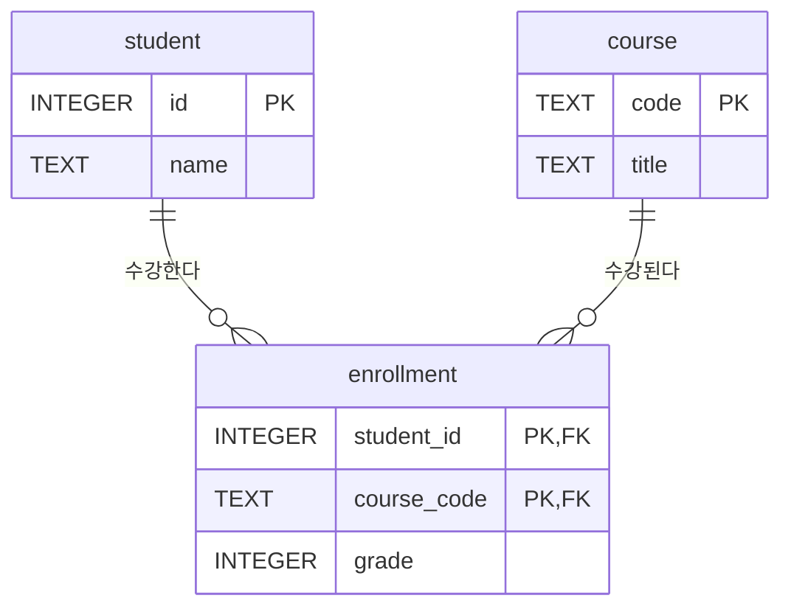
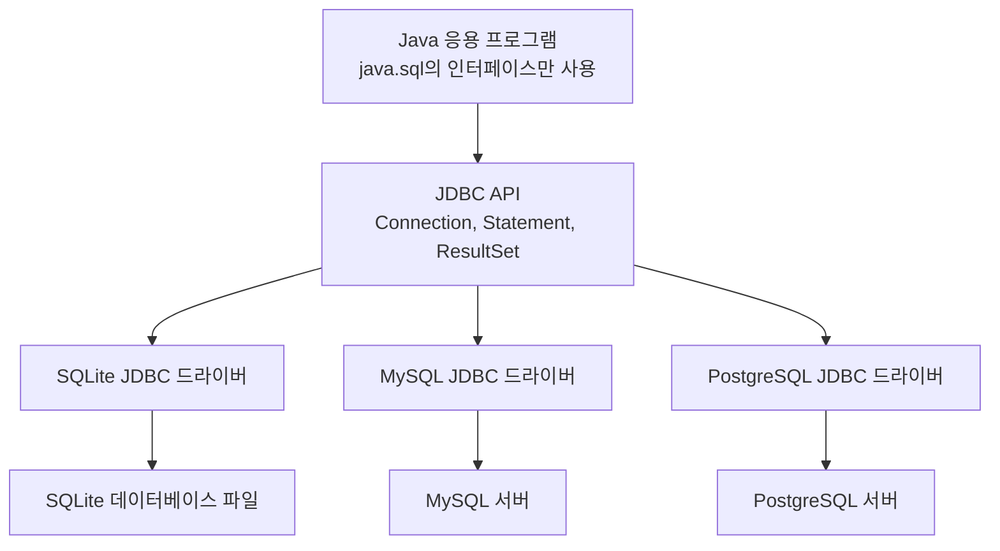
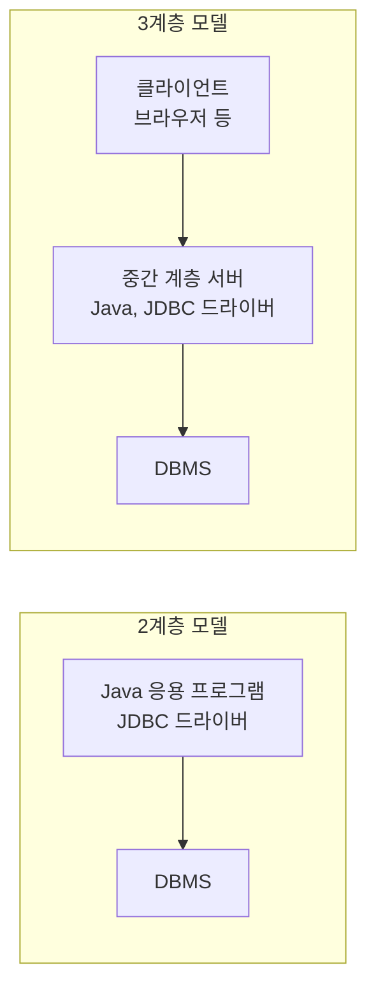
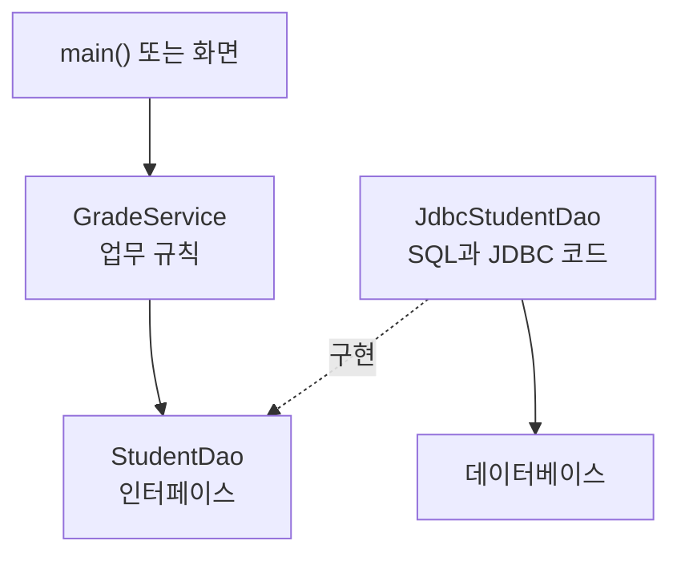

# 17강 — JDBC 데이터베이스 프로그래밍

[레포지토리 안내](../../README.ko.md) | [English](Concepts_Lecture.md) | [한국어](Concepts_Lecture.ko.md)

> **최종 수정일:** 2026-11-27

> **학습 목표:**
> 1. 테이블, 행, 열, 기본 키, 외래 키의 개념을 설명하고 CRUD, JOIN, GROUP BY를 쓰는 SQL 문을 작성할 수 있다
> 2. JDBC API와 드라이버의 관계, 드라이버의 종류를 설명하고 연결 URL로 데이터베이스에 연결할 수 있다
> 3. Statement와 PreparedStatement로 SQL을 실행하고 ResultSet의 값을 SQL 타입에 맞는 Java 타입으로 읽을 수 있다
> 4. SQL 주입이 일어나는 원리를 설명하고 PreparedStatement로 막을 수 있다
> 5. 자동 커밋을 끄고 commit(), rollback(), 저장점, 일괄 처리로 트랜잭션을 처리하며 고립 수준을 설명할 수 있다
> 6. try-with-resources, SQLException, DAO 계층으로 연결과 오류를 관리하는 프로그램을 구성할 수 있다

---

## 목차

- [1. 관계형 데이터베이스와 SQL](#1-관계형-데이터베이스와-sql)
  - [1.1 테이블, 행, 열, 기본 키](#11-테이블-행-열-기본-키)
  - [1.2 이 강의에서 쓰는 SQL](#12-이-강의에서-쓰는-sql)
  - [1.3 여러 테이블과 외래 키](#13-여러-테이블과-외래-키)
  - [1.4 JOIN과 GROUP BY](#14-join과-group-by)
- [2. JDBC의 구조](#2-jdbc의-구조)
  - [2.1 JDBC API와 드라이버](#21-jdbc-api와-드라이버)
  - [2.2 연결 URL과 DriverManager](#22-연결-url과-drivermanager)
  - [2.3 드라이버의 종류와 계층 구조](#23-드라이버의-종류와-계층-구조)
- [3. SQL의 실행과 결과](#3-sql의-실행과-결과)
  - [3.1 Statement와 실행 메서드](#31-statement와-실행-메서드)
  - [3.2 ResultSet과 커서](#32-resultset과-커서)
  - [3.3 PreparedStatement](#33-preparedstatement)
  - [3.4 SQL 주입](#34-sql-주입)
  - [3.5 SQL 타입과 Java 타입](#35-sql-타입과-java-타입)
  - [3.6 생성된 키와 메타데이터](#36-생성된-키와-메타데이터)
- [4. CRUD 예제](#4-crud-예제)
  - [4.1 DAO로 나눈 계층](#41-dao로-나눈-계층)
- [5. 트랜잭션](#5-트랜잭션)
  - [5.1 자동 커밋과 트랜잭션](#51-자동-커밋과-트랜잭션)
  - [5.2 계좌 이체 예제](#52-계좌-이체-예제)
  - [5.3 고립 수준](#53-고립-수준)
  - [5.4 일괄 처리와 저장점](#54-일괄-처리와-저장점)
- [6. 자원 관리와 예외](#6-자원-관리와-예외)
  - [6.1 SQLException의 연쇄와 SQLState](#61-sqlexception의-연쇄와-sqlstate)
  - [6.2 확정하지 않은 트랜잭션과 연결 닫기](#62-확정하지-않은-트랜잭션과-연결-닫기)
- [7. 흔한 실수](#7-흔한-실수)
- [요약](#요약)
- [점검 문제](#점검-문제)
- [참고 문헌](#참고-문헌)

---

<br>

## 1. 관계형 데이터베이스와 SQL

### 1.1 테이블, 행, 열, 기본 키

10강의 파일은 프로그램이 정한 형식대로 바이트를 저장할 뿐, 원하는 자료를 찾거나 여러 프로그램이 동시에 고치는 일은 프로그램이 직접 처리해야 했다. **데이터베이스 관리 시스템(DBMS)** 은 데이터를 저장하고, 질의로 찾아 주고, 여러 사용자의 동시 접근과 장애로부터 데이터를 지키는 소프트웨어이다. 가장 널리 쓰이는 관계형 DBMS(MySQL, PostgreSQL, Oracle, SQLite 등)는 데이터를 표 모양의 **테이블(table)** 에 저장한다.

| id | name | score |
|:-----|:-----|:-----|
| 1 | Kim | 90 |
| 2 | Lee | 55 |
| 3 | Park | 72 |

*표 1. 학생 테이블 student의 예*

테이블의 가로 한 줄을 **행(row)** 또는 레코드라 하고 객체 하나에 해당하며, 세로 한 줄을 **열(column)** 이라 하고 필드 하나에 해당한다. 열마다 정수, 문자열 같은 타입이 정해져 있다. 값이 없음을 나타내는 특별한 값은 `NULL`이다.

> **용어 정의:** **기본 키(primary key)** 는 테이블의 각 행을 하나씩 구별하는 열(또는 열의 묶음)이다. 기본 키의 값은 행마다 달라야 하고 `NULL`일 수 없으며, DBMS가 이 규칙을 지키도록 강제한다.

student 테이블에서는 학번 `id`가 기본 키이다. 이름은 같은 학생이 둘 있을 수 있으므로 기본 키가 될 수 없다. 9강 3.10절에서 `equals()`와 `hashCode()`로 객체의 같음을 정한 것처럼, 데이터베이스에서는 기본 키가 행의 같음을 정한다.

> **[데이터베이스]** 데이터베이스 과목은 관계형 모델의 이론, 여러 테이블에 데이터를 나누어 중복을 없애는 정규화, 빠른 검색을 위한 인덱스, 트랜잭션과 동시성 제어의 구현을 다룬다. 이 강의는 Java 프로그램이 JDBC로 데이터베이스를 쓰는 데 필요한 만큼만 SQL과 트랜잭션을 다룬다.

### 1.2 이 강의에서 쓰는 SQL

**SQL(Structured Query Language)** 은 관계형 데이터베이스에 테이블을 만들고, 데이터를 넣고, 찾고, 고치고, 지우는 명령을 쓰는 언어이다. 데이터를 다루는 네 가지 기본 연산인 생성(Create), 조회(Read), 수정(Update), 삭제(Delete)를 머리글자로 **CRUD**라 부르며, SQL에서는 각각 `INSERT`, `SELECT`, `UPDATE`, `DELETE`에 해당한다.

```sql
CREATE TABLE student (                      -- create a table
    id    INTEGER PRIMARY KEY,
    name  TEXT NOT NULL,                    -- cannot be left empty
    score INTEGER                           -- may be NULL
);

INSERT INTO student (id, name, score) VALUES (1, 'Kim', 90);   -- Create

SELECT id, name, score FROM student         -- Read
WHERE score >= 60                           -- only rows that match
ORDER BY id;                                -- in ascending order of id

UPDATE student SET score = score + 10 WHERE score < 60;        -- Update
DELETE FROM student WHERE id = 3;                              -- Delete

SELECT COUNT(*), AVG(score) FROM student;   -- number of rows and the average
```

SQL의 키워드는 대소문자를 가리지 않지만, 읽기 쉽도록 키워드를 대문자로 쓰는 것이 관례이다. 문자열 값은 작은따옴표로 감싸고, `--` 뒤는 주석이다. `WHERE`가 없는 `UPDATE`와 `DELETE`는 테이블의 모든 행에 적용되므로 특히 주의해야 한다.

`NULL`은 값이 없음을 뜻하므로 보통의 비교가 통하지 않는다. `score < 60`에서 `score`가 `NULL`이면 결과는 참도 거짓도 아닌 알 수 없음이 되어, 그 행은 `WHERE` 조건에 맞지 않는 것으로 처리된다. `NULL`인 행을 찾으려면 `score IS NULL`로 쓴다. `AVG()`, `SUM()` 같은 집계 함수는 `NULL`을 계산에서 빼고, `COUNT(*)`는 `NULL`과 관계없이 행의 수를 센다. 4절의 실행 결과에서 이 규칙을 확인할 수 있다.

### 1.3 여러 테이블과 외래 키

학생이 여러 과목을 수강한 기록을 student 테이블 하나에 담으려 하면, 과목마다 열을 늘리거나 같은 학생의 이름을 여러 행에 되풀이해야 한다. 열을 늘리면 수강 과목의 수가 열의 수로 제한되고, 이름을 되풀이하면 이름을 고칠 때 모든 행을 함께 고쳐야 하며 하나라도 빠뜨리면 데이터가 서로 어긋난다. 관계형 데이터베이스는 이런 데이터를 주제별 테이블로 나누고, 테이블 사이의 관계를 키 값으로 나타낸다. 학생(student), 과목(course), 어떤 학생이 어떤 과목을 들어 몇 점을 받았는지 담는 수강(enrollment)의 세 테이블로 나누면, 학생의 이름은 student에 한 번만 저장되고 enrollment는 학번과 과목 코드만 가진다.

> **용어 정의:** **외래 키(foreign key)** 는 한 테이블의 열(또는 열의 묶음)로서, 그 값이 참조하는 테이블(같은 테이블일 수도 있다)의 기본 키 값 가운데 하나이거나 `NULL`이어야 하는 열이다. DBMS는 가리킬 행이 없는 값을 넣는 변경과, 기본 설정에서는 다른 행이 가리키고 있는 행을 지우는 변경을 거부하여 테이블 사이의 참조가 끊어지지 않게 한다.

```sql
PRAGMA foreign_keys = ON;                   -- SQLite needs this on each connection

CREATE TABLE student (
    id   INTEGER PRIMARY KEY,
    name TEXT NOT NULL
);
CREATE TABLE course (
    code  TEXT PRIMARY KEY,
    title TEXT NOT NULL
);
CREATE TABLE enrollment (
    student_id  INTEGER NOT NULL REFERENCES student(id),    -- foreign key
    course_code TEXT    NOT NULL REFERENCES course(code),   -- foreign key
    grade       INTEGER,
    PRIMARY KEY (student_id, course_code)                   -- a two-column primary key
);

INSERT INTO student VALUES (1, 'Kim'), (2, 'Lee'), (3, 'Park'), (4, 'Choi');
INSERT INTO course VALUES ('OOP', 'Object-Oriented Programming'), ('DB', 'Databases');
INSERT INTO enrollment VALUES (1, 'OOP', 90), (1, 'DB', 85), (2, 'OOP', 55),
                              (3, 'OOP', 72), (3, 'DB', NULL);

INSERT INTO enrollment VALUES (9, 'OOP', 70);  -- student 9 does not exist
DELETE FROM student WHERE id = 1;              -- a student referenced by enrollments
```

```text
Error near line 23: FOREIGN KEY constraint failed
Error near line 24: FOREIGN KEY constraint failed
```

| student_id | course_code | grade |
|:-----|:-----|:-----|
| 1 | OOP | 90 |
| 1 | DB | 85 |
| 2 | OOP | 55 |
| 3 | OOP | 72 |
| 3 | DB | NULL |

*표 2. 수강 테이블 enrollment의 내용*



*그림 1. student, course, enrollment 테이블의 관계*

enrollment의 기본 키는 `PRIMARY KEY (student_id, course_code)`로 두 열을 묶은 것이다. 같은 학생이 같은 과목을 두 번 수강하는 행은 넣을 수 없다는 규칙을 DBMS가 지키게 된다. `student_id`는 student의 `id`를, `course_code`는 course의 `code`를 가리키는 외래 키이며, `REFERENCES 테이블(열)`로 선언한다. 한 학생은 수강 행을 여러 개 가질 수 있고 한 수강 행은 정확히 한 학생에 속하므로, student와 enrollment는 일대다(1:N) 관계이다. student와 course는 enrollment를 사이에 두고 다대다(M:N) 관계를 이룬다. 그림 1의 선 끝 기호는 student 쪽이 정확히 하나, enrollment 쪽이 0개 이상임을 나타낸다.

SQLite는 하위 호환을 위해 외래 키 검사가 기본으로 꺼져 있어, 연결마다 `PRAGMA foreign_keys = ON`으로 켜야 한다 [1]. 켠 상태에서 위 SQL의 마지막 두 문장은 모두 거부된다. 23번째 줄은 student에 없는 학번 9를 가리키는 수강 행을 넣으려 했고, 24번째 줄은 수강 행 두 개가 가리키고 있는 학생 1을 지우려 했기 때문이다. 검사를 켜지 않으면 두 문장이 모두 성공하여, 존재하지 않는 학생의 수강 기록이 남는다.

### 1.4 JOIN과 GROUP BY

여러 테이블에 나누어 저장한 데이터는 질의할 때 다시 잇는다. `JOIN`은 두 테이블의 행 가운데 `ON` 조건이 참인 쌍마다 두 행을 이어 붙인 행을 만든다. 집계 함수에 `GROUP BY`를 붙이면 테이블 전체가 아니라 같은 값을 가진 행의 묶음마다 집계한다. SQLite의 명령행 도구 `sqlite3`에서 `.headers on`, `.mode table`, `.nullvalue NULL`로 출력 형식을 정하고 1.3절의 테이블에 다음 SQL을 실행하면, 결과는 그 아래와 같다.

```sql
SELECT s.name, c.title, e.grade                 -- join three tables
FROM enrollment e
JOIN student s ON e.student_id = s.id
JOIN course  c ON e.course_code = c.code
ORDER BY s.id, c.code;

SELECT s.name, e.course_code                     -- students without enrollments too
FROM student s
LEFT JOIN enrollment e ON e.student_id = s.id
ORDER BY s.id, e.course_code;

SELECT course_code, COUNT(*), COUNT(grade),      -- one row per course
       AVG(grade), MAX(grade)
FROM enrollment
GROUP BY course_code
ORDER BY course_code;

SELECT s.name, COUNT(*) AS n                     -- a condition after grouping
FROM enrollment e JOIN student s ON e.student_id = s.id
GROUP BY s.id
HAVING COUNT(*) >= 2;
```

```text
+------+-----------------------------+-------+
| name |            title            | grade |
+------+-----------------------------+-------+
| Kim  | Databases                   |    85 |
| Kim  | Object-Oriented Programming |    90 |
| Lee  | Object-Oriented Programming |    55 |
| Park | Databases                   | NULL  |
| Park | Object-Oriented Programming |    72 |
+------+-----------------------------+-------+
+------+-------------+
| name | course_code |
+------+-------------+
| Kim  | DB          |
| Kim  | OOP         |
| Lee  | OOP         |
| Park | DB          |
| Park | OOP         |
| Choi | NULL        |
+------+-------------+
+-------------+----------+--------------+--------------------+------------+
| course_code | COUNT(*) | COUNT(grade) |     AVG(grade)     | MAX(grade) |
+-------------+----------+--------------+--------------------+------------+
| DB          |        2 |            1 |               85.0 |         85 |
| OOP         |        3 |            3 | 72.333333333333329 |         90 |
+-------------+----------+--------------+--------------------+------------+
+------+---+
| name | n |
+------+---+
| Kim  | 2 |
| Park | 2 |
+------+---+
```

첫 질의의 `JOIN`(`INNER JOIN`과 같다)은 enrollment의 각 행에 학번이 같은 student의 행과 과목 코드가 같은 course의 행을 이어 붙인다. `FROM enrollment e`처럼 테이블에 짧은 별칭을 붙이면 `s.name`, `e.grade`처럼 어느 테이블의 열인지 밝힐 수 있다. enrollment의 다섯 행이 모두 짝을 찾으므로 결과도 다섯 행이며, 수강 행이 없는 Choi는 짝이 없어 나오지 않는다.

`LEFT JOIN`은 왼쪽 테이블의 모든 행을 남기고, 짝이 없는 행은 오른쪽 테이블의 열을 `NULL`로 채운다. 그래서 둘째 결과에는 Choi가 `course_code`가 `NULL`인 행으로 나타나고, 행의 수는 짝이 있는 5행에 Choi의 1행을 더한 6행이다. 수강하지 않은 학생만 찾으려면 `LEFT JOIN` 뒤에 `WHERE e.student_id IS NULL`을 붙인다(1.2절의 `IS NULL`).

`GROUP BY course_code`는 행을 과목 코드별로 묶어 묶음마다 결과 한 행을 만든다. DB 묶음은 Kim의 85와 Park의 `NULL` 두 행이므로 `COUNT(*)`는 2이지만 `NULL`을 빼는 `COUNT(grade)`는 1이고, `AVG(grade)`와 `MAX(grade)`는 85이다. OOP 묶음의 평균은 (90 + 55 + 72) / 3 = 217 / 3 ≈ 72.33이다. 결과에 72.333333333333329로 나온 것은 실수를 이진 부동소수점으로 저장하기 때문이다(3강 2.6절). 표시되는 자릿수는 SQLite의 버전과 값을 읽는 방법에 따라 다르며, 위 결과는 sqlite3 3.54.0의 출력이고 이 강의의 JDBC 드라이버(SQLite 3.49.1)로 같은 값을 문자열로 읽으면 72.3333333333333이다. 묶은 결과의 각 열은 묶음마다 값이 하나로 정해져야 하므로, `SELECT`에는 묶는 열과 집계 함수를 쓴다. 넷째 질의의 `s.name`은 기본 키 `s.id`로 묶었으므로 묶음마다 이름이 하나이다.

`WHERE`는 묶기 전의 행을 거르고, `HAVING`은 묶은 뒤의 묶음을 거른다. 넷째 질의는 학생별로 수강 행을 세어 2개 이상인 학생만 남기므로 Kim과 Park이 나온다. 집계 함수의 결과는 묶은 뒤에야 정해지므로, 같은 조건을 `WHERE COUNT(*) >= 2`로 쓰면 SQLite는 "misuse of aggregate: COUNT()" 오류를 낸다. `SELECT` 문의 절은 `SELECT`, `FROM`, `JOIN`, `WHERE`, `GROUP BY`, `HAVING`, `ORDER BY`의 순서로 쓰지만, 논리적으로는 `FROM`과 `JOIN`으로 행을 만들고, `WHERE`로 거르고, `GROUP BY`로 묶고, `HAVING`으로 묶음을 거르고, `SELECT`의 식을 계산한 뒤 `ORDER BY`로 정렬하는 순서로 처리된다.

---

<br>

## 2. JDBC의 구조

### 2.1 JDBC API와 드라이버

DBMS마다 통신하는 방식이 다르므로, 프로그램이 DBMS의 방식을 직접 쓰면 DBMS를 바꿀 때 코드를 모두 고쳐야 한다. **JDBC(Java Database Connectivity)** 는 Java 프로그램이 관계형 데이터베이스에 연결하여 SQL을 실행하고 결과를 받는 표준 API이며, `java.sql` 패키지에 인터페이스로 정의되어 있다. 각 DBMS의 개발사는 이 인터페이스를 구현한 **JDBC 드라이버(JDBC driver)** 를 JAR 파일로 제공한다. 이 구조는 11강 4절의 인터페이스와 구현 클래스의 관계 그대로이다.



*그림 2. JDBC API와 DBMS별 드라이버의 관계*

| 인터페이스와 클래스 | 역할 |
|:-----|:-----|
| `DriverManager` | 연결 URL에 맞는 드라이버를 찾아 연결을 만든다 |
| `Connection` | 데이터베이스와의 연결 하나이며, 문장을 만들고 트랜잭션을 관리한다 |
| `Statement` | SQL 문을 실행한다 |
| `PreparedStatement` | 매개변수 자리(`?`)가 있는 미리 컴파일된 SQL 문을 실행한다 |
| `ResultSet` | `SELECT`의 결과인 행들을 커서로 하나씩 읽게 한다 |
| `SQLException` | 데이터베이스 작업의 오류를 나타내는 검사 예외이다 |

*표 3. JDBC의 주요 인터페이스와 클래스*

프로그램은 `java.sql`의 인터페이스 타입만 쓰고, 실제 객체는 드라이버의 클래스가 만든다. 예를 들어 `Connection conn`이 가리키는 객체의 클래스는 SQLite 드라이버의 클래스이지만, 프로그램은 그 이름을 알 필요가 없다. DBMS를 바꿀 때는 드라이버 JAR 파일과 연결 URL만 바꾸면 되고, 같은 SQL을 쓰는 한 나머지 코드는 그대로 쓸 수 있다.

### 2.2 연결 URL과 DriverManager

연결은 `DriverManager.getConnection(url)` 또는 `getConnection(url, user, password)`로 만든다. **연결 URL(connection URL)** 은 어떤 드라이버로 어디에 있는 어떤 데이터베이스에 연결할지를 나타내는 문자열이며, `jdbc:`로 시작하고 그다음에 드라이버를 가리키는 이름이 온다.

| DBMS | 연결 URL의 예 | 뜻 |
|:-----|:-----|:-----|
| SQLite | `jdbc:sqlite:school.db` | 작업 디렉터리의 파일 `school.db` (없으면 만든다) |
| MySQL | `jdbc:mysql://localhost:3306/school` | 이 컴퓨터의 3306번 포트에서 동작하는 서버의 `school` 데이터베이스 |
| PostgreSQL | `jdbc:postgresql://db.example.com:5432/school` | 다른 호스트의 5432번 포트에서 동작하는 서버의 `school` 데이터베이스 |

*표 4. 연결 URL의 예*

SQLite는 별도의 서버 없이 데이터베이스 전체를 파일 하나에 저장하므로, 드라이버 JAR 파일 하나만 있으면 바로 실습할 수 있다. MySQL과 PostgreSQL은 14강의 소켓으로 접속하는 서버이므로 URL에 호스트와 포트가 들어간다. 상대 경로의 파일은 10강 1.6절처럼 작업 디렉터리를 기준으로 찾는다.

`DriverManager`는 초기화될 때 클래스 경로에 있는 드라이버를 서비스 제공자 로딩 방식으로 찾아 등록한다 [2]. 그래서 드라이버 JAR 파일을 클래스 경로에 두기만 하면 되고, 옛날 코드에서 보던 `Class.forName("org.sqlite.JDBC")` 같은 드라이버 클래스 적재 문장은 필요 없다. 이 강의의 예제는 SQLite의 JDBC 드라이버 JAR 파일(`sqlite-jdbc-3.49.1.0.jar`)을 클래스 경로에 넣어 다음과 같이 실행한다. 클래스 경로의 구분자는 macOS와 Linux에서 `:`, Windows에서 `;`이다. SQLite 드라이버는 JNI로 네이티브 라이브러리를 적재하는데, 최근 JDK는 이런 적재에 경고를 출력하므로 `--enable-native-access=ALL-UNNAMED` 옵션으로 허용한다.

```text
javac StudentCrud.java
java --enable-native-access=ALL-UNNAMED -cp .:sqlite-jdbc-3.49.1.0.jar StudentCrud
```

드라이버가 클래스 경로에 없으면 `getConnection()`이 "No suitable driver found for jdbc:sqlite:school.db" 같은 메시지의 `SQLException`을 던진다.

### 2.3 드라이버의 종류와 계층 구조

JDBC 드라이버는 DBMS와 통신하는 방식에 따라 흔히 네 가지로 나눈다.

| 종류 | 이름 | 동작 방식 |
|:-----|:-----|:-----|
| 1형 | JDBC-ODBC 브리지 | JDBC 호출을 ODBC 호출로 바꾸어 ODBC 드라이버에 넘긴다 |
| 2형 | 네이티브 API 드라이버 | JDBC 호출을 DBMS 개발사의 클라이언트 라이브러리(네이티브 코드)의 호출로 바꾼다 |
| 3형 | 네트워크 프로토콜 드라이버 | DBMS와 무관한 프로토콜로 미들웨어 서버에 요청을 보내고, 미들웨어가 DBMS에 맞게 바꾼다 |
| 4형 | 순수 Java 드라이버 | DBMS의 네트워크 프로토콜을 Java만으로 구현하여 DBMS와 직접 통신한다 |

*표 5. JDBC 드라이버의 네 가지 종류*

1형과 2형은 클라이언트 컴퓨터마다 ODBC 드라이버나 네이티브 라이브러리를 설치해야 하므로 배포가 번거롭다. Java SE 7 문서는 JDK에 들어 있던 JDBC-ODBC 브리지를 과도기의 해법으로 보고 JDK 8에서 제거한다고 밝히면서, 브리지 대신 DBMS 개발사가 제공하는 JDBC 드라이버를 쓰도록 권했다 [3]. 4형 드라이버는 JAR 파일 하나만 클래스 경로에 두면 어느 플랫폼에서나 동작한다. 이 강의의 SQLite 드라이버는 서버가 없는 내장형 DBMS의 드라이버로, JAR 파일 안에 플랫폼별 SQLite 네이티브 라이브러리를 담고 있다가 JNI로 적재한다(2.2절). 그래서 JAR 파일 하나로 배포할 수 있지만 네이티브 코드를 쓴다는 점에서 4형과 다르다.

응용 프로그램이 데이터베이스를 쓰는 구성도 두 가지로 나눈다 [4]. 2계층 모델에서는 응용 프로그램이 JDBC 드라이버로 데이터 원본과 직접 통신하며, 사용자의 컴퓨터가 클라이언트, 데이터베이스가 있는 컴퓨터가 서버이다. 3계층 모델에서는 응용 프로그램이 중간 계층의 서비스에 명령을 보내고, 중간 계층이 데이터 원본에 명령을 보내 받은 결과를 다시 사용자에게 돌려준다. 중간 계층은 회사의 데이터에 대한 접근과 변경의 종류를 통제할 수 있게 하고, 응용 프로그램의 배포를 단순하게 하며, 많은 경우 성능에도 유리하다 [4]. 웹 서비스에서는 브라우저가 클라이언트, 웹 응용 서버가 중간 계층, DBMS가 데이터 원본이며, JDBC 코드는 중간 계층의 서버에서 실행된다.



*그림 3. 2계층 모델과 3계층 모델*

---

<br>

## 3. SQL의 실행과 결과

### 3.1 Statement와 실행 메서드

`conn.createStatement()`가 반환하는 `Statement`는 완성된 SQL 문자열을 실행한다. SQL의 종류에 따라 다른 메서드를 쓴다.

| 메서드 | 쓰는 SQL | 반환값 |
|:-----|:-----|:-----|
| `executeQuery(sql)` | `SELECT` | 결과 행을 담은 `ResultSet` |
| `executeUpdate(sql)` | `INSERT`, `UPDATE`, `DELETE`, `CREATE TABLE` 등 | 영향을 받은 행의 수 (`CREATE TABLE` 등은 0) |
| `execute(sql)` | 어느 것이든 | 결과가 `ResultSet`이면 `true` |

*표 6. Statement의 실행 메서드*

`executeUpdate()`의 반환값은 바뀐 행의 수이므로, `UPDATE`나 `DELETE`가 실제로 몇 행에 적용되었는지 확인하는 데 쓴다. 조건에 맞는 행이 없으면 오류가 아니라 0이 반환된다.

### 3.2 ResultSet과 커서

`executeQuery()`가 반환하는 `ResultSet`은 결과 행들의 현재 위치를 가리키는 **커서(cursor)** 를 가진다. 처음에 커서는 첫 행의 앞에 있고, `next()`는 커서를 다음 행으로 옮기며 더 이상 행이 없으면 `false`를 반환하므로 `while` 반복문으로 모든 행을 읽을 수 있다 [5]. 9강의 `Iterator`와 같은 방식이다.

```java
try (ResultSet rs = st.executeQuery("SELECT id, name, score FROM student ORDER BY id")) {
    while (rs.next()) {                      // the first call moves to the first row
        int id = rs.getInt("id");            // read by column name
        String name = rs.getString(2);       // read by column number (from 1)
        System.out.println(id + " " + name);
    }
}
```

현재 행의 값은 열의 타입에 맞는 `getXxx()` 메서드로 읽으며, 인자로 열 이름이나 열 번호를 준다. 열 번호는 0이 아니라 1부터 센다는 점에 주의해야 한다.

| SQL 타입 | `ResultSet`의 메서드 | Java 타입 |
|:-----|:-----|:-----|
| `INTEGER` | `getInt()` | `int` |
| `BIGINT` | `getLong()` | `long` |
| `DOUBLE`, `FLOAT` | `getDouble()` | `double` |
| `CHAR`, `VARCHAR`, `TEXT` | `getString()` | `String` |
| `BOOLEAN` | `getBoolean()` | `boolean` |
| `DATE` | `getDate()` 또는 `getObject(i, LocalDate.class)` | `java.sql.Date`, `LocalDate` |
| `DECIMAL`, `NUMERIC` | `getBigDecimal()` | `java.math.BigDecimal` |
| `TIMESTAMP` | `getTimestamp()` 또는 `getObject(i, LocalDateTime.class)` | `java.sql.Timestamp`, `LocalDateTime` |
| `BINARY`, `VARBINARY` | `getBytes()` | `byte[]` |

*표 7. SQL 타입과 ResultSet 메서드의 대응*

값이 `NULL`인 열을 `getInt()`로 읽으면 0이 반환되므로, 0점과 점수 없음을 구별할 수 없다. 이때는 값을 읽은 직후 `rs.wasNull()`을 호출하여 방금 읽은 값이 `NULL`이었는지 확인한다(4절). 또는 `rs.getObject("score")`로 읽으면 `NULL`이 `null`로 돌아온다. 래퍼 타입을 지정하는 `rs.getObject("score", Integer.class)`가 `NULL`을 어떻게 다루는지는 드라이버에 따라 다르며, 3.5절에서 보듯 이 강의의 SQLite 드라이버는 예외를 던진다.

### 3.3 PreparedStatement

SQL에 들어갈 값이 실행할 때마다 달라지면 `PreparedStatement`를 쓴다. SQL 문의 값이 들어갈 자리에 `?`를 쓰고, 실행하기 전에 `setXxx(번호, 값)`으로 자리마다 값을 정한다. 번호는 왼쪽의 `?`부터 1, 2, 3이다.

```java
String sql = "INSERT INTO student (id, name, score) VALUES (?, ?, ?)";
try (PreparedStatement ps = conn.prepareStatement(sql)) {
    ps.setInt(1, 5);
    ps.setString(2, "Jung");
    ps.setNull(3, Types.INTEGER);            // NULL in the third placeholder
    ps.executeUpdate();
}
```

`PreparedStatement`는 미리 컴파일되어 저장된 SQL 문이며, 같은 문장을 값만 바꾸어 여러 번 효율적으로 실행할 수 있다 [6]. 값을 문자열 연결로 SQL에 끼워 넣지 않으므로, 문자열 안의 작은따옴표를 신경 쓸 필요가 없고 3.4절의 SQL 주입을 막는다. 여러 행을 넣을 때는 값을 정할 때마다 `addBatch()`로 모았다가 `executeBatch()`로 한 번에 보내면 데이터베이스와 주고받는 횟수가 줄어든다(4절).

### 3.4 SQL 주입

사용자가 입력한 값을 문자열 연결로 SQL에 넣으면, 입력에 SQL의 문법이 섞여 들어가 문장의 뜻이 바뀔 수 있다. 이 공격을 **SQL 주입(SQL injection)** 이라고 한다. 다음 프로그램은 이름으로 학생을 찾는 질의에 공격자가 만든 문자열을 넣는다.

```java
import java.sql.*;

public class Injection {
    public static void main(String[] args) throws SQLException {
        try (Connection conn = DriverManager.getConnection("jdbc:sqlite:school.db")) {
            String input = "nobody' OR '1'='1";                                 // a name typed by an attacker

            String sql = "SELECT name FROM student WHERE name = '" + input + "'";
            System.out.println("built SQL: " + sql);
            try (Statement st = conn.createStatement(); ResultSet rs = st.executeQuery(sql)) {
                int n = 0;
                while (rs.next()) n++;
                System.out.println("Statement matched " + n + " rows");
            }

            try (PreparedStatement ps = conn.prepareStatement("SELECT name FROM student WHERE name = ?")) {
                ps.setString(1, input);                                          // used only as a value
                try (ResultSet rs = ps.executeQuery()) {
                    int n = 0;
                    while (rs.next()) n++;
                    System.out.println("PreparedStatement matched " + n + " rows");
                }
            }
        }
    }
}
```

```text
built SQL: SELECT name FROM student WHERE name = 'nobody' OR '1'='1'
Statement matched 3 rows
PreparedStatement matched 0 rows
```

입력 `nobody' OR '1'='1`이 문자열 연결로 들어가면, 작은따옴표가 문자열을 일찍 닫고 `OR '1'='1'`이 조건으로 붙는다. 완성된 SQL의 조건은 이름이 nobody이거나 '1'이 '1'과 같다는 뜻이 되고, 뒤의 비교가 항상 참이므로 테이블의 모든 행 3개가 나온다. 로그인 확인처럼 조건이 참인지로 권한을 주는 코드라면 비밀번호 없이 통과하게 된다.

`PreparedStatement`에 같은 문자열을 `setString()`으로 넣으면 0행이 나온다. 드라이버가 입력 전체를 하나의 문자열 값으로 다루므로, 작은따옴표를 포함한 그 문자열과 정확히 같은 이름을 가진 학생을 찾을 뿐 문장의 구조는 바뀌지 않는다. 그러므로 사용자가 입력한 값은 어떤 경우에도 문자열 연결로 SQL에 넣지 않고 `?` 자리에 넣는다.

> **[정보보호]** SQL 주입은 입력을 코드로 해석하게 만드는 주입 공격의 한 종류이며, 웹 응용 프로그램에서 오랫동안 가장 흔한 취약점 가운데 하나였다. 정보보호 과목은 이런 공격의 유형과 입력 검증, 최소 권한 원칙 같은 방어를 함께 다룬다.

### 3.5 SQL 타입과 Java 타입

표 7은 SQL 타입과 그 값을 읽는 메서드, Java 타입의 대표적인 대응이며, 각 행의 Java 타입은 JDBC가 정한 대응을 따른다. `TEXT`는 여러 DBMS가 쓰는 문자열 타입의 이름이고, 나머지는 `java.sql.Types`의 상수(`Types.INTEGER`, `Types.VARCHAR` 등)로 나타내는 JDBC의 SQL 타입이다. 이 상수는 `setNull(i, Types.INTEGER)`나 `setObject(i, 값, Types.INTEGER)`처럼 값의 SQL 타입을 밝힐 때 쓴다. 금액처럼 정확한 십진수가 필요한 값은 `DECIMAL(10,2)` 같은 고정 소수점 타입으로 저장하고 Java에서는 `BigDecimal`로 다룬다. `double`은 이진 부동소수점이라 0.10을 정확히 나타내지 못하기 때문이다(3강 2.6절). 다음 프로그램은 여러 타입의 열을 만들어 값을 넣고 다시 읽는다.

```java
import java.math.BigDecimal;
import java.sql.*;
import java.time.LocalDate;

public class TypesDemo {
    public static void main(String[] args) throws SQLException {
        try (Connection conn = DriverManager.getConnection("jdbc:sqlite:shop.db")) {
            try (Statement st = conn.createStatement()) {
                st.executeUpdate("DROP TABLE IF EXISTS item");
                st.executeUpdate("CREATE TABLE item (id INTEGER PRIMARY KEY, name TEXT, "
                        + "price DECIMAL(10,2), qty INTEGER, sold DATE, active BOOLEAN)");
            }
            try (PreparedStatement ps = conn.prepareStatement("INSERT INTO item VALUES (?, ?, ?, ?, ?, ?)")) {
                ps.setInt(1, 1);
                ps.setString(2, "pen");
                ps.setBigDecimal(3, new BigDecimal("0.10"));                     // an exact decimal
                ps.setObject(4, "123");                                          // a string into an integer column
                ps.setString(5, LocalDate.of(2025, 6, 9).toString());           // stored as an ISO string
                ps.setBoolean(6, true);
                ps.executeUpdate();
            }
            String q = "SELECT name, price, qty, sold, active, typeof(qty), typeof(price), typeof(active) FROM item";
            try (Statement st = conn.createStatement(); ResultSet rs = st.executeQuery(q)) {
                rs.next();
                ResultSetMetaData md = rs.getMetaData();
                for (int c = 1; c <= 5; c++) {
                    Object v = rs.getObject(c);
                    System.out.printf("%-6s declared %-8s getObject -> %s (%s)%n", md.getColumnName(c),
                            md.getColumnTypeName(c), v, v == null ? "null" : v.getClass().getSimpleName());
                }
                System.out.println("stored classes: qty " + rs.getString(6) + ", price " + rs.getString(7)
                        + ", active " + rs.getString(8));
                System.out.println("getInt(qty) " + rs.getInt("qty") + ", getString(qty) \"" + rs.getString("qty") + "\"");
                System.out.println("getBigDecimal(price) " + rs.getBigDecimal("price")
                        + ", getBoolean(active) " + rs.getBoolean("active"));
                System.out.println("sold as LocalDate " + LocalDate.parse(rs.getString("sold")).plusDays(30));
            }

            double d = 0;
            BigDecimal b = BigDecimal.ZERO;
            for (int i = 0; i < 3; i++) { d += 0.10; b = b.add(new BigDecimal("0.10")); }
            System.out.println("three pens: double " + d + ", BigDecimal " + b);

            try (Statement st = conn.createStatement(); ResultSet rs = st.executeQuery("SELECT 'abc', NULL")) {
                rs.next();
                System.out.println("getInt('abc') " + rs.getInt(1) + ", getInt(NULL) " + rs.getInt(2)
                        + " wasNull " + rs.wasNull() + ", getObject(NULL) " + rs.getObject(2));
                try {
                    System.out.println("getObject(NULL, Integer.class) " + rs.getObject(2, Integer.class));
                } catch (SQLException e) {
                    System.out.println("getObject(NULL, Integer.class) -> SQLException: " + e.getMessage());
                }
            }
        }
    }
}
```

```text
name   declared TEXT     getObject -> pen (String)
price  declared DECIMAL  getObject -> 0.1 (Double)
qty    declared INTEGER  getObject -> 123 (Integer)
sold   declared DATE     getObject -> 2025-06-09 (String)
active declared BOOLEAN  getObject -> 1 (Integer)
stored classes: qty integer, price real, active integer
getInt(qty) 123, getString(qty) "123"
getBigDecimal(price) 0.1, getBoolean(active) true
sold as LocalDate 2025-07-09
three pens: double 0.30000000000000004, BigDecimal 0.30
getInt('abc') 0, getInt(NULL) 0 wasNull true, getObject(NULL) null
getObject(NULL, Integer.class) -> SQLException: Bad value for type Integer
```

출력의 앞 다섯 줄은 `getObject()`가 돌려준 객체의 클래스이다. `DECIMAL`로 선언한 price는 `Double`로, `DATE`로 선언한 sold는 `String`으로, `BOOLEAN`으로 선언한 active는 정수 1로 돌아왔다. 열의 타입을 엄격히 지키는 DBMS라면 각각 `BigDecimal`, 날짜, 불리언으로 돌아왔을 값이다. SQLite는 `STRICT`로 선언한 테이블(3.37.0부터)이 아니면 값의 타입이 열이 아니라 값 자신에 붙는 동적 타입 시스템을 쓰며, 열에 선언한 타입은 그 열이 선호하는 저장 방식인 **타입 친화성(type affinity)** 만 정한다 [7]. 불리언을 위한 저장 형식이 따로 없어 참과 거짓은 정수 1과 0으로 저장되고, 날짜를 위한 저장 형식도 없어 날짜는 ISO 8601 문자열 같은 텍스트나 수로 저장한다 [7]. `typeof()`로 확인한 저장 형식에서 정수 열에 문자열 "123"으로 넣은 qty는 정수로 바뀌어 저장되었고, `DECIMAL` 열의 0.10은 실수로 저장되었다.

이 차이는 결과에 그대로 나타난다. `getBigDecimal("price")`는 0.10이 아니라 0.1을 돌려주어 소수점 아래 둘째 자리의 0, 곧 스케일 2가 사라졌다. 고정 소수점을 그대로 지키는 DBMS라면 0.10이 돌아온다. 펜 세 개의 값을 더하면 `double`로는 0.30000000000000004가 되고 `BigDecimal`로는 정확히 0.30이 된다. 날짜는 `LocalDate.toString()`이 만드는 ISO 문자열(2025-06-09)로 저장했다가 `LocalDate.parse()`로 다시 읽어, 30일 뒤인 2025-07-09를 계산했다. 날짜 형식이 없는 DBMS에서는 문자열의 정렬 순서가 날짜의 순서와 같은 ISO 형식으로 저장하는 것이 안전하다.

마지막 두 줄은 변환할 수 없는 값과 `NULL`이다. SQLite 드라이버는 숫자가 아닌 문자열 'abc'도 예외 없이 0으로 읽으므로, `getInt()`가 돌려준 0만으로는 실제 0, `NULL`, 변환 실패를 구별할 수 없다. `NULL`은 `getInt()` 다음의 `wasNull()`이나 `getObject(i)`로 확인할 수 있다. 래퍼 클래스를 지정하는 `getObject(i, Integer.class)`는 이 드라이버에서 `NULL`에 `SQLException`을 던졌다. 이처럼 드라이버마다 다를 수 있는 동작에 기대지 않으려면, 열에는 그 값에 맞는 타입을 선언하고, 값은 선언한 타입의 `getXxx()`로 읽으며, `NULL`은 `wasNull()`로 확인한다.

### 3.6 생성된 키와 메타데이터

기본 키를 프로그램이 정하지 않고 DBMS가 정하게 하는 일이 많다. 키를 만드는 문법은 DBMS마다 다르지만(SQLite는 `INTEGER PRIMARY KEY AUTOINCREMENT`), 새 행의 키를 돌려받는 방법은 JDBC가 통일한다. 문장을 준비할 때 `Statement.RETURN_GENERATED_KEYS`를 넘기고, 실행한 뒤 `getGeneratedKeys()`가 돌려주는 `ResultSet`에서 키를 읽는다 [8].

```java
import java.sql.*;

public class KeysAndMeta {
    public static void main(String[] args) throws SQLException {
        try (Connection conn = DriverManager.getConnection("jdbc:sqlite:club.db")) {
            try (Statement st = conn.createStatement()) {
                st.executeUpdate("DROP TABLE IF EXISTS member");
                st.executeUpdate("CREATE TABLE member (id INTEGER PRIMARY KEY AUTOINCREMENT, "   // the DBMS chooses the key
                        + "name TEXT NOT NULL, joined TEXT DEFAULT CURRENT_DATE)");
            }
            String sql = "INSERT INTO member (name) VALUES (?)";
            try (PreparedStatement ps = conn.prepareStatement(sql, Statement.RETURN_GENERATED_KEYS)) {
                for (String name : new String[] {"Kim", "Lee"}) {
                    ps.setString(1, name);
                    ps.executeUpdate();
                    try (ResultSet keys = ps.getGeneratedKeys()) {               // the key just generated
                        keys.next();
                        System.out.println(name + " got id " + keys.getLong(1));
                    }
                }
            }

            try (Statement st = conn.createStatement();
                 ResultSet rs = st.executeQuery("SELECT id, name, length(name) AS len FROM member")) {
                ResultSetMetaData md = rs.getMetaData();                         // information about the result's columns
                int n = md.getColumnCount();
                for (int c = 1; c <= n; c++)
                    System.out.println("column " + c + ": label=" + md.getColumnLabel(c) + ", type=" + md.getColumnTypeName(c)
                            + ", nullable=" + (md.isNullable(c) == ResultSetMetaData.columnNoNulls ? "no" : "yes/unknown"));
                while (rs.next()) {
                    StringBuilder sb = new StringBuilder();
                    for (int c = 1; c <= n; c++) sb.append(md.getColumnLabel(c)).append('=').append(rs.getObject(c)).append(' ');
                    System.out.println(sb.toString().trim());
                }
                System.out.println("result set type forward only? " + (rs.getType() == ResultSet.TYPE_FORWARD_ONLY));
            }

            DatabaseMetaData db = conn.getMetaData();
            try (ResultSet tables = db.getTables(null, null, "%", new String[] {"TABLE"})) {
                StringBuilder sb = new StringBuilder("tables:");
                while (tables.next()) sb.append(' ').append(tables.getString("TABLE_NAME"));
                System.out.println(sb);
            }
            System.out.println("scrollable result sets supported? "
                    + db.supportsResultSetType(ResultSet.TYPE_SCROLL_INSENSITIVE));
            try (Statement st = conn.createStatement(ResultSet.TYPE_SCROLL_INSENSITIVE, ResultSet.CONCUR_READ_ONLY)) {
                st.executeQuery("SELECT * FROM member");
            } catch (SQLException e) {
                System.out.println("SQLException: " + e.getMessage());
            }
        }
    }
}
```

```text
Kim got id 1
Lee got id 2
column 1: label=id, type=INTEGER, nullable=yes/unknown
column 2: label=name, type=TEXT, nullable=no
column 3: label=len, type=INTEGER, nullable=yes/unknown
id=1 name=Kim len=3
id=2 name=Lee len=3
result set type forward only? true
tables: member
scrollable result sets supported? false
SQLException: SQLite only supports TYPE_FORWARD_ONLY cursors
```

Kim과 Lee는 DBMS가 정한 키 1과 2를 받았다. 키를 돌려받지 않고 넣은 뒤에 `SELECT MAX(id)`로 찾으면, 그사이 다른 연결이 행을 넣었을 때 남의 키를 얻게 된다. joined 열은 값을 주지 않았으므로 `DEFAULT CURRENT_DATE`에 따라 그날의 날짜가 들어간다.

`ResultSetMetaData`는 결과의 열 수, 각 열의 이름과 레이블, SQL 타입의 이름, `NULL` 허용 여부를 알려 준다. 위 프로그램은 열의 이름을 코드에 적지 않고도 어떤 `SELECT`의 결과든 출력할 수 있다. 계산된 열 `length(name)`은 `AS`로 붙인 레이블 len으로 나타나며, 레이블은 `getColumnLabel()`로 읽는다. `NOT NULL`로 선언한 name만 `NULL`을 허용하지 않는다고 보고되었다. 화면에 표를 그리는 프로그램은 이 정보로 열 머리글과 열의 개수를 정한다.

`DatabaseMetaData`는 데이터베이스와 드라이버 전체의 정보이다. 4절에서 읽은 제품 이름과 버전 외에, `getTables()`로 테이블의 목록을, `supportsXxx()` 메서드로 지원하는 기능을 알 수 있다. 결과 집합에는 앞으로만 움직이는 `TYPE_FORWARD_ONLY`, 앞뒤로 움직일 수 있고 다른 곳의 변경을 대체로 반영하지 않는 `TYPE_SCROLL_INSENSITIVE`, 변경을 대체로 반영하는 `TYPE_SCROLL_SENSITIVE`의 세 종류가 있다 [5]. 스크롤할 수 있는 결과 집합에서는 `previous()`, `absolute(n)`, `last()` 등으로 커서를 움직인다. SQLite 드라이버는 앞으로만 움직이는 결과 집합만 지원하므로 `supportsResultSetType()`이 `false`이고, 스크롤할 수 있는 문장을 만들려 하면 `SQLException`이 난다. 이처럼 특정 기능에 기대는 코드는 `DatabaseMetaData`로 먼저 확인한다.

---

<br>

## 4. CRUD 예제

다음 프로그램은 student 테이블을 만들고 생성, 조회, 수정, 삭제를 모두 실행한다.

```java
import java.sql.*;

public class StudentCrud {
    static final String URL = "jdbc:sqlite:school.db";             // connect to the file school.db

    public static void main(String[] args) throws SQLException {
        try (Connection conn = DriverManager.getConnection(URL)) {
            DatabaseMetaData meta = conn.getMetaData();
            System.out.println("connected: " + meta.getDatabaseProductName() + " " + meta.getDatabaseProductVersion()
                    + ", driver " + meta.getDriverName());

            try (Statement st = conn.createStatement()) {
                st.executeUpdate("DROP TABLE IF EXISTS student");
                st.executeUpdate("CREATE TABLE student ("
                        + "id INTEGER PRIMARY KEY, name TEXT NOT NULL, score INTEGER)");
            }

            String insert = "INSERT INTO student (id, name, score) VALUES (?, ?, ?)";
            try (PreparedStatement ps = conn.prepareStatement(insert)) {          // Create
                Object[][] rows = {{1, "Kim", 90}, {2, "Lee", 55}, {3, "Park", 72}, {4, "Choi", null}};
                for (Object[] r : rows) {
                    ps.setInt(1, (Integer) r[0]);
                    ps.setString(2, (String) r[1]);
                    if (r[2] == null) ps.setNull(3, Types.INTEGER);
                    else ps.setInt(3, (Integer) r[2]);
                    ps.addBatch();                                                // send together
                }
                int[] counts = ps.executeBatch();
                System.out.println("inserted rows: " + counts.length);
            }

            printAll(conn, "after insert");                                       // Read

            try (PreparedStatement ps = conn.prepareStatement(
                    "UPDATE student SET score = score + ? WHERE score < ?")) {     // Update
                ps.setInt(1, 10);
                ps.setInt(2, 60);
                System.out.println("updated rows: " + ps.executeUpdate());
            }

            try (PreparedStatement ps = conn.prepareStatement("DELETE FROM student WHERE id = ?")) {  // Delete
                ps.setInt(1, 3);
                System.out.println("deleted rows: " + ps.executeUpdate());
            }
            printAll(conn, "after update and delete");

            try (Statement st = conn.createStatement();
                 ResultSet rs = st.executeQuery("SELECT COUNT(*), AVG(score) FROM student")) {
                rs.next();
                System.out.printf("count %d, average score %.2f%n", rs.getInt(1), rs.getDouble(2));
            }
        }
    }

    static void printAll(Connection conn, String title) throws SQLException {
        System.out.println("-- " + title);
        String sql = "SELECT id, name, score FROM student ORDER BY id";
        try (Statement st = conn.createStatement();
             ResultSet rs = st.executeQuery(sql)) {
            while (rs.next()) {                                                   // move the cursor to the next row
                int id = rs.getInt("id");
                String name = rs.getString("name");
                int score = rs.getInt("score");
                String shown = rs.wasNull() ? "NULL" : String.valueOf(score);     // was the value just read NULL
                System.out.println(id + " " + name + " " + shown);
            }
        }
    }
}
```

```text
connected: SQLite 3.49.1, driver SQLite JDBC
inserted rows: 4
-- after insert
1 Kim 90
2 Lee 55
3 Park 72
4 Choi NULL
updated rows: 1
deleted rows: 1
-- after update and delete
1 Kim 90
2 Lee 65
4 Choi NULL
count 3, average score 77.50
```

실행을 단계별로 추적하면 다음과 같다.

1. **연결:** `getConnection()`이 작업 디렉터리에 `school.db`를 열거나 새로 만든다. `DatabaseMetaData`에서 읽은 첫 줄은 SQLite 3.49.1에 SQLite JDBC 드라이버로 연결되었음을 보여 준다. `Connection`은 try-with-resources로 열었으므로 `main()`이 끝나면 닫힌다.
2. **테이블 생성:** `DROP TABLE IF EXISTS`로 이전 실행에서 만든 테이블을 지우고 `CREATE TABLE`로 새로 만든다. 이 문장들은 값이 바뀌지 않으므로 `Statement`로 실행했다.
3. **생성(Create):** `PreparedStatement` 하나로 네 행을 넣는다. 행마다 세 자리의 값을 정하고 `addBatch()`로 모은 뒤 `executeBatch()`로 한 번에 실행하며, 반환된 배열의 길이 4가 실행된 문장의 수이다. Choi의 점수는 `setNull()`로 `NULL`을 넣었다.
4. **조회(Read):** `printAll()`이 `ORDER BY id`로 정렬된 행을 읽는다. Choi의 `getInt("score")`는 0을 반환하지만 바로 뒤의 `wasNull()`이 `true`이므로 `NULL`로 출력된다.
5. **수정(Update):** 60점 미만인 학생에게 10점을 더한다. 조건에 맞는 행은 55점인 Lee 하나이므로 `executeUpdate()`가 1을 반환한다. Choi의 점수는 `NULL`이어서 `score < 60`이 참이 아니므로(1.2절) 바뀌지 않는다.
6. **삭제(Delete):** `id`가 3인 Park을 지워 1을 반환한다.
7. **집계:** 남은 행은 3개이므로 `COUNT(*)`는 3이고, `AVG(score)`는 `NULL`인 Choi를 빼고 (90 + 65) / 2 = 77.50이다. `NULL`을 0으로 계산했다면 (90 + 65 + 0) / 3 = 51.67이 되었을 것이다.

이 프로그램에서 SQL 문은 모두 문자열 상수이고, 실행할 때마다 달라지는 값은 모두 `?` 자리로 넘겼다. 테이블과 열의 이름은 `?`로 넘길 수 없으므로, 그런 부분이 사용자 입력에 따라 달라져야 한다면 허용된 이름의 목록과 비교하여 검사한 뒤에 넣는다.

### 4.1 DAO로 나눈 계층

4절의 프로그램은 SQL 문, 결과를 읽는 코드, 출력이 `main()` 하나에 섞여 있다. 프로그램이 커지면 화면이나 업무 규칙을 다루는 코드 곳곳에 SQL이 흩어져, 테이블의 열 하나를 바꿀 때 여러 곳을 고쳐야 한다. 데이터에 접근하는 코드를 한 계층으로 모으는 대표적인 방법이 DAO이다.

> **용어 정의:** **DAO(Data Access Object)** 는 한 종류의 데이터를 저장하고 꺼내는 연산을 인터페이스로 정의하고, 그 구현 안에 SQL과 JDBC 코드를 모아 두는 객체이다. 나머지 코드는 인터페이스의 메서드만 호출하므로 데이터가 어디에 어떻게 저장되는지 알 필요가 없다.



*그림 4. DAO를 사이에 둔 계층 구조*

```java
import java.sql.*;
import java.util.*;

public class DaoDemo {
    record Student(int id, String name, Integer score) { }                       // domain object; the score may be absent

    interface StudentDao {                                                       // the contract of data access
        void create(Student s) throws SQLException;
        Optional<Student> findById(int id) throws SQLException;
        List<Student> findAll() throws SQLException;
        boolean updateScore(int id, Integer score) throws SQLException;
        boolean delete(int id) throws SQLException;
    }

    static class JdbcStudentDao implements StudentDao {                          // SQL lives only in this class
        private final Connection conn;
        JdbcStudentDao(Connection conn) { this.conn = conn; }                    // the connection comes from outside

        public void create(Student s) throws SQLException {
            try (PreparedStatement ps = conn.prepareStatement("INSERT INTO student (id, name, score) VALUES (?, ?, ?)")) {
                ps.setInt(1, s.id());
                ps.setString(2, s.name());
                ps.setObject(3, s.score(), Types.INTEGER);                       // SQL NULL when null
                ps.executeUpdate();
            }
        }

        public Optional<Student> findById(int id) throws SQLException {
            try (PreparedStatement ps = conn.prepareStatement("SELECT id, name, score FROM student WHERE id = ?")) {
                ps.setInt(1, id);
                try (ResultSet rs = ps.executeQuery()) {
                    return rs.next() ? Optional.of(map(rs)) : Optional.empty();
                }
            }
        }

        public List<Student> findAll() throws SQLException {
            List<Student> list = new ArrayList<>();
            try (Statement st = conn.createStatement();
                 ResultSet rs = st.executeQuery("SELECT id, name, score FROM student ORDER BY id")) {
                while (rs.next()) list.add(map(rs));
            }
            return list;
        }

        public boolean updateScore(int id, Integer score) throws SQLException {
            try (PreparedStatement ps = conn.prepareStatement("UPDATE student SET score = ? WHERE id = ?")) {
                ps.setObject(1, score, Types.INTEGER);
                ps.setInt(2, id);
                return ps.executeUpdate() == 1;                                  // whether exactly one row changed
            }
        }

        public boolean delete(int id) throws SQLException {
            try (PreparedStatement ps = conn.prepareStatement("DELETE FROM student WHERE id = ?")) {
                ps.setInt(1, id);
                return ps.executeUpdate() == 1;
            }
        }

        private static Student map(ResultSet rs) throws SQLException {           // one row to one object
            Integer score = rs.getInt("score");
            if (rs.wasNull()) score = null;                                      // checked right after reading score
            return new Student(rs.getInt("id"), rs.getString("name"), score);
        }
    }

    static class GradeService {                                                  // business rules, unaware of SQL
        private final StudentDao dao;
        GradeService(StudentDao dao) { this.dao = dao; }

        double passRate() throws SQLException {
            List<Integer> scores = dao.findAll().stream().map(Student::score).filter(Objects::nonNull).toList();
            return scores.isEmpty() ? 0 : (double) scores.stream().filter(s -> s >= 60).count() / scores.size();
        }
    }

    public static void main(String[] args) throws SQLException {
        try (Connection conn = DriverManager.getConnection("jdbc:sqlite:dao.db")) {
            try (Statement st = conn.createStatement()) {
                st.executeUpdate("DROP TABLE IF EXISTS student");
                st.executeUpdate("CREATE TABLE student (id INTEGER PRIMARY KEY, name TEXT NOT NULL, score INTEGER)");
            }
            StudentDao dao = new JdbcStudentDao(conn);
            for (Student s : List.of(new Student(1, "Kim", 90), new Student(2, "Lee", 55),
                                     new Student(3, "Park", 72), new Student(4, "Choi", null)))
                dao.create(s);
            System.out.println("find 2: " + dao.findById(2));
            System.out.println("find 9: " + dao.findById(9));
            System.out.println("update 2: " + dao.updateScore(2, 65) + ", update 9: " + dao.updateScore(9, 70));
            System.out.println("delete 3: " + dao.delete(3));
            dao.findAll().forEach(s -> System.out.println("  " + s));
            System.out.printf("pass rate %.2f%n", new GradeService(dao).passRate());
        }
    }
}
```

```text
find 2: Optional[Student[id=2, name=Lee, score=55]]
find 9: Optional.empty
update 2: true, update 9: false
delete 3: true
  Student[id=1, name=Kim, score=90]
  Student[id=2, name=Lee, score=65]
  Student[id=4, name=Choi, score=null]
pass rate 1.00
```

`Student`는 행 하나를 담는 레코드(9강)이다. 점수가 없을 수 있으므로 `int` 대신 `Integer`로 두어 `NULL`을 `null`로 나타낸다. `StudentDao` 인터페이스는 만들기, 하나 찾기, 모두 찾기, 점수 고치기, 지우기의 다섯 연산을 정하고, `JdbcStudentDao`가 그 연산을 `PreparedStatement`로 구현한다. 11강 4절의 인터페이스와 구현의 관계가 데이터 접근에 그대로 쓰인 것이다.

찾는 행이 없을 수 있는 `findById()`는 `null` 대신 `Optional`을 돌려주어, 호출한 쪽이 없는 경우를 빠뜨리지 않게 한다. 출력의 find 9가 `Optional.empty`이다. `updateScore()`와 `delete()`는 `executeUpdate()`의 반환값이 1인지로 성공을 알린다. 없는 학생 9를 고치면 오류가 아니라 0행이 바뀌므로(3.1절) `false`이다.

`map()`은 한 행을 `Student` 객체 하나로 바꾸며, score를 읽은 바로 뒤에 `wasNull()`을 호출한다. `wasNull()`은 마지막으로 읽은 열에 대해서만 답하므로, score를 읽고 name을 읽은 뒤에 호출하면 name이 `NULL`인지를 알려 준다. 그렇게 쓰면 name이 `NULL`이 아니어서 Choi의 점수가 `null` 대신 0으로 만들어지고, 아래의 합격률도 1.00이 아니라 0.67로 계산된다.

`GradeService`는 SQL을 전혀 모르고 `StudentDao` 인터페이스만 안다. 점수가 있는 학생 Kim 90과 Lee 65 가운데 60점 이상은 2명이므로 합격률은 2 / 2 = 1.00이다. DAO를 인터페이스로 둔 덕분에, 시험할 때는 `HashMap`에 학생을 담는 가짜 구현을 넘겨 데이터베이스 없이 `GradeService`만 시험할 수 있고, 저장 방식을 바꿀 때는 `JdbcStudentDao`만 고치면 된다. `JdbcStudentDao`는 연결을 직접 만들지 않고 생성자로 받는다. 여러 DAO 메서드를 한 트랜잭션(5절)으로 묶으려면 모든 메서드가 같은 연결을 써야 하기 때문이며, 연결을 언제 열고 닫으며 언제 `commit()`할지는 DAO를 쓰는 쪽이 정한다.

---

<br>

## 5. 트랜잭션

### 5.1 자동 커밋과 트랜잭션

**트랜잭션(transaction)** 은 하나의 논리적인 작업을 이루는 SQL 문들의 묶음으로, 그 안의 문장이 모두 반영되거나 하나도 반영되지 않아야 한다. 계좌 이체를 예로 들면, 보내는 계좌에서 빼는 `UPDATE`와 받는 계좌에 더하는 `UPDATE`는 하나의 작업이다. 앞의 문장만 실행되고 프로그램이 멈추면 돈이 사라진다.

트랜잭션이 지켜야 할 성질은 머리글자를 따서 ACID라 부른다. **원자성(atomicity)** 은 모두 반영되거나 하나도 반영되지 않는 성질, **일관성(consistency)** 은 트랜잭션 전후에 데이터가 규칙(예: 잔액은 음수가 아님)을 지키는 성질, **고립성(isolation)** 은 동시에 실행되는 트랜잭션이 서로의 중간 상태를 보지 않는 성질, **지속성(durability)** 은 반영된 결과가 장애가 나도 사라지지 않는 성질이다. 고립성은 15강에서 본 동기화와 같은 문제를 데이터베이스가 대신 처리하는 것이라 할 수 있다.

JDBC의 `Connection`은 기본적으로 **자동 커밋(auto-commit)** 모드이며, 문장 하나를 실행할 때마다 그 변경을 자동으로 확정한다 [9]. 여러 문장을 하나의 트랜잭션으로 묶으려면 다음 순서를 따른다.

1. `conn.setAutoCommit(false)`로 자동 커밋을 끈다.
2. 묶을 문장들을 실행한다. 이 변경은 아직 확정되지 않았다.
3. 모두 성공하면 `conn.commit()`으로 확정한다.
4. 중간에 실패하면 `conn.rollback()`으로 2단계의 변경을 모두 취소한다.

### 5.2 계좌 이체 예제

```java
import java.sql.*;

public class Transfer {
    static void transfer(Connection conn, String from, String to, int amount) throws SQLException {
        conn.setAutoCommit(false);                                               // begin a transaction
        try (PreparedStatement withdraw = conn.prepareStatement(
                     "UPDATE account SET balance = balance - ? WHERE owner = ?");
             PreparedStatement deposit = conn.prepareStatement(
                     "UPDATE account SET balance = balance + ? WHERE owner = ?");
             PreparedStatement check = conn.prepareStatement(
                     "SELECT balance FROM account WHERE owner = ?")) {
            withdraw.setInt(1, amount); withdraw.setString(2, from); withdraw.executeUpdate();
            deposit.setInt(1, amount);  deposit.setString(2, to);   deposit.executeUpdate();

            check.setString(1, from);
            try (ResultSet rs = check.executeQuery()) {
                rs.next();
                if (rs.getInt(1) < 0) throw new SQLException("insufficient funds in " + from);
            }
            conn.commit();                                                       // make both permanent
            System.out.println("committed: " + from + " -> " + to + " " + amount);
        } catch (SQLException e) {
            conn.rollback();                                                     // undo both
            System.out.println("rolled back: " + e.getMessage());
        } finally {
            conn.setAutoCommit(true);
        }
    }

    static void show(Connection conn) throws SQLException {
        try (Statement st = conn.createStatement();
             ResultSet rs = st.executeQuery("SELECT owner, balance FROM account ORDER BY owner")) {
            StringBuilder sb = new StringBuilder("  balances:");
            while (rs.next()) sb.append(' ').append(rs.getString(1)).append('=').append(rs.getInt(2));
            System.out.println(sb);
        }
    }

    public static void main(String[] args) throws SQLException {
        try (Connection conn = DriverManager.getConnection("jdbc:sqlite:bank.db")) {
            try (Statement st = conn.createStatement()) {
                st.executeUpdate("DROP TABLE IF EXISTS account");
                st.executeUpdate("CREATE TABLE account (owner TEXT PRIMARY KEY, balance INTEGER NOT NULL)");
                st.executeUpdate("INSERT INTO account VALUES ('Alice', 100), ('Bob', 50)");
            }
            show(conn);
            transfer(conn, "Alice", "Bob", 30);
            show(conn);
            transfer(conn, "Bob", "Alice", 500);
            show(conn);

            try (Statement st = conn.createStatement()) {
                st.executeUpdate("INSERT INTO account VALUES ('Alice', 10)");
            } catch (SQLException e) {
                System.out.println("SQLException: " + e.getMessage());
                System.out.println("  error code " + e.getErrorCode());
            }
        }
    }
}
```

```text
  balances: Alice=100 Bob=50
committed: Alice -> Bob 30
  balances: Alice=70 Bob=80
rolled back: insufficient funds in Bob
  balances: Alice=70 Bob=80
SQLException: [SQLITE_CONSTRAINT_PRIMARYKEY] A PRIMARY KEY constraint failed (UNIQUE constraint failed: account.owner)
  error code 19
```

첫 이체는 Alice에서 Bob으로 30을 보낸다. 두 `UPDATE` 뒤에 Alice의 잔액이 70으로 음수가 아니므로 `commit()`이 두 변경을 확정하고, 잔액은 Alice 70, Bob 80이 된다. 두 번째 이체는 Bob에서 Alice로 500을 보내려 한다. 두 `UPDATE`는 실행되었지만 Bob의 잔액이 -420이 되어 검사에서 `SQLException`을 던지고, `catch` 블록의 `rollback()`이 두 `UPDATE`를 모두 취소한다. 그래서 이체 뒤의 잔액이 이체 전과 같은 Alice 70, Bob 80이다. `finally` 블록은 성공과 실패에 관계없이 자동 커밋을 다시 켜서, 같은 연결로 실행하는 다음 문장이 예상하지 못한 트랜잭션에 묶이지 않게 한다.

마지막 부분은 데이터베이스가 지키는 규칙이 오류로 나타나는 예이다. 기본 키 `owner`가 이미 `Alice`인 행이 있으므로, 같은 기본 키로 행을 넣으려 하면 DBMS가 거부하고 드라이버가 `SQLException`을 던진다. 메시지는 어떤 제약을 어겼는지(`PRIMARY KEY constraint failed`) 알려 주고, `getErrorCode()`는 DBMS가 정한 오류 번호(SQLite의 제약 위반 19)를 돌려준다. 오류 번호는 DBMS마다 다르므로, 여러 DBMS에서 쓰는 코드는 표준화된 다섯 글자 코드인 `getSQLState()`를 함께 확인한다.

### 5.3 고립 수준

5.1절의 고립성은 동시에 실행되는 트랜잭션이 서로의 중간 상태를 보지 않는 성질이었다. 완전한 고립은 트랜잭션을 하나씩 차례로 실행한 것과 같은 결과를 보장하지만, 그만큼 잠금이 늘어 동시에 처리할 수 있는 양이 줄어든다. 그래서 JDBC의 `Connection`은 트랜잭션을 지원하지 않음을 뜻하는 `TRANSACTION_NONE` 외에 고립의 정도를 네 단계로 나누고, 단계마다 다음 이상 현상을 허용하는지 정한다 [10].

- **더티 읽기(dirty read):** 다른 트랜잭션이 고치고 아직 확정하지 않은 값을 읽는 것이다. 그 트랜잭션이 `rollback()`하면 존재한 적 없는 값을 읽은 것이 된다.
- **반복 불가능한 읽기(non-repeatable read):** 트랜잭션 A가 읽은 행을 트랜잭션 B가 고쳐 확정한 뒤, A가 같은 행을 다시 읽으면 다른 값이 나오는 것이다.
- **팬텀 읽기(phantom read):** A가 조건에 맞는 행들을 읽은 뒤 B가 그 조건에 맞는 행을 넣거나 고쳐 확정하면, A가 같은 조건으로 다시 읽을 때 없던 행이 나타나는 것이다.

| 고립 수준 (`Connection`의 상수와 값) | 더티 읽기 | 반복 불가능한 읽기 | 팬텀 읽기 |
|:-----|:-----|:-----|:-----|
| `TRANSACTION_READ_UNCOMMITTED` (1) | 허용 | 허용 | 허용 |
| `TRANSACTION_READ_COMMITTED` (2) | 방지 | 허용 | 허용 |
| `TRANSACTION_REPEATABLE_READ` (4) | 방지 | 방지 | 허용 |
| `TRANSACTION_SERIALIZABLE` (8) | 방지 | 방지 | 방지 |

*표 8. 고립 수준과 허용하는 이상 현상*

고립 수준은 `setTransactionIsolation()`으로 정하고 `getTransactionIsolation()`으로 읽는다. 기본값은 DBMS마다 다르며, 드라이버가 요청한 수준을 지원하지 않으면 더 엄격한 수준으로 바꾸어 쓰거나, 그럴 수 없으면 `SQLException`을 던진다 [10]. 지원 여부는 `DatabaseMetaData.supportsTransactionIsolationLevel()`로 확인한다. 다음 프로그램은 같은 데이터베이스에 연결 두 개를 열어, 한 연결의 트랜잭션이 다른 연결에 어떻게 보이는지 확인한다.

```java
import java.sql.*;

public class Isolation {
    public static void main(String[] args) throws SQLException {
        try (Connection a = DriverManager.getConnection("jdbc:sqlite:bank.db");
             Connection b = DriverManager.getConnection("jdbc:sqlite:bank.db")) {     // two connections to the same database
            try (Statement st = a.createStatement()) {
                st.executeUpdate("DROP TABLE IF EXISTS account");
                st.executeUpdate("CREATE TABLE account (owner TEXT PRIMARY KEY, balance INTEGER NOT NULL)");
                st.executeUpdate("INSERT INTO account VALUES ('Alice', 100)");
            }
            DatabaseMetaData md = a.getMetaData();
            int[] levels = {Connection.TRANSACTION_READ_UNCOMMITTED, Connection.TRANSACTION_READ_COMMITTED,
                            Connection.TRANSACTION_REPEATABLE_READ, Connection.TRANSACTION_SERIALIZABLE};
            StringBuilder sb = new StringBuilder("supported levels:");
            for (int lv : levels) sb.append(' ').append(lv).append('=').append(md.supportsTransactionIsolationLevel(lv));
            System.out.println(sb + ", current " + a.getTransactionIsolation());

            try (Statement st = b.createStatement()) { st.execute("PRAGMA busy_timeout = 200"); }   // wait only 0.2 s for a lock
            a.setAutoCommit(false);
            try (Statement st = a.createStatement()) {
                st.executeUpdate("UPDATE account SET balance = 70 WHERE owner = 'Alice'");   // not yet committed
                System.out.println("A sees " + balance(a) + " inside its transaction");
            }
            System.out.println("B sees " + balance(b) + " before A commits");
            try (Statement st = b.createStatement()) {
                st.executeUpdate("UPDATE account SET balance = 0 WHERE owner = 'Alice'");
            } catch (SQLException e) {
                System.out.println("B cannot write: " + e.getMessage());
            }
            a.commit();
            a.setAutoCommit(true);
            System.out.println("B sees " + balance(b) + " after A commits");
        }
    }

    static int balance(Connection c) throws SQLException {
        try (Statement st = c.createStatement();
             ResultSet rs = st.executeQuery("SELECT balance FROM account WHERE owner = 'Alice'")) {
            rs.next();
            return rs.getInt(1);
        }
    }
}
```

```text
supported levels: 1=false 2=false 4=false 8=true, current 8
A sees 70 inside its transaction
B sees 100 before A commits
B cannot write: [SQLITE_BUSY] The database file is locked (database is locked)
B sees 70 after A commits
```

SQLite 드라이버의 `DatabaseMetaData`는 `SERIALIZABLE`(8)만 지원한다고 보고하며, 그것이 기본값이다. 이 드라이버의 `setTransactionIsolation()`은 다른 세 수준도 예외 없이 받아들이고 `getTransactionIsolation()`도 요청한 값을 돌려주지만, 연결 B를 1(`READ_UNCOMMITTED`)로 바꾸어 같은 실험을 해도 B는 확정된 값 100을 읽었다. 설정한 값이 실제 동작을 보장하지는 않으므로, 지원 여부는 메타데이터로 확인한다. 연결 A가 자동 커밋을 끄고 잔액을 70으로 고치면, A 자신은 트랜잭션 안에서 70을 보지만 B는 확정된 값 100을 읽는다. 더티 읽기가 일어나지 않은 것이다. B가 같은 행을 고치려 하면 A가 쓰기 잠금을 쥐고 있으므로, `busy_timeout`으로 정한 0.2초를 기다린 뒤 `SQLITE_BUSY` 오류가 난다. A가 `commit()`하면 잠금이 풀리고 B는 70을 읽는다. 15강 4절의 동기화가 공유 객체를 잠금으로 보호한 것처럼, DBMS는 고립 수준에 따라 잠금 같은 방법으로 트랜잭션 사이의 간섭을 막는다. 잠금은 트랜잭션이 끝날 때까지 유지되므로, 자동 커밋은 트랜잭션 동안에만 끄고 트랜잭션은 짧게 유지한다 [10]. 트랜잭션을 연 채 사용자의 입력을 기다리면 그동안 다른 연결이 모두 기다리게 된다.

### 5.4 일괄 처리와 저장점

4절에서 여러 행을 넣을 때 `addBatch()`와 `executeBatch()`를 썼다. 일괄 처리는 데이터베이스와 주고받는 횟수를 줄이고, 자동 커밋을 끈 트랜잭션 하나에 묶으면 확정도 한 번만 일어난다. 변경을 확정할 때마다 그 내용을 디스크에 안전하게 기록하는 DBMS에서는 이 차이가 크다.

```java
import java.sql.*;
import java.util.Arrays;

public class BatchDemo {
    static final int N = 2000;

    public static void main(String[] args) throws SQLException {
        try (Connection conn = DriverManager.getConnection("jdbc:sqlite:log.db")) {
            reset(conn);
            long t0 = System.nanoTime();
            try (PreparedStatement ps = conn.prepareStatement("INSERT INTO log (id, msg) VALUES (?, ?)")) {
                for (int i = 1; i <= N; i++) {                                   // auto-commit after every statement
                    ps.setInt(1, i); ps.setString(2, "event " + i);
                    ps.executeUpdate();
                }
            }
            long t1 = System.nanoTime();
            reset(conn);
            conn.setAutoCommit(false);                                           // group into one transaction
            try (PreparedStatement ps = conn.prepareStatement("INSERT INTO log (id, msg) VALUES (?, ?)")) {
                for (int i = 1; i <= N; i++) {
                    ps.setInt(1, i); ps.setString(2, "event " + i);
                    ps.addBatch();
                }
                ps.executeBatch();
                conn.commit();
            }
            long t2 = System.nanoTime();
            System.out.printf("%d rows: auto-commit each %.0f ms, one transaction with batch %.0f ms, rows now %d%n",
                    N, (t1 - t0) / 1e6, (t2 - t1) / 1e6, count(conn));

            Savepoint sp = null;
            try (Statement st = conn.createStatement()) {
                st.executeUpdate("DELETE FROM log WHERE id <= 1000");
                sp = conn.setSavepoint();                                        // keep the work up to here
                st.executeUpdate("DELETE FROM log");
                System.out.println("after deleting all: " + count(conn));
                conn.rollback(sp);                                               // undo only the changes after the savepoint
                System.out.println("after rollback to savepoint: " + count(conn));
                conn.commit();
            }

            try (PreparedStatement ps = conn.prepareStatement("INSERT INTO log (id, msg) VALUES (?, ?)")) {
                for (int id : new int[] {5001, 5002, 1500, 5003}) {             // 1500 is an existing key
                    ps.setInt(1, id); ps.setString(2, "late " + id);
                    ps.addBatch();
                }
                ps.executeBatch();
                conn.commit();
            } catch (SQLException e) {
                if (e instanceof BatchUpdateException b)                         // the batch exception the specification defines
                    System.out.println("update counts " + Arrays.toString(b.getUpdateCounts()));
                else
                    System.out.println(e.getClass().getSimpleName() + ": " + e.getMessage());
                conn.rollback();                                                 // undo the whole batch
                System.out.println("rolled back, rows " + count(conn));
            }
            conn.setAutoCommit(true);
        }
    }

    static void reset(Connection conn) throws SQLException {
        try (Statement st = conn.createStatement()) {
            st.executeUpdate("DROP TABLE IF EXISTS log");
            st.executeUpdate("CREATE TABLE log (id INTEGER PRIMARY KEY, msg TEXT)");
        }
    }

    static int count(Connection conn) throws SQLException {
        try (Statement st = conn.createStatement(); ResultSet rs = st.executeQuery("SELECT COUNT(*) FROM log")) {
            rs.next();
            return rs.getInt(1);
        }
    }
}
```

```text
2000 rows: auto-commit each 691 ms, one transaction with batch 7 ms, rows now 2000
after deleting all: 0
after rollback to savepoint: 1000
SQLiteException: [SQLITE_CONSTRAINT_PRIMARYKEY] A PRIMARY KEY constraint failed (UNIQUE constraint failed: log.id)
rolled back, rows 1000
```

2,000행을 문장마다 자동 커밋하며 넣으면 이 실행에서 691밀리초가 걸렸지만, 트랜잭션 하나에서 일괄 처리하면 7밀리초로 약 100배 빨랐다. 정확한 시간은 디스크와 실행마다 다르지만, 확정의 횟수가 2,000번에서 1번으로 줄어든 효과는 언제나 크다.

**저장점(savepoint)** 은 트랜잭션 안에 표시해 둔 지점이며, `rollback(저장점)`은 트랜잭션 전체가 아니라 그 지점 뒤의 변경만 취소한다 [10]. 위 프로그램은 id가 1,000 이하인 행을 지운 뒤 저장점을 만들고 나머지를 모두 지웠다. 저장점으로 되돌리면 뒤의 삭제만 취소되어 1,000행이 남고, 이어지는 `commit()`이 앞의 삭제를 확정한다.

일괄 처리 도중 한 문장이 실패하면 명세는 `BatchUpdateException`을 던지게 정하며, `getUpdateCounts()`는 실패 전에 성공한 문장마다 바뀐 행의 수를 담는다. 드라이버가 실패한 뒤에도 나머지 문장을 계속 실행하면 배열은 모든 문장의 결과를 담고, 실패한 자리는 `Statement.EXECUTE_FAILED`이다 [11]. 그러나 출력에서 보듯 SQLite 드라이버는 이미 있는 키 1500에서 `BatchUpdateException`이 아닌 `SQLiteException`을 던졌다. 그래서 위 코드는 `SQLException`으로 잡은 뒤 `instanceof`로 종류를 확인한다. 어느 경우든 트랜잭션 안의 일괄 처리라면 `rollback()`으로 이미 실행된 5001과 5002의 삽입까지 모두 취소할 수 있어, 행의 수는 1,000 그대로이다.

---

<br>

## 6. 자원 관리와 예외

`Connection`, `Statement`, `ResultSet`은 모두 `AutoCloseable`을 구현하므로 10강 4절의 try-with-resources로 닫는다. 연결은 데이터베이스 서버의 자원(소켓, 메모리, 세션)을 붙잡고 있으므로, 닫지 않은 연결이 쌓이면 서버가 새 연결을 받지 못한다.

```java
try (Connection conn = DriverManager.getConnection(URL);
     PreparedStatement ps = conn.prepareStatement("SELECT name FROM student WHERE score >= ?")) {
    ps.setInt(1, 60);
    try (ResultSet rs = ps.executeQuery()) {
        while (rs.next()) System.out.println(rs.getString("name"));
    }
} catch (SQLException e) {
    System.err.println("DB error " + e.getErrorCode() + " (" + e.getSQLState() + "): " + e.getMessage());
}
```

자원은 선언의 역순으로 닫히므로(10강 4.1절) `ResultSet`, `PreparedStatement`, `Connection`의 순서로 닫힌다. `Statement`를 닫으면 그 문장이 만든 `ResultSet`도 닫히고, 연결을 닫으면 그 연결의 문장도 닫히지만, 각 자원을 그것을 쓰는 범위에서 직접 닫는 것이 분명하다.

`SQLException`은 검사 예외이므로 처리하거나 `throws`로 밝혀야 한다(10강 1.7절). 연결 실패, SQL 문법 오류, 제약 위반, 타입이 맞지 않는 값 읽기 등이 모두 `SQLException`으로 나타나며, 원인은 `getMessage()`, `getErrorCode()`, `getSQLState()`로 구별한다. 트랜잭션 도중의 `SQLException`은 5.2절처럼 잡아서 `rollback()`한 뒤 필요하면 다시 던진다.

> **참고:** **연결 풀과 DataSource.** 연결을 만드는 일은 네트워크 접속과 인증을 거치므로 비용이 크다. 실제 응용 프로그램은 연결을 미리 몇 개 만들어 두고 빌려 쓰는 **연결 풀(connection pool)** 을 쓰며, 15강 5.3절의 스레드 풀과 같은 생각이다. API 문서는 `DriverManager`보다 `javax.sql.DataSource`에서 연결을 얻는 방법을 권하며, 연결 풀을 구현한 `DataSource`가 돌려준 연결은 풀에 참여한다 [12]. 이런 연결의 `close()`는 연결을 끊지 않고 풀에 돌려주어 다시 쓰이게 하므로 [13], 풀을 쓰더라도 try-with-resources로 닫는 코드는 그대로이다.

### 6.1 SQLException의 연쇄와 SQLState

**SQLState**는 ISO/ANSI와 X/Open이 표준화한 다섯 글자의 오류 코드이며, 일부 코드는 DBMS 개발사가 정의하도록 남겨 두었다 [14]. 앞 두 글자는 오류의 클래스를 나타내고, `java.sql` 패키지는 대표적인 클래스마다 `SQLException`의 하위 클래스를 정해 두었다 [15]. DBMS의 오류 번호(`getErrorCode()`)는 DBMS마다 다르지만 SQLState의 클래스는 공통이므로, 여러 DBMS에서 쓰는 코드는 클래스로 원인을 나눈다.

| SQLState 클래스 | 뜻 | `SQLException`의 하위 클래스 |
|:-----|:-----|:-----|
| `08` | 연결 오류 | `SQLNonTransientConnectionException` 등 |
| `22` | 데이터 오류 (변환 실패, 0으로 나누기 등) | `SQLDataException` |
| `23` | 무결성 제약 위반 (기본 키, 외래 키, 고유 키) | `SQLIntegrityConstraintViolationException` |
| `40` | 교착 상태 같은 직렬화 실패로 인한 트랜잭션 롤백 | `SQLTransactionRollbackException` |
| `42` | SQL 문법 오류 | `SQLSyntaxErrorException` |

*표 9. SQLState의 클래스와 SQLException의 하위 클래스*

```java
import java.sql.*;

public class Errors {
    public static void main(String[] args) throws SQLException {
        try {
            DriverManager.getConnection("jdbc:nosuch:test.db");                  // no such driver
        } catch (SQLException e) { report("no driver", e); }

        try (Connection conn = DriverManager.getConnection("jdbc:sqlite:errors.db");
             Statement st = conn.createStatement()) {
            st.executeUpdate("DROP TABLE IF EXISTS t");
            st.executeUpdate("CREATE TABLE t (id INTEGER PRIMARY KEY)");
            st.executeUpdate("INSERT INTO t VALUES (1)");
            try { st.executeQuery("SELEC id FROM t"); } catch (SQLException e) { report("syntax", e); }
            try { st.executeUpdate("INSERT INTO t VALUES (1)"); } catch (SQLException e) { report("duplicate", e); }
        }

        SQLException first = new SQLException("first problem", "23000", 19);    // imitates a chain a driver builds
        first.setNextException(new SQLException("second problem", "42000", 1));
        for (Throwable t : first)                                                // walks the chain in order
            if (t instanceof SQLException s)
                System.out.println("chain: " + s.getMessage() + " state " + s.getSQLState() + " -> " + kind(s));
    }

    static void report(String what, SQLException e) {
        System.out.println(what + ": " + e.getClass().getSimpleName() + ", SQLState " + e.getSQLState()
                + ", code " + e.getErrorCode() + ", kind " + kind(e));
    }

    static String kind(SQLException e) {                                         // classify by the first two characters (the class)
        String s = e.getSQLState();
        if (s == null || s.length() < 2) return "unknown (vendor code " + e.getErrorCode() + ")";
        return switch (s.substring(0, 2)) {
            case "08" -> "connection";
            case "22" -> "data";
            case "23" -> "integrity constraint";
            case "40" -> "transaction rollback";
            case "42" -> "syntax or access rule";
            default -> "class " + s.substring(0, 2);
        };
    }
}
```

```text
no driver: SQLException, SQLState 08001, code 0, kind connection
syntax: SQLiteException, SQLState null, code 1, kind unknown (vendor code 1)
duplicate: SQLiteException, SQLState null, code 19, kind unknown (vendor code 19)
chain: first problem state 23000 -> integrity constraint
chain: second problem state 42000 -> syntax or access rule
```

`DriverManager`가 맞는 드라이버를 찾지 못했을 때의 SQLState 08001은 연결 클래스 08에 속한다. 반면 SQLite 드라이버는 두 오류 모두 SQLState를 채우지 않고(`null`), 오류 번호로 SQLite의 결과 코드(1은 일반 오류, 19는 제약 위반)를 준다. 예외의 클래스도 표의 하위 클래스가 아니라 드라이버의 `SQLiteException`이다. 그래서 위 `kind()`는 SQLState가 있으면 그 클래스로 나누고, 없으면 DBMS의 오류 번호로 판단하도록 따로 처리한다. 이 구분은 실패한 연산을 다시 시도할지 정할 때 쓰인다. 40처럼 일시적인 원인은 다시 시도하면 성공할 수 있지만, 23이나 42는 입력이나 SQL을 고치기 전에는 몇 번을 시도해도 실패한다.

오류가 여럿 생기면 드라이버는 `SQLException`들을 `getNextException()`으로 이어 연쇄로 만들고, 각 예외는 `getCause()`로 원인 예외를 가질 수 있다 [14]. `SQLException`은 `Iterable<Throwable>`을 구현하므로 `for` 문 하나로 연쇄 전체를 차례로 방문할 수 있다. 위 프로그램의 끝부분은 드라이버가 만드는 연쇄를 흉내 내어 두 예외를 이은 것으로, 반복문이 첫째와 둘째 예외를 차례로 방문했다. 실행을 멈추지 않는 경고는 `SQLException`의 하위 클래스인 `SQLWarning`으로 나타나며, `Connection`, `Statement`, `ResultSet`의 `getWarnings()`로 얻는다 [14].

### 6.2 확정하지 않은 트랜잭션과 연결 닫기

자원을 닫는 일에서 가장 조심해야 할 경우는 트랜잭션이 진행 중인 연결을 닫는 것이다. 다음 프로그램은 문장을 닫았을 때의 결과 집합과, 확정하지 않은 변경을 가진 연결을 닫았을 때의 결과를 확인한다.

```java
import java.sql.*;

public class Closing {
    public static void main(String[] args) throws SQLException {
        String url = "jdbc:sqlite:close.db";
        try (Connection conn = DriverManager.getConnection(url)) {
            Statement st = conn.createStatement();
            st.executeUpdate("DROP TABLE IF EXISTS t");
            st.executeUpdate("CREATE TABLE t (id INTEGER)");
            st.executeUpdate("INSERT INTO t VALUES (1), (2)");
            ResultSet rs = st.executeQuery("SELECT id FROM t");
            st.close();                                                          // closed only the statement
            System.out.println("statement closed " + st.isClosed() + ", its result set closed " + rs.isClosed());
        }

        Connection c = DriverManager.getConnection(url);
        c.setAutoCommit(false);
        try (Statement st = c.createStatement()) {
            st.executeUpdate("INSERT INTO t VALUES (3)");                        // an uncommitted change
        }
        c.close();                                                               // close without commit or rollback
        try (Connection again = DriverManager.getConnection(url);
             Statement st = again.createStatement();
             ResultSet rs = st.executeQuery("SELECT COUNT(*) FROM t")) {
            rs.next();
            System.out.println("rows after reopening: " + rs.getInt(1));
        }
        try {
            c.createStatement();
        } catch (SQLException e) {
            System.out.println("using a closed connection: " + e.getMessage());
        }
    }
}
```

```text
statement closed true, its result set closed true
rows after reopening: 2
using a closed connection: database connection closed
```

첫 줄은 6절에서 말한 대로 `Statement`를 닫으면 그 문장이 만든 `ResultSet`도 닫힌다는 것을 보여 준다. 둘째 부분은 자동 커밋을 끄고 세 번째 행을 넣은 뒤, `commit()`도 `rollback()`도 하지 않고 연결을 닫았다. API 문서는 `close()` 전에 진행 중인 트랜잭션을 명시적으로 `commit()`하거나 `rollback()`하라고 강하게 권하며, 그러지 않고 닫았을 때의 결과는 구현이 정한다고 밝힌다 [9]. 이 SQLite 드라이버는 확정하지 않은 행을 버려, 다시 연결했을 때 행이 2개이다. 다른 드라이버는 다르게 동작할 수 있으므로 이 결과에 기대지 말고, 5.2절처럼 `catch`에서 `rollback()`하고 성공하면 `commit()`하여 트랜잭션을 명시적으로 끝낸 뒤 닫는다. 마지막 줄처럼 닫힌 연결을 다시 쓰면 `SQLException`이 난다.

---

<br>

## 7. 흔한 실수

| 실수 | 일어나는 일 | 바로잡는 방법 |
|:-----|:-----|:-----|
| 사용자 입력을 문자열 연결로 SQL에 넣는다 | SQL 주입으로 문장의 뜻이 바뀐다 | `PreparedStatement`의 `?` 자리에 넣는다 |
| `ResultSet`에서 `next()`를 호출하기 전에 값을 읽는다 | 명세상 잘못된 호출이며 드라이버에 따라 예외가 나거나 다른 값이 나온다 | `while (rs.next())` 안에서 읽는다 |
| 열 번호를 0부터 센다 | 첫 열을 0으로 읽으려다 오류가 난다 | 열 번호는 1부터 센다 |
| `NULL`인 열을 `getInt()`로 읽고 그대로 쓴다 | `NULL`이 0으로 읽혀 0점과 구별되지 않는다 | `wasNull()`로 확인하거나 래퍼 타입으로 읽는다 |
| `score < 60`이 `NULL`인 행도 고른다고 생각한다 | `NULL`인 행은 조건에 맞지 않아 빠진다 | `IS NULL`을 따로 쓴다 |
| `WHERE` 없이 `UPDATE`나 `DELETE`를 실행한다 | 모든 행이 바뀌거나 지워진다 | 실행 전에 조건을 확인하고 반환된 행 수를 검사한다 |
| 여러 문장을 자동 커밋 모드로 실행한다 | 중간에 실패하면 앞의 변경만 남는다 | 자동 커밋을 끄고 `commit()`과 `rollback()`을 쓴다 |
| 실패한 트랜잭션을 `rollback()`하지 않는다 | 확정되지 않은 변경이 연결에 남는다 | `catch`에서 `rollback()`을 호출한다 |
| 연결과 문장을 닫지 않는다 | 서버의 자원이 고갈된다 | try-with-resources로 닫는다 |
| 드라이버 JAR 파일을 클래스 경로에 넣지 않는다 | "No suitable driver" 예외가 난다 | `-cp`에 드라이버 JAR 파일을 넣는다 |
| SQLite에서 외래 키를 선언만 하고 검사를 켜지 않는다 | 없는 학생을 가리키는 행이 들어간다 | 연결마다 `PRAGMA foreign_keys = ON`을 실행한다 |
| 짝이 없는 행도 `JOIN`의 결과에 나올 것이라 생각한다 | 수강하지 않은 학생이 결과에서 빠진다 | `LEFT JOIN`을 쓴다 |
| 집계 결과의 조건을 `WHERE`에 쓴다 | "misuse of aggregate" 같은 오류가 난다 | 묶은 뒤의 조건은 `HAVING`에 쓴다 |
| 금액을 `double`로 다룬다 | 0.10을 세 번 더하면 0.30000000000000004가 된다 | `DECIMAL` 열과 `BigDecimal`을 쓴다 |
| `wasNull()`을 다른 열을 읽은 뒤에 호출한다 | 다른 열의 `NULL` 여부를 알게 된다 | 검사할 열을 읽은 바로 뒤에 호출한다 |
| 새 행의 키를 `SELECT MAX(id)`로 찾는다 | 다른 연결이 넣은 행의 키를 얻을 수 있다 | `RETURN_GENERATED_KEYS`와 `getGeneratedKeys()`를 쓴다 |
| DAO의 메서드마다 연결을 새로 연다 | 여러 메서드를 한 트랜잭션으로 묶을 수 없다 | 연결을 바깥에서 받아 쓴다 |
| 많은 행을 자동 커밋 모드에서 한 행씩 넣는다 | 확정이 행마다 일어나 매우 느리다 | 트랜잭션 하나에서 일괄 처리한다 |
| 트랜잭션을 연 채 사용자의 입력을 기다린다 | 잠금이 유지되어 다른 연결이 기다리거나 실패한다 | 트랜잭션을 짧게 유지한다 |
| `getSQLState()`가 항상 값을 돌려준다고 가정한다 | `null`에서 `NullPointerException`이 난다 | `null`을 검사하고 오류 번호로도 판단한다 |
| 트랜잭션을 끝내지 않고 연결을 닫는다 | 결과가 드라이버마다 다르다 | 닫기 전에 `commit()`이나 `rollback()`을 호출한다 |

*표 10. JDBC 프로그래밍의 흔한 실수*

---

<br>

## 요약

| 개념 | 핵심 요약 |
|:-----|:-----|
| 테이블과 기본 키 | 관계형 데이터베이스는 데이터를 행과 열의 테이블에 저장하며, 기본 키가 각 행을 하나씩 구별한다. |
| CRUD | 생성, 조회, 수정, 삭제의 네 연산이며 SQL의 `INSERT`, `SELECT`, `UPDATE`, `DELETE`에 해당한다. |
| NULL | 값이 없음을 뜻하며, 보통의 비교가 참이 되지 않고 집계 함수에서 빠진다. |
| JDBC 드라이버 | `java.sql` 인터페이스를 DBMS에 맞게 구현한 JAR 파일이며, 클래스 경로에 두면 `DriverManager`가 자동으로 찾는다. |
| 연결 URL | `jdbc:`로 시작하여 드라이버와 데이터베이스의 위치를 나타내는 문자열이다. |
| ResultSet | 커서가 첫 행의 앞에서 시작하고 `next()`로 한 행씩 나아가며, 열은 이름이나 1부터 세는 번호로 읽는다. |
| PreparedStatement | `?` 자리에 값을 따로 넣는 미리 컴파일된 문장이며, 반복 실행에 효율적이고 SQL 주입을 막는다. |
| SQL 주입 | 입력이 SQL의 문법으로 해석되어 문장의 뜻이 바뀌는 공격이다. |
| 트랜잭션 | 모두 반영되거나 하나도 반영되지 않아야 하는 문장의 묶음이며, 자동 커밋을 끄고 `commit()`과 `rollback()`으로 처리한다. |
| SQLException | 데이터베이스 작업의 오류를 나타내는 검사 예외이며, 오류 번호와 SQLState로 원인을 구별한다. |
| 외래 키 | 다른 테이블(또는 같은 테이블)의 기본 키를 가리키는 열이며, DBMS가 가리킬 행이 없는 값을 거부한다. |
| JOIN | `ON` 조건이 참인 행의 쌍을 이어 붙이며, `LEFT JOIN`은 짝이 없는 왼쪽 행도 오른쪽 열을 `NULL`로 채워 남긴다. |
| GROUP BY와 HAVING | 같은 값의 행을 묶어 묶음마다 집계하고, `HAVING`은 묶은 뒤의 묶음을 거른다. |
| 드라이버의 종류 | 1형 브리지, 2형 네이티브 API, 3형 네트워크 프로토콜, 4형 순수 Java로 나뉘며, 4형은 JAR 파일 하나로 어디서나 동작한다. |
| SQL 타입과 Java 타입 | `DECIMAL`은 `BigDecimal`, `DATE`는 `LocalDate` 등으로 대응하며, SQLite는 선언한 타입을 친화성으로만 쓴다. |
| 생성된 키 | `RETURN_GENERATED_KEYS`로 실행한 뒤 `getGeneratedKeys()`로 DBMS가 정한 키를 읽는다. |
| 메타데이터 | `ResultSetMetaData`는 결과의 열 정보를, `DatabaseMetaData`는 데이터베이스와 드라이버의 정보와 기능을 알려 준다. |
| DAO | 한 종류의 데이터에 대한 SQL을 인터페이스 뒤의 한 클래스에 모아, 나머지 코드가 저장 방식을 모르게 한다. |
| 고립 수준 | 더티 읽기, 반복 불가능한 읽기, 팬텀 읽기 가운데 무엇을 막을지 정하는 네 단계이며, 높을수록 동시성이 줄어든다. |
| 일괄 처리와 저장점 | 일괄 처리는 여러 문장을 한 번에 보내 확정의 횟수를 줄이고, 저장점은 그 뒤의 변경만 되돌리게 한다. |
| SQLState | 앞 두 글자가 오류의 클래스인 표준 코드이며, 드라이버에 따라 비어 있을 수 있다. |

---

<br>

## 점검 문제

1. **NULL:** 4절의 실행 직후 student 테이블에 대해 다음 SQL의 결과를 쓰라. (a) `SELECT COUNT(score) FROM student` (b) `SELECT name FROM student WHERE score IS NULL` (c) `SELECT name FROM student WHERE score >= 60`

   <details>
   <summary>정답</summary>

   남은 행은 Kim 90, Lee 65, Choi `NULL`이다. (a) `COUNT(열)`은 `NULL`이 아닌 값만 세므로 2이다(`COUNT(*)`는 3). (b) Choi이다. (c) Kim과 Lee이다. Choi는 `NULL >= 60`이 참이 아니므로 나오지 않는다.

   </details>

2. **커서:** `ResultSet rs = st.executeQuery("SELECT name FROM student");` 직후에 `rs.getString(1)`을 호출하면 어떻게 되는가? 결과 행이 하나도 없을 때 `while (rs.next())` 반복문은 몇 번 실행되는가?

   <details>
   <summary>정답</summary>

   커서가 첫 행의 앞에 있어 현재 행이 없으므로 명세상 잘못된 호출이며, 많은 드라이버가 `SQLException`을 던진다. 그러나 SQLite 드라이버로 실행하면 예외 없이 첫 행의 `Kim`이 반환된다. 이처럼 잘못된 호출의 결과는 드라이버마다 다르므로, 반드시 `next()`로 커서를 첫 행으로 옮긴 뒤에 읽는다. 결과 행이 없으면 첫 `next()`가 `false`를 반환하므로 반복문의 본문은 한 번도 실행되지 않는다.

   </details>

3. **SQL 주입:** 로그인 확인을 `"SELECT * FROM users WHERE id = '" + id + "' AND pw = '" + pw + "'"`로 만들었다. 공격자가 아이디 칸에 `admin' --`를 넣고 비밀번호 칸을 아무렇게나 채우면 완성되는 SQL은 무엇이고, 어떤 일이 일어나는가?

   <details>
   <summary>정답</summary>

   `SELECT * FROM users WHERE id = 'admin' --' AND pw = '...'`가 된다. `--` 뒤는 SQL의 주석이므로 비밀번호 조건이 사라지고, 조건은 `id = 'admin'`만 남는다. 따라서 비밀번호를 몰라도 admin 계정의 행이 나와 로그인에 성공한다. `PreparedStatement`로 `WHERE id = ? AND pw = ?`를 만들고 두 값을 `setString()`으로 넣으면 막을 수 있다.

   </details>

4. **트랜잭션:** 5.2절의 `transfer()`에서 `conn.setAutoCommit(false)`를 지우면, Bob에서 Alice로 500을 보내는 두 번째 이체 뒤의 잔액은 어떻게 되는가?

   <details>
   <summary>정답</summary>

   자동 커밋 모드에서는 각 `UPDATE`가 실행되는 즉시 확정되므로, 검사에서 예외가 난 뒤의 `rollback()`은 취소할 변경이 없다(게다가 API 문서는 자동 커밋 모드의 `rollback()`이 `SQLException`을 던진다고 정하며 [9], SQLite 드라이버도 "database in auto-commit mode" 예외를 던지므로 이 예외가 `transfer()` 밖으로 나간다). 결과적으로 Bob은 80 - 500 = -420, Alice는 70 + 500 = 570이 되어 잔액이 음수가 되는 잘못된 상태가 남는다.

   </details>

5. **실행 메서드:** 다음 문장을 실행할 때 쓸 메서드와 반환값을 쓰라. 4절 실행 직후의 테이블이다. (a) `DELETE FROM student WHERE score < 50` (b) `SELECT * FROM student` (c) `UPDATE student SET score = 100`

   <details>
   <summary>정답</summary>

   (a) `executeUpdate()`이며, 50점 미만인 행이 없으므로(Choi는 `NULL`이라 조건에 맞지 않음) 0을 반환한다. (b) `executeQuery()`이며, 세 행을 담은 `ResultSet`을 반환한다. (c) `executeUpdate()`이며, `WHERE`가 없으므로 모든 행에 적용되어 3을 반환한다.

   </details>

6. **자원 관리:** 메서드가 호출될 때마다 `DriverManager.getConnection()`으로 연결을 만들고 닫지 않는 웹 서버 프로그램이 있다. 처음에는 잘 동작하다가 시간이 지나면 어떤 문제가 생기는가? 어떻게 고쳐야 하는가?

   <details>
   <summary>정답</summary>

   닫지 않은 연결이 데이터베이스 서버의 소켓과 세션을 계속 붙잡으므로, 연결의 수가 서버의 한도에 이르면 새 연결이 거부되어 프로그램이 데이터베이스를 쓸 수 없게 된다. 연결을 try-with-resources로 열어 쓰고 나면 바로 닫게 하고, 요청이 많은 프로그램은 연결 풀을 써서 연결을 만드는 비용도 줄인다(6절).

   </details>

7. **JOIN:** 1.3절의 테이블에 대해 다음 질의의 결과를 쓰라. (a) `SELECT COUNT(*) FROM student s JOIN enrollment e ON e.student_id = s.id` (b) 같은 질의에서 `JOIN`을 `LEFT JOIN`으로 바꾼 것 (c) (b)에 `WHERE e.student_id IS NULL`을 붙이고 `COUNT(*)` 대신 `s.name`을 고른 것

   <details>
   <summary>정답</summary>

   (a) enrollment의 다섯 행이 모두 학생과 짝을 이루므로 5이다. (b) 짝이 있는 5행에 짝이 없는 Choi의 1행이 더해져 6이다. (c) 오른쪽 열이 `NULL`로 채워진 행만 남으므로 Choi이다.

   </details>

8. **고립 수준:** 고립 수준이 `TRANSACTION_READ_COMMITTED`인 트랜잭션 A가 잔액 70을 읽은 뒤, 트랜잭션 B가 같은 잔액을 50으로 고치고 확정했다. A가 같은 행을 다시 읽으면 무엇이 나오며, 이는 어떤 이상 현상인가? 이를 막으려면 어느 고립 수준이 필요한가?

   <details>
   <summary>정답</summary>

   B의 변경이 확정되었으므로 A는 50을 읽는다. 같은 트랜잭션 안에서 같은 행을 두 번 읽었는데 값이 달라졌으므로 반복 불가능한 읽기이다. `READ_COMMITTED`는 더티 읽기만 막으므로, 이를 막으려면 `TRANSACTION_REPEATABLE_READ`(4) 이상이 필요하다(표 8).

   </details>

9. **wasNull:** 4.1절의 `map()`을 `int score = rs.getInt("score"); String name = rs.getString("name"); Integer s = rs.wasNull() ? null : score;`처럼 바꾸었다. Choi의 행에 대해 `s`는 무엇이 되며, 합격률은 얼마로 계산되는가?

   <details>
   <summary>정답</summary>

   `wasNull()`은 마지막으로 읽은 name이 `NULL`이었는지를 답한다. Choi의 이름은 `NULL`이 아니므로 `false`이고, `s`는 `getInt()`가 돌려준 0이 된다. 그러면 점수 목록은 90, 65, 0이 되어 60점 이상은 3명 가운데 2명이므로 합격률은 2 / 3 ≈ 0.67이다. 올바른 합격률 1.00과 다르다.

   </details>

10. **SQLState:** 어떤 드라이버가 기본 키가 겹치는 행을 넣을 때 SQLState가 "23505"인 예외를 던졌다. 6.1절의 `kind()`는 무엇을 돌려주며, 같은 연산을 그대로 다시 시도할 가치가 있는가? 같은 상황에서 SQLite 드라이버의 예외에 대해서는 무엇을 돌려주는가?

    <details>
    <summary>정답</summary>

    앞 두 글자가 23이므로 "integrity constraint"를 돌려준다. 무결성 제약 위반은 키를 바꾸기 전에는 몇 번을 다시 시도해도 같은 이유로 실패하므로 그대로 다시 시도할 가치가 없다. SQLite 드라이버는 SQLState가 `null`이고 오류 번호가 19이므로 "unknown (vendor code 19)"를 돌려준다. 이식성 있는 코드는 이런 경우를 위해 DBMS별 오류 번호의 해석을 따로 둔다.

    </details>

---

<br>

## 참고 문헌

1. SQLite, "SQLite Foreign Key Support." https://www.sqlite.org/foreignkeys.html
2. Oracle, "DriverManager (Java SE 21 & JDK 21)," *Java Platform, Standard Edition 21 API Specification*. https://docs.oracle.com/en/java/javase/21/docs/api/java.sql/java/sql/DriverManager.html
3. Oracle, "JDBC-ODBC Bridge," *Java SE 7 Documentation, JDBC Technology*. https://docs.oracle.com/javase/7/docs/technotes/guides/jdbc/bridge.html
4. Oracle, "JDBC Architecture," *The Java Tutorials: JDBC Database Access, JDBC Introduction*. https://docs.oracle.com/javase/tutorial/jdbc/overview/architecture.html
5. Oracle, "ResultSet (Java SE 21 & JDK 21)," *Java Platform, Standard Edition 21 API Specification*. https://docs.oracle.com/en/java/javase/21/docs/api/java.sql/java/sql/ResultSet.html
6. Oracle, "PreparedStatement (Java SE 21 & JDK 21)," *Java Platform, Standard Edition 21 API Specification*. https://docs.oracle.com/en/java/javase/21/docs/api/java.sql/java/sql/PreparedStatement.html
7. SQLite, "Datatypes In SQLite." https://www.sqlite.org/datatype3.html
8. Oracle, "Statement (Java SE 21 & JDK 21)," *Java Platform, Standard Edition 21 API Specification*. https://docs.oracle.com/en/java/javase/21/docs/api/java.sql/java/sql/Statement.html
9. Oracle, "Connection (Java SE 21 & JDK 21)," *Java Platform, Standard Edition 21 API Specification*. https://docs.oracle.com/en/java/javase/21/docs/api/java.sql/java/sql/Connection.html
10. Oracle, "Using Transactions," *The Java Tutorials: JDBC Database Access, JDBC Basics*. https://docs.oracle.com/javase/tutorial/jdbc/basics/transactions.html
11. Oracle, "BatchUpdateException (Java SE 21 & JDK 21)," *Java Platform, Standard Edition 21 API Specification*. https://docs.oracle.com/en/java/javase/21/docs/api/java.sql/java/sql/BatchUpdateException.html
12. Oracle, "DataSource (Java SE 21 & JDK 21)," *Java Platform, Standard Edition 21 API Specification*. https://docs.oracle.com/en/java/javase/21/docs/api/java.sql/javax/sql/DataSource.html
13. Oracle, "Connecting with DataSource Objects," *The Java Tutorials: JDBC Database Access, JDBC Basics*. https://docs.oracle.com/javase/tutorial/jdbc/basics/sqldatasources.html
14. Oracle, "Handling SQLExceptions," *The Java Tutorials: JDBC Database Access, JDBC Basics*. https://docs.oracle.com/javase/tutorial/jdbc/basics/sqlexception.html
15. Oracle, "java.sql (Java SE 21 & JDK 21)," *Java Platform, Standard Edition 21 API Specification*. https://docs.oracle.com/en/java/javase/21/docs/api/java.sql/java/sql/package-summary.html
