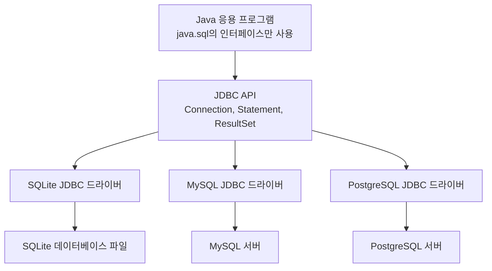

# 17강 — JDBC 데이터베이스 프로그래밍

[레포지토리 안내](../../README.ko.md) | [English](Concepts_Lecture.md) | [한국어](Concepts_Lecture.ko.md)

> **최종 수정일:** 2026-11-19

> **학습 목표:**
> 1. 테이블, 행, 열, 기본 키의 개념을 설명하고 CRUD에 필요한 SQL 문을 작성할 수 있다
> 2. JDBC API와 드라이버의 관계를 설명하고 연결 URL로 데이터베이스에 연결할 수 있다
> 3. Statement와 PreparedStatement로 SQL을 실행하고 ResultSet의 커서로 결과를 읽을 수 있다
> 4. SQL 주입이 일어나는 원리를 설명하고 PreparedStatement로 막을 수 있다
> 5. 자동 커밋을 끄고 commit()과 rollback()으로 트랜잭션을 처리할 수 있다
> 6. try-with-resources와 SQLException으로 연결과 오류를 관리할 수 있다

---

## 목차

- [1. 관계형 데이터베이스와 SQL](#1-관계형-데이터베이스와-sql)
  - [1.1 테이블, 행, 열, 기본 키](#11-테이블-행-열-기본-키)
  - [1.2 이 강의에서 쓰는 SQL](#12-이-강의에서-쓰는-sql)
- [2. JDBC의 구조](#2-jdbc의-구조)
  - [2.1 JDBC API와 드라이버](#21-jdbc-api와-드라이버)
  - [2.2 연결 URL과 DriverManager](#22-연결-url과-drivermanager)
- [3. SQL의 실행과 결과](#3-sql의-실행과-결과)
  - [3.1 Statement와 실행 메서드](#31-statement와-실행-메서드)
  - [3.2 ResultSet과 커서](#32-resultset과-커서)
  - [3.3 PreparedStatement](#33-preparedstatement)
  - [3.4 SQL 주입](#34-sql-주입)
- [4. CRUD 예제](#4-crud-예제)
- [5. 트랜잭션](#5-트랜잭션)
  - [5.1 자동 커밋과 트랜잭션](#51-자동-커밋과-트랜잭션)
  - [5.2 계좌 이체 예제](#52-계좌-이체-예제)
- [6. 자원 관리와 예외](#6-자원-관리와-예외)
- [7. 흔한 실수](#7-흔한-실수)
- [요약](#요약)
- [점검 문제](#점검-문제)
- [참고 문헌](#참고-문헌)

---

<br>

## 1. 관계형 데이터베이스와 SQL

### 1.1 테이블, 행, 열, 기본 키

10강의 파일은 프로그램이 정한 형식대로 바이트를 저장할 뿐, 원하는 자료를 찾거나 여러 프로그램이 동시에 고치는 일은 프로그램이 직접 처리해야 했다. **데이터베이스 관리 시스템(DBMS)** 은 데이터를 저장하고, 질의로 찾아 주고, 여러 사용자의 동시 접근과 장애로부터 데이터를 지키는 소프트웨어이다. 가장 널리 쓰이는 관계형 DBMS(MySQL, PostgreSQL, Oracle, SQLite 등)는 데이터를 표 모양의 **테이블(table)** 에 저장한다.

| id | name | score |
|:-----|:-----|:-----|
| 1 | Kim | 90 |
| 2 | Lee | 55 |
| 3 | Park | 72 |

*표 1. 학생 테이블 student의 예*

테이블의 가로 한 줄을 **행(row)** 또는 레코드라 하고 객체 하나에 해당하며, 세로 한 줄을 **열(column)** 이라 하고 필드 하나에 해당한다. 열마다 정수, 문자열 같은 타입이 정해져 있다. 값이 없음을 나타내는 특별한 값은 `NULL`이다.

> **용어 정의:** **기본 키(primary key)** 는 테이블의 각 행을 하나씩 구별하는 열(또는 열의 묶음)이다. 기본 키의 값은 행마다 달라야 하고 `NULL`일 수 없으며, DBMS가 이 규칙을 지키도록 강제한다.

student 테이블에서는 학번 `id`가 기본 키이다. 이름은 같은 학생이 둘 있을 수 있으므로 기본 키가 될 수 없다. 9강 3.10절에서 `equals()`와 `hashCode()`로 객체의 같음을 정한 것처럼, 데이터베이스에서는 기본 키가 행의 같음을 정한다.

> **[데이터베이스]** 데이터베이스 과목은 관계형 모델의 이론, 여러 테이블에 데이터를 나누어 중복을 없애는 정규화, 빠른 검색을 위한 인덱스, 트랜잭션과 동시성 제어의 구현을 다룬다. 이 강의는 Java 프로그램이 JDBC로 데이터베이스를 쓰는 데 필요한 만큼만 SQL과 트랜잭션을 다룬다.

### 1.2 이 강의에서 쓰는 SQL

**SQL(Structured Query Language)** 은 관계형 데이터베이스에 테이블을 만들고, 데이터를 넣고, 찾고, 고치고, 지우는 명령을 쓰는 언어이다. 데이터를 다루는 네 가지 기본 연산인 생성(Create), 조회(Read), 수정(Update), 삭제(Delete)를 머리글자로 **CRUD**라 부르며, SQL에서는 각각 `INSERT`, `SELECT`, `UPDATE`, `DELETE`에 해당한다.

```sql
CREATE TABLE student (                      -- 테이블을 만든다
    id    INTEGER PRIMARY KEY,
    name  TEXT NOT NULL,                    -- 비워 둘 수 없다
    score INTEGER                           -- NULL이 될 수 있다
);

INSERT INTO student (id, name, score) VALUES (1, 'Kim', 90);   -- Create

SELECT id, name, score FROM student         -- Read
WHERE score >= 60                           -- 조건에 맞는 행만
ORDER BY id;                                -- id의 오름차순으로

UPDATE student SET score = score + 10 WHERE score < 60;        -- Update
DELETE FROM student WHERE id = 3;                              -- Delete

SELECT COUNT(*), AVG(score) FROM student;   -- 행의 수와 평균
```

SQL의 키워드는 대소문자를 가리지 않지만, 읽기 쉽도록 키워드를 대문자로 쓰는 것이 관례이다. 문자열 값은 작은따옴표로 감싸고, `--` 뒤는 주석이다. `WHERE`가 없는 `UPDATE`와 `DELETE`는 테이블의 모든 행에 적용되므로 특히 주의해야 한다.

`NULL`은 값이 없음을 뜻하므로 보통의 비교가 통하지 않는다. `score < 60`에서 `score`가 `NULL`이면 결과는 참도 거짓도 아닌 알 수 없음이 되어, 그 행은 `WHERE` 조건에 맞지 않는 것으로 처리된다. `NULL`인 행을 찾으려면 `score IS NULL`로 쓴다. `AVG()`, `SUM()` 같은 집계 함수는 `NULL`을 계산에서 빼고, `COUNT(*)`는 `NULL`과 관계없이 행의 수를 센다. 4절의 실행 결과에서 이 규칙을 확인할 수 있다.

---

<br>

## 2. JDBC의 구조

### 2.1 JDBC API와 드라이버

DBMS마다 통신하는 방식이 다르므로, 프로그램이 DBMS의 방식을 직접 쓰면 DBMS를 바꿀 때 코드를 모두 고쳐야 한다. **JDBC(Java Database Connectivity)** 는 Java 프로그램이 관계형 데이터베이스에 연결하여 SQL을 실행하고 결과를 받는 표준 API이며, `java.sql` 패키지에 인터페이스로 정의되어 있다. 각 DBMS의 개발사는 이 인터페이스를 구현한 **JDBC 드라이버(JDBC driver)** 를 jar 파일로 제공한다. 이 구조는 11강 4절의 인터페이스와 구현 클래스의 관계 그대로이다.



*그림 1. JDBC API와 DBMS별 드라이버의 관계*

| 인터페이스와 클래스 | 역할 |
|:-----|:-----|
| `DriverManager` | 연결 URL에 맞는 드라이버를 찾아 연결을 만든다 |
| `Connection` | 데이터베이스와의 연결 하나이며, 문장을 만들고 트랜잭션을 관리한다 |
| `Statement` | SQL 문을 실행한다 |
| `PreparedStatement` | 매개변수 자리(`?`)가 있는 미리 컴파일된 SQL 문을 실행한다 |
| `ResultSet` | `SELECT`의 결과인 행들을 커서로 하나씩 읽게 한다 |
| `SQLException` | 데이터베이스 작업의 오류를 나타내는 검사 예외이다 |

*표 2. JDBC의 주요 인터페이스와 클래스*

프로그램은 `java.sql`의 인터페이스 타입만 쓰고, 실제 객체는 드라이버의 클래스가 만든다. 예를 들어 `Connection conn`이 가리키는 객체의 클래스는 SQLite 드라이버의 클래스이지만, 프로그램은 그 이름을 알 필요가 없다. DBMS를 바꿀 때는 드라이버 jar와 연결 URL만 바꾸면 되고, 같은 SQL을 쓰는 한 나머지 코드는 그대로 쓸 수 있다.

### 2.2 연결 URL과 DriverManager

연결은 `DriverManager.getConnection(url)` 또는 `getConnection(url, user, password)`로 만든다. **연결 URL(connection URL)** 은 어떤 드라이버로 어디에 있는 어떤 데이터베이스에 연결할지를 나타내는 문자열이며, `jdbc:`로 시작하고 그다음에 드라이버를 가리키는 이름이 온다.

| DBMS | 연결 URL의 예 | 뜻 |
|:-----|:-----|:-----|
| SQLite | `jdbc:sqlite:school.db` | 작업 디렉터리의 파일 `school.db` (없으면 만든다) |
| MySQL | `jdbc:mysql://localhost:3306/school` | 이 컴퓨터의 3306번 포트에서 동작하는 서버의 `school` 데이터베이스 |
| PostgreSQL | `jdbc:postgresql://db.example.com:5432/school` | 다른 호스트의 5432번 포트에서 동작하는 서버의 `school` 데이터베이스 |

*표 3. 연결 URL의 예*

SQLite는 별도의 서버 없이 데이터베이스 전체를 파일 하나에 저장하므로, 드라이버 jar 하나만 있으면 바로 실습할 수 있다. MySQL과 PostgreSQL은 14강의 소켓으로 접속하는 서버이므로 URL에 호스트와 포트가 들어간다. 상대 경로의 파일은 10강 1.6절처럼 작업 디렉터리를 기준으로 찾는다.

`DriverManager`는 초기화될 때 클래스 경로에 있는 드라이버를 서비스 제공자 로딩 방식으로 찾아 등록한다 [1]. 그래서 드라이버 jar를 클래스 경로에 두기만 하면 되고, 옛날 코드에서 보던 `Class.forName("org.sqlite.JDBC")` 같은 드라이버 클래스 적재 문장은 필요 없다. 이 강의의 예제는 SQLite의 JDBC 드라이버 jar(`sqlite-jdbc-3.49.1.0.jar`)를 클래스 경로에 넣어 다음과 같이 실행한다. 클래스 경로의 구분자는 macOS와 Linux에서 `:`, Windows에서 `;`이다. SQLite 드라이버는 JNI로 네이티브 라이브러리를 적재하는데, 최근 JDK는 이런 적재에 경고를 출력하므로 `--enable-native-access=ALL-UNNAMED` 옵션으로 허용한다.

```text
javac StudentCrud.java
java --enable-native-access=ALL-UNNAMED -cp .:sqlite-jdbc-3.49.1.0.jar StudentCrud
```

드라이버가 클래스 경로에 없으면 `getConnection()`이 "No suitable driver found for jdbc:sqlite:school.db" 같은 메시지의 `SQLException`을 던진다.

---

<br>

## 3. SQL의 실행과 결과

### 3.1 Statement와 실행 메서드

`conn.createStatement()`가 반환하는 `Statement`는 완성된 SQL 문자열을 실행한다. SQL의 종류에 따라 다른 메서드를 쓴다.

| 메서드 | 쓰는 SQL | 반환값 |
|:-----|:-----|:-----|
| `executeQuery(sql)` | `SELECT` | 결과 행을 담은 `ResultSet` |
| `executeUpdate(sql)` | `INSERT`, `UPDATE`, `DELETE`, `CREATE TABLE` 등 | 영향을 받은 행의 수 (`CREATE TABLE` 등은 0) |
| `execute(sql)` | 어느 것이든 | 결과가 `ResultSet`이면 `true` |

*표 4. Statement의 실행 메서드*

`executeUpdate()`의 반환값은 바뀐 행의 수이므로, `UPDATE`나 `DELETE`가 실제로 몇 행에 적용되었는지 확인하는 데 쓴다. 조건에 맞는 행이 없으면 오류가 아니라 0이 반환된다.

### 3.2 ResultSet과 커서

`executeQuery()`가 반환하는 `ResultSet`은 결과 행들의 현재 위치를 가리키는 **커서(cursor)** 를 가진다. 처음에 커서는 첫 행의 앞에 있고, `next()`는 커서를 다음 행으로 옮기며 더 이상 행이 없으면 `false`를 반환하므로 `while` 반복문으로 모든 행을 읽을 수 있다 [2]. 9강의 `Iterator`와 같은 방식이다.

```java
try (ResultSet rs = st.executeQuery("SELECT id, name, score FROM student ORDER BY id")) {
    while (rs.next()) {                      // 처음 호출에서 첫 행으로 간다
        int id = rs.getInt("id");            // 열 이름으로 읽는다
        String name = rs.getString(2);       // 열 번호로 읽는다 (1부터)
        System.out.println(id + " " + name);
    }
}
```

현재 행의 값은 열의 타입에 맞는 `getXxx()` 메서드로 읽으며, 인자로 열 이름이나 열 번호를 준다. 열 번호는 0이 아니라 1부터 센다는 점에 주의해야 한다.

| SQL 타입 | `ResultSet`의 메서드 | Java 타입 |
|:-----|:-----|:-----|
| `INTEGER` | `getInt()` | `int` |
| `BIGINT` | `getLong()` | `long` |
| `REAL`, `DOUBLE` | `getDouble()` | `double` |
| `TEXT`, `VARCHAR` | `getString()` | `String` |
| `BOOLEAN` | `getBoolean()` | `boolean` |
| `DATE` | `getDate()` 또는 `getObject(i, LocalDate.class)` | `java.sql.Date`, `LocalDate` |

*표 5. SQL 타입과 ResultSet 메서드의 대응*

값이 `NULL`인 열을 `getInt()`로 읽으면 0이 반환되므로, 0점과 점수 없음을 구별할 수 없다. 이때는 값을 읽은 직후 `rs.wasNull()`을 호출하여 방금 읽은 값이 `NULL`이었는지 확인한다(4절). 또는 `rs.getObject("score", Integer.class)`처럼 래퍼 타입으로 읽으면 `NULL`이 `null`로 돌아온다.

### 3.3 PreparedStatement

SQL에 들어갈 값이 실행할 때마다 달라지면 `PreparedStatement`를 쓴다. SQL 문의 값이 들어갈 자리에 `?`를 쓰고, 실행하기 전에 `setXxx(번호, 값)`으로 자리마다 값을 정한다. 번호는 왼쪽의 `?`부터 1, 2, 3이다.

```java
String sql = "INSERT INTO student (id, name, score) VALUES (?, ?, ?)";
try (PreparedStatement ps = conn.prepareStatement(sql)) {
    ps.setInt(1, 5);
    ps.setString(2, "Jung");
    ps.setNull(3, Types.INTEGER);            // 세 번째 자리에 NULL
    ps.executeUpdate();
}
```

`PreparedStatement`는 미리 컴파일되어 저장된 SQL 문이며, 같은 문장을 값만 바꾸어 여러 번 효율적으로 실행할 수 있다 [3]. 값을 문자열 연결로 SQL에 끼워 넣지 않으므로, 문자열 안의 작은따옴표를 신경 쓸 필요가 없고 3.4절의 SQL 주입을 막는다. 여러 행을 넣을 때는 값을 정할 때마다 `addBatch()`로 모았다가 `executeBatch()`로 한 번에 보내면 데이터베이스와 주고받는 횟수가 줄어든다(4절).

### 3.4 SQL 주입

사용자가 입력한 값을 문자열 연결로 SQL에 넣으면, 입력에 SQL의 문법이 섞여 들어가 문장의 뜻이 바뀔 수 있다. 이 공격을 **SQL 주입(SQL injection)** 이라고 한다. 다음 프로그램은 이름으로 학생을 찾는 질의에 공격자가 만든 문자열을 넣는다.

```java
import java.sql.*;

public class Injection {
    public static void main(String[] args) throws SQLException {
        try (Connection conn = DriverManager.getConnection("jdbc:sqlite:school.db")) {
            String input = "nobody' OR '1'='1";                                 // 공격자가 입력한 이름

            String sql = "SELECT name FROM student WHERE name = '" + input + "'";
            System.out.println("built SQL: " + sql);
            try (Statement st = conn.createStatement(); ResultSet rs = st.executeQuery(sql)) {
                int n = 0;
                while (rs.next()) n++;
                System.out.println("Statement matched " + n + " rows");
            }

            try (PreparedStatement ps = conn.prepareStatement("SELECT name FROM student WHERE name = ?")) {
                ps.setString(1, input);                                          // 값으로만 쓰인다
                try (ResultSet rs = ps.executeQuery()) {
                    int n = 0;
                    while (rs.next()) n++;
                    System.out.println("PreparedStatement matched " + n + " rows");
                }
            }
        }
    }
}
```

```text
built SQL: SELECT name FROM student WHERE name = 'nobody' OR '1'='1'
Statement matched 3 rows
PreparedStatement matched 0 rows
```

입력 `nobody' OR '1'='1`이 문자열 연결로 들어가면, 작은따옴표가 문자열을 일찍 닫고 `OR '1'='1'`이 조건으로 붙는다. 완성된 SQL의 조건은 이름이 nobody이거나 '1'이 '1'과 같다는 뜻이 되고, 뒤의 비교가 항상 참이므로 테이블의 모든 행 3개가 나온다. 로그인 확인처럼 조건이 참인지로 권한을 주는 코드라면 비밀번호 없이 통과하게 된다.

`PreparedStatement`에 같은 문자열을 `setString()`으로 넣으면 0행이 나온다. 드라이버가 입력 전체를 하나의 문자열 값으로 다루므로, 작은따옴표를 포함한 그 문자열과 정확히 같은 이름을 가진 학생을 찾을 뿐 문장의 구조는 바뀌지 않는다. 그러므로 사용자가 입력한 값은 어떤 경우에도 문자열 연결로 SQL에 넣지 않고 `?` 자리에 넣는다.

> **[정보보호]** SQL 주입은 입력을 코드로 해석하게 만드는 주입 공격의 한 종류이며, 웹 응용 프로그램에서 오랫동안 가장 흔한 취약점 가운데 하나였다. 정보보호 과목은 이런 공격의 유형과 입력 검증, 최소 권한 원칙 같은 방어를 함께 다룬다.

---

<br>

## 4. CRUD 예제

다음 프로그램은 student 테이블을 만들고 생성, 조회, 수정, 삭제를 모두 실행한다.

```java
import java.sql.*;

public class StudentCrud {
    static final String URL = "jdbc:sqlite:school.db";             // 파일 school.db에 연결

    public static void main(String[] args) throws SQLException {
        try (Connection conn = DriverManager.getConnection(URL)) {
            DatabaseMetaData meta = conn.getMetaData();
            System.out.println("connected: " + meta.getDatabaseProductName() + " " + meta.getDatabaseProductVersion()
                    + ", driver " + meta.getDriverName());

            try (Statement st = conn.createStatement()) {
                st.executeUpdate("DROP TABLE IF EXISTS student");
                st.executeUpdate("CREATE TABLE student ("
                        + "id INTEGER PRIMARY KEY, name TEXT NOT NULL, score INTEGER)");
            }

            String insert = "INSERT INTO student (id, name, score) VALUES (?, ?, ?)";
            try (PreparedStatement ps = conn.prepareStatement(insert)) {          // Create
                Object[][] rows = {{1, "Kim", 90}, {2, "Lee", 55}, {3, "Park", 72}, {4, "Choi", null}};
                for (Object[] r : rows) {
                    ps.setInt(1, (Integer) r[0]);
                    ps.setString(2, (String) r[1]);
                    if (r[2] == null) ps.setNull(3, Types.INTEGER);
                    else ps.setInt(3, (Integer) r[2]);
                    ps.addBatch();                                                // 묶어서 보낸다
                }
                int[] counts = ps.executeBatch();
                System.out.println("inserted rows: " + counts.length);
            }

            printAll(conn, "after insert");                                       // Read

            try (PreparedStatement ps = conn.prepareStatement(
                    "UPDATE student SET score = score + ? WHERE score < ?")) {     // Update
                ps.setInt(1, 10);
                ps.setInt(2, 60);
                System.out.println("updated rows: " + ps.executeUpdate());
            }

            try (PreparedStatement ps = conn.prepareStatement("DELETE FROM student WHERE id = ?")) {  // Delete
                ps.setInt(1, 3);
                System.out.println("deleted rows: " + ps.executeUpdate());
            }
            printAll(conn, "after update and delete");

            try (Statement st = conn.createStatement();
                 ResultSet rs = st.executeQuery("SELECT COUNT(*), AVG(score) FROM student")) {
                rs.next();
                System.out.printf("count %d, average score %.2f%n", rs.getInt(1), rs.getDouble(2));
            }
        }
    }

    static void printAll(Connection conn, String title) throws SQLException {
        System.out.println("-- " + title);
        String sql = "SELECT id, name, score FROM student ORDER BY id";
        try (Statement st = conn.createStatement();
             ResultSet rs = st.executeQuery(sql)) {
            while (rs.next()) {                                                   // 다음 행으로 커서를 옮긴다
                int id = rs.getInt("id");
                String name = rs.getString("name");
                int score = rs.getInt("score");
                String shown = rs.wasNull() ? "NULL" : String.valueOf(score);     // 방금 읽은 값이 NULL이었나
                System.out.println(id + " " + name + " " + shown);
            }
        }
    }
}
```

```text
connected: SQLite 3.49.1, driver SQLite JDBC
inserted rows: 4
-- after insert
1 Kim 90
2 Lee 55
3 Park 72
4 Choi NULL
updated rows: 1
deleted rows: 1
-- after update and delete
1 Kim 90
2 Lee 65
4 Choi NULL
count 3, average score 77.50
```

실행을 단계별로 추적하면 다음과 같다.

1. **연결:** `getConnection()`이 작업 디렉터리에 `school.db`를 열거나 새로 만든다. `DatabaseMetaData`에서 읽은 첫 줄은 SQLite 3.49.1에 SQLite JDBC 드라이버로 연결되었음을 보여 준다. `Connection`은 try-with-resources로 열었으므로 `main()`이 끝나면 닫힌다.
2. **테이블 생성:** `DROP TABLE IF EXISTS`로 이전 실행에서 만든 테이블을 지우고 `CREATE TABLE`로 새로 만든다. 이 문장들은 값이 바뀌지 않으므로 `Statement`로 실행했다.
3. **생성(Create):** `PreparedStatement` 하나로 네 행을 넣는다. 행마다 세 자리의 값을 정하고 `addBatch()`로 모은 뒤 `executeBatch()`로 한 번에 실행하며, 반환된 배열의 길이 4가 실행된 문장의 수이다. Choi의 점수는 `setNull()`로 `NULL`을 넣었다.
4. **조회(Read):** `printAll()`이 `ORDER BY id`로 정렬된 행을 읽는다. Choi의 `getInt("score")`는 0을 반환하지만 바로 뒤의 `wasNull()`이 `true`이므로 `NULL`로 출력된다.
5. **수정(Update):** 60점 미만인 학생에게 10점을 더한다. 조건에 맞는 행은 55점인 Lee 하나이므로 `executeUpdate()`가 1을 반환한다. Choi의 점수는 `NULL`이어서 `score < 60`이 참이 아니므로(1.2절) 바뀌지 않는다.
6. **삭제(Delete):** `id`가 3인 Park을 지워 1을 반환한다.
7. **집계:** 남은 행은 3개이므로 `COUNT(*)`는 3이고, `AVG(score)`는 `NULL`인 Choi를 빼고 (90 + 65) / 2 = 77.50이다. `NULL`을 0으로 계산했다면 (90 + 65 + 0) / 3 = 51.67이 되었을 것이다.

이 프로그램에서 SQL 문은 모두 문자열 상수이고, 실행할 때마다 달라지는 값은 모두 `?` 자리로 넘겼다. 테이블과 열의 이름은 `?`로 넘길 수 없으므로, 그런 부분이 사용자 입력에 따라 달라져야 한다면 허용된 이름의 목록과 비교하여 검사한 뒤에 넣는다.

---

<br>

## 5. 트랜잭션

### 5.1 자동 커밋과 트랜잭션

**트랜잭션(transaction)** 은 하나의 논리적인 작업을 이루는 SQL 문들의 묶음으로, 그 안의 문장이 모두 반영되거나 하나도 반영되지 않아야 한다. 계좌 이체를 예로 들면, 보내는 계좌에서 빼는 `UPDATE`와 받는 계좌에 더하는 `UPDATE`는 하나의 작업이다. 앞의 문장만 실행되고 프로그램이 멈추면 돈이 사라진다.

트랜잭션이 지켜야 할 성질은 머리글자를 따서 ACID라 부른다. **원자성(atomicity)** 은 모두 반영되거나 하나도 반영되지 않는 성질, **일관성(consistency)** 은 트랜잭션 전후에 데이터가 규칙(예: 잔액은 음수가 아님)을 지키는 성질, **고립성(isolation)** 은 동시에 실행되는 트랜잭션이 서로의 중간 상태를 보지 않는 성질, **지속성(durability)** 은 반영된 결과가 장애가 나도 사라지지 않는 성질이다. 고립성은 15강에서 본 동기화와 같은 문제를 데이터베이스가 대신 처리하는 것이라 할 수 있다.

JDBC의 `Connection`은 기본적으로 **자동 커밋(auto-commit)** 모드이며, 문장 하나를 실행할 때마다 그 변경을 자동으로 확정한다 [4]. 여러 문장을 하나의 트랜잭션으로 묶으려면 다음 순서를 따른다.

1. `conn.setAutoCommit(false)`로 자동 커밋을 끈다.
2. 묶을 문장들을 실행한다. 이 변경은 아직 확정되지 않았다.
3. 모두 성공하면 `conn.commit()`으로 확정한다.
4. 중간에 실패하면 `conn.rollback()`으로 2단계의 변경을 모두 취소한다.

### 5.2 계좌 이체 예제

```java
import java.sql.*;

public class Transfer {
    static void transfer(Connection conn, String from, String to, int amount) throws SQLException {
        conn.setAutoCommit(false);                                               // 트랜잭션 시작
        try (PreparedStatement withdraw = conn.prepareStatement(
                     "UPDATE account SET balance = balance - ? WHERE owner = ?");
             PreparedStatement deposit = conn.prepareStatement(
                     "UPDATE account SET balance = balance + ? WHERE owner = ?");
             PreparedStatement check = conn.prepareStatement(
                     "SELECT balance FROM account WHERE owner = ?")) {
            withdraw.setInt(1, amount); withdraw.setString(2, from); withdraw.executeUpdate();
            deposit.setInt(1, amount);  deposit.setString(2, to);   deposit.executeUpdate();

            check.setString(1, from);
            try (ResultSet rs = check.executeQuery()) {
                rs.next();
                if (rs.getInt(1) < 0) throw new SQLException("insufficient funds in " + from);
            }
            conn.commit();                                                       // 둘 다 반영
            System.out.println("committed: " + from + " -> " + to + " " + amount);
        } catch (SQLException e) {
            conn.rollback();                                                     // 둘 다 취소
            System.out.println("rolled back: " + e.getMessage());
        } finally {
            conn.setAutoCommit(true);
        }
    }

    static void show(Connection conn) throws SQLException {
        try (Statement st = conn.createStatement();
             ResultSet rs = st.executeQuery("SELECT owner, balance FROM account ORDER BY owner")) {
            StringBuilder sb = new StringBuilder("  balances:");
            while (rs.next()) sb.append(' ').append(rs.getString(1)).append('=').append(rs.getInt(2));
            System.out.println(sb);
        }
    }

    public static void main(String[] args) throws SQLException {
        try (Connection conn = DriverManager.getConnection("jdbc:sqlite:bank.db")) {
            try (Statement st = conn.createStatement()) {
                st.executeUpdate("DROP TABLE IF EXISTS account");
                st.executeUpdate("CREATE TABLE account (owner TEXT PRIMARY KEY, balance INTEGER NOT NULL)");
                st.executeUpdate("INSERT INTO account VALUES ('Alice', 100), ('Bob', 50)");
            }
            show(conn);
            transfer(conn, "Alice", "Bob", 30);
            show(conn);
            transfer(conn, "Bob", "Alice", 500);
            show(conn);

            try (Statement st = conn.createStatement()) {
                st.executeUpdate("INSERT INTO account VALUES ('Alice', 10)");
            } catch (SQLException e) {
                System.out.println("SQLException: " + e.getMessage());
                System.out.println("  error code " + e.getErrorCode());
            }
        }
    }
}
```

```text
  balances: Alice=100 Bob=50
committed: Alice -> Bob 30
  balances: Alice=70 Bob=80
rolled back: insufficient funds in Bob
  balances: Alice=70 Bob=80
SQLException: [SQLITE_CONSTRAINT_PRIMARYKEY] A PRIMARY KEY constraint failed (UNIQUE constraint failed: account.owner)
  error code 19
```

첫 이체는 Alice에서 Bob으로 30을 보낸다. 두 `UPDATE` 뒤에 Alice의 잔액이 70으로 음수가 아니므로 `commit()`이 두 변경을 확정하고, 잔액은 Alice 70, Bob 80이 된다. 두 번째 이체는 Bob에서 Alice로 500을 보내려 한다. 두 `UPDATE`는 실행되었지만 Bob의 잔액이 -420이 되어 검사에서 `SQLException`을 던지고, `catch` 블록의 `rollback()`이 두 `UPDATE`를 모두 취소한다. 그래서 이체 뒤의 잔액이 이체 전과 같은 Alice 70, Bob 80이다. `finally` 블록은 성공과 실패에 관계없이 자동 커밋을 다시 켜서, 같은 연결로 실행하는 다음 문장이 예상하지 못한 트랜잭션에 묶이지 않게 한다.

마지막 부분은 데이터베이스가 지키는 규칙이 오류로 나타나는 예이다. 기본 키 `owner`가 이미 `Alice`인 행이 있으므로, 같은 기본 키로 행을 넣으려 하면 DBMS가 거부하고 드라이버가 `SQLException`을 던진다. 메시지는 어떤 제약을 어겼는지(`PRIMARY KEY constraint failed`) 알려 주고, `getErrorCode()`는 DBMS가 정한 오류 번호(SQLite의 제약 위반 19)를 돌려준다. 오류 번호는 DBMS마다 다르므로, 여러 DBMS에서 쓰는 코드는 표준화된 다섯 글자 코드인 `getSQLState()`를 함께 확인한다.

---

<br>

## 6. 자원 관리와 예외

`Connection`, `Statement`, `ResultSet`은 모두 `AutoCloseable`을 구현하므로 10강 4절의 try-with-resources로 닫는다. 연결은 데이터베이스 서버의 자원(소켓, 메모리, 세션)을 붙잡고 있으므로, 닫지 않은 연결이 쌓이면 서버가 새 연결을 받지 못한다.

```java
try (Connection conn = DriverManager.getConnection(URL);
     PreparedStatement ps = conn.prepareStatement("SELECT name FROM student WHERE score >= ?")) {
    ps.setInt(1, 60);
    try (ResultSet rs = ps.executeQuery()) {
        while (rs.next()) System.out.println(rs.getString("name"));
    }
} catch (SQLException e) {
    System.err.println("DB error " + e.getErrorCode() + " (" + e.getSQLState() + "): " + e.getMessage());
}
```

자원은 선언의 역순으로 닫히므로(10강 4.1절) `ResultSet`, `PreparedStatement`, `Connection`의 순서로 닫힌다. `Statement`를 닫으면 그 문장이 만든 `ResultSet`도 닫히고, 연결을 닫으면 그 연결의 문장도 닫히지만, 각 자원을 그것을 쓰는 범위에서 직접 닫는 것이 분명하다.

`SQLException`은 검사 예외이므로 처리하거나 `throws`로 밝혀야 한다(10강 1.7절). 연결 실패, SQL 문법 오류, 제약 위반, 타입이 맞지 않는 값 읽기 등이 모두 `SQLException`으로 나타나며, 원인은 `getMessage()`, `getErrorCode()`, `getSQLState()`로 구별한다. 트랜잭션 도중의 `SQLException`은 5.2절처럼 잡아서 `rollback()`한 뒤 필요하면 다시 던진다. 실제 응용 프로그램은 연결을 만드는 비용을 줄이기 위해 연결을 미리 몇 개 만들어 두고 빌려 쓰는 **연결 풀(connection pool)** 을 쓴다. 15강 5.3절의 스레드 풀과 같은 생각이다.

---

<br>

## 7. 흔한 실수

| 실수 | 일어나는 일 | 바로잡는 방법 |
|:-----|:-----|:-----|
| 사용자 입력을 문자열 연결로 SQL에 넣는다 | SQL 주입으로 문장의 뜻이 바뀐다 | `PreparedStatement`의 `?` 자리에 넣는다 |
| `ResultSet`에서 `next()`를 호출하기 전에 값을 읽는다 | 명세상 잘못된 호출이며 드라이버에 따라 예외가 나거나 다른 값이 나온다 | `while (rs.next())` 안에서 읽는다 |
| 열 번호를 0부터 센다 | 첫 열을 0으로 읽으려다 오류가 난다 | 열 번호는 1부터 센다 |
| `NULL`인 열을 `getInt()`로 읽고 그대로 쓴다 | `NULL`이 0으로 읽혀 0점과 구별되지 않는다 | `wasNull()`로 확인하거나 래퍼 타입으로 읽는다 |
| `score < 60`이 `NULL`인 행도 고른다고 생각한다 | `NULL`인 행은 조건에 맞지 않아 빠진다 | `IS NULL`을 따로 쓴다 |
| `WHERE` 없이 `UPDATE`나 `DELETE`를 실행한다 | 모든 행이 바뀌거나 지워진다 | 실행 전에 조건을 확인하고 반환된 행 수를 검사한다 |
| 여러 문장을 자동 커밋 모드로 실행한다 | 중간에 실패하면 앞의 변경만 남는다 | 자동 커밋을 끄고 `commit()`과 `rollback()`을 쓴다 |
| 실패한 트랜잭션을 `rollback()`하지 않는다 | 확정되지 않은 변경이 연결에 남는다 | `catch`에서 `rollback()`을 호출한다 |
| 연결과 문장을 닫지 않는다 | 서버의 자원이 고갈된다 | try-with-resources로 닫는다 |
| 드라이버 jar를 클래스 경로에 넣지 않는다 | "No suitable driver" 예외가 난다 | `-cp`에 드라이버 jar를 넣는다 |

*표 6. JDBC 프로그래밍의 흔한 실수*

---

<br>

## 요약

| 개념 | 핵심 요약 |
|:-----|:-----|
| 테이블과 기본 키 | 관계형 데이터베이스는 데이터를 행과 열의 테이블에 저장하며, 기본 키가 각 행을 하나씩 구별한다. |
| CRUD | 생성, 조회, 수정, 삭제의 네 연산이며 SQL의 `INSERT`, `SELECT`, `UPDATE`, `DELETE`에 해당한다. |
| NULL | 값이 없음을 뜻하며, 보통의 비교가 참이 되지 않고 집계 함수에서 빠진다. |
| JDBC 드라이버 | `java.sql` 인터페이스를 DBMS에 맞게 구현한 jar이며, 클래스 경로에 두면 `DriverManager`가 자동으로 찾는다. |
| 연결 URL | `jdbc:`로 시작하여 드라이버와 데이터베이스의 위치를 나타내는 문자열이다. |
| ResultSet | 커서가 첫 행의 앞에서 시작하고 `next()`로 한 행씩 나아가며, 열은 이름이나 1부터 세는 번호로 읽는다. |
| PreparedStatement | `?` 자리에 값을 따로 넣는 미리 컴파일된 문장이며, 반복 실행에 효율적이고 SQL 주입을 막는다. |
| SQL 주입 | 입력이 SQL의 문법으로 해석되어 문장의 뜻이 바뀌는 공격이다. |
| 트랜잭션 | 모두 반영되거나 하나도 반영되지 않아야 하는 문장의 묶음이며, 자동 커밋을 끄고 `commit()`과 `rollback()`으로 처리한다. |
| SQLException | 데이터베이스 작업의 오류를 나타내는 검사 예외이며, 오류 번호와 SQLState로 원인을 구별한다. |

---

<br>

## 점검 문제

1. **NULL:** 4절의 실행 직후 student 테이블에 대해 다음 SQL의 결과를 쓰라. (a) `SELECT COUNT(score) FROM student` (b) `SELECT name FROM student WHERE score IS NULL` (c) `SELECT name FROM student WHERE score >= 60`

   <details>
   <summary>정답</summary>

   남은 행은 Kim 90, Lee 65, Choi `NULL`이다. (a) `COUNT(열)`은 `NULL`이 아닌 값만 세므로 2이다(`COUNT(*)`는 3). (b) Choi이다. (c) Kim과 Lee이다. Choi는 `NULL >= 60`이 참이 아니므로 나오지 않는다.

   </details>

2. **커서:** `ResultSet rs = st.executeQuery("SELECT name FROM student");` 직후에 `rs.getString(1)`을 호출하면 어떻게 되는가? 결과 행이 하나도 없을 때 `while (rs.next())` 반복문은 몇 번 실행되는가?

   <details>
   <summary>정답</summary>

   커서가 첫 행의 앞에 있어 현재 행이 없으므로 명세상 잘못된 호출이며, 많은 드라이버가 `SQLException`을 던진다. 그러나 SQLite 드라이버로 실행하면 예외 없이 첫 행의 `Kim`이 반환된다. 이처럼 잘못된 호출의 결과는 드라이버마다 다르므로, 반드시 `next()`로 커서를 첫 행으로 옮긴 뒤에 읽는다. 결과 행이 없으면 첫 `next()`가 `false`를 반환하므로 반복문의 본문은 한 번도 실행되지 않는다.

   </details>

3. **SQL 주입:** 로그인 확인을 `"SELECT * FROM users WHERE id = '" + id + "' AND pw = '" + pw + "'"`로 만들었다. 공격자가 아이디 칸에 `admin' --`를 넣고 비밀번호 칸을 아무렇게나 채우면 완성되는 SQL은 무엇이고, 어떤 일이 일어나는가?

   <details>
   <summary>정답</summary>

   `SELECT * FROM users WHERE id = 'admin' --' AND pw = '...'`가 된다. `--` 뒤는 SQL의 주석이므로 비밀번호 조건이 사라지고, 조건은 `id = 'admin'`만 남는다. 따라서 비밀번호를 몰라도 admin 계정의 행이 나와 로그인에 성공한다. `PreparedStatement`로 `WHERE id = ? AND pw = ?`를 만들고 두 값을 `setString()`으로 넣으면 막을 수 있다.

   </details>

4. **트랜잭션:** 5.2절의 `transfer()`에서 `conn.setAutoCommit(false)`를 지우면, Bob에서 Alice로 500을 보내는 두 번째 이체 뒤의 잔액은 어떻게 되는가?

   <details>
   <summary>정답</summary>

   자동 커밋 모드에서는 각 `UPDATE`가 실행되는 즉시 확정되므로, 검사에서 예외가 난 뒤의 `rollback()`은 취소할 변경이 없다(드라이버에 따라 자동 커밋 모드의 `rollback()`이 예외를 던지기도 한다). 결과적으로 Bob은 80 - 500 = -420, Alice는 70 + 500 = 570이 되어 잔액이 음수가 되는 잘못된 상태가 남는다.

   </details>

5. **실행 메서드:** 다음 문장을 실행할 때 쓸 메서드와 반환값을 쓰라. 4절 실행 직후의 테이블이다. (a) `DELETE FROM student WHERE score < 50` (b) `SELECT * FROM student` (c) `UPDATE student SET score = 100`

   <details>
   <summary>정답</summary>

   (a) `executeUpdate()`이며, 50점 미만인 행이 없으므로(Choi는 `NULL`이라 조건에 맞지 않음) 0을 반환한다. (b) `executeQuery()`이며, 세 행을 담은 `ResultSet`을 반환한다. (c) `executeUpdate()`이며, `WHERE`가 없으므로 모든 행에 적용되어 3을 반환한다.

   </details>

6. **자원 관리:** 메서드가 호출될 때마다 `DriverManager.getConnection()`으로 연결을 만들고 닫지 않는 웹 서버 프로그램이 있다. 처음에는 잘 동작하다가 시간이 지나면 어떤 문제가 생기는가? 어떻게 고쳐야 하는가?

   <details>
   <summary>정답</summary>

   닫지 않은 연결이 데이터베이스 서버의 소켓과 세션을 계속 붙잡으므로, 연결의 수가 서버의 한도에 이르면 새 연결이 거부되어 프로그램이 데이터베이스를 쓸 수 없게 된다. 연결을 try-with-resources로 열어 쓰고 나면 바로 닫게 하고, 요청이 많은 프로그램은 연결 풀을 써서 연결을 만드는 비용도 줄인다(6절).

   </details>

---

<br>

## 참고 문헌

1. Oracle, "DriverManager (Java SE 21 & JDK 21)," *Java Platform, Standard Edition 21 API Specification*. https://docs.oracle.com/en/java/javase/21/docs/api/java.sql/java/sql/DriverManager.html
2. Oracle, "ResultSet (Java SE 21 & JDK 21)," *Java Platform, Standard Edition 21 API Specification*. https://docs.oracle.com/en/java/javase/21/docs/api/java.sql/java/sql/ResultSet.html
3. Oracle, "PreparedStatement (Java SE 21 & JDK 21)," *Java Platform, Standard Edition 21 API Specification*. https://docs.oracle.com/en/java/javase/21/docs/api/java.sql/java/sql/PreparedStatement.html
4. Oracle, "Connection (Java SE 21 & JDK 21)," *Java Platform, Standard Edition 21 API Specification*. https://docs.oracle.com/en/java/javase/21/docs/api/java.sql/java/sql/Connection.html
