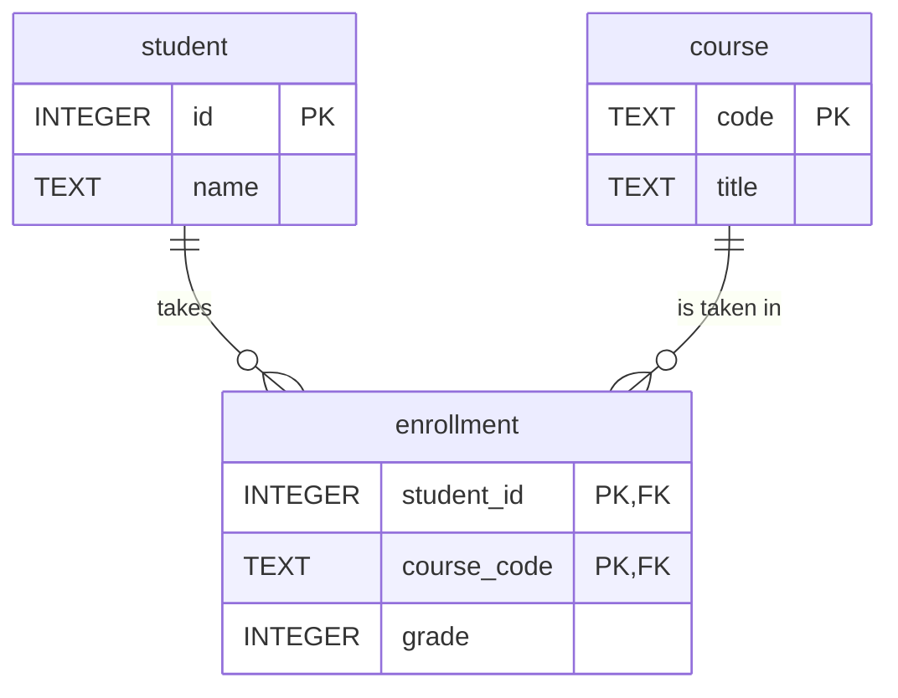
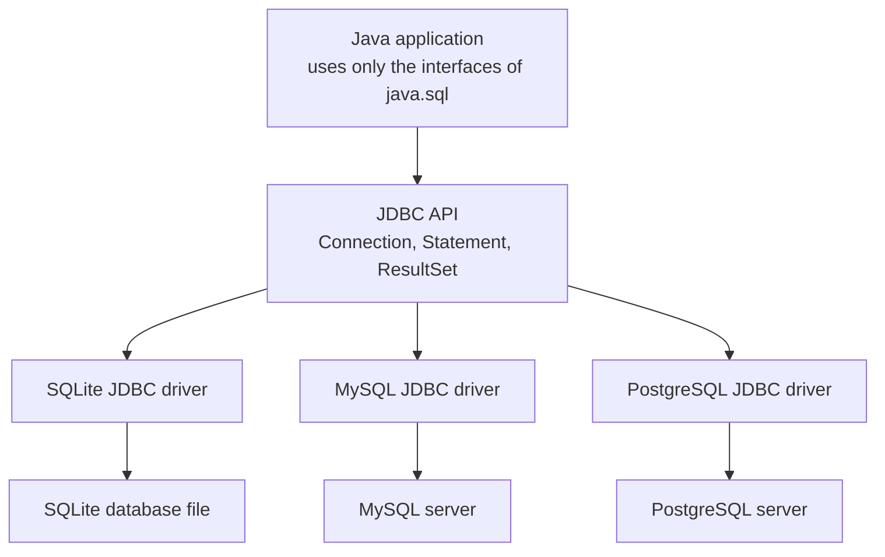
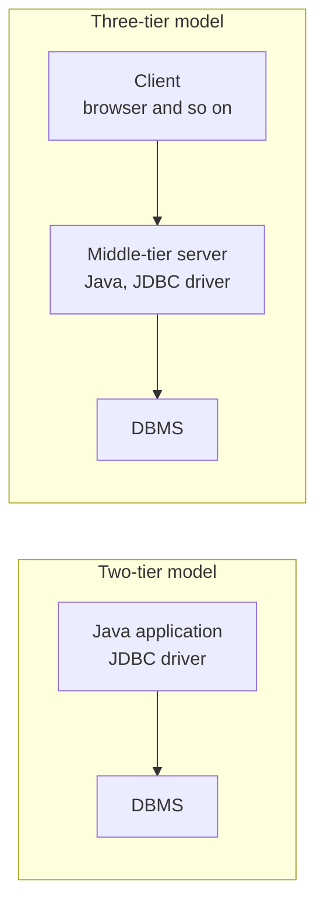
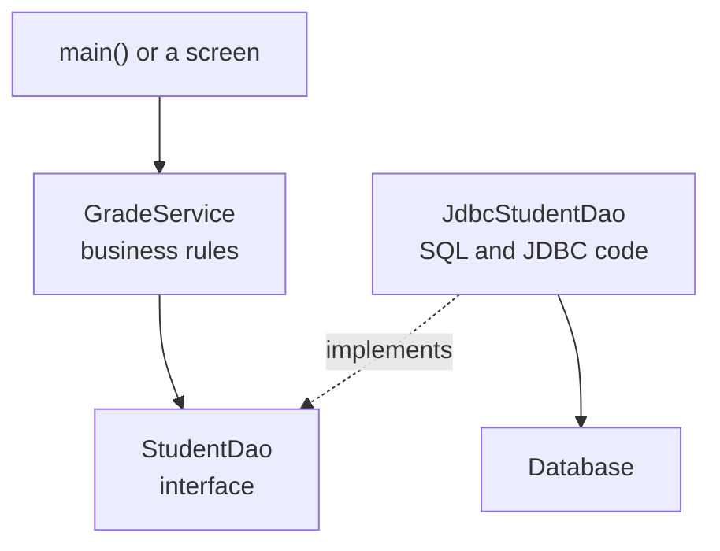

# Lecture 17 — Database Programming with JDBC

[Repository Guide](../../README.md) | [English](Concepts_Lecture.md) | [한국어](Concepts_Lecture.ko.md)

> **Last Updated:** 2026-11-19

> **Learning Objectives:**
> 1. Explain tables, rows, columns, primary keys, and foreign keys and write SQL statements that use CRUD, JOIN, and GROUP BY
> 2. Explain the relationship between the JDBC API and drivers and the kinds of drivers, and connect to a database with a connection URL
> 3. Execute SQL with Statement and PreparedStatement and read the values of a ResultSet as the Java types matching their SQL types
> 4. Explain how SQL injection happens and prevent it with PreparedStatement
> 5. Turn off auto-commit, handle transactions with commit(), rollback(), savepoints, and batches, and explain isolation levels
> 6. Organize programs that manage connections and errors with try-with-resources, SQLException, and a DAO layer

---

## Table of Contents

- [1. Relational Databases and SQL](#1-relational-databases-and-sql)
  - [1.1 Tables, Rows, Columns, and Primary Keys](#11-tables-rows-columns-and-primary-keys)
  - [1.2 The SQL Used in This Lecture](#12-the-sql-used-in-this-lecture)
  - [1.3 Multiple Tables and Foreign Keys](#13-multiple-tables-and-foreign-keys)
  - [1.4 JOIN and GROUP BY](#14-join-and-group-by)
- [2. The Structure of JDBC](#2-the-structure-of-jdbc)
  - [2.1 The JDBC API and Drivers](#21-the-jdbc-api-and-drivers)
  - [2.2 Connection URLs and DriverManager](#22-connection-urls-and-drivermanager)
  - [2.3 Kinds of Drivers and Tiered Architectures](#23-kinds-of-drivers-and-tiered-architectures)
- [3. Executing SQL and Reading Results](#3-executing-sql-and-reading-results)
  - [3.1 Statement and Its Execution Methods](#31-statement-and-its-execution-methods)
  - [3.2 ResultSet and the Cursor](#32-resultset-and-the-cursor)
  - [3.3 PreparedStatement](#33-preparedstatement)
  - [3.4 SQL Injection](#34-sql-injection)
  - [3.5 SQL Types and Java Types](#35-sql-types-and-java-types)
  - [3.6 Generated Keys and Metadata](#36-generated-keys-and-metadata)
- [4. A CRUD Example](#4-a-crud-example)
  - [4.1 Layering with a DAO](#41-layering-with-a-dao)
- [5. Transactions](#5-transactions)
  - [5.1 Auto-Commit and Transactions](#51-auto-commit-and-transactions)
  - [5.2 A Money Transfer Example](#52-a-money-transfer-example)
  - [5.3 Isolation Levels](#53-isolation-levels)
  - [5.4 Batch Updates and Savepoints](#54-batch-updates-and-savepoints)
- [6. Resource Management and Exceptions](#6-resource-management-and-exceptions)
  - [6.1 SQLException Chains and SQLState](#61-sqlexception-chains-and-sqlstate)
  - [6.2 Uncommitted Transactions and Closing Connections](#62-uncommitted-transactions-and-closing-connections)
- [7. Common Mistakes](#7-common-mistakes)
- [Summary](#summary)
- [Self-Check Questions](#self-check-questions)
- [References](#references)

---

<br>

## 1. Relational Databases and SQL

### 1.1 Tables, Rows, Columns, and Primary Keys

The files of Lecture 10 only store bytes in a format the program decides, and finding the desired data or letting several programs change it at once had to be handled by the program itself. A **database management system (DBMS)** is software that stores data, finds it in response to queries, and protects it against concurrent access by many users and against failures. The most widely used relational DBMSs (MySQL, PostgreSQL, Oracle, SQLite, and others) store data in table-shaped **tables**.

| id | name | score |
|:-----|:-----|:-----|
| 1 | Kim | 90 |
| 2 | Lee | 55 |
| 3 | Park | 72 |

*Table 1. An example of the student table*

One horizontal line of a table is called a **row**, or record, and corresponds to one object; one vertical line is called a **column** and corresponds to one field. Each column has a fixed type, such as integer or string. The special value that marks the absence of a value is `NULL`.

> **Definition:** A **primary key** is the column (or set of columns) that distinguishes each row of a table from the others. The value of the primary key must differ in every row and cannot be `NULL`, and the DBMS enforces this rule.

In the student table, the student ID `id` is the primary key. Two students can have the same name, so the name cannot be the primary key. Just as `equals()` and `hashCode()` defined the equality of objects in Lecture 9, Section 3.10, the primary key defines the equality of rows in a database.

> **[Databases]** The databases course covers the theory of the relational model, normalization that removes duplication by splitting data among several tables, indexes for fast search, and the implementation of transactions and concurrency control. This lecture covers SQL and transactions only as far as a Java program needs them to use a database through JDBC.

### 1.2 The SQL Used in This Lecture

**SQL (Structured Query Language)** is the language for commands that create tables in a relational database and insert, find, change, and delete data. The four basic operations on data, Create, Read, Update, and Delete, are called **CRUD** by their initials, and in SQL they correspond to `INSERT`, `SELECT`, `UPDATE`, and `DELETE`.

```sql
CREATE TABLE student (                      -- create a table
    id    INTEGER PRIMARY KEY,
    name  TEXT NOT NULL,                    -- cannot be left empty
    score INTEGER                           -- may be NULL
);

INSERT INTO student (id, name, score) VALUES (1, 'Kim', 90);   -- Create

SELECT id, name, score FROM student         -- Read
WHERE score >= 60                           -- only rows that match
ORDER BY id;                                -- in ascending order of id

UPDATE student SET score = score + 10 WHERE score < 60;        -- Update
DELETE FROM student WHERE id = 3;                              -- Delete

SELECT COUNT(*), AVG(score) FROM student;   -- number of rows and the average
```

SQL keywords are case-insensitive, but by convention keywords are written in uppercase for readability. String values are enclosed in single quotes, and anything after `--` is a comment. An `UPDATE` or `DELETE` without `WHERE` applies to every row of the table, so it calls for particular care.

`NULL` means that there is no value, so ordinary comparisons do not work on it. In `score < 60`, if `score` is `NULL`, the result is neither true nor false but unknown, and the row is treated as not matching the `WHERE` condition. To find rows that are `NULL`, write `score IS NULL`. Aggregate functions such as `AVG()` and `SUM()` leave `NULL` out of the computation, while `COUNT(*)` counts rows regardless of `NULL`. These rules can be seen in the results of Section 4.

### 1.3 Multiple Tables and Foreign Keys

Trying to keep the record of the courses each student took in the single student table means either adding columns per course or repeating the same student's name over several rows. Adding columns limits the number of courses to the number of columns, and repeating names means that renaming a student requires changing every row together, and missing even one makes the data inconsistent. A relational database splits such data into tables by subject and expresses the relations between tables with key values. Splitting it into three tables, student, course, and enrollment (which student took which course with what grade), stores each student's name only once in student, while enrollment holds only student numbers and course codes.

> **Definition:** A **foreign key** is a column (or group of columns) of one table whose value must be one of the primary key values of the referenced table (which may be the same table) or `NULL`. The DBMS rejects changes that insert a value with no row to refer to and, by default, changes that delete a row other rows still refer to, so that references between tables are never broken.

```sql
PRAGMA foreign_keys = ON;                   -- SQLite needs this on each connection

CREATE TABLE student (
    id   INTEGER PRIMARY KEY,
    name TEXT NOT NULL
);
CREATE TABLE course (
    code  TEXT PRIMARY KEY,
    title TEXT NOT NULL
);
CREATE TABLE enrollment (
    student_id  INTEGER NOT NULL REFERENCES student(id),    -- foreign key
    course_code TEXT    NOT NULL REFERENCES course(code),   -- foreign key
    grade       INTEGER,
    PRIMARY KEY (student_id, course_code)                   -- a two-column primary key
);

INSERT INTO student VALUES (1, 'Kim'), (2, 'Lee'), (3, 'Park'), (4, 'Choi');
INSERT INTO course VALUES ('OOP', 'Object-Oriented Programming'), ('DB', 'Databases');
INSERT INTO enrollment VALUES (1, 'OOP', 90), (1, 'DB', 85), (2, 'OOP', 55),
                              (3, 'OOP', 72), (3, 'DB', NULL);

INSERT INTO enrollment VALUES (9, 'OOP', 70);  -- student 9 does not exist
DELETE FROM student WHERE id = 1;              -- a student referenced by enrollments
```

```text
Error near line 23: FOREIGN KEY constraint failed
Error near line 24: FOREIGN KEY constraint failed
```

| student_id | course_code | grade |
|:-----|:-----|:-----|
| 1 | OOP | 90 |
| 1 | DB | 85 |
| 2 | OOP | 55 |
| 3 | OOP | 72 |
| 3 | DB | NULL |

*Table 2. Contents of the enrollment table*



*Figure 1. Relations among the student, course, and enrollment tables*

The primary key of enrollment combines two columns, `PRIMARY KEY (student_id, course_code)`. The DBMS thereby enforces the rule that a row where the same student takes the same course twice cannot be inserted. `student_id` is a foreign key referring to `id` of student and `course_code` one referring to `code` of course, declared with `REFERENCES table(column)`. A student can have several enrollment rows and an enrollment row belongs to exactly one student, so student and enrollment are in a one-to-many (1:N) relation. Student and course form a many-to-many (M:N) relation through enrollment. The symbols at the line ends in Figure 1 mean exactly one on the student side and zero or more on the enrollment side.

For backward compatibility SQLite has foreign key checks off by default, so they must be turned on for each connection with `PRAGMA foreign_keys = ON` [1]. With them on, the last two statements of the SQL above are both rejected. Line 23 tried to insert an enrollment row referring to student number 9, which is not in student, and line 24 tried to delete student 1, whom two enrollment rows refer to. Without the checks both statements succeed, leaving enrollment records of a student who does not exist.

### 1.4 JOIN and GROUP BY

Data split across several tables is joined again when queried. `JOIN` creates, for every pair of rows from two tables for which the `ON` condition is true, a row joining the two. Adding `GROUP BY` to aggregate functions aggregates not over the whole table but over each group of rows with the same value. Setting the output format with `.headers on`, `.mode table`, and `.nullvalue NULL` in SQLite's command-line tool `sqlite3` and running the following SQL on the tables of Section 1.3 gives the results below it.

```sql
SELECT s.name, c.title, e.grade                 -- join three tables
FROM enrollment e
JOIN student s ON e.student_id = s.id
JOIN course  c ON e.course_code = c.code
ORDER BY s.id, c.code;

SELECT s.name, e.course_code                     -- students without enrollments too
FROM student s
LEFT JOIN enrollment e ON e.student_id = s.id
ORDER BY s.id, e.course_code;

SELECT course_code, COUNT(*), COUNT(grade),      -- one row per course
       AVG(grade), MAX(grade)
FROM enrollment
GROUP BY course_code
ORDER BY course_code;

SELECT s.name, COUNT(*) AS n                     -- a condition after grouping
FROM enrollment e JOIN student s ON e.student_id = s.id
GROUP BY s.id
HAVING COUNT(*) >= 2;
```

```text
+------+-----------------------------+-------+
| name |            title            | grade |
+------+-----------------------------+-------+
| Kim  | Databases                   |    85 |
| Kim  | Object-Oriented Programming |    90 |
| Lee  | Object-Oriented Programming |    55 |
| Park | Databases                   | NULL  |
| Park | Object-Oriented Programming |    72 |
+------+-----------------------------+-------+
+------+-------------+
| name | course_code |
+------+-------------+
| Kim  | DB          |
| Kim  | OOP         |
| Lee  | OOP         |
| Park | DB          |
| Park | OOP         |
| Choi | NULL        |
+------+-------------+
+-------------+----------+--------------+--------------------+------------+
| course_code | COUNT(*) | COUNT(grade) |     AVG(grade)     | MAX(grade) |
+-------------+----------+--------------+--------------------+------------+
| DB          |        2 |            1 |               85.0 |         85 |
| OOP         |        3 |            3 | 72.333333333333329 |         90 |
+-------------+----------+--------------+--------------------+------------+
+------+---+
| name | n |
+------+---+
| Kim  | 2 |
| Park | 2 |
+------+---+
```

The `JOIN` of the first query (the same as `INNER JOIN`) attaches to each row of enrollment the student row with the same student number and the course row with the same course code. Giving a table a short alias, as in `FROM enrollment e`, lets columns be qualified by table, as in `s.name` and `e.grade`. All five rows of enrollment find partners, so the result also has five rows, and Choi, with no enrollment rows, has no partner and does not appear.

`LEFT JOIN` keeps every row of the left table and fills the right table's columns with `NULL` for rows without a partner. So Choi appears in the second result as a row whose `course_code` is `NULL`, and the number of rows is the 5 paired rows plus Choi's 1, 6 rows. To find only students without enrollments, add `WHERE e.student_id IS NULL` after the `LEFT JOIN` (the `IS NULL` of Section 1.2).

`GROUP BY course_code` groups the rows by course code and produces one result row per group. The DB group has two rows, Kim's 85 and Park's `NULL`, so `COUNT(*)` is 2 but `COUNT(grade)`, which leaves out `NULL`, is 1, and `AVG(grade)` and `MAX(grade)` are 85. The average of the OOP group is (90 + 55 + 72) / 3 = 217 / 3 ≈ 72.33. It appears as 72.333333333333329 in the result because real numbers are stored in binary floating point (Lecture 3, Section 2.6). The number of digits shown depends on the SQLite version and on how the value is read: the result above is the output of sqlite3 3.54.0, and reading the same value as a string through this lecture's JDBC driver (SQLite 3.49.1) gives 72.3333333333333. Each column of a grouped result must have a single value per group, so `SELECT` lists the grouping columns and aggregate functions. In the fourth query `s.name` was grouped by the primary key `s.id`, so there is one name per group.

`WHERE` filters rows before grouping, and `HAVING` filters groups after grouping. The fourth query counts enrollment rows per student and keeps only students with 2 or more, so Kim and Park appear. Aggregate results are determined only after grouping, so writing the same condition as `WHERE COUNT(*) >= 2` makes SQLite report the error "misuse of aggregate: COUNT()". The clauses of a `SELECT` statement are written in the order `SELECT`, `FROM`, `JOIN`, `WHERE`, `GROUP BY`, `HAVING`, `ORDER BY`, but logically they are processed by building rows with `FROM` and `JOIN`, filtering with `WHERE`, grouping with `GROUP BY`, filtering groups with `HAVING`, computing the expressions of `SELECT`, and sorting with `ORDER BY`.

---

<br>

## 2. The Structure of JDBC

### 2.1 The JDBC API and Drivers

Each DBMS communicates differently, so if a program used a DBMS's own method directly, all the code would have to change when the DBMS changes. **JDBC (Java Database Connectivity)** is the standard API through which Java programs connect to relational databases, execute SQL, and receive the results, and it is defined as interfaces in the `java.sql` package. The vendor of each DBMS provides a **JDBC driver**, a jar file that implements these interfaces. This structure is exactly the relationship between interfaces and implementing classes of Lecture 11, Section 4.



*Figure 2. The JDBC API and drivers for each DBMS*

| Interface or class | Role |
|:-----|:-----|
| `DriverManager` | Finds the driver that matches a connection URL and creates the connection |
| `Connection` | One connection to a database; creates statements and manages transactions |
| `Statement` | Executes SQL statements |
| `PreparedStatement` | Executes a precompiled SQL statement with parameter placeholders (`?`) |
| `ResultSet` | Lets the rows resulting from a `SELECT` be read one at a time with a cursor |
| `SQLException` | A checked exception that represents an error in a database operation |

*Table 3. The main interfaces and classes of JDBC*

The program uses only the interface types of `java.sql`, and the actual objects are created by the driver's classes. For example, the class of the object `Connection conn` refers to is a class of the SQLite driver, but the program need not know its name. To change the DBMS, only the driver jar and the connection URL change, and as long as the same SQL is used, the rest of the code can stay as it is.

### 2.2 Connection URLs and DriverManager

A connection is created with `DriverManager.getConnection(url)` or `getConnection(url, user, password)`. A **connection URL** is a string that says through which driver to connect to which database where; it starts with `jdbc:`, followed by a name that identifies the driver.

| DBMS | Example connection URL | Meaning |
|:-----|:-----|:-----|
| SQLite | `jdbc:sqlite:school.db` | The file `school.db` in the working directory (created if absent) |
| MySQL | `jdbc:mysql://localhost:3306/school` | The `school` database of the server running on port 3306 of this computer |
| PostgreSQL | `jdbc:postgresql://db.example.com:5432/school` | The `school` database of the server running on port 5432 of another host |

*Table 4. Examples of connection URLs*

SQLite stores a whole database in a single file without a separate server, so practice can start right away with just the driver jar. MySQL and PostgreSQL are servers reached through the sockets of Lecture 14, so their URLs contain a host and a port. A file at a relative path is looked up from the working directory, as in Lecture 10, Section 1.6.

When it is initialized, `DriverManager` finds the drivers on the class path through the service-provider loading mechanism and registers them [2]. So it is enough to put the driver jar on the class path, and statements that load a driver class, such as the `Class.forName("org.sqlite.JDBC")` seen in older code, are unnecessary. The examples of this lecture are run as follows, with the SQLite JDBC driver jar (`sqlite-jdbc-3.49.1.0.jar`) on the class path. The class-path separator is `:` on macOS and Linux and `;` on Windows. The SQLite driver loads a native library through JNI, and recent JDKs print a warning for such loading, so it is allowed with the `--enable-native-access=ALL-UNNAMED` option.

```text
javac StudentCrud.java
java --enable-native-access=ALL-UNNAMED -cp .:sqlite-jdbc-3.49.1.0.jar StudentCrud
```

If the driver is not on the class path, `getConnection()` throws an `SQLException` with a message such as "No suitable driver found for jdbc:sqlite:school.db".

### 2.3 Kinds of Drivers and Tiered Architectures

JDBC drivers are commonly divided into four kinds by how they communicate with the DBMS.

| Kind | Name | How it works |
|:-----|:-----|:-----|
| Type 1 | JDBC-ODBC bridge | Translates JDBC calls into ODBC calls and passes them to an ODBC driver |
| Type 2 | Native-API driver | Translates JDBC calls into calls of the DBMS vendor's client library (native code) |
| Type 3 | Network-protocol driver | Sends requests in a DBMS-independent protocol to a middleware server, which translates them for the DBMS |
| Type 4 | Pure Java driver | Implements the DBMS's network protocol in Java alone and talks to the DBMS directly |

*Table 5. The four kinds of JDBC drivers*

Types 1 and 2 require an ODBC driver or a native library installed on every client computer, which makes deployment cumbersome. The Java SE 7 documentation described the JDBC-ODBC bridge bundled with the JDK as a transitional solution to be removed in JDK 8, and recommended the JDBC drivers provided by DBMS vendors instead of the bridge [3]. A type 4 driver works on any platform once a single jar is on the class path. The SQLite driver of this lecture is a driver for an embedded DBMS without a server; its jar carries SQLite native libraries for each platform and loads them through JNI (Section 2.2). So it can be deployed as one jar, but it differs from type 4 in that it uses native code.

The ways an application uses a database are also divided into two models [4]. In the two-tier model, the application talks directly to the data source through a JDBC driver; the user's machine is the client and the machine housing the database is the server. In the three-tier model, the application sends commands to a middle tier of services, which sends the commands to the data source and returns the results to the user. The middle tier makes it possible to control access to corporate data and the kinds of updates made, simplifies the deployment of applications, and in many cases has performance advantages [4]. In a web service the browser is the client, the web application server is the middle tier, and the DBMS is the data source, and JDBC code runs on the middle-tier server.



*Figure 3. The two-tier and three-tier models*

---

<br>

## 3. Executing SQL and Reading Results

### 3.1 Statement and Its Execution Methods

The `Statement` returned by `conn.createStatement()` executes a complete SQL string. Different methods are used depending on the kind of SQL.

| Method | SQL it is used for | Return value |
|:-----|:-----|:-----|
| `executeQuery(sql)` | `SELECT` | A `ResultSet` holding the result rows |
| `executeUpdate(sql)` | `INSERT`, `UPDATE`, `DELETE`, `CREATE TABLE`, and so on | The number of rows affected (0 for `CREATE TABLE` and the like) |
| `execute(sql)` | Any | `true` if the result is a `ResultSet` |

*Table 6. Execution methods of Statement*

The return value of `executeUpdate()` is the number of changed rows, so it is used to check how many rows an `UPDATE` or `DELETE` actually applied to. If no row matches the condition, 0 is returned, not an error.

### 3.2 ResultSet and the Cursor

The `ResultSet` returned by `executeQuery()` has a **cursor** that points to the current position among the result rows. Initially the cursor is positioned before the first row, and `next()` moves the cursor to the next row and returns `false` when there are no more rows, so all rows can be read with a `while` loop [5]. This works like the `Iterator` of Lecture 9.

```java
try (ResultSet rs = st.executeQuery("SELECT id, name, score FROM student ORDER BY id")) {
    while (rs.next()) {                      // the first call moves to the first row
        int id = rs.getInt("id");            // read by column name
        String name = rs.getString(2);       // read by column number (from 1)
        System.out.println(id + " " + name);
    }
}
```

The values of the current row are read with the `getXxx()` method that matches the column's type, given a column name or column number as the argument. Note that column numbers start from 1, not 0.

| SQL type | `ResultSet` method | Java type |
|:-----|:-----|:-----|
| `INTEGER` | `getInt()` | `int` |
| `BIGINT` | `getLong()` | `long` |
| `DOUBLE`, `FLOAT` | `getDouble()` | `double` |
| `CHAR`, `VARCHAR`, `TEXT` | `getString()` | `String` |
| `BOOLEAN` | `getBoolean()` | `boolean` |
| `DATE` | `getDate()` or `getObject(i, LocalDate.class)` | `java.sql.Date`, `LocalDate` |
| `DECIMAL`, `NUMERIC` | `getBigDecimal()` | `java.math.BigDecimal` |
| `TIMESTAMP` | `getTimestamp()` or `getObject(i, LocalDateTime.class)` | `java.sql.Timestamp`, `LocalDateTime` |
| `BINARY`, `VARBINARY` | `getBytes()` | `byte[]` |

*Table 7. Correspondence between SQL types and ResultSet methods*

Reading a `NULL` column with `getInt()` returns 0, so a score of 0 cannot be told apart from no score. In that case, call `rs.wasNull()` right after reading the value to check whether the value just read was `NULL` (Section 4). Alternatively, reading with `rs.getObject("score")` returns `NULL` as `null`. How `rs.getObject("score", Integer.class)`, which specifies a wrapper type, treats `NULL` depends on the driver, and as Section 3.5 shows, the SQLite driver of this lecture throws an exception.

### 3.3 PreparedStatement

When the values that go into SQL differ on every execution, use `PreparedStatement`. Write `?` where values go in the SQL statement, and before executing, set the value of each placeholder with `setXxx(number, value)`. The numbers are 1, 2, 3, counting the `?`s from the left.

```java
String sql = "INSERT INTO student (id, name, score) VALUES (?, ?, ?)";
try (PreparedStatement ps = conn.prepareStatement(sql)) {
    ps.setInt(1, 5);
    ps.setString(2, "Jung");
    ps.setNull(3, Types.INTEGER);            // NULL in the third placeholder
    ps.executeUpdate();
}
```

A `PreparedStatement` is a precompiled, stored SQL statement that can efficiently execute the same statement many times with only the values changed [6]. Values are not spliced into the SQL by string concatenation, so single quotes inside strings need no attention, and the SQL injection of Section 3.4 is prevented. When inserting many rows, collecting each set of values with `addBatch()` and sending them all at once with `executeBatch()` reduces the number of round trips to the database (Section 4).

### 3.4 SQL Injection

If values typed by a user are put into SQL by string concatenation, SQL syntax mixed into the input can change the meaning of the statement. This attack is called **SQL injection**. The following program puts a string crafted by an attacker into a query that finds students by name.

```java
import java.sql.*;

public class Injection {
    public static void main(String[] args) throws SQLException {
        try (Connection conn = DriverManager.getConnection("jdbc:sqlite:school.db")) {
            String input = "nobody' OR '1'='1";                                 // a name typed by an attacker

            String sql = "SELECT name FROM student WHERE name = '" + input + "'";
            System.out.println("built SQL: " + sql);
            try (Statement st = conn.createStatement(); ResultSet rs = st.executeQuery(sql)) {
                int n = 0;
                while (rs.next()) n++;
                System.out.println("Statement matched " + n + " rows");
            }

            try (PreparedStatement ps = conn.prepareStatement("SELECT name FROM student WHERE name = ?")) {
                ps.setString(1, input);                                          // used only as a value
                try (ResultSet rs = ps.executeQuery()) {
                    int n = 0;
                    while (rs.next()) n++;
                    System.out.println("PreparedStatement matched " + n + " rows");
                }
            }
        }
    }
}
```

```text
built SQL: SELECT name FROM student WHERE name = 'nobody' OR '1'='1'
Statement matched 3 rows
PreparedStatement matched 0 rows
```

When the input `nobody' OR '1'='1` goes in by string concatenation, the single quote closes the string early and `OR '1'='1'` is attached as a condition. The condition of the completed SQL comes to mean that the name is nobody or '1' equals '1', and since the latter comparison is always true, all 3 rows of the table come out. In code that grants access depending on whether a condition is true, such as a login check, this lets an attacker in without a password.

Putting the same string into a `PreparedStatement` with `setString()` gives 0 rows. The driver treats the entire input as a single string value, so it only looks for a student whose name is exactly that string, single quotes included, and the structure of the statement does not change. So values typed by users are never put into SQL by string concatenation under any circumstances; they go into `?` placeholders.

> **[Information Security]** SQL injection is one kind of injection attack, which makes input be interpreted as code, and it was for a long time one of the most common vulnerabilities of web applications. The information security course covers the types of such attacks together with defenses such as input validation and the principle of least privilege.

### 3.5 SQL Types and Java Types

Table 7 lists representative correspondences between SQL types, the methods that read them, and Java types, and the Java type in each row follows the mapping defined by JDBC. `TEXT` is the name of a string type used by many DBMSs, and the others are JDBC SQL types represented by the constants of `java.sql.Types` (`Types.INTEGER`, `Types.VARCHAR`, and so on). These constants are used to state a value's SQL type, as in `setNull(i, Types.INTEGER)` or `setObject(i, value, Types.INTEGER)`. Values that need exact decimals, such as amounts of money, are stored in a fixed-point type such as `DECIMAL(10,2)` and handled as `BigDecimal` in Java. This is because `double` is binary floating point and cannot represent 0.10 exactly (Lecture 3, Section 2.6). The following program creates columns of several types, inserts values, and reads them back.

```java
import java.math.BigDecimal;
import java.sql.*;
import java.time.LocalDate;

public class TypesDemo {
    public static void main(String[] args) throws SQLException {
        try (Connection conn = DriverManager.getConnection("jdbc:sqlite:shop.db")) {
            try (Statement st = conn.createStatement()) {
                st.executeUpdate("DROP TABLE IF EXISTS item");
                st.executeUpdate("CREATE TABLE item (id INTEGER PRIMARY KEY, name TEXT, "
                        + "price DECIMAL(10,2), qty INTEGER, sold DATE, active BOOLEAN)");
            }
            try (PreparedStatement ps = conn.prepareStatement("INSERT INTO item VALUES (?, ?, ?, ?, ?, ?)")) {
                ps.setInt(1, 1);
                ps.setString(2, "pen");
                ps.setBigDecimal(3, new BigDecimal("0.10"));                     // an exact decimal
                ps.setObject(4, "123");                                          // a string into an integer column
                ps.setString(5, LocalDate.of(2025, 6, 9).toString());           // stored as an ISO string
                ps.setBoolean(6, true);
                ps.executeUpdate();
            }
            String q = "SELECT name, price, qty, sold, active, typeof(qty), typeof(price), typeof(active) FROM item";
            try (Statement st = conn.createStatement(); ResultSet rs = st.executeQuery(q)) {
                rs.next();
                ResultSetMetaData md = rs.getMetaData();
                for (int c = 1; c <= 5; c++) {
                    Object v = rs.getObject(c);
                    System.out.printf("%-6s declared %-8s getObject -> %s (%s)%n", md.getColumnName(c),
                            md.getColumnTypeName(c), v, v == null ? "null" : v.getClass().getSimpleName());
                }
                System.out.println("stored classes: qty " + rs.getString(6) + ", price " + rs.getString(7)
                        + ", active " + rs.getString(8));
                System.out.println("getInt(qty) " + rs.getInt("qty") + ", getString(qty) \"" + rs.getString("qty") + "\"");
                System.out.println("getBigDecimal(price) " + rs.getBigDecimal("price")
                        + ", getBoolean(active) " + rs.getBoolean("active"));
                System.out.println("sold as LocalDate " + LocalDate.parse(rs.getString("sold")).plusDays(30));
            }

            double d = 0;
            BigDecimal b = BigDecimal.ZERO;
            for (int i = 0; i < 3; i++) { d += 0.10; b = b.add(new BigDecimal("0.10")); }
            System.out.println("three pens: double " + d + ", BigDecimal " + b);

            try (Statement st = conn.createStatement(); ResultSet rs = st.executeQuery("SELECT 'abc', NULL")) {
                rs.next();
                System.out.println("getInt('abc') " + rs.getInt(1) + ", getInt(NULL) " + rs.getInt(2)
                        + " wasNull " + rs.wasNull() + ", getObject(NULL) " + rs.getObject(2));
                try {
                    System.out.println("getObject(NULL, Integer.class) " + rs.getObject(2, Integer.class));
                } catch (SQLException e) {
                    System.out.println("getObject(NULL, Integer.class) -> SQLException: " + e.getMessage());
                }
            }
        }
    }
}
```

```text
name   declared TEXT     getObject -> pen (String)
price  declared DECIMAL  getObject -> 0.1 (Double)
qty    declared INTEGER  getObject -> 123 (Integer)
sold   declared DATE     getObject -> 2025-06-09 (String)
active declared BOOLEAN  getObject -> 1 (Integer)
stored classes: qty integer, price real, active integer
getInt(qty) 123, getString(qty) "123"
getBigDecimal(price) 0.1, getBoolean(active) true
sold as LocalDate 2025-07-09
three pens: double 0.30000000000000004, BigDecimal 0.30
getInt('abc') 0, getInt(NULL) 0 wasNull true, getObject(NULL) null
getObject(NULL, Integer.class) -> SQLException: Bad value for type Integer
```

The first five output lines are the classes of the objects returned by `getObject()`. price, declared `DECIMAL`, came back as a `Double`, sold, declared `DATE`, as a `String`, and active, declared `BOOLEAN`, as the integer 1. A DBMS that enforces column types strictly would have returned a `BigDecimal`, a date, and a boolean. Except in tables declared `STRICT` (available since 3.37.0), SQLite uses a dynamic type system in which the type is attached to the value itself rather than to the column, and the type declared for a column only sets its **type affinity**, the storage the column prefers [7]. There is no separate storage for booleans, so true and false are stored as the integers 1 and 0, and no storage set aside for dates either, so dates are stored as text such as ISO 8601 strings or as numbers [7]. In the storage classes checked with `typeof()`, qty, inserted into an integer column as the string "123", was converted and stored as an integer, and the 0.10 of the `DECIMAL` column was stored as a real.

This difference shows in the results. `getBigDecimal("price")` returns 0.1 rather than 0.10, losing the 0 in the second decimal place, that is, the scale 2. A DBMS that keeps fixed-point values exactly would return 0.10. Adding the prices of three pens gives 0.30000000000000004 with `double` and exactly 0.30 with `BigDecimal`. The date was stored as the ISO string (2025-06-09) made by `LocalDate.toString()` and read back with `LocalDate.parse()` to compute the date 30 days later, 2025-07-09. In a DBMS without a date type, storing dates in ISO format, whose string order matches date order, is the safe choice.

The last two lines concern an unconvertible value and `NULL`. The SQLite driver reads even the non-numeric string 'abc' as 0 without an exception, so the 0 returned by `getInt()` alone cannot distinguish a real 0, `NULL`, and a failed conversion. `NULL` can be checked with `wasNull()` after `getInt()` or with `getObject(i)`. `getObject(i, Integer.class)`, which specifies a wrapper class, threw an `SQLException` for `NULL` with this driver. To avoid relying on behavior that can differ between drivers, declare columns with types that match their values, read values with the `getXxx()` of the declared type, and check `NULL` with `wasNull()`.

### 3.6 Generated Keys and Metadata

Often the primary key is chosen by the DBMS rather than the program. The syntax for generating keys differs between DBMSs (SQLite uses `INTEGER PRIMARY KEY AUTOINCREMENT`), but JDBC unifies how the key of a new row is returned. Pass `Statement.RETURN_GENERATED_KEYS` when preparing the statement, and after executing it read the key from the `ResultSet` returned by `getGeneratedKeys()` [8].

```java
import java.sql.*;

public class KeysAndMeta {
    public static void main(String[] args) throws SQLException {
        try (Connection conn = DriverManager.getConnection("jdbc:sqlite:club.db")) {
            try (Statement st = conn.createStatement()) {
                st.executeUpdate("DROP TABLE IF EXISTS member");
                st.executeUpdate("CREATE TABLE member (id INTEGER PRIMARY KEY AUTOINCREMENT, "   // the DBMS chooses the key
                        + "name TEXT NOT NULL, joined TEXT DEFAULT CURRENT_DATE)");
            }
            String sql = "INSERT INTO member (name) VALUES (?)";
            try (PreparedStatement ps = conn.prepareStatement(sql, Statement.RETURN_GENERATED_KEYS)) {
                for (String name : new String[] {"Kim", "Lee"}) {
                    ps.setString(1, name);
                    ps.executeUpdate();
                    try (ResultSet keys = ps.getGeneratedKeys()) {               // the key just generated
                        keys.next();
                        System.out.println(name + " got id " + keys.getLong(1));
                    }
                }
            }

            try (Statement st = conn.createStatement();
                 ResultSet rs = st.executeQuery("SELECT id, name, length(name) AS len FROM member")) {
                ResultSetMetaData md = rs.getMetaData();                         // information about the result's columns
                int n = md.getColumnCount();
                for (int c = 1; c <= n; c++)
                    System.out.println("column " + c + ": label=" + md.getColumnLabel(c) + ", type=" + md.getColumnTypeName(c)
                            + ", nullable=" + (md.isNullable(c) == ResultSetMetaData.columnNoNulls ? "no" : "yes/unknown"));
                while (rs.next()) {
                    StringBuilder sb = new StringBuilder();
                    for (int c = 1; c <= n; c++) sb.append(md.getColumnLabel(c)).append('=').append(rs.getObject(c)).append(' ');
                    System.out.println(sb.toString().trim());
                }
                System.out.println("result set type forward only? " + (rs.getType() == ResultSet.TYPE_FORWARD_ONLY));
            }

            DatabaseMetaData db = conn.getMetaData();
            try (ResultSet tables = db.getTables(null, null, "%", new String[] {"TABLE"})) {
                StringBuilder sb = new StringBuilder("tables:");
                while (tables.next()) sb.append(' ').append(tables.getString("TABLE_NAME"));
                System.out.println(sb);
            }
            System.out.println("scrollable result sets supported? "
                    + db.supportsResultSetType(ResultSet.TYPE_SCROLL_INSENSITIVE));
            try (Statement st = conn.createStatement(ResultSet.TYPE_SCROLL_INSENSITIVE, ResultSet.CONCUR_READ_ONLY)) {
                st.executeQuery("SELECT * FROM member");
            } catch (SQLException e) {
                System.out.println("SQLException: " + e.getMessage());
            }
        }
    }
}
```

```text
Kim got id 1
Lee got id 2
column 1: label=id, type=INTEGER, nullable=yes/unknown
column 2: label=name, type=TEXT, nullable=no
column 3: label=len, type=INTEGER, nullable=yes/unknown
id=1 name=Kim len=3
id=2 name=Lee len=3
result set type forward only? true
tables: member
scrollable result sets supported? false
SQLException: SQLite only supports TYPE_FORWARD_ONLY cursors
```

Kim and Lee received the keys 1 and 2 chosen by the DBMS. Inserting without getting the key back and then looking it up with `SELECT MAX(id)` can return someone else's key if another connection inserted a row in between. No value was given for the joined column, so the day's date is stored according to `DEFAULT CURRENT_DATE`.

`ResultSetMetaData` gives the number of columns in a result and, for each column, its name and label, the name of its SQL type, and whether it allows `NULL`. The program above can print the result of any `SELECT` without writing column names in the code. The computed column `length(name)` appears under the label len given with `AS`, and labels are read with `getColumnLabel()`. Only name, declared `NOT NULL`, was reported as not allowing `NULL`. A program that draws a table on the screen uses this information to decide the column headers and the number of columns.

`DatabaseMetaData` is information about the database and the driver as a whole. Besides the product name and version read in Section 4, it gives the list of tables through `getTables()` and the supported features through `supportsXxx()` methods. There are three kinds of result sets: `TYPE_FORWARD_ONLY`, which moves only forward, `TYPE_SCROLL_INSENSITIVE`, which can move both ways and generally does not reflect changes made elsewhere, and `TYPE_SCROLL_SENSITIVE`, which generally reflects them [5]. In a scrollable result set the cursor is moved with `previous()`, `absolute(n)`, `last()`, and so on. The SQLite driver supports only forward-only result sets, so `supportsResultSetType()` is `false`, and trying to create a scrollable statement raises an `SQLException`. Code that relies on a particular feature should check it first with `DatabaseMetaData` in this way.

---

<br>

## 4. A CRUD Example

The following program creates the student table and performs all of creation, reading, updating, and deletion.

```java
import java.sql.*;

public class StudentCrud {
    static final String URL = "jdbc:sqlite:school.db";             // connect to the file school.db

    public static void main(String[] args) throws SQLException {
        try (Connection conn = DriverManager.getConnection(URL)) {
            DatabaseMetaData meta = conn.getMetaData();
            System.out.println("connected: " + meta.getDatabaseProductName() + " " + meta.getDatabaseProductVersion()
                    + ", driver " + meta.getDriverName());

            try (Statement st = conn.createStatement()) {
                st.executeUpdate("DROP TABLE IF EXISTS student");
                st.executeUpdate("CREATE TABLE student ("
                        + "id INTEGER PRIMARY KEY, name TEXT NOT NULL, score INTEGER)");
            }

            String insert = "INSERT INTO student (id, name, score) VALUES (?, ?, ?)";
            try (PreparedStatement ps = conn.prepareStatement(insert)) {          // Create
                Object[][] rows = {{1, "Kim", 90}, {2, "Lee", 55}, {3, "Park", 72}, {4, "Choi", null}};
                for (Object[] r : rows) {
                    ps.setInt(1, (Integer) r[0]);
                    ps.setString(2, (String) r[1]);
                    if (r[2] == null) ps.setNull(3, Types.INTEGER);
                    else ps.setInt(3, (Integer) r[2]);
                    ps.addBatch();                                                // send together
                }
                int[] counts = ps.executeBatch();
                System.out.println("inserted rows: " + counts.length);
            }

            printAll(conn, "after insert");                                       // Read

            try (PreparedStatement ps = conn.prepareStatement(
                    "UPDATE student SET score = score + ? WHERE score < ?")) {     // Update
                ps.setInt(1, 10);
                ps.setInt(2, 60);
                System.out.println("updated rows: " + ps.executeUpdate());
            }

            try (PreparedStatement ps = conn.prepareStatement("DELETE FROM student WHERE id = ?")) {  // Delete
                ps.setInt(1, 3);
                System.out.println("deleted rows: " + ps.executeUpdate());
            }
            printAll(conn, "after update and delete");

            try (Statement st = conn.createStatement();
                 ResultSet rs = st.executeQuery("SELECT COUNT(*), AVG(score) FROM student")) {
                rs.next();
                System.out.printf("count %d, average score %.2f%n", rs.getInt(1), rs.getDouble(2));
            }
        }
    }

    static void printAll(Connection conn, String title) throws SQLException {
        System.out.println("-- " + title);
        String sql = "SELECT id, name, score FROM student ORDER BY id";
        try (Statement st = conn.createStatement();
             ResultSet rs = st.executeQuery(sql)) {
            while (rs.next()) {                                                   // move the cursor to the next row
                int id = rs.getInt("id");
                String name = rs.getString("name");
                int score = rs.getInt("score");
                String shown = rs.wasNull() ? "NULL" : String.valueOf(score);     // was the value just read NULL
                System.out.println(id + " " + name + " " + shown);
            }
        }
    }
}
```

```text
connected: SQLite 3.49.1, driver SQLite JDBC
inserted rows: 4
-- after insert
1 Kim 90
2 Lee 55
3 Park 72
4 Choi NULL
updated rows: 1
deleted rows: 1
-- after update and delete
1 Kim 90
2 Lee 65
4 Choi NULL
count 3, average score 77.50
```

Tracing the run step by step gives the following.

1. **Connecting:** `getConnection()` opens `school.db` in the working directory or creates it. The first line, read from `DatabaseMetaData`, shows a connection to SQLite 3.49.1 through the SQLite JDBC driver. The `Connection` was opened with try-with-resources, so it is closed when `main()` ends.
2. **Creating the table:** `DROP TABLE IF EXISTS` removes the table made by an earlier run, and `CREATE TABLE` creates it anew. These statements have no changing values, so they were executed with a `Statement`.
3. **Create:** one `PreparedStatement` inserts four rows. For each row the values of the three placeholders are set and collected with `addBatch()`, then executed at once with `executeBatch()`, and the length 4 of the returned array is the number of statements executed. Choi's score was set to `NULL` with `setNull()`.
4. **Read:** `printAll()` reads the rows sorted with `ORDER BY id`. `getInt("score")` for Choi returns 0, but `wasNull()` right after it is `true`, so it is printed as `NULL`.
5. **Update:** 10 points are added to students below 60. The only matching row is Lee with 55, so `executeUpdate()` returns 1. Choi's score is `NULL`, so `score < 60` is not true (Section 1.2) and it does not change.
6. **Delete:** Park, whose `id` is 3, is deleted, returning 1.
7. **Aggregation:** 3 rows remain, so `COUNT(*)` is 3, and `AVG(score)` leaves out Choi, who is `NULL`, giving (90 + 65) / 2 = 77.50. Counting `NULL` as 0 would have given (90 + 65 + 0) / 3 = 51.67.

In this program every SQL statement is a string constant, and every value that changes between executions was passed through a `?` placeholder. Table and column names cannot be passed through `?`, so if such parts must depend on user input, check them against a list of allowed names before putting them in.

### 4.1 Layering with a DAO

In the program of Section 4, SQL statements, the code that reads results, and the output are mixed in one `main()`. As a program grows, SQL scatters through the code handling the screen and the business rules, so changing one column of a table requires edits in many places. The typical way to gather the code that accesses data into one layer is the DAO.

> **Definition:** A **DAO (Data Access Object)** is an object that defines the operations storing and retrieving one kind of data as an interface and gathers the SQL and JDBC code inside its implementation. The rest of the code calls only the interface's methods, so it need not know where or how the data is stored.



*Figure 4. A layered structure with a DAO in between*

```java
import java.sql.*;
import java.util.*;

public class DaoDemo {
    record Student(int id, String name, Integer score) { }                       // domain object; the score may be absent

    interface StudentDao {                                                       // the contract of data access
        void create(Student s) throws SQLException;
        Optional<Student> findById(int id) throws SQLException;
        List<Student> findAll() throws SQLException;
        boolean updateScore(int id, Integer score) throws SQLException;
        boolean delete(int id) throws SQLException;
    }

    static class JdbcStudentDao implements StudentDao {                          // SQL lives only in this class
        private final Connection conn;
        JdbcStudentDao(Connection conn) { this.conn = conn; }                    // the connection comes from outside

        public void create(Student s) throws SQLException {
            try (PreparedStatement ps = conn.prepareStatement("INSERT INTO student (id, name, score) VALUES (?, ?, ?)")) {
                ps.setInt(1, s.id());
                ps.setString(2, s.name());
                ps.setObject(3, s.score(), Types.INTEGER);                       // SQL NULL when null
                ps.executeUpdate();
            }
        }

        public Optional<Student> findById(int id) throws SQLException {
            try (PreparedStatement ps = conn.prepareStatement("SELECT id, name, score FROM student WHERE id = ?")) {
                ps.setInt(1, id);
                try (ResultSet rs = ps.executeQuery()) {
                    return rs.next() ? Optional.of(map(rs)) : Optional.empty();
                }
            }
        }

        public List<Student> findAll() throws SQLException {
            List<Student> list = new ArrayList<>();
            try (Statement st = conn.createStatement();
                 ResultSet rs = st.executeQuery("SELECT id, name, score FROM student ORDER BY id")) {
                while (rs.next()) list.add(map(rs));
            }
            return list;
        }

        public boolean updateScore(int id, Integer score) throws SQLException {
            try (PreparedStatement ps = conn.prepareStatement("UPDATE student SET score = ? WHERE id = ?")) {
                ps.setObject(1, score, Types.INTEGER);
                ps.setInt(2, id);
                return ps.executeUpdate() == 1;                                  // whether exactly one row changed
            }
        }

        public boolean delete(int id) throws SQLException {
            try (PreparedStatement ps = conn.prepareStatement("DELETE FROM student WHERE id = ?")) {
                ps.setInt(1, id);
                return ps.executeUpdate() == 1;
            }
        }

        private static Student map(ResultSet rs) throws SQLException {           // one row to one object
            Integer score = rs.getInt("score");
            if (rs.wasNull()) score = null;                                      // checked right after reading score
            return new Student(rs.getInt("id"), rs.getString("name"), score);
        }
    }

    static class GradeService {                                                  // business rules, unaware of SQL
        private final StudentDao dao;
        GradeService(StudentDao dao) { this.dao = dao; }

        double passRate() throws SQLException {
            List<Integer> scores = dao.findAll().stream().map(Student::score).filter(Objects::nonNull).toList();
            return scores.isEmpty() ? 0 : (double) scores.stream().filter(s -> s >= 60).count() / scores.size();
        }
    }

    public static void main(String[] args) throws SQLException {
        try (Connection conn = DriverManager.getConnection("jdbc:sqlite:dao.db")) {
            try (Statement st = conn.createStatement()) {
                st.executeUpdate("DROP TABLE IF EXISTS student");
                st.executeUpdate("CREATE TABLE student (id INTEGER PRIMARY KEY, name TEXT NOT NULL, score INTEGER)");
            }
            StudentDao dao = new JdbcStudentDao(conn);
            for (Student s : List.of(new Student(1, "Kim", 90), new Student(2, "Lee", 55),
                                     new Student(3, "Park", 72), new Student(4, "Choi", null)))
                dao.create(s);
            System.out.println("find 2: " + dao.findById(2));
            System.out.println("find 9: " + dao.findById(9));
            System.out.println("update 2: " + dao.updateScore(2, 65) + ", update 9: " + dao.updateScore(9, 70));
            System.out.println("delete 3: " + dao.delete(3));
            dao.findAll().forEach(s -> System.out.println("  " + s));
            System.out.printf("pass rate %.2f%n", new GradeService(dao).passRate());
        }
    }
}
```

```text
find 2: Optional[Student[id=2, name=Lee, score=55]]
find 9: Optional.empty
update 2: true, update 9: false
delete 3: true
  Student[id=1, name=Kim, score=90]
  Student[id=2, name=Lee, score=65]
  Student[id=4, name=Choi, score=null]
pass rate 1.00
```

`Student` is a record (Lecture 9) holding one row. The score may be absent, so it is an `Integer` rather than an `int`, representing `NULL` as `null`. The `StudentDao` interface defines five operations, create, find one, find all, update score, and delete, and `JdbcStudentDao` implements them with `PreparedStatement`s. The interface-implementation relation of Lecture 11, Section 4 is applied directly to data access.

`findById()`, whose row may not exist, returns an `Optional` instead of `null` so that the caller does not overlook the missing case. find 9 in the output is `Optional.empty`. `updateScore()` and `delete()` report success by whether `executeUpdate()` returned 1. Updating the nonexistent student 9 is not an error but changes 0 rows (Section 3.1), so the result is `false`.

`map()` turns one row into one `Student` object and calls `wasNull()` right after reading score. `wasNull()` answers only for the column read last, so calling it after reading score and then name tells whether name was `NULL`. Written that way, name is not `NULL`, so Choi's score is built as 0 instead of `null`, and the pass rate below is computed as 0.67 instead of 1.00.

`GradeService` knows nothing about SQL and knows only the `StudentDao` interface. Among the students with scores, Kim 90 and Lee 65, 2 have 60 or more, so the pass rate is 2 / 2 = 1.00. Because the DAO is an interface, a test can pass a fake implementation that keeps students in a `HashMap` and test `GradeService` alone without a database, and changing the storage requires changing only `JdbcStudentDao`. `JdbcStudentDao` does not create connections itself but receives one through its constructor. This is because grouping several DAO methods into one transaction (Section 5) requires all of them to use the same connection, and the code using the DAO decides when to open and close the connection and when to `commit()`.

---

<br>

## 5. Transactions

### 5.1 Auto-Commit and Transactions

A **transaction** is a group of SQL statements that make up one logical piece of work, all of which must take effect or none of which may. Taking a money transfer as an example, the `UPDATE` that subtracts from the sending account and the `UPDATE` that adds to the receiving account are one piece of work. If only the first statement runs and the program stops, money disappears.

The properties a transaction must keep are called ACID after their initials. **Atomicity** is the property that everything takes effect or nothing does, **consistency** that the data keeps its rules (for example, balances are not negative) before and after the transaction, **isolation** that concurrently running transactions do not see each other's intermediate states, and **durability** that results that took effect do not disappear even after a failure. Isolation can be seen as the database handling, on behalf of the program, the same problem as the synchronization seen in Lecture 15.

A JDBC `Connection` is in **auto-commit** mode by default, committing the changes automatically after each statement is executed [9]. To group several statements into one transaction, follow this order.

1. Turn off auto-commit with `conn.setAutoCommit(false)`.
2. Execute the statements to group. These changes are not yet committed.
3. If all succeed, commit them with `conn.commit()`.
4. If something fails midway, cancel all the changes of step 2 with `conn.rollback()`.

### 5.2 A Money Transfer Example

```java
import java.sql.*;

public class Transfer {
    static void transfer(Connection conn, String from, String to, int amount) throws SQLException {
        conn.setAutoCommit(false);                                               // begin a transaction
        try (PreparedStatement withdraw = conn.prepareStatement(
                     "UPDATE account SET balance = balance - ? WHERE owner = ?");
             PreparedStatement deposit = conn.prepareStatement(
                     "UPDATE account SET balance = balance + ? WHERE owner = ?");
             PreparedStatement check = conn.prepareStatement(
                     "SELECT balance FROM account WHERE owner = ?")) {
            withdraw.setInt(1, amount); withdraw.setString(2, from); withdraw.executeUpdate();
            deposit.setInt(1, amount);  deposit.setString(2, to);   deposit.executeUpdate();

            check.setString(1, from);
            try (ResultSet rs = check.executeQuery()) {
                rs.next();
                if (rs.getInt(1) < 0) throw new SQLException("insufficient funds in " + from);
            }
            conn.commit();                                                       // make both permanent
            System.out.println("committed: " + from + " -> " + to + " " + amount);
        } catch (SQLException e) {
            conn.rollback();                                                     // undo both
            System.out.println("rolled back: " + e.getMessage());
        } finally {
            conn.setAutoCommit(true);
        }
    }

    static void show(Connection conn) throws SQLException {
        try (Statement st = conn.createStatement();
             ResultSet rs = st.executeQuery("SELECT owner, balance FROM account ORDER BY owner")) {
            StringBuilder sb = new StringBuilder("  balances:");
            while (rs.next()) sb.append(' ').append(rs.getString(1)).append('=').append(rs.getInt(2));
            System.out.println(sb);
        }
    }

    public static void main(String[] args) throws SQLException {
        try (Connection conn = DriverManager.getConnection("jdbc:sqlite:bank.db")) {
            try (Statement st = conn.createStatement()) {
                st.executeUpdate("DROP TABLE IF EXISTS account");
                st.executeUpdate("CREATE TABLE account (owner TEXT PRIMARY KEY, balance INTEGER NOT NULL)");
                st.executeUpdate("INSERT INTO account VALUES ('Alice', 100), ('Bob', 50)");
            }
            show(conn);
            transfer(conn, "Alice", "Bob", 30);
            show(conn);
            transfer(conn, "Bob", "Alice", 500);
            show(conn);

            try (Statement st = conn.createStatement()) {
                st.executeUpdate("INSERT INTO account VALUES ('Alice', 10)");
            } catch (SQLException e) {
                System.out.println("SQLException: " + e.getMessage());
                System.out.println("  error code " + e.getErrorCode());
            }
        }
    }
}
```

```text
  balances: Alice=100 Bob=50
committed: Alice -> Bob 30
  balances: Alice=70 Bob=80
rolled back: insufficient funds in Bob
  balances: Alice=70 Bob=80
SQLException: [SQLITE_CONSTRAINT_PRIMARYKEY] A PRIMARY KEY constraint failed (UNIQUE constraint failed: account.owner)
  error code 19
```

The first transfer sends 30 from Alice to Bob. After the two `UPDATE`s, Alice's balance is 70, not negative, so `commit()` makes both changes permanent, and the balances become Alice 70 and Bob 80. The second transfer tries to send 500 from Bob to Alice. Both `UPDATE`s ran, but Bob's balance became -420, so the check throws an `SQLException`, and `rollback()` in the `catch` block cancels both `UPDATE`s. That is why the balances after the transfer are the same as before it, Alice 70 and Bob 80. The `finally` block turns auto-commit back on whether the transfer succeeded or failed, so that the next statement executed on the same connection is not caught in an unexpected transaction.

The last part is an example of a rule enforced by the database appearing as an error. A row whose primary key `owner` is `Alice` already exists, so trying to insert a row with the same primary key is refused by the DBMS, and the driver throws an `SQLException`. The message tells which constraint was violated (`PRIMARY KEY constraint failed`), and `getErrorCode()` returns the error number defined by the DBMS (19 for a constraint violation in SQLite). Error numbers differ between DBMSs, so code meant for several DBMSs also checks `getSQLState()`, a standardized five-character code.

### 5.3 Isolation Levels

The isolation of Section 5.1 was the property that concurrently running transactions do not see each other's intermediate states. Complete isolation guarantees the same result as running the transactions one at a time, but locking increases accordingly and the amount of work that can proceed concurrently drops. So JDBC's `Connection`, besides `TRANSACTION_NONE`, which means transactions are not supported, divides the degree of isolation into four levels and specifies for each level whether the following anomalies are allowed [10].

- **Dirty read:** reading a value that another transaction has changed but not yet committed. If that transaction calls `rollback()`, the value read never existed.
- **Non-repeatable read:** after transaction B changes and commits a row that transaction A read, A reads the same row again and gets a different value.
- **Phantom read:** after A reads the rows meeting a condition, B inserts or changes a row meeting that condition and commits, and when A reads again with the same condition a row that was not there appears.

| Isolation level (`Connection` constant and value) | Dirty read | Non-repeatable read | Phantom read |
|:-----|:-----|:-----|:-----|
| `TRANSACTION_READ_UNCOMMITTED` (1) | Allowed | Allowed | Allowed |
| `TRANSACTION_READ_COMMITTED` (2) | Prevented | Allowed | Allowed |
| `TRANSACTION_REPEATABLE_READ` (4) | Prevented | Prevented | Allowed |
| `TRANSACTION_SERIALIZABLE` (8) | Prevented | Prevented | Prevented |

*Table 8. Isolation levels and the anomalies they allow*

The isolation level is set with `setTransactionIsolation()` and read with `getTransactionIsolation()`. The default differs between DBMSs, and if the driver does not support the requested level, it substitutes a stricter level or, if it cannot, throws an `SQLException` [10]. Support is checked with `DatabaseMetaData.supportsTransactionIsolationLevel()`. The following program opens two connections to the same database and checks how a transaction on one connection looks from the other.

```java
import java.sql.*;

public class Isolation {
    public static void main(String[] args) throws SQLException {
        try (Connection a = DriverManager.getConnection("jdbc:sqlite:bank.db");
             Connection b = DriverManager.getConnection("jdbc:sqlite:bank.db")) {     // two connections to the same database
            try (Statement st = a.createStatement()) {
                st.executeUpdate("DROP TABLE IF EXISTS account");
                st.executeUpdate("CREATE TABLE account (owner TEXT PRIMARY KEY, balance INTEGER NOT NULL)");
                st.executeUpdate("INSERT INTO account VALUES ('Alice', 100)");
            }
            DatabaseMetaData md = a.getMetaData();
            int[] levels = {Connection.TRANSACTION_READ_UNCOMMITTED, Connection.TRANSACTION_READ_COMMITTED,
                            Connection.TRANSACTION_REPEATABLE_READ, Connection.TRANSACTION_SERIALIZABLE};
            StringBuilder sb = new StringBuilder("supported levels:");
            for (int lv : levels) sb.append(' ').append(lv).append('=').append(md.supportsTransactionIsolationLevel(lv));
            System.out.println(sb + ", current " + a.getTransactionIsolation());

            try (Statement st = b.createStatement()) { st.execute("PRAGMA busy_timeout = 200"); }   // wait only 0.2 s for a lock
            a.setAutoCommit(false);
            try (Statement st = a.createStatement()) {
                st.executeUpdate("UPDATE account SET balance = 70 WHERE owner = 'Alice'");   // not yet committed
                System.out.println("A sees " + balance(a) + " inside its transaction");
            }
            System.out.println("B sees " + balance(b) + " before A commits");
            try (Statement st = b.createStatement()) {
                st.executeUpdate("UPDATE account SET balance = 0 WHERE owner = 'Alice'");
            } catch (SQLException e) {
                System.out.println("B cannot write: " + e.getMessage());
            }
            a.commit();
            a.setAutoCommit(true);
            System.out.println("B sees " + balance(b) + " after A commits");
        }
    }

    static int balance(Connection c) throws SQLException {
        try (Statement st = c.createStatement();
             ResultSet rs = st.executeQuery("SELECT balance FROM account WHERE owner = 'Alice'")) {
            rs.next();
            return rs.getInt(1);
        }
    }
}
```

```text
supported levels: 1=false 2=false 4=false 8=true, current 8
A sees 70 inside its transaction
B sees 100 before A commits
B cannot write: [SQLITE_BUSY] The database file is locked (database is locked)
B sees 70 after A commits
```

The SQLite driver's `DatabaseMetaData` reports that only `SERIALIZABLE` (8) is supported, and that is also the default. This driver's `setTransactionIsolation()` nevertheless accepts the other three levels without an exception, and `getTransactionIsolation()` returns the requested value, yet when the same experiment is run with connection B set to 1 (`READ_UNCOMMITTED`), B still reads the committed value 100. Since the value set does not guarantee the actual behavior, check support through the metadata. When connection A turns off auto-commit and changes the balance to 70, A itself sees 70 inside its transaction, but B reads the committed value 100. No dirty read occurred. When B tries to change the same row, A holds the write lock, so after waiting the 0.2 seconds set by `busy_timeout`, an `SQLITE_BUSY` error occurs. When A calls `commit()`, the lock is released and B reads 70. Just as the synchronization of Lecture 15, Section 4 protected shared objects with locks, the DBMS prevents interference between transactions with methods such as locking, according to the isolation level. Locks are held until the transaction ends, so turn off auto-commit only for the duration of a transaction and keep transactions short [10]. Waiting for user input with a transaction open makes every other connection wait in the meantime.

### 5.4 Batch Updates and Savepoints

Section 4 used `addBatch()` and `executeBatch()` to insert several rows. A batch reduces the number of round trips to the database, and grouping it into one transaction with auto-commit off also makes the commit happen only once. The difference is large in a DBMS that writes changes safely to disk on every commit.

```java
import java.sql.*;
import java.util.Arrays;

public class BatchDemo {
    static final int N = 2000;

    public static void main(String[] args) throws SQLException {
        try (Connection conn = DriverManager.getConnection("jdbc:sqlite:log.db")) {
            reset(conn);
            long t0 = System.nanoTime();
            try (PreparedStatement ps = conn.prepareStatement("INSERT INTO log (id, msg) VALUES (?, ?)")) {
                for (int i = 1; i <= N; i++) {                                   // auto-commit after every statement
                    ps.setInt(1, i); ps.setString(2, "event " + i);
                    ps.executeUpdate();
                }
            }
            long t1 = System.nanoTime();
            reset(conn);
            conn.setAutoCommit(false);                                           // group into one transaction
            try (PreparedStatement ps = conn.prepareStatement("INSERT INTO log (id, msg) VALUES (?, ?)")) {
                for (int i = 1; i <= N; i++) {
                    ps.setInt(1, i); ps.setString(2, "event " + i);
                    ps.addBatch();
                }
                ps.executeBatch();
                conn.commit();
            }
            long t2 = System.nanoTime();
            System.out.printf("%d rows: auto-commit each %.0f ms, one transaction with batch %.0f ms, rows now %d%n",
                    N, (t1 - t0) / 1e6, (t2 - t1) / 1e6, count(conn));

            Savepoint sp = null;
            try (Statement st = conn.createStatement()) {
                st.executeUpdate("DELETE FROM log WHERE id <= 1000");
                sp = conn.setSavepoint();                                        // keep the work up to here
                st.executeUpdate("DELETE FROM log");
                System.out.println("after deleting all: " + count(conn));
                conn.rollback(sp);                                               // undo only the changes after the savepoint
                System.out.println("after rollback to savepoint: " + count(conn));
                conn.commit();
            }

            try (PreparedStatement ps = conn.prepareStatement("INSERT INTO log (id, msg) VALUES (?, ?)")) {
                for (int id : new int[] {5001, 5002, 1500, 5003}) {             // 1500 is an existing key
                    ps.setInt(1, id); ps.setString(2, "late " + id);
                    ps.addBatch();
                }
                ps.executeBatch();
                conn.commit();
            } catch (SQLException e) {
                if (e instanceof BatchUpdateException b)                         // the batch exception the specification defines
                    System.out.println("update counts " + Arrays.toString(b.getUpdateCounts()));
                else
                    System.out.println(e.getClass().getSimpleName() + ": " + e.getMessage());
                conn.rollback();                                                 // undo the whole batch
                System.out.println("rolled back, rows " + count(conn));
            }
            conn.setAutoCommit(true);
        }
    }

    static void reset(Connection conn) throws SQLException {
        try (Statement st = conn.createStatement()) {
            st.executeUpdate("DROP TABLE IF EXISTS log");
            st.executeUpdate("CREATE TABLE log (id INTEGER PRIMARY KEY, msg TEXT)");
        }
    }

    static int count(Connection conn) throws SQLException {
        try (Statement st = conn.createStatement(); ResultSet rs = st.executeQuery("SELECT COUNT(*) FROM log")) {
            rs.next();
            return rs.getInt(1);
        }
    }
}
```

```text
2000 rows: auto-commit each 691 ms, one transaction with batch 7 ms, rows now 2000
after deleting all: 0
after rollback to savepoint: 1000
SQLiteException: [SQLITE_CONSTRAINT_PRIMARYKEY] A PRIMARY KEY constraint failed (UNIQUE constraint failed: log.id)
rolled back, rows 1000
```

Inserting 2,000 rows with auto-commit after every statement took 691 milliseconds in this run, while a batch in one transaction took 7 milliseconds, about 100 times faster. The exact times differ by disk and by run, but the effect of reducing the number of commits from 2,000 to 1 is always large.

A **savepoint** is a point marked inside a transaction, and `rollback(savepoint)` undoes not the whole transaction but only the changes after that point [10]. The program above deleted the rows with id up to 1,000, set a savepoint, and then deleted all the rest. Rolling back to the savepoint undoes only the later deletion, leaving 1,000 rows, and the following `commit()` commits the earlier deletion.

When a statement fails in the middle of a batch, the specification has the driver throw a `BatchUpdateException`, whose `getUpdateCounts()` holds the number of changed rows for each statement that succeeded before the failure. If the driver keeps executing the remaining statements after a failure, the array holds the results of all statements, with `Statement.EXECUTE_FAILED` in the failed positions [11]. But as the output shows, the SQLite driver threw an `SQLiteException`, not a `BatchUpdateException`, at the existing key 1500. So the code above catches `SQLException` and checks the kind with `instanceof`. Either way, a batch inside a transaction can be completely undone with `rollback()`, including the inserts of 5001 and 5002 already executed, so the row count stays at 1,000.

---

<br>

## 6. Resource Management and Exceptions

`Connection`, `Statement`, and `ResultSet` all implement `AutoCloseable`, so they are closed with the try-with-resources of Lecture 10, Section 4. A connection holds resources of the database server (a socket, memory, a session), so if unclosed connections pile up, the server cannot accept new ones.

```java
try (Connection conn = DriverManager.getConnection(URL);
     PreparedStatement ps = conn.prepareStatement("SELECT name FROM student WHERE score >= ?")) {
    ps.setInt(1, 60);
    try (ResultSet rs = ps.executeQuery()) {
        while (rs.next()) System.out.println(rs.getString("name"));
    }
} catch (SQLException e) {
    System.err.println("DB error " + e.getErrorCode() + " (" + e.getSQLState() + "): " + e.getMessage());
}
```

Resources are closed in the reverse order of declaration (Lecture 10, Section 4.1), so they close in the order `ResultSet`, `PreparedStatement`, `Connection`. Closing a `Statement` also closes the `ResultSet` it created, and closing a connection also closes its statements, but closing each resource directly within the scope that uses it is clearer.

`SQLException` is a checked exception, so it must be handled or declared with `throws` (Lecture 10, Section 1.7). Connection failures, SQL syntax errors, constraint violations, reading values of mismatched types, and so on all appear as `SQLException`, and the cause is distinguished with `getMessage()`, `getErrorCode()`, and `getSQLState()`. An `SQLException` in the middle of a transaction is caught and rolled back with `rollback()`, then rethrown if necessary, as in Section 5.2.

> **Note:** **Connection pools and DataSource.** Creating a connection involves network connection and authentication, so it is costly. Real applications use a **connection pool**, which creates a few connections in advance and lends them out, the same idea as the thread pool of Lecture 15, Section 5.3. The API documentation recommends obtaining connections from a `javax.sql.DataSource` rather than `DriverManager`, and connections returned by a `DataSource` that implements connection pooling participate in the pool [12]. Calling `close()` on such a connection does not disconnect it but returns it to the pool to be recycled [13], so even with a pool, the code that closes with try-with-resources stays the same.

### 6.1 SQLException Chains and SQLState

The **SQLState** is a five-character error code standardized by ISO/ANSI and X/Open, with some codes reserved for DBMS vendors to define [14]. The first two characters denote the class of the error, and the `java.sql` package defines a subclass of `SQLException` for each representative class [15]. The DBMS error number (`getErrorCode()`) differs between DBMSs, but the SQLState classes are common, so code used with several DBMSs classifies causes by class.

| SQLState class | Meaning | Subclass of `SQLException` |
|:-----|:-----|:-----|
| `08` | Connection error | `SQLNonTransientConnectionException` and others |
| `22` | Data error (failed conversion, division by zero, and so on) | `SQLDataException` |
| `23` | Integrity constraint violation (primary key, foreign key, unique key) | `SQLIntegrityConstraintViolationException` |
| `40` | Transaction rolled back by a serialization failure such as a deadlock | `SQLTransactionRollbackException` |
| `42` | SQL syntax error | `SQLSyntaxErrorException` |

*Table 9. SQLState classes and subclasses of SQLException*

```java
import java.sql.*;

public class Errors {
    public static void main(String[] args) throws SQLException {
        try {
            DriverManager.getConnection("jdbc:nosuch:test.db");                  // no such driver
        } catch (SQLException e) { report("no driver", e); }

        try (Connection conn = DriverManager.getConnection("jdbc:sqlite:errors.db");
             Statement st = conn.createStatement()) {
            st.executeUpdate("DROP TABLE IF EXISTS t");
            st.executeUpdate("CREATE TABLE t (id INTEGER PRIMARY KEY)");
            st.executeUpdate("INSERT INTO t VALUES (1)");
            try { st.executeQuery("SELEC id FROM t"); } catch (SQLException e) { report("syntax", e); }
            try { st.executeUpdate("INSERT INTO t VALUES (1)"); } catch (SQLException e) { report("duplicate", e); }
        }

        SQLException first = new SQLException("first problem", "23000", 19);    // imitates a chain a driver builds
        first.setNextException(new SQLException("second problem", "42000", 1));
        for (Throwable t : first)                                                // walks the chain in order
            if (t instanceof SQLException s)
                System.out.println("chain: " + s.getMessage() + " state " + s.getSQLState() + " -> " + kind(s));
    }

    static void report(String what, SQLException e) {
        System.out.println(what + ": " + e.getClass().getSimpleName() + ", SQLState " + e.getSQLState()
                + ", code " + e.getErrorCode() + ", kind " + kind(e));
    }

    static String kind(SQLException e) {                                         // classify by the first two characters (the class)
        String s = e.getSQLState();
        if (s == null || s.length() < 2) return "unknown (vendor code " + e.getErrorCode() + ")";
        return switch (s.substring(0, 2)) {
            case "08" -> "connection";
            case "22" -> "data";
            case "23" -> "integrity constraint";
            case "40" -> "transaction rollback";
            case "42" -> "syntax or access rule";
            default -> "class " + s.substring(0, 2);
        };
    }
}
```

```text
no driver: SQLException, SQLState 08001, code 0, kind connection
syntax: SQLiteException, SQLState null, code 1, kind unknown (vendor code 1)
duplicate: SQLiteException, SQLState null, code 19, kind unknown (vendor code 19)
chain: first problem state 23000 -> integrity constraint
chain: second problem state 42000 -> syntax or access rule
```

The SQLState 08001, given when `DriverManager` found no suitable driver, belongs to the connection class 08. The SQLite driver, by contrast, leaves the SQLState empty (`null`) for both errors and gives SQLite's result code as the error number (1 for a generic error, 19 for a constraint violation). The exception's class is also not a subclass from the table but the driver's `SQLiteException`. So `kind()` above classifies by the SQLState class when there is one and otherwise handles the case separately by the DBMS error number. This distinction is used when deciding whether to retry a failed operation. A transient cause such as 40 may succeed on retry, but 23 or 42 fails however many times it is retried until the input or the SQL is fixed.

When several errors occur, the driver links the `SQLException`s into a chain with `getNextException()`, and each exception can have a cause exception through `getCause()` [14]. `SQLException` implements `Iterable<Throwable>`, so a single `for` statement visits the whole chain in order. The end of the program above imitates a chain a driver builds by linking two exceptions, and the loop visited the first and second exceptions in turn. Warnings that do not stop execution appear as `SQLWarning`, a subclass of `SQLException`, obtained with `getWarnings()` of `Connection`, `Statement`, and `ResultSet` [14].

### 6.2 Uncommitted Transactions and Closing Connections

The case that needs the most care when closing resources is closing a connection with a transaction in progress. The following program checks the result set after its statement is closed, and the result of closing a connection that has uncommitted changes.

```java
import java.sql.*;

public class Closing {
    public static void main(String[] args) throws SQLException {
        String url = "jdbc:sqlite:close.db";
        try (Connection conn = DriverManager.getConnection(url)) {
            Statement st = conn.createStatement();
            st.executeUpdate("DROP TABLE IF EXISTS t");
            st.executeUpdate("CREATE TABLE t (id INTEGER)");
            st.executeUpdate("INSERT INTO t VALUES (1), (2)");
            ResultSet rs = st.executeQuery("SELECT id FROM t");
            st.close();                                                          // closed only the statement
            System.out.println("statement closed " + st.isClosed() + ", its result set closed " + rs.isClosed());
        }

        Connection c = DriverManager.getConnection(url);
        c.setAutoCommit(false);
        try (Statement st = c.createStatement()) {
            st.executeUpdate("INSERT INTO t VALUES (3)");                        // an uncommitted change
        }
        c.close();                                                               // close without commit or rollback
        try (Connection again = DriverManager.getConnection(url);
             Statement st = again.createStatement();
             ResultSet rs = st.executeQuery("SELECT COUNT(*) FROM t")) {
            rs.next();
            System.out.println("rows after reopening: " + rs.getInt(1));
        }
        try {
            c.createStatement();
        } catch (SQLException e) {
            System.out.println("using a closed connection: " + e.getMessage());
        }
    }
}
```

```text
statement closed true, its result set closed true
rows after reopening: 2
using a closed connection: database connection closed
```

The first line shows that closing a `Statement` also closes the `ResultSet` it created, as Section 6 said. The second part turned off auto-commit, inserted a third row, and closed the connection without calling either `commit()` or `rollback()`. The API documentation strongly recommends explicitly committing or rolling back an active transaction before `close()` and states that the result of closing without doing so is implementation-defined [9]. This SQLite driver discarded the uncommitted row, so there are 2 rows after reconnecting. Other drivers may behave differently, so do not rely on this result; end the transaction explicitly, as in Section 5.2, with `rollback()` in `catch` and `commit()` on success, before closing. As the last line shows, using a closed connection again raises an `SQLException`.

---

<br>

## 7. Common Mistakes

| Mistake | What happens | How to fix it |
|:-----|:-----|:-----|
| Putting user input into SQL by string concatenation | SQL injection changes the meaning of the statement | Put it into a `?` placeholder of a `PreparedStatement` |
| Reading values from a `ResultSet` before calling `next()` | It is an invalid call by the specification, and depending on the driver an exception occurs or a different value comes back | Read inside `while (rs.next())` |
| Counting column numbers from 0 | Trying to read the first column as 0 causes an error | Column numbers start from 1 |
| Reading a `NULL` column with `getInt()` and using it as it is | `NULL` is read as 0 and cannot be told apart from a score of 0 | Check with `wasNull()` or read with a wrapper type |
| Thinking `score < 60` also selects rows that are `NULL` | Rows that are `NULL` do not match the condition and are left out | Write `IS NULL` separately |
| Executing `UPDATE` or `DELETE` without `WHERE` | Every row is changed or deleted | Check the condition before executing and examine the returned row count |
| Executing several statements in auto-commit mode | If something fails midway, only the earlier changes remain | Turn off auto-commit and use `commit()` and `rollback()` |
| Not rolling back a failed transaction | Uncommitted changes remain on the connection | Call `rollback()` in `catch` |
| Not closing connections and statements | The server's resources are exhausted | Close them with try-with-resources |
| Not putting the driver jar on the class path | A "No suitable driver" exception occurs | Put the driver jar in `-cp` |
| Declaring foreign keys in SQLite without turning the checks on | Rows referring to nonexistent students get in | Run `PRAGMA foreign_keys = ON` on each connection |
| Expecting rows without partners to appear in a `JOIN` result | Students without enrollments drop out of the result | Use `LEFT JOIN` |
| Writing a condition on an aggregate result in `WHERE` | An error such as "misuse of aggregate" occurs | Write conditions after grouping in `HAVING` |
| Handling money as `double` | Adding 0.10 three times gives 0.30000000000000004 | Use a `DECIMAL` column and `BigDecimal` |
| Calling `wasNull()` after reading another column | It reports whether the other column was `NULL` | Call it right after reading the column to check |
| Finding a new row's key with `SELECT MAX(id)` | The key of a row inserted by another connection may come back | Use `RETURN_GENERATED_KEYS` and `getGeneratedKeys()` |
| Opening a new connection in every DAO method | Several methods cannot be grouped into one transaction | Receive the connection from outside |
| Inserting many rows one at a time in auto-commit mode | A commit happens for every row, which is very slow | Batch them in one transaction |
| Waiting for user input with a transaction open | Locks are held, so other connections wait or fail | Keep transactions short |
| Assuming `getSQLState()` always returns a value | A `NullPointerException` occurs on `null` | Check for `null` and also judge by the error number |
| Closing a connection without ending the transaction | The result differs between drivers | Call `commit()` or `rollback()` before closing |

*Table 10. Common mistakes in JDBC programming*

---

<br>

## Summary

| Concept | Key Summary |
|:-----|:-----|
| Tables and primary keys | A relational database stores data in tables of rows and columns, and the primary key distinguishes each row from the others. |
| CRUD | These are the four operations Create, Read, Update, and Delete, corresponding to `INSERT`, `SELECT`, `UPDATE`, and `DELETE` in SQL. |
| NULL | It means that there is no value; ordinary comparisons with it are not true, and aggregate functions leave it out. |
| JDBC driver | It is a jar that implements the `java.sql` interfaces for a DBMS, and `DriverManager` finds it automatically on the class path. |
| Connection URL | It is a string that starts with `jdbc:` and gives the driver and the location of the database. |
| ResultSet | Its cursor starts before the first row and advances one row at a time with `next()`, and columns are read by name or by a number counted from 1. |
| PreparedStatement | It is a precompiled statement with values put separately into `?` placeholders, efficient for repeated execution and a defense against SQL injection. |
| SQL injection | It is an attack in which input is interpreted as SQL syntax and changes the meaning of the statement. |
| Transaction | It is a group of statements that must all take effect or none, handled by turning off auto-commit and using `commit()` and `rollback()`. |
| SQLException | It is a checked exception representing an error in a database operation, whose cause is distinguished by the error code and SQLState. |
| Foreign key | A column referring to the primary key of another table (or the same table), and the DBMS rejects values with no row to refer to. |
| JOIN | It joins pairs of rows for which the `ON` condition is true, and `LEFT JOIN` also keeps unpaired left rows with the right columns filled with `NULL`. |
| GROUP BY and HAVING | Rows with the same value are grouped and aggregated per group, and `HAVING` filters groups after grouping. |
| Kinds of drivers | They are type 1 bridges, type 2 native-API, type 3 network-protocol, and type 4 pure Java drivers, and type 4 works anywhere as a single jar. |
| SQL types and Java types | `DECIMAL` corresponds to `BigDecimal`, `DATE` to `LocalDate`, and so on, and SQLite uses declared types only as affinities. |
| Generated keys | After executing with `RETURN_GENERATED_KEYS`, the key chosen by the DBMS is read with `getGeneratedKeys()`. |
| Metadata | `ResultSetMetaData` gives information on the columns of a result, and `DatabaseMetaData` on the database and the driver and their features. |
| DAO | It gathers the SQL for one kind of data in one class behind an interface so that the rest of the code does not know how data is stored. |
| Isolation level | It is one of four levels deciding which of dirty reads, non-repeatable reads, and phantom reads to prevent, and higher levels reduce concurrency. |
| Batches and savepoints | A batch sends several statements at once to reduce the number of commits, and a savepoint allows rolling back only the changes after it. |
| SQLState | It is a standard code whose first two characters are the error class, and it may be empty depending on the driver. |

---

<br>

## Self-Check Questions

1. **NULL:** For the student table right after the run of Section 4, write the results of the following SQL. (a) `SELECT COUNT(score) FROM student` (b) `SELECT name FROM student WHERE score IS NULL` (c) `SELECT name FROM student WHERE score >= 60`

   <details>
   <summary>Answer</summary>

   The remaining rows are Kim 90, Lee 65, and Choi `NULL`. (a) `COUNT(column)` counts only values that are not `NULL`, so it is 2 (`COUNT(*)` is 3). (b) Choi. (c) Kim and Lee. Choi does not appear because `NULL >= 60` is not true.

   </details>

2. **The cursor:** What happens if `rs.getString(1)` is called right after `ResultSet rs = st.executeQuery("SELECT name FROM student");`? How many times does a `while (rs.next())` loop run when there are no result rows?

   <details>
   <summary>Answer</summary>

   The cursor is before the first row, so there is no current row, which makes it an invalid call by the specification, and many drivers throw an `SQLException`. Running it with the SQLite driver, however, returns `Kim` from the first row without any exception. Since the outcome of an invalid call differs between drivers, always move the cursor to the first row with `next()` before reading. When there are no result rows, the first `next()` returns `false`, so the body of the loop never runs.

   </details>

3. **SQL injection:** A login check was built as `"SELECT * FROM users WHERE id = '" + id + "' AND pw = '" + pw + "'"`. If an attacker types `admin' --` in the ID field and fills the password field with anything, what SQL is formed, and what happens?

   <details>
   <summary>Answer</summary>

   It becomes `SELECT * FROM users WHERE id = 'admin' --' AND pw = '...'`. Anything after `--` is an SQL comment, so the password condition disappears and only `id = 'admin'` remains. So the admin account's row comes out without knowing the password, and the login succeeds. It can be prevented by building `WHERE id = ? AND pw = ?` with a `PreparedStatement` and putting the two values in with `setString()`.

   </details>

4. **Transactions:** If `conn.setAutoCommit(false)` is deleted from `transfer()` of Section 5.2, what are the balances after the second transfer, which sends 500 from Bob to Alice?

   <details>
   <summary>Answer</summary>

   In auto-commit mode each `UPDATE` is committed as soon as it runs, so the `rollback()` after the check throws has no changes to cancel (moreover, the API documentation specifies that `rollback()` in auto-commit mode throws `SQLException` [9], and the SQLite driver indeed throws a "database in auto-commit mode" exception, so this exception propagates out of `transfer()`). As a result Bob ends at 80 - 500 = -420 and Alice at 70 + 500 = 570, leaving an invalid state with a negative balance.

   </details>

5. **Execution methods:** Write the method to use and the return value when executing the following statements, on the table right after the run of Section 4. (a) `DELETE FROM student WHERE score < 50` (b) `SELECT * FROM student` (c) `UPDATE student SET score = 100`

   <details>
   <summary>Answer</summary>

   (a) `executeUpdate()`, which returns 0 because no row is below 50 (Choi is `NULL` and does not match the condition). (b) `executeQuery()`, which returns a `ResultSet` holding three rows. (c) `executeUpdate()`, which applies to every row because there is no `WHERE` and returns 3.

   </details>

6. **Resource management:** A web server program creates a connection with `DriverManager.getConnection()` every time a method is called and never closes it. It works well at first; what problem appears over time, and how should it be fixed?

   <details>
   <summary>Answer</summary>

   Unclosed connections keep holding the database server's sockets and sessions, so once the number of connections reaches the server's limit, new connections are refused and the program can no longer use the database. Open each connection with try-with-resources so that it is closed right after use, and in programs with many requests use a connection pool to reduce the cost of creating connections as well (Section 6).

   </details>

7. **JOIN:** Give the results of the following queries on the tables of Section 1.3. (a) `SELECT COUNT(*) FROM student s JOIN enrollment e ON e.student_id = s.id` (b) the same query with `JOIN` changed to `LEFT JOIN` (c) (b) with `WHERE e.student_id IS NULL` added and `s.name` selected instead of `COUNT(*)`

   <details>
   <summary>Answer</summary>

   (a) All five rows of enrollment pair with a student, so it is 5. (b) Choi's unpaired row is added to the 5 paired rows, so it is 6. (c) Only the row whose right columns were filled with `NULL` remains, so it is Choi.

   </details>

8. **Isolation levels:** After transaction A at isolation level `TRANSACTION_READ_COMMITTED` reads a balance of 70, transaction B changes the same balance to 50 and commits. What does A get if it reads the same row again, and which anomaly is this? Which isolation level is needed to prevent it?

   <details>
   <summary>Answer</summary>

   B's change has been committed, so A reads 50. The same row was read twice in the same transaction and the value changed, so this is a non-repeatable read. `READ_COMMITTED` prevents only dirty reads, so preventing it requires `TRANSACTION_REPEATABLE_READ` (4) or higher (Table 8).

   </details>

9. **wasNull:** `map()` of Section 4.1 was changed to `int score = rs.getInt("score"); String name = rs.getString("name"); Integer s = rs.wasNull() ? null : score;`. What does `s` become for Choi's row, and what pass rate is computed?

   <details>
   <summary>Answer</summary>

   `wasNull()` answers whether name, the column read last, was `NULL`. Choi's name is not `NULL`, so it is `false`, and `s` becomes the 0 returned by `getInt()`. The score list then becomes 90, 65, 0, of which 2 of 3 have 60 or more, so the pass rate is 2 / 3 ≈ 0.67. This differs from the correct pass rate 1.00.

   </details>

10. **SQLState:** A driver threw an exception with SQLState "23505" when inserting a row with a duplicate primary key. What does `kind()` of Section 6.1 return, and is it worth retrying the same operation as is? What does it return for the SQLite driver's exception in the same situation?

    <details>
    <summary>Answer</summary>

    The first two characters are 23, so it returns "integrity constraint". An integrity constraint violation fails for the same reason however often it is retried until the key is changed, so retrying as is is not worthwhile. The SQLite driver's SQLState is `null` and its error number 19, so it returns "unknown (vendor code 19)". Portable code keeps a separate interpretation of DBMS-specific error numbers for such cases.

    </details>

---

<br>

## References

1. SQLite, "SQLite Foreign Key Support." https://www.sqlite.org/foreignkeys.html
2. Oracle, "DriverManager (Java SE 21 & JDK 21)," *Java Platform, Standard Edition 21 API Specification*. https://docs.oracle.com/en/java/javase/21/docs/api/java.sql/java/sql/DriverManager.html
3. Oracle, "JDBC-ODBC Bridge," *Java SE 7 Documentation, JDBC Technology*. https://docs.oracle.com/javase/7/docs/technotes/guides/jdbc/bridge.html
4. Oracle, "JDBC Architecture," *The Java Tutorials: JDBC Database Access, JDBC Introduction*. https://docs.oracle.com/javase/tutorial/jdbc/overview/architecture.html
5. Oracle, "ResultSet (Java SE 21 & JDK 21)," *Java Platform, Standard Edition 21 API Specification*. https://docs.oracle.com/en/java/javase/21/docs/api/java.sql/java/sql/ResultSet.html
6. Oracle, "PreparedStatement (Java SE 21 & JDK 21)," *Java Platform, Standard Edition 21 API Specification*. https://docs.oracle.com/en/java/javase/21/docs/api/java.sql/java/sql/PreparedStatement.html
7. SQLite, "Datatypes In SQLite." https://www.sqlite.org/datatype3.html
8. Oracle, "Statement (Java SE 21 & JDK 21)," *Java Platform, Standard Edition 21 API Specification*. https://docs.oracle.com/en/java/javase/21/docs/api/java.sql/java/sql/Statement.html
9. Oracle, "Connection (Java SE 21 & JDK 21)," *Java Platform, Standard Edition 21 API Specification*. https://docs.oracle.com/en/java/javase/21/docs/api/java.sql/java/sql/Connection.html
10. Oracle, "Using Transactions," *The Java Tutorials: JDBC Database Access, JDBC Basics*. https://docs.oracle.com/javase/tutorial/jdbc/basics/transactions.html
11. Oracle, "BatchUpdateException (Java SE 21 & JDK 21)," *Java Platform, Standard Edition 21 API Specification*. https://docs.oracle.com/en/java/javase/21/docs/api/java.sql/java/sql/BatchUpdateException.html
12. Oracle, "DataSource (Java SE 21 & JDK 21)," *Java Platform, Standard Edition 21 API Specification*. https://docs.oracle.com/en/java/javase/21/docs/api/java.sql/javax/sql/DataSource.html
13. Oracle, "Connecting with DataSource Objects," *The Java Tutorials: JDBC Database Access, JDBC Basics*. https://docs.oracle.com/javase/tutorial/jdbc/basics/sqldatasources.html
14. Oracle, "Handling SQLExceptions," *The Java Tutorials: JDBC Database Access, JDBC Basics*. https://docs.oracle.com/javase/tutorial/jdbc/basics/sqlexception.html
15. Oracle, "java.sql (Java SE 21 & JDK 21)," *Java Platform, Standard Edition 21 API Specification*. https://docs.oracle.com/en/java/javase/21/docs/api/java.sql/java/sql/package-summary.html
