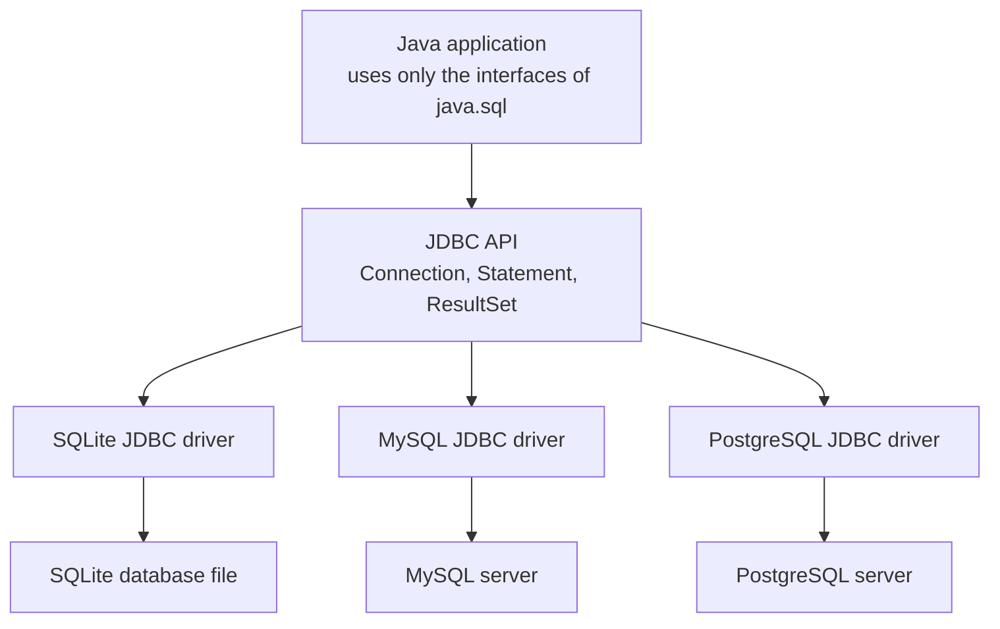

# Lecture 17 — Database Programming with JDBC

[Repository Guide](../../README.md) | [English](Concepts_Lecture.md) | [한국어](Concepts_Lecture.ko.md)

> **Last Updated:** 2026-11-19

> **Learning Objectives:**
> 1. Explain tables, rows, columns, and primary keys and write the SQL statements needed for CRUD
> 2. Explain the relationship between the JDBC API and drivers and connect to a database with a connection URL
> 3. Execute SQL with Statement and PreparedStatement and read results with the cursor of a ResultSet
> 4. Explain how SQL injection happens and prevent it with PreparedStatement
> 5. Turn off auto-commit and handle transactions with commit() and rollback()
> 6. Manage connections and errors with try-with-resources and SQLException

---

## Table of Contents

- [1. Relational Databases and SQL](#1-relational-databases-and-sql)
  - [1.1 Tables, Rows, Columns, and Primary Keys](#11-tables-rows-columns-and-primary-keys)
  - [1.2 The SQL Used in This Lecture](#12-the-sql-used-in-this-lecture)
- [2. The Structure of JDBC](#2-the-structure-of-jdbc)
  - [2.1 The JDBC API and Drivers](#21-the-jdbc-api-and-drivers)
  - [2.2 Connection URLs and DriverManager](#22-connection-urls-and-drivermanager)
- [3. Executing SQL and Reading Results](#3-executing-sql-and-reading-results)
  - [3.1 Statement and Its Execution Methods](#31-statement-and-its-execution-methods)
  - [3.2 ResultSet and the Cursor](#32-resultset-and-the-cursor)
  - [3.3 PreparedStatement](#33-preparedstatement)
  - [3.4 SQL Injection](#34-sql-injection)
- [4. A CRUD Example](#4-a-crud-example)
- [5. Transactions](#5-transactions)
  - [5.1 Auto-Commit and Transactions](#51-auto-commit-and-transactions)
  - [5.2 A Money Transfer Example](#52-a-money-transfer-example)
- [6. Resource Management and Exceptions](#6-resource-management-and-exceptions)
- [7. Common Mistakes](#7-common-mistakes)
- [Summary](#summary)
- [Self-Check Questions](#self-check-questions)
- [References](#references)

---

<br>

## 1. Relational Databases and SQL

### 1.1 Tables, Rows, Columns, and Primary Keys

The files of Lecture 10 only store bytes in a format the program decides, and finding the desired data or letting several programs change it at once had to be handled by the program itself. A **database management system (DBMS)** is software that stores data, finds it in response to queries, and protects it against concurrent access by many users and against failures. The most widely used relational DBMSs (MySQL, PostgreSQL, Oracle, SQLite, and others) store data in table-shaped **tables**.

| id | name | score |
|:-----|:-----|:-----|
| 1 | Kim | 90 |
| 2 | Lee | 55 |
| 3 | Park | 72 |

*Table 1. An example of the student table*

One horizontal line of a table is called a **row**, or record, and corresponds to one object; one vertical line is called a **column** and corresponds to one field. Each column has a fixed type, such as integer or string. The special value that marks the absence of a value is `NULL`.

> **Definition:** A **primary key** is the column (or set of columns) that distinguishes each row of a table from the others. The value of the primary key must differ in every row and cannot be `NULL`, and the DBMS enforces this rule.

In the student table, the student ID `id` is the primary key. Two students can have the same name, so the name cannot be the primary key. Just as `equals()` and `hashCode()` defined the equality of objects in Lecture 9, Section 3.10, the primary key defines the equality of rows in a database.

> **[Databases]** The databases course covers the theory of the relational model, normalization that removes duplication by splitting data among several tables, indexes for fast search, and the implementation of transactions and concurrency control. This lecture covers SQL and transactions only as far as a Java program needs them to use a database through JDBC.

### 1.2 The SQL Used in This Lecture

**SQL (Structured Query Language)** is the language for commands that create tables in a relational database and insert, find, change, and delete data. The four basic operations on data, Create, Read, Update, and Delete, are called **CRUD** by their initials, and in SQL they correspond to `INSERT`, `SELECT`, `UPDATE`, and `DELETE`.

```sql
CREATE TABLE student (                      -- create a table
    id    INTEGER PRIMARY KEY,
    name  TEXT NOT NULL,                    -- cannot be left empty
    score INTEGER                           -- may be NULL
);

INSERT INTO student (id, name, score) VALUES (1, 'Kim', 90);   -- Create

SELECT id, name, score FROM student         -- Read
WHERE score >= 60                           -- only rows that match
ORDER BY id;                                -- in ascending order of id

UPDATE student SET score = score + 10 WHERE score < 60;        -- Update
DELETE FROM student WHERE id = 3;                              -- Delete

SELECT COUNT(*), AVG(score) FROM student;   -- number of rows and the average
```

SQL keywords are case-insensitive, but by convention keywords are written in uppercase for readability. String values are enclosed in single quotes, and anything after `--` is a comment. An `UPDATE` or `DELETE` without `WHERE` applies to every row of the table, so it calls for particular care.

`NULL` means that there is no value, so ordinary comparisons do not work on it. In `score < 60`, if `score` is `NULL`, the result is neither true nor false but unknown, and the row is treated as not matching the `WHERE` condition. To find rows that are `NULL`, write `score IS NULL`. Aggregate functions such as `AVG()` and `SUM()` leave `NULL` out of the computation, while `COUNT(*)` counts rows regardless of `NULL`. These rules can be seen in the results of Section 4.

---

<br>

## 2. The Structure of JDBC

### 2.1 The JDBC API and Drivers

Each DBMS communicates differently, so if a program used a DBMS's own method directly, all the code would have to change when the DBMS changes. **JDBC (Java Database Connectivity)** is the standard API through which Java programs connect to relational databases, execute SQL, and receive the results, and it is defined as interfaces in the `java.sql` package. The vendor of each DBMS provides a **JDBC driver**, a jar file that implements these interfaces. This structure is exactly the relationship between interfaces and implementing classes of Lecture 11, Section 4.



*Figure 1. The JDBC API and drivers for each DBMS*

| Interface or class | Role |
|:-----|:-----|
| `DriverManager` | Finds the driver that matches a connection URL and creates the connection |
| `Connection` | One connection to a database; creates statements and manages transactions |
| `Statement` | Executes SQL statements |
| `PreparedStatement` | Executes a precompiled SQL statement with parameter placeholders (`?`) |
| `ResultSet` | Lets the rows resulting from a `SELECT` be read one at a time with a cursor |
| `SQLException` | A checked exception that represents an error in a database operation |

*Table 2. The main interfaces and classes of JDBC*

The program uses only the interface types of `java.sql`, and the actual objects are created by the driver's classes. For example, the class of the object `Connection conn` refers to is a class of the SQLite driver, but the program need not know its name. To change the DBMS, only the driver jar and the connection URL change, and as long as the same SQL is used, the rest of the code can stay as it is.

### 2.2 Connection URLs and DriverManager

A connection is created with `DriverManager.getConnection(url)` or `getConnection(url, user, password)`. A **connection URL** is a string that says through which driver to connect to which database where; it starts with `jdbc:`, followed by a name that identifies the driver.

| DBMS | Example connection URL | Meaning |
|:-----|:-----|:-----|
| SQLite | `jdbc:sqlite:school.db` | The file `school.db` in the working directory (created if absent) |
| MySQL | `jdbc:mysql://localhost:3306/school` | The `school` database of the server running on port 3306 of this computer |
| PostgreSQL | `jdbc:postgresql://db.example.com:5432/school` | The `school` database of the server running on port 5432 of another host |

*Table 3. Examples of connection URLs*

SQLite stores a whole database in a single file without a separate server, so practice can start right away with just the driver jar. MySQL and PostgreSQL are servers reached through the sockets of Lecture 14, so their URLs contain a host and a port. A file at a relative path is looked up from the working directory, as in Lecture 10, Section 1.6.

When it is initialized, `DriverManager` finds the drivers on the class path through the service-provider loading mechanism and registers them [1]. So it is enough to put the driver jar on the class path, and statements that load a driver class, such as the `Class.forName("org.sqlite.JDBC")` seen in older code, are unnecessary. The examples of this lecture are run as follows, with the SQLite JDBC driver jar (`sqlite-jdbc-3.49.1.0.jar`) on the class path. The class-path separator is `:` on macOS and Linux and `;` on Windows. The SQLite driver loads a native library through JNI, and recent JDKs print a warning for such loading, so it is allowed with the `--enable-native-access=ALL-UNNAMED` option.

```text
javac StudentCrud.java
java --enable-native-access=ALL-UNNAMED -cp .:sqlite-jdbc-3.49.1.0.jar StudentCrud
```

If the driver is not on the class path, `getConnection()` throws an `SQLException` with a message such as "No suitable driver found for jdbc:sqlite:school.db".

---

<br>

## 3. Executing SQL and Reading Results

### 3.1 Statement and Its Execution Methods

The `Statement` returned by `conn.createStatement()` executes a complete SQL string. Different methods are used depending on the kind of SQL.

| Method | SQL it is used for | Return value |
|:-----|:-----|:-----|
| `executeQuery(sql)` | `SELECT` | A `ResultSet` holding the result rows |
| `executeUpdate(sql)` | `INSERT`, `UPDATE`, `DELETE`, `CREATE TABLE`, and so on | The number of rows affected (0 for `CREATE TABLE` and the like) |
| `execute(sql)` | Any | `true` if the result is a `ResultSet` |

*Table 4. Execution methods of Statement*

The return value of `executeUpdate()` is the number of changed rows, so it is used to check how many rows an `UPDATE` or `DELETE` actually applied to. If no row matches the condition, 0 is returned, not an error.

### 3.2 ResultSet and the Cursor

The `ResultSet` returned by `executeQuery()` has a **cursor** that points to the current position among the result rows. Initially the cursor is positioned before the first row, and `next()` moves the cursor to the next row and returns `false` when there are no more rows, so all rows can be read with a `while` loop [2]. This works like the `Iterator` of Lecture 9.

```java
try (ResultSet rs = st.executeQuery("SELECT id, name, score FROM student ORDER BY id")) {
    while (rs.next()) {                      // the first call moves to the first row
        int id = rs.getInt("id");            // read by column name
        String name = rs.getString(2);       // read by column number (from 1)
        System.out.println(id + " " + name);
    }
}
```

The values of the current row are read with the `getXxx()` method that matches the column's type, given a column name or column number as the argument. Note that column numbers start from 1, not 0.

| SQL type | `ResultSet` method | Java type |
|:-----|:-----|:-----|
| `INTEGER` | `getInt()` | `int` |
| `BIGINT` | `getLong()` | `long` |
| `REAL`, `DOUBLE` | `getDouble()` | `double` |
| `TEXT`, `VARCHAR` | `getString()` | `String` |
| `BOOLEAN` | `getBoolean()` | `boolean` |
| `DATE` | `getDate()` or `getObject(i, LocalDate.class)` | `java.sql.Date`, `LocalDate` |

*Table 5. Correspondence between SQL types and ResultSet methods*

Reading a `NULL` column with `getInt()` returns 0, so a score of 0 cannot be told apart from no score. In that case, call `rs.wasNull()` right after reading the value to check whether the value just read was `NULL` (Section 4). Alternatively, reading with a wrapper type, as in `rs.getObject("score", Integer.class)`, returns `NULL` as `null`.

### 3.3 PreparedStatement

When the values that go into SQL differ on every execution, use `PreparedStatement`. Write `?` where values go in the SQL statement, and before executing, set the value of each placeholder with `setXxx(number, value)`. The numbers are 1, 2, 3, counting the `?`s from the left.

```java
String sql = "INSERT INTO student (id, name, score) VALUES (?, ?, ?)";
try (PreparedStatement ps = conn.prepareStatement(sql)) {
    ps.setInt(1, 5);
    ps.setString(2, "Jung");
    ps.setNull(3, Types.INTEGER);            // NULL in the third placeholder
    ps.executeUpdate();
}
```

A `PreparedStatement` is a precompiled, stored SQL statement that can efficiently execute the same statement many times with only the values changed [3]. Values are not spliced into the SQL by string concatenation, so single quotes inside strings need no attention, and the SQL injection of Section 3.4 is prevented. When inserting many rows, collecting each set of values with `addBatch()` and sending them all at once with `executeBatch()` reduces the number of round trips to the database (Section 4).

### 3.4 SQL Injection

If values typed by a user are put into SQL by string concatenation, SQL syntax mixed into the input can change the meaning of the statement. This attack is called **SQL injection**. The following program puts a string crafted by an attacker into a query that finds students by name.

```java
import java.sql.*;

public class Injection {
    public static void main(String[] args) throws SQLException {
        try (Connection conn = DriverManager.getConnection("jdbc:sqlite:school.db")) {
            String input = "nobody' OR '1'='1";                                 // a name typed by an attacker

            String sql = "SELECT name FROM student WHERE name = '" + input + "'";
            System.out.println("built SQL: " + sql);
            try (Statement st = conn.createStatement(); ResultSet rs = st.executeQuery(sql)) {
                int n = 0;
                while (rs.next()) n++;
                System.out.println("Statement matched " + n + " rows");
            }

            try (PreparedStatement ps = conn.prepareStatement("SELECT name FROM student WHERE name = ?")) {
                ps.setString(1, input);                                          // used only as a value
                try (ResultSet rs = ps.executeQuery()) {
                    int n = 0;
                    while (rs.next()) n++;
                    System.out.println("PreparedStatement matched " + n + " rows");
                }
            }
        }
    }
}
```

```text
built SQL: SELECT name FROM student WHERE name = 'nobody' OR '1'='1'
Statement matched 3 rows
PreparedStatement matched 0 rows
```

When the input `nobody' OR '1'='1` goes in by string concatenation, the single quote closes the string early and `OR '1'='1'` is attached as a condition. The condition of the completed SQL comes to mean that the name is nobody or '1' equals '1', and since the latter comparison is always true, all 3 rows of the table come out. In code that grants access depending on whether a condition is true, such as a login check, this lets an attacker in without a password.

Putting the same string into a `PreparedStatement` with `setString()` gives 0 rows. The driver treats the entire input as a single string value, so it only looks for a student whose name is exactly that string, single quotes included, and the structure of the statement does not change. So values typed by users are never put into SQL by string concatenation under any circumstances; they go into `?` placeholders.

> **[Information Security]** SQL injection is one kind of injection attack, which makes input be interpreted as code, and it was for a long time one of the most common vulnerabilities of web applications. The information security course covers the types of such attacks together with defenses such as input validation and the principle of least privilege.

---

<br>

## 4. A CRUD Example

The following program creates the student table and performs all of creation, reading, updating, and deletion.

```java
import java.sql.*;

public class StudentCrud {
    static final String URL = "jdbc:sqlite:school.db";             // connect to the file school.db

    public static void main(String[] args) throws SQLException {
        try (Connection conn = DriverManager.getConnection(URL)) {
            DatabaseMetaData meta = conn.getMetaData();
            System.out.println("connected: " + meta.getDatabaseProductName() + " " + meta.getDatabaseProductVersion()
                    + ", driver " + meta.getDriverName());

            try (Statement st = conn.createStatement()) {
                st.executeUpdate("DROP TABLE IF EXISTS student");
                st.executeUpdate("CREATE TABLE student ("
                        + "id INTEGER PRIMARY KEY, name TEXT NOT NULL, score INTEGER)");
            }

            String insert = "INSERT INTO student (id, name, score) VALUES (?, ?, ?)";
            try (PreparedStatement ps = conn.prepareStatement(insert)) {          // Create
                Object[][] rows = {{1, "Kim", 90}, {2, "Lee", 55}, {3, "Park", 72}, {4, "Choi", null}};
                for (Object[] r : rows) {
                    ps.setInt(1, (Integer) r[0]);
                    ps.setString(2, (String) r[1]);
                    if (r[2] == null) ps.setNull(3, Types.INTEGER);
                    else ps.setInt(3, (Integer) r[2]);
                    ps.addBatch();                                                // send together
                }
                int[] counts = ps.executeBatch();
                System.out.println("inserted rows: " + counts.length);
            }

            printAll(conn, "after insert");                                       // Read

            try (PreparedStatement ps = conn.prepareStatement(
                    "UPDATE student SET score = score + ? WHERE score < ?")) {     // Update
                ps.setInt(1, 10);
                ps.setInt(2, 60);
                System.out.println("updated rows: " + ps.executeUpdate());
            }

            try (PreparedStatement ps = conn.prepareStatement("DELETE FROM student WHERE id = ?")) {  // Delete
                ps.setInt(1, 3);
                System.out.println("deleted rows: " + ps.executeUpdate());
            }
            printAll(conn, "after update and delete");

            try (Statement st = conn.createStatement();
                 ResultSet rs = st.executeQuery("SELECT COUNT(*), AVG(score) FROM student")) {
                rs.next();
                System.out.printf("count %d, average score %.2f%n", rs.getInt(1), rs.getDouble(2));
            }
        }
    }

    static void printAll(Connection conn, String title) throws SQLException {
        System.out.println("-- " + title);
        String sql = "SELECT id, name, score FROM student ORDER BY id";
        try (Statement st = conn.createStatement();
             ResultSet rs = st.executeQuery(sql)) {
            while (rs.next()) {                                                   // move the cursor to the next row
                int id = rs.getInt("id");
                String name = rs.getString("name");
                int score = rs.getInt("score");
                String shown = rs.wasNull() ? "NULL" : String.valueOf(score);     // was the value just read NULL
                System.out.println(id + " " + name + " " + shown);
            }
        }
    }
}
```

```text
connected: SQLite 3.49.1, driver SQLite JDBC
inserted rows: 4
-- after insert
1 Kim 90
2 Lee 55
3 Park 72
4 Choi NULL
updated rows: 1
deleted rows: 1
-- after update and delete
1 Kim 90
2 Lee 65
4 Choi NULL
count 3, average score 77.50
```

Tracing the run step by step gives the following.

1. **Connecting:** `getConnection()` opens `school.db` in the working directory or creates it. The first line, read from `DatabaseMetaData`, shows a connection to SQLite 3.49.1 through the SQLite JDBC driver. The `Connection` was opened with try-with-resources, so it is closed when `main()` ends.
2. **Creating the table:** `DROP TABLE IF EXISTS` removes the table made by an earlier run, and `CREATE TABLE` creates it anew. These statements have no changing values, so they were executed with a `Statement`.
3. **Create:** one `PreparedStatement` inserts four rows. For each row the values of the three placeholders are set and collected with `addBatch()`, then executed at once with `executeBatch()`, and the length 4 of the returned array is the number of statements executed. Choi's score was set to `NULL` with `setNull()`.
4. **Read:** `printAll()` reads the rows sorted with `ORDER BY id`. `getInt("score")` for Choi returns 0, but `wasNull()` right after it is `true`, so it is printed as `NULL`.
5. **Update:** 10 points are added to students below 60. The only matching row is Lee with 55, so `executeUpdate()` returns 1. Choi's score is `NULL`, so `score < 60` is not true (Section 1.2) and it does not change.
6. **Delete:** Park, whose `id` is 3, is deleted, returning 1.
7. **Aggregation:** 3 rows remain, so `COUNT(*)` is 3, and `AVG(score)` leaves out Choi, who is `NULL`, giving (90 + 65) / 2 = 77.50. Counting `NULL` as 0 would have given (90 + 65 + 0) / 3 = 51.67.

In this program every SQL statement is a string constant, and every value that changes between executions was passed through a `?` placeholder. Table and column names cannot be passed through `?`, so if such parts must depend on user input, check them against a list of allowed names before putting them in.

---

<br>

## 5. Transactions

### 5.1 Auto-Commit and Transactions

A **transaction** is a group of SQL statements that make up one logical piece of work, all of which must take effect or none of which may. Taking a money transfer as an example, the `UPDATE` that subtracts from the sending account and the `UPDATE` that adds to the receiving account are one piece of work. If only the first statement runs and the program stops, money disappears.

The properties a transaction must keep are called ACID after their initials. **Atomicity** is the property that everything takes effect or nothing does, **consistency** that the data keeps its rules (for example, balances are not negative) before and after the transaction, **isolation** that concurrently running transactions do not see each other's intermediate states, and **durability** that results that took effect do not disappear even after a failure. Isolation can be seen as the database handling, on behalf of the program, the same problem as the synchronization seen in Lecture 15.

A JDBC `Connection` is in **auto-commit** mode by default, committing the changes automatically after each statement is executed [4]. To group several statements into one transaction, follow this order.

1. Turn off auto-commit with `conn.setAutoCommit(false)`.
2. Execute the statements to group. These changes are not yet committed.
3. If all succeed, commit them with `conn.commit()`.
4. If something fails midway, cancel all the changes of step 2 with `conn.rollback()`.

### 5.2 A Money Transfer Example

```java
import java.sql.*;

public class Transfer {
    static void transfer(Connection conn, String from, String to, int amount) throws SQLException {
        conn.setAutoCommit(false);                                               // begin a transaction
        try (PreparedStatement withdraw = conn.prepareStatement(
                     "UPDATE account SET balance = balance - ? WHERE owner = ?");
             PreparedStatement deposit = conn.prepareStatement(
                     "UPDATE account SET balance = balance + ? WHERE owner = ?");
             PreparedStatement check = conn.prepareStatement(
                     "SELECT balance FROM account WHERE owner = ?")) {
            withdraw.setInt(1, amount); withdraw.setString(2, from); withdraw.executeUpdate();
            deposit.setInt(1, amount);  deposit.setString(2, to);   deposit.executeUpdate();

            check.setString(1, from);
            try (ResultSet rs = check.executeQuery()) {
                rs.next();
                if (rs.getInt(1) < 0) throw new SQLException("insufficient funds in " + from);
            }
            conn.commit();                                                       // make both permanent
            System.out.println("committed: " + from + " -> " + to + " " + amount);
        } catch (SQLException e) {
            conn.rollback();                                                     // undo both
            System.out.println("rolled back: " + e.getMessage());
        } finally {
            conn.setAutoCommit(true);
        }
    }

    static void show(Connection conn) throws SQLException {
        try (Statement st = conn.createStatement();
             ResultSet rs = st.executeQuery("SELECT owner, balance FROM account ORDER BY owner")) {
            StringBuilder sb = new StringBuilder("  balances:");
            while (rs.next()) sb.append(' ').append(rs.getString(1)).append('=').append(rs.getInt(2));
            System.out.println(sb);
        }
    }

    public static void main(String[] args) throws SQLException {
        try (Connection conn = DriverManager.getConnection("jdbc:sqlite:bank.db")) {
            try (Statement st = conn.createStatement()) {
                st.executeUpdate("DROP TABLE IF EXISTS account");
                st.executeUpdate("CREATE TABLE account (owner TEXT PRIMARY KEY, balance INTEGER NOT NULL)");
                st.executeUpdate("INSERT INTO account VALUES ('Alice', 100), ('Bob', 50)");
            }
            show(conn);
            transfer(conn, "Alice", "Bob", 30);
            show(conn);
            transfer(conn, "Bob", "Alice", 500);
            show(conn);

            try (Statement st = conn.createStatement()) {
                st.executeUpdate("INSERT INTO account VALUES ('Alice', 10)");
            } catch (SQLException e) {
                System.out.println("SQLException: " + e.getMessage());
                System.out.println("  error code " + e.getErrorCode());
            }
        }
    }
}
```

```text
  balances: Alice=100 Bob=50
committed: Alice -> Bob 30
  balances: Alice=70 Bob=80
rolled back: insufficient funds in Bob
  balances: Alice=70 Bob=80
SQLException: [SQLITE_CONSTRAINT_PRIMARYKEY] A PRIMARY KEY constraint failed (UNIQUE constraint failed: account.owner)
  error code 19
```

The first transfer sends 30 from Alice to Bob. After the two `UPDATE`s, Alice's balance is 70, not negative, so `commit()` makes both changes permanent, and the balances become Alice 70 and Bob 80. The second transfer tries to send 500 from Bob to Alice. Both `UPDATE`s ran, but Bob's balance became -420, so the check throws an `SQLException`, and `rollback()` in the `catch` block cancels both `UPDATE`s. That is why the balances after the transfer are the same as before it, Alice 70 and Bob 80. The `finally` block turns auto-commit back on whether the transfer succeeded or failed, so that the next statement executed on the same connection is not caught in an unexpected transaction.

The last part is an example of a rule enforced by the database appearing as an error. A row whose primary key `owner` is `Alice` already exists, so trying to insert a row with the same primary key is refused by the DBMS, and the driver throws an `SQLException`. The message tells which constraint was violated (`PRIMARY KEY constraint failed`), and `getErrorCode()` returns the error number defined by the DBMS (19 for a constraint violation in SQLite). Error numbers differ between DBMSs, so code meant for several DBMSs also checks `getSQLState()`, a standardized five-character code.

---

<br>

## 6. Resource Management and Exceptions

`Connection`, `Statement`, and `ResultSet` all implement `AutoCloseable`, so they are closed with the try-with-resources of Lecture 10, Section 4. A connection holds resources of the database server (a socket, memory, a session), so if unclosed connections pile up, the server cannot accept new ones.

```java
try (Connection conn = DriverManager.getConnection(URL);
     PreparedStatement ps = conn.prepareStatement("SELECT name FROM student WHERE score >= ?")) {
    ps.setInt(1, 60);
    try (ResultSet rs = ps.executeQuery()) {
        while (rs.next()) System.out.println(rs.getString("name"));
    }
} catch (SQLException e) {
    System.err.println("DB error " + e.getErrorCode() + " (" + e.getSQLState() + "): " + e.getMessage());
}
```

Resources are closed in the reverse order of declaration (Lecture 10, Section 4.1), so they close in the order `ResultSet`, `PreparedStatement`, `Connection`. Closing a `Statement` also closes the `ResultSet` it created, and closing a connection also closes its statements, but closing each resource directly within the scope that uses it is clearer.

`SQLException` is a checked exception, so it must be handled or declared with `throws` (Lecture 10, Section 1.7). Connection failures, SQL syntax errors, constraint violations, reading values of mismatched types, and so on all appear as `SQLException`, and the cause is distinguished with `getMessage()`, `getErrorCode()`, and `getSQLState()`. An `SQLException` in the middle of a transaction is caught and rolled back with `rollback()`, then rethrown if necessary, as in Section 5.2. Real applications use a **connection pool**, which creates a few connections in advance and lends them out, to reduce the cost of creating connections. This is the same idea as the thread pool of Lecture 15, Section 5.3.

---

<br>

## 7. Common Mistakes

| Mistake | What happens | How to fix it |
|:-----|:-----|:-----|
| Putting user input into SQL by string concatenation | SQL injection changes the meaning of the statement | Put it into a `?` placeholder of a `PreparedStatement` |
| Reading values from a `ResultSet` before calling `next()` | It is an invalid call by the specification, and depending on the driver an exception occurs or a different value comes back | Read inside `while (rs.next())` |
| Counting column numbers from 0 | Trying to read the first column as 0 causes an error | Column numbers start from 1 |
| Reading a `NULL` column with `getInt()` and using it as it is | `NULL` is read as 0 and cannot be told apart from a score of 0 | Check with `wasNull()` or read with a wrapper type |
| Thinking `score < 60` also selects rows that are `NULL` | Rows that are `NULL` do not match the condition and are left out | Write `IS NULL` separately |
| Executing `UPDATE` or `DELETE` without `WHERE` | Every row is changed or deleted | Check the condition before executing and examine the returned row count |
| Executing several statements in auto-commit mode | If something fails midway, only the earlier changes remain | Turn off auto-commit and use `commit()` and `rollback()` |
| Not rolling back a failed transaction | Uncommitted changes remain on the connection | Call `rollback()` in `catch` |
| Not closing connections and statements | The server's resources are exhausted | Close them with try-with-resources |
| Not putting the driver jar on the class path | A "No suitable driver" exception occurs | Put the driver jar in `-cp` |

*Table 6. Common mistakes in JDBC programming*

---

<br>

## Summary

| Concept | Key Summary |
|:-----|:-----|
| Tables and primary keys | A relational database stores data in tables of rows and columns, and the primary key distinguishes each row from the others. |
| CRUD | These are the four operations Create, Read, Update, and Delete, corresponding to `INSERT`, `SELECT`, `UPDATE`, and `DELETE` in SQL. |
| NULL | It means that there is no value; ordinary comparisons with it are not true, and aggregate functions leave it out. |
| JDBC driver | It is a jar that implements the `java.sql` interfaces for a DBMS, and `DriverManager` finds it automatically on the class path. |
| Connection URL | It is a string that starts with `jdbc:` and gives the driver and the location of the database. |
| ResultSet | Its cursor starts before the first row and advances one row at a time with `next()`, and columns are read by name or by a number counted from 1. |
| PreparedStatement | It is a precompiled statement with values put separately into `?` placeholders, efficient for repeated execution and a defense against SQL injection. |
| SQL injection | It is an attack in which input is interpreted as SQL syntax and changes the meaning of the statement. |
| Transaction | It is a group of statements that must all take effect or none, handled by turning off auto-commit and using `commit()` and `rollback()`. |
| SQLException | It is a checked exception representing an error in a database operation, whose cause is distinguished by the error code and SQLState. |

---

<br>

## Self-Check Questions

1. **NULL:** For the student table right after the run of Section 4, write the results of the following SQL. (a) `SELECT COUNT(score) FROM student` (b) `SELECT name FROM student WHERE score IS NULL` (c) `SELECT name FROM student WHERE score >= 60`

   <details>
   <summary>Answer</summary>

   The remaining rows are Kim 90, Lee 65, and Choi `NULL`. (a) `COUNT(column)` counts only values that are not `NULL`, so it is 2 (`COUNT(*)` is 3). (b) Choi. (c) Kim and Lee. Choi does not appear because `NULL >= 60` is not true.

   </details>

2. **The cursor:** What happens if `rs.getString(1)` is called right after `ResultSet rs = st.executeQuery("SELECT name FROM student");`? How many times does a `while (rs.next())` loop run when there are no result rows?

   <details>
   <summary>Answer</summary>

   The cursor is before the first row, so there is no current row, which makes it an invalid call by the specification, and many drivers throw an `SQLException`. Running it with the SQLite driver, however, returns `Kim` from the first row without any exception. Since the outcome of an invalid call differs between drivers, always move the cursor to the first row with `next()` before reading. When there are no result rows, the first `next()` returns `false`, so the body of the loop never runs.

   </details>

3. **SQL injection:** A login check was built as `"SELECT * FROM users WHERE id = '" + id + "' AND pw = '" + pw + "'"`. If an attacker types `admin' --` in the ID field and fills the password field with anything, what SQL is formed, and what happens?

   <details>
   <summary>Answer</summary>

   It becomes `SELECT * FROM users WHERE id = 'admin' --' AND pw = '...'`. Anything after `--` is an SQL comment, so the password condition disappears and only `id = 'admin'` remains. So the admin account's row comes out without knowing the password, and the login succeeds. It can be prevented by building `WHERE id = ? AND pw = ?` with a `PreparedStatement` and putting the two values in with `setString()`.

   </details>

4. **Transactions:** If `conn.setAutoCommit(false)` is deleted from `transfer()` of Section 5.2, what are the balances after the second transfer, which sends 500 from Bob to Alice?

   <details>
   <summary>Answer</summary>

   In auto-commit mode each `UPDATE` is committed as soon as it runs, so the `rollback()` after the check throws has no changes to cancel (depending on the driver, `rollback()` in auto-commit mode may itself throw an exception). As a result Bob ends at 80 - 500 = -420 and Alice at 70 + 500 = 570, leaving an invalid state with a negative balance.

   </details>

5. **Execution methods:** Write the method to use and the return value when executing the following statements, on the table right after the run of Section 4. (a) `DELETE FROM student WHERE score < 50` (b) `SELECT * FROM student` (c) `UPDATE student SET score = 100`

   <details>
   <summary>Answer</summary>

   (a) `executeUpdate()`, which returns 0 because no row is below 50 (Choi is `NULL` and does not match the condition). (b) `executeQuery()`, which returns a `ResultSet` holding three rows. (c) `executeUpdate()`, which applies to every row because there is no `WHERE` and returns 3.

   </details>

6. **Resource management:** A web server program creates a connection with `DriverManager.getConnection()` every time a method is called and never closes it. It works well at first; what problem appears over time, and how should it be fixed?

   <details>
   <summary>Answer</summary>

   Unclosed connections keep holding the database server's sockets and sessions, so once the number of connections reaches the server's limit, new connections are refused and the program can no longer use the database. Open each connection with try-with-resources so that it is closed right after use, and in programs with many requests use a connection pool to reduce the cost of creating connections as well (Section 6).

   </details>

---

<br>

## References

1. Oracle, "DriverManager (Java SE 21 & JDK 21)," *Java Platform, Standard Edition 21 API Specification*. https://docs.oracle.com/en/java/javase/21/docs/api/java.sql/java/sql/DriverManager.html
2. Oracle, "ResultSet (Java SE 21 & JDK 21)," *Java Platform, Standard Edition 21 API Specification*. https://docs.oracle.com/en/java/javase/21/docs/api/java.sql/java/sql/ResultSet.html
3. Oracle, "PreparedStatement (Java SE 21 & JDK 21)," *Java Platform, Standard Edition 21 API Specification*. https://docs.oracle.com/en/java/javase/21/docs/api/java.sql/java/sql/PreparedStatement.html
4. Oracle, "Connection (Java SE 21 & JDK 21)," *Java Platform, Standard Edition 21 API Specification*. https://docs.oracle.com/en/java/javase/21/docs/api/java.sql/java/sql/Connection.html
